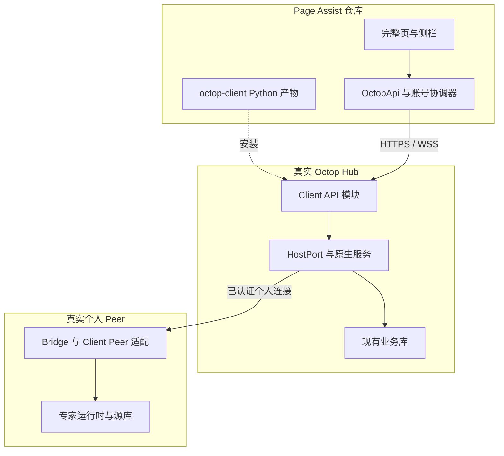

# Page Assist 方案 B 落地收口 PRD v1.1

**交付用途：**交给 Cursor 生成实施计划并完成代码、测试、部署工具及真实验收。本文件是实施目标，不是产品已经验收通过的声明。

**架构决定继续有效：**服务器端 OctopClient 的代码保留在 Page Assist 仓库根目录 `octop-client/`，独立构建 Python 包，安装到 Octop 服务器，由 Octop 原有进程、端口和生命周期承载。浏览器 `src/services/octop-api/` 只消费 Client API。Octop 仓库配套提供真实宿主、认证、运行时和 Bridge 适配；不复制第二套用户库、正式历史或 Agent Runtime。

**范围已经确定：**本实例专家与个人 Bridge 专家均需真实可用。共享 Bridge 私聊、远端扩展内审批、Firefox 企业功能、独立网关和多 worker 不属于 B1-RC1。

**Cursor 首读：**第 0、4、9、14、17、25、28、29 章；再按第 10 章的 12 个需求和第 20 章的 48 个新增验收实施。原 22 个需求、66 个验收继续有效，映射见第 27 章。

# 0. PRD 使用原则

## 0.1 文档地位与证据边界

本轮用户要求以已确认的落地功能需求生成可交 Cursor 实施的 PRD；据此将本文件标记 `APPROVED_FOR_PLAN`。该状态表示范围和工程默认值已具体到可生成计划，不表示代码 `IMPLEMENTED` 或产品 `VERIFIED`，也不构成对任意生产实例的发布指令。

本文采用工程模板完整结构，覆盖 WHY、WHAT、BOUNDARY、STATE、INPUT、OUTPUT、SIDE EFFECT、FAILURE、ACCEPTANCE、EVIDENCE。对既有功能先复用再修正；发现某缺陷在后续提交已修复，应保留验收并记录当前证据，不重复实现。

事实分为三类：

- **固定源码事实**：仅针对文首两个 SHA；2026-11-02 再次核对远端分支，仍指向这两个提交。
- **离线观察**：上一轮在上述源码快照中执行的单元、fixture 及最小复现；不是生产事故报告。
- **目标合同**：本文定义的接口、状态、命令和验收；不能据此声称当前代码已经支持。

没有访问真实 Hub/Peer，没有执行完整 WXT 构建。客户现场路径、systemd unit、域名、测试账号和证书为第 17 章定义的必填部署输入；这些是环境绑定值，不允许用猜测值替代。

## 0.2 继承与冲突优先级

规范优先级：本文件明确修订 → [固定版本原 PRD][BASE-PRD]的其余规范 → 实施计划 → 示例代码。当前实现不得反向覆盖需求。

原 PRD 的 0–36 章、22 个 REQ、66 个 A 和 FI-01～FI-16 保留；本文件新增 REQ-CLOSE-001～012、A-CLOSE-001～048 和 FI-CLOSE-001～016。相同场景可以共享一次执行的原始证据，但每个验收 ID 必须独立输出其断言结果。原验收输入涉及本次协议修订时同步升级，不能删除原约束。

`MUST`/`MUST NOT` 是强制要求，集中于第 10 章并就近映射 AC；第 7–9、11–19、21–29 章是被这些条款引用的规范细节。第 27 章提供完整追踪。P0/P1 表示实施优先级，两个优先级都属于本版发布必需范围。

## 0.3 明确修订清单

| 修订 | 本次唯一决定 | 对应需求 |
|---|---|---|
| D-01 | Client API 路径保留 v1，协议 minor 升为 1；增加 `runtime_revision_v1` 能力及可比较运行态版本；新客户端连接 minor<1 的服务器时在登录前阻断 | REQ-CLOSE-002/006 |
| D-02 | WebSocket 控制确认与有序事件分离；请求 ID 不在传输层重新随机生成；确认 deadline 固定 10 秒 | REQ-CLOSE-006 |
| D-03 | 订阅当前待审批任务时，确认后发送同 revision 的 `approval.required` 表单快照 | REQ-CLOSE-006/008 |
| D-04 | CREATING、AWAITING_APPROVAL、RECONCILING 等都禁止重复发送；关闭连接不取消专家任务 | REQ-CLOSE-001/006 |
| D-05 | Peer 白名单补入只读 `approval.instructions`；禁止远端 `approval.submit`；跨 Hub 绑定唯一性在 Peer 落库强制执行 | REQ-CLOSE-009 |
| D-06 | 扩展企业身份由一个受信后台协调器串行写入；配置按字段区分“未配置”和 false；登录/退出/换 Hub 均使用 epoch | REQ-CLOSE-004 |
| D-07 | 部署正式参数为 `--releases-root`；旧 `--release-root` 仅兼容别名，禁止两个参数同时出现；不继续接受仅 `--wheel` 的不完整发布输入 | REQ-CLOSE-011 |
| D-08 | v1.1 增量元数据 schema=2；接受经核验的 schema0/1/2，迁移 checksum 不可重用；降级仅可到声明支持 schema2 的兼容产物 | REQ-CLOSE-002/011 |
| D-09 | 发布 Gate 只有 PASS 或 FAIL；任何 required 项缺失、BLOCKED、SKIPPED 或证据不合法，均为 FAIL/退出码1；单用例状态保留四态 | REQ-CLOSE-012 |
| D-10 | disable采用热失效，不重启宿主；所有需要重启的部署动作先取得宿主维护闸门并确认全部运行任务空闲，非空闲则阻断且不强制中断 | REQ-CLOSE-002/011 |
| D-11 | Peer绑定建立/查询/解除使用独立client_binding_v1控制面，受原生连接owner认证，不属于普通客户端数据操作白名单 | REQ-CLOSE-009 |
| D-12 | 验收身份分为被测候选版本、已允许基线、阶段观察和负例输入；Gate按预先声明场景检查，负例输入不能冒充有效release证据 | REQ-CLOSE-012 |
| D-13 | history_revision改为源端线程内持久单调十进制字符串，正式投影变化时同事务递增；旧历史响应不得覆盖新投影 | REQ-CLOSE-005/006 |

这些是本 PRD 的工程默认值，供实施直接执行；不描述为用户逐项指定的实现。若后续要改变这些可观察语义，先升版合同并更新对应 AC。

## 0.4 No-Inference Rule

发现未定义的身份来源、所有权、默认值、事务、冲突、恢复或 oracle，记录 `SPEC_SEMANTIC_GAP`，定位章节及 REQ，并阻断受影响计划。类名、内部数据结构、测试库和文件拆分可由工程人员选择；不得用内部选择改变本文可观察合同。缺现场参数输出 `ENVIRONMENT_REQUIRED`，继续不依赖该参数的编码/fixture 工作，真实验收保持 BLOCKED。

# 1. 文档元数据

文首 YAML 是唯一元数据。对照源码和产品目标均固定，不自动跟随 GitHub 分支最新值。Cursor 开始前记录实际 HEAD；不一致时先比较影响范围，并将计划与证据绑定实际 SHA，不能冒用本文基线。

| 状态 | 定义 |
|---|---|
| APPROVED_FOR_PLAN | 当前文档状态；可据此生成并执行计划 |
| IMPLEMENTED | 对应代码已写、构建可执行；不代表实测完成 |
| VERIFIED | required AC 及原验收均有有效证据，G-RELEASE=PASS |
| BLOCKED（计划项） | 依赖或环境阻塞，保留原因；不能写为 verified |

评审按角色归责，未虚构人员签字或部署批准。本文不新增具体工期承诺；第 29 章给出依赖顺序及每批退出条件。

# 2. 一句话目标

让已部署兼容 OctopClient 的企业用户，通过 Page Assist 完整页与侧栏登录真实 Octop、选择本实例或个人远端专家，创建、发送、审批、停止和恢复独立会话；在身份变更、网络故障及升级回滚后保持权限、消息、附件与业务状态一致，并能用真实发布产物和可核验测试证据证明。

## 2.1 发布必达结果

1. Chromium 两界面都完成真实登录及本实例专家问答。
2. 真实 Hub 经已授权个人连接访问真实 Peer，完成问答和重开恢复。
3. 用户能够找到旧线程、向前翻历史、恢复运行态及待审批表单。
4. 退出、撤权、过期和换 Hub 后，旧凭据、旧连接、旧响应不能继续产生授权业务。
5. 文件内容不被上传解析改变，非法归属引用零接纳，部分失败能复用 ready 结果。
6. 真实服务器安装、启用、升级、关闭、回滚和卸载均由实际进程/API 验证。
7. 原 Page Assist 本地功能与 Octop Dashboard、原 JWT、原 Bridge 行为保持；未知归属数据不被认领。
8. 发布 Gate 不会因缺失证据、常量断言、旧源码标识或模拟环境冒充 live 而放行。

# 3. 背景与问题定义

## 3.1 Current State

| 已有能力 | 固定源码事实 | 保留原则 |
|---|---|---|
| Chrome 企业入口 | 完整页/侧栏路由、设置、目录和聊天组件已经接线 | 修状态和行为，不重造入口 |
| 认证基础 | PKCE/state/AuthBroker、opaque token、SID、一次性 ticket 已有基础实现 | 补真实完成回调、身份发布及撤销 |
| Python 模块 | `octop-client/` 已分包，注册、API、paoc 表和 fixture 存在 | 通过真实 HostPort 接入，不复制运行时 |
| 上传/审批/Bridge | 已有接口外形和模拟宿主流程 | 补真实归属、事务、协调器及对端协议 |
| 验收与部署 | 有 runner、schema、Gate、部署 CLI | 将源码检查和状态标签改为真实断言与实际动作 |

来源：[PA-ROUTES]、[PA-API]、[PA-HOST]、[PA-DEPLOY]、[PA-GATE]。

## 3.2 已确认问题与验收挂钩

| 缺陷 | 证据类别与观察 | 目标 AC |
|---|---|---|
| GAP-01 构建表达式非法 | `??` 与 `||` 未加括号，独立语法检查报错 | A-CLOSE-001 |
| GAP-02 首轮连接关闭/重复创建 | threadId 变更触发 cleanup，连接复用；CREATING 非 busy | A-CLOSE-002/003 |
| GAP-03 只有模拟 HostPort/登录签发 | 正常模式拼登录 URL，真实宿主与授权完成桥接缺失 | A-CLOSE-005/009 |
| GAP-04 退出后旧 WS 可发 | fixture DELETE session=204 后 user_turn=accepted，消息增量2 | A-CLOSE-014 |
| GAP-05 跨 Hub token/epoch | 新 origin 配旧固定 token 键；epoch 无完整消费者 | A-CLOSE-013 |
| GAP-06 无旧会话入口/分页 | listThreads、recent refs 未被 UI 完整消费 | A-CLOSE-017/018 |
| GAP-07 WS 恢复缺口 | 无握手等待、重用单次ticket、pending不收敛、无持续订阅 | A-CLOSE-021～024 |
| GAP-08 附件引用越权 | fixture A 引用 B 的 upload_id 被接纳并修改 B 元数据；未证明正文外泄 | A-CLOSE-026 |
| GAP-09 文件末尾被改 | 正确摘要的 `text\n` 上传被报 sha mismatch | A-CLOSE-025 |
| GAP-10 空审批被接纳 | fixture 空 decisions、非法 decision_id 返回202并完成 | A-CLOSE-030 |
| GAP-11 个人绑定模拟化 | peer_user 固定、自动绑定、身份返回未用 | A-CLOSE-033～036 |
| GAP-12 部署假 READY | 临时目录无效wheel仅复制/建链接便返回READY | A-CLOSE-042 |
| GAP-13 空证据 Gate PASS | 隔离临时目录无证据时 G-RELEASE=PASS/exit0 | A-CLOSE-046 |
| GAP-14 证据来源与实测不足 | runner写死旧main SHA，live路径未真实执行，部分常量断言 | A-CLOSE-045/047 |
| GAP-15 资源与回执不一致 | 宿主资源先写、module receipt后写，没有共同事务接口 | A-CLOSE-007/027 |
| GAP-16 恢复排序/审批快照未唯一化 | 原合同缺可比较runtime版本；仅pending_id不能重建表单 | A-CLOSE-022/029 |

上一轮执行结果：Python 单元 1 PASS；服务端 fixture 58 PASS/3 BLOCKED（含16项FI）；前端脚本20 PASS/1 BLOCKED。上述结果是原 runner 的输出，不认领为本次 48 项 AC 的执行证据。

## 3.3 Impact

业务影响是无法证明真实专家可用、旧会话可恢复；权限影响是旧身份/非法附件引用可能继续被处理；交付影响是错误 READY/PASS 掩盖实际未安装或未测试；AI Coding 影响是按文件存在或脚本标绿完成任务。本文用运行态、数据库、网络目的地和实际进程 oracle 消除这些判断歧义。

# 4. Scope

## 4.1 In Scope

| 范围 | 内容 | Requirement |
|---|---|---|
| SCOPE-01 | 构建、首次发送、并发点击、原功能回归 | REQ-CLOSE-001 |
| SCOPE-02 | 真实 HostPort、挂载、共同 UoW、迁移与生命周期 | REQ-CLOSE-002 |
| SCOPE-03 | 真实托管登录完成、code/SID/PKCE闭环 | REQ-CLOSE-003 |
| SCOPE-04 | 配置优先级、账户epoch、跨界面失效、逐命令授权 | REQ-CLOSE-004 |
| SCOPE-05 | 专家目录、线程列表、最近引用、稳定历史分页 | REQ-CLOSE-005 |
| SCOPE-06 | 实时事件、恢复、停止、运行态版本、结果未知 | REQ-CLOSE-006 |
| SCOPE-07 | 上传字节、归属、资源事务与回收 | REQ-CLOSE-007 |
| SCOPE-08 | 本实例审批及远端只读处理指引 | REQ-CLOSE-008 |
| SCOPE-09 | 真实个人 Bridge、双端绑定、源端业务 | REQ-CLOSE-009 |
| SCOPE-10 | 网页材料、输出呈现、独立数据、交互状态 | REQ-CLOSE-010 |
| SCOPE-11 | 独立产物、真实安装/升级/关闭/卸载/回滚 | REQ-CLOSE-011 |
| SCOPE-12 | 强证据、CI、真实组合验收、日志与性能 | REQ-CLOSE-012 |

## 4.2 Out of Scope

| ID | B1-RC1边界 | 必须保留的拒绝/回归行为 |
|---|---|---|
| NON-GOAL-01 | 共享 Bridge 私聊及用户级委托体系 | 显示受限原因；创建/读私有历史/上传/发送均拒绝 |
| NON-GOAL-02 | 远端扩展内 HITL 决策 | 只展示已鉴权指引，用户显式打开源端；不转发approve |
| NON-GOAL-03 | Firefox 企业能力 | 无企业授权入口，原功能构建与行为回归 |
| NON-GOAL-04 | 新用户库、模型网关、第二Agent运行时 | 继续使用Octop现有身份、权限和运行服务 |
| NON-GOAL-05 | 独立BFF、另开端口、多worker、HA、PostgreSQL | 部署预检阻断不支持组合 |
| NON-GOAL-06 | 自动改TLS/防火墙/systemd unit、远程SSH部署、容器部署 | 管理员准备前置环境；工具不偷偷改宿主基础配置 |
| NON-GOAL-07 | 自动批准、自动重发未知结果、执行网页指令 | 保留显式操作与UNKNOWN核对 |
| NON-GOAL-08 | 删除历史、purge、原地pip卸载、自动清理旧release | 卸载保留业务数据及恢复材料 |

## 4.3 Architecture Boundary

| Domain | Owner | 输入/输出 | 不负责 |
|---|---|---|---|
| 扩展UI与账号协调器 | Page Assist | 用户动作 → OctopApi；接收已校验投影 | 专家运行、安装、普通账户JWT |
| Client API/规范化 | Page Assist `octop-client/` | SID/命令 → 受检HostPort调用/规范事件 | 另建正式消息库 |
| HostPort/原生服务 | Octop仓库 | 已认证Principal、UoW、runtime、ACL | 浏览器组件与企业视图 |
| Peer源端 | Octop+同版本兼容模块 | 已认证Bridge绑定 → 源库操作 | 信任浏览器声明的peer_subject |
| 部署与证据 | 模块工具/CI/管理员 | 固定制品、环境输入 → 真实状态和证据 | 从浏览器SID提升部署权限 |

# 5. Terminology / Domain Model

| 术语 | 本文唯一含义 |
|---|---|
| Hub | 扩展直接连接的Octop实例 |
| Peer | 个人Bridge连接的专家所在实例 |
| HostPort | Octop向模块提供的受控适配接口；fixture不是生产实现 |
| Principal | 宿主验证后的用户/租户/权限上下文，不能由请求body创建 |
| accountPartition | origin+instance+tenant+subject的规范摘要；不是SID |
| accountEpoch | 企业身份与配置有效期代数；迟到响应必须核对 |
| thread | 源端独立channel=page_assist线程，不是Dashboard默认会话 |
| runtime_revision | 源端线程运行态的持久单调版本，不是WS seq |
| seq | 一个WS连接内事件序号；不可作为持久重放游标 |
| receipt | 某操作实际接纳/提交的记录；accepted不等于任务完成 |
| ready上传 | 已提交元数据、内容完整、尚未附着正式消息的资源 |
| binding | 双端可验证的Hub身份与Peer身份关联，含版本及失效状态 |
| fixture | 可控的模拟输入/运行环境，只证明其对应局部oracle |
| live | 实际扩展、实际宿主服务、实际Peer和部署产物参与的执行 |
| VERIFIED | 对应required验收已实测并有可信证据 |

# 6. System Context

## 6.1 Context Diagram



安装产物归属与运行位置分开。浏览器永远不读取Peer密码、工作区绝对路径或服务器安装权限。

## 6.2 System Boundary

信任来源是宿主认证结果、已验证Bridge通道、服务器持久状态及管理员提供的可信发布清单。客户端ID、网页文本、附件、名称、URL参数、目录缓存和fixture数据不构成授权事实。所有业务写入都在源端重新验证；Hub可见性不能替代Peer权限。

# 7. Authoritative State / Source of Truth

| 状态 | 类型 | 唯一事实源 / Writer | Reader | 覆盖规则 |
|---|---|---|---|---|
| 企业服务策略 | DESIRED_STATE | managed按字段优先，其余用户配置 | 协调器/设置页 | managed字段不可由用户覆盖 |
| 有效身份记录 | RESOLVED_STATE | 受信后台协调器；服务器GET/session确认后发布 | 两界面/API | epoch不匹配不可覆盖 |
| SID/code/ticket | RUNTIME_STATE | 源实例paoc表及认证事务 | HTTP/WS准入 | 原子消费/撤销，不恢复旧SID |
| 用户/ACL | RUNTIME_STATE | Octop原用户与权限服务 | HostPort | 缓存不能独立授权写操作 |
| 专家/正式线程消息 | RUNTIME_STATE | 专家所在端原服务和业务库 | 模块投影/UI | 不从浏览器回填权威正文 |
| runtime+revision | RUNTIME_STATE | 源端runtime协调器与同库版本投影 | WS/history | 低版本不覆盖高版本 |
| attachment/binding | RUNTIME_STATE | 源端元数据；双端绑定各自持久记录 | 命令/历史/清理 | 无当前授权不可附着/读取 |
| 当前发布配置 | LAST_APPLIED_STATE | 成功回执+实际配置hash | deploy | 漂移阻断，不能静默覆盖 |
| 活动服务 | OBSERVED_STATE | active链接+PID+解释器+实际加载包+API | status/verify | 文件存在不能推导READY |
| 验收结果 | EVIDENCE_STATE | 原始执行输出、scope摘要、runner | Gate | 单个PASS字段不能作为事实 |

# 8. State Machine

## 8.1 企业身份

`DISABLED → SIGNED_OUT → AUTHENTICATING → VALIDATING_SESSION → AUTHENTICATED`。登录取消/校验失败回SIGNED_OUT并清临时凭据；到期为EXPIRED；清理失败为STORAGE_CLEANUP_REQUIRED并封锁新登录。退出先进入LOCAL_LOCKED，广播清敏感状态，再尝试服务器撤销；失败显示LOGOUT_UNCONFIRMED，仍保持本地退出。

配置切换先锁定旧epoch、关闭连接、清凭据；新配置原子提交后重新发现能力。配置写失败保留旧配置值，但不恢复旧token。协调器重启后对session记录/config_hash/epoch进行比对，矛盾时清身份并要求重新登录。完整页/侧栏不能各自选一个“最近登录”覆盖。

## 8.2 会话控制器

`EMPTY → CREATING → CONNECTING → SUBSCRIBING → RECONCILING → IDLE → UPLOADING → SUBMITTING → RUNNING → AWAITING_APPROVAL / CANCELLING → RECONCILING`。

- 同一界面只有一个活动控制器，身份为(epoch,expertKey,threadId或draftId)。
- CREATING、CONNECTING、SUBSCRIBING、UPLOADING、SUBMITTING、RUNNING、AWAITING_APPROVAL、CANCELLING、RECONCILING、UNKNOWN均禁止新turn；其中CREATING/UPLOADING/SUBMITTING禁止切换目标。
- 用户主动离开运行中的线程只关UI连接，任务继续；重开按源端恢复。
- 非空问题原文不trim；只用trim判断是否空白。上传失败回可编辑状态并保留ready项；只有可能已写出的业务命令才进入UNKNOWN。
- UNKNOWN显示“核对状态”，不自动发送；核对无法确定时允许用户显式确认发起一个新的提交，生成新ID并告知可能重复。
- 打开awaiting_approval线程先等表单快照，缺表单时显示“正在恢复审批”，不显示普通发送。

## 8.3 服务器与部署

模块：DISABLED → VALIDATING → REGISTERED → READY → DRAINING → STOPPED；任一依赖校验失败为FAILED。运行时关闭闸门后拒绝新业务，已接纳任务可完成，不自动cancel。

部署：PRECHECK → STAGED → VERIFIED_OFFLINE → ACTIVATING → VERIFYING_ONLINE → READY；失败按第14章进入ROLLED_BACK或RECOVERY_REQUIRED。metadata和日志记录是观察，不代替实际阶段条件。

非法转移包括未校验登录直接AUTHENTICATED、仅切链接即READY、仅收到cancel回执即completed、证据缺失即VERIFIED。

# 9. Data / Schema Contract

## 9.1 版本与Schema规则

目标Client API `{major:1,minor:1}`；HostPort主版本仍为1，并声明 `shared_uow_v1,runtime_subscription_v1,runtime_revision_v1,hosted_auth_completion_v1,restart_barrier_v1` 必需能力。Peer在 `client_peer_v1` 下协商同样的运行态版本能力，并支持独立client_binding_v1控制面。能力不足返回PROTOCOL_INCOMPATIBLE/CAPABILITY_UNAVAILABLE，不能用fixture填空。

`contracts/octop-client/v1/` 保存HTTP、WS命令/回执/事件、HostPort、Peer、release、run、required-acceptance清单schema。请求对象 `additionalProperties=false`；响应按明确版本schema校验，新增可选兼容字段由minor协商，未知必需事件阻断。文中新增运行态字段是minor1合同；新客户端必须在登录前要求minor≥1及runtime_revision_v1，旧minor0组合不作为RC1兼容目标。

全部时间为UTC RFC3339，ID为opaque string或明确要求UUID v4；不把展示名作为身份。禁止undefined与null互换改变业务hash。实例ID持久UUID，不能每次启动重生成。

## 9.2 固定默认值与限制

| 字段/行为 | 唯一取值或默认 |
|---|---|
| 企业enabled | false；managed字段存在即优先，包括false |
| base_url | 正式包仅HTTPS origin；去默认端口按scheme判定（HTTPS443/HTTP80），不误删HTTPS80；禁userinfo/query/fragment/非根路径 |
| client_id/回调 | 管理员精确注册；回调来自identity.getRedirectURL("octop")，开发/正式ID分开 |
| auth transaction / code / ticket | 600秒 / 60秒 / 30秒；code及ticket单次消费 |
| 客户端SID | 28800秒绝对有效，无refresh/滑动续期；token为octopc1_+32字节随机base64url，库内仅SHA256 |
| HTTP GET | 10秒；网络/502/503/504最多重试2次，间隔1、2秒；429按1–60秒Retry-After；不自动重复写操作 |
| WS | 握手10秒；命令确认10秒；20秒ping、最早未响应ping起40秒无pong断开 |
| 重连 | 1、2、4、8、16秒，最多5次；每次新ticket；明确401/4401/4403立即终止重连 |
| WS背压 | 每连接发送队列最多512事件或1MiB序列化UTF-8，任一先达限即关闭1013并进入核对，不取消turn |
| 分页 | 目录/线程/历史每页50；目录/线程cursor10分钟 |
| 输入 | question32KiB；context min(20000code points,64KiB)；turn JSON128KiB |
| 文件 | 单文件10MiB、每轮5个、总20MiB，取服务器更低上限；ready TTL24h |
| 清理 | 启动后一次受管孤儿核对、此后每小时；有正式/运行引用不删除 |
| 审批 | 1–20items；question字段1–20；text/reason≤4096UTF-8字节 |
| 失效时限 | 退出广播后活跃界面1秒内清正文；服务器撤销/ACL变化后5秒内关闭WS |
| 健康检查 | 激活后最多60秒，每2秒检查；任一oracle不符不写READY |

## 9.3 HTTP合同与真实授权完成

以下客户端路径统一前缀 `/api/client/v1`，沿用原字段合同：

| 方法/路径 | 输入 | 成功输出 / 失败边界 |
|---|---|---|
| GET /capabilities | 无身份 | ready时200，含协议/实例/功能/限制；disabled或failed为503 |
| POST /auth/transactions | client_id,redirect_uri,state,code_challenge,method=S256 | 201授权URL/到期；注册不匹配400 |
| POST /auth/exchange | client_id,redirect_uri,code,code_verifier | 200 token+session；code消费和SID创建同事务 |
| GET /session | 客户端Bearer | 200真实用户session；失效401 |
| DELETE /session | 客户端Bearer | 204；撤销SID、ticket、真实连接；已撤销重复204 |
| GET /experts | q/source/cursor | 当前ACL安全投影；source=all/local/remote |
| GET /experts/{key}/threads | cursor | 当前用户独立page_assist线程 |
| POST /experts/{key}/threads | Idempotency-Key + {} | 首次201，同键同hash重放200原thread |
| GET /experts/{key}/threads/{id}/history | cursor | items,next_cursor,history_revision,runtime |
| POST /experts/{key}/threads/{id}/uploads | Idempotency-Key + multipart file/sha256 | 首次201，重放200原upload |
| POST /ws-tickets | expertKey | 201 ticket/expiry/ws_url；逐操作鉴权 |
| POST /experts/{key}/threads/{id}/approvals | pending_id,decision_id,decisions | 202accepted；内容/归属不合法拒绝且零决定 |
| GET /experts/{key}/threads/{id}/approval-instructions | pending_id | 200受检固定说明/HTTPS入口或null；失效409，不可见404 |

**新增的宿主桥接路由属于Octop原生认证域：**
`POST /api/auth/client-authorizations/{transaction_id}/complete`。它使用原Octop认证栈得到Principal，要求POST、可信同源调用及原系统适用的CSRF保护；客户端opaque token不可调用。body只允许 `{client_id,state}`，subject/redirect不能从body传入。校验事务仍有效、client/state与注册绑定一致后，在同库事务将真实Principal绑定、签发60秒一次性code，返回 `{redirect_url}`；地址只取服务器注册值并添加code/state。Dashboard托管页使用这个地址完成跳转。

该完成动作只允许事务从created到authorized一次；重复完成返回AUTH_CODE_INVALID，不重签另一个code。交换响应丢失要求重新登录。登录过程中取消、切Hub或epoch变化，所有迟到回调丢弃并清临时身份。校验GET/session成功且账号元组匹配后，才一次性提交浏览器身份记录；写入失败清全部token/session，不能留半份登录。

## 9.4 身份、Runtime与分页字段

`AuthSessionRecord`在trusted storage.session中作为单个对象写入：`{epoch,canonical_origin,client_id,instance_id,tenant_id,subject,expires_at,token,session,config_hash}`。请求发出前与落地前核对epoch+origin+instance；凭据只可发往绑定origin，普通fetch设置redirect:error。内容脚本无权读取该对象。持久local只放无敏感的配置与epoch元数据。

`RuntimeState`：`{state,turn_id,pending_id,last_outcome,runtime_revision}`。state=idle/running/awaiting_approval/interrupted；ID无值为null。revision为非负十进制字符串，源端每次可观察状态转移加1并持久记录，同一状态快照重复读取不增加。宿主重启不能倒退；中断恢复由原runtime协调器认定，适配器更新revision投影，不自建任务执行器。历史与订阅快照使用同一锁/一致性边界读取runtime+revision。

Thread新增元数据只标channel/owner/来源/绑定与稳定投影，不另存正文。目录按name Unicode code point、expertKey ASCII升序；搜索NFC+小写子串，trim查询，最多100code points。线程列表按首次快照(updated_at降序,thread_id升序)固定ID序列；新变更在刷新体现。历史首次读取固定max_order上界，向前keyset，items内部升序；游标绑定SID/分区/源实例/专家/thread/过滤/上界/generation/expiry。篡改拒绝，generation变化或到期返回CURSOR_STALE并从最新页重读。

`history_revision`是源端线程内持久单调的非负十进制字符串，初始"0"；正式消息新增/正文修订/删除或投影重建在同一HostUoW内递增，并随一致历史快照读取。它与runtime_revision分别比较，不能相互替代。删除/重建还改变cursor generation，使旧游标CURSOR_STALE。

客户端保存当前已应用history_revision：低版本响应整页丢弃并重新读取对应页；若游标已失效则清本轮分页重读。相同版本允许不同页，但重叠message_id的内容必须一致，否则PROTOCOL_INCOMPATIBLE并核对；更高版本才可替换同ID正文。所有消息仍按稳定order排序，不因HTTP返回顺序插入。message_id/order由源端持久分配，重启不变。GET不回填业务；缺投影返回HISTORY_PROJECTION_PENDING，由显式维护/迁移流程重建。

## 9.5 WebSocket命令、确认和事件

命令：`{v:1,type,request_id,thread_id,payload}`，request_id=UUID v4。对user_turn，`sendTurn.clientRequestId = request_id = 原消息client_request_id`，传输层禁止换ID。pending在发送前登记；真正写出帧时启动10秒确认计时。未写出则返回NETWORK_UNAVAILABLE、业务零提交；已写出未确认则RESULT_UNKNOWN，关闭时一次性结算所有pending并清计时器。

控制确认**不占seq**，并遵循这些完整形状（示例ID仅表示字段，运行时为合法UUID）：

```json
{"v":1,"type":"subscribe.ok","request_id":"<uuid>","thread_id":"<thread>","runtime":{"state":"running","turn_id":"<turn>","pending_id":null,"last_outcome":null,"runtime_revision":"12"}}
{"v":1,"type":"submission.receipt","request_id":"<same-user-turn-uuid>","thread_id":"<thread>","turn_id":"<turn>","status":"accepted"}
{"v":1,"type":"cancel.receipt","request_id":"<uuid>","thread_id":"<thread>","turn_id":"<expected-turn>","status":"requested"}
{"v":1,"type":"command.error","request_id":"<uuid>","thread_id":"<thread-or-null>","error":{"code":"TURN_BUSY","message":"该会话已有任务运行","retryable":false,"request_id":"<uuid>","details":{}}}
```

cancel无活动任务时status=already_terminal；当前任务不同返回TURN_CHANGED，零取消。command.error使对应pending reject；不等待未来另一个事件来猜测拒绝。

有序事件：`{v,connection_id,seq,type,thread_id,turn_id,client_request_id,runtime_revision,payload,optional?}`。seq从1递增；所有正常事件包括pong均参与序号，控制确认不参与。状态相关事件runtime_revision必填十进制字符串；pong可为null。optional为boolean、缺省false；已知事件注册于events.schema.json并按其payload校验，不能靠optional=true跳过已知事件。只有未知type且optional=true允许在校验基础envelope、推进seq后忽略；未知type缺标志/false或已知事件schema不符均PROTOCOL_INCOMPATIBLE。重复(connection_id,seq)丢弃；缺号/乱序进入RECONCILING。payload形状继承原PRD事件表。

ping不创建命令pending，不等10秒控制确认，仅按nonce等待pong；pong先处理seq再处理心跳。第一笔尚未得到有效pong的ping启动40秒deadline，后续ping不能延后；任一匹配已发送nonce的有效pong清除此deadline，陌生nonce不能清除。subscribe/user_turn/cancel才进入10秒pending表；同步发送失败立即移除该pending。

订阅必须先在源端注册持续监听并获取一致快照，再发subscribe.ok，再发当前thread.status；若awaiting_approval，紧随同revision的approval.required表单快照。每个连接单发送队列，runtime异步pump不能阻塞receive处理cancel/ping。取消订阅/WS关闭停止pump并回收队列，不取消turn。模块stop和SID撤销真实发送关闭并终止关联task。

恢复顺序：订阅确认 → 缓冲事件 → 读history/runtime → 清旧临时流并按message_id/order重建 → 采用较高runtime_revision状态 → 应用匹配当前pending/revision表单 → 终态再回读。历史R与缓冲状态版本比较，小于R丢弃、大于R应用；同版本相同状态幂等，内容矛盾报PROTOCOL_INCOMPATIBLE。回读期间旧delta不直接拼正式正文；之后同当前turn的delta作为新临时流，最终由历史收敛。若pending变化，重新获取订阅快照；未拿到匹配表单前不得审批。

## 9.6 HostPort生产接口合同

具体Python类名可沿项目风格，但生产接口必须具有以下语义，且与FixtureHostPort分别注册：

| 能力 | 约定 |
|---|---|
| HostCapabilities | host_api_version=1、真实build_id、必需能力集合、worker_count=1 |
| Principal/ACL | 从宿主认证上下文取用户；lookup当前启用状态；每个业务动作校验scope/ACL/owner |
| HostUoW | `with host.uow() as uow` 提供同一SQLite connection；模块Store和原仓储借用；禁止底层独立commit/第二连接补receipt |
| create_thread | 在传入UoW中创建channel=page_assist，不改Dashboard默认绑定 |
| runtime.subscribe | 返回可取消的AsyncIterator及一致snapshot；支持当前pending快照、运行态版本、终态 |
| runtime.accept/cancel | 原协调器原子忙碌检查；同一临界区核对expected_turn_id，取消不阻塞事件监听 |
| approvals | 读当前pending、整批校验/接纳；同库决定记录；工具运行在commit后发生 |
| uploads | 受管临时文件/核验/发布、绑定元数据与receipt、引用校验、清理；不给浏览器workspace_path |
| hosted_auth.complete | 仅接收原生认证Principal，操作绑定事务，不能接收浏览器as_user |
| lifecycle | 精确挂载、启动校验、撤销/ACL通知、drain/stop；安装/迁移不藏在GET中 |
| restart barrier | 由OS部署身份请求宿主原runtime维护闸门；原子拒绝全部新任务准入并读取全部运行/待审批/排队任务数，任务非零即释放并返回DEPLOYMENT_BUSY；不得只看Page Assist任务 |
| bridge | 当前已认证Peer身份/能力/绑定/受限操作，不能通过任意URL/方法代理 |

真实实现建议位于Octop `src/octop/integrations/page_assist_client/`。这是目标新增目录，不是已存在事实。模块生产启动发现fixture_mode=true或FixtureHostPort时拒绝READY；fixture仅在显式测试配置及测试runner中使用。

## 9.7 审批、附件和网页材料

审批schema继承原PRD：tool只能approve/reject；question只能respond；text/boolean/select三类字段，无动态脚本。text默认空；boolean/select默认未答，false是合法boolean答案；必填未答阻止提交；选填未答从answers省略。整批items恰好覆盖pending，decision_id=UUID v4，与owner/源实例/expert/thread/pending/决策hash绑定，不能用全局decision_id缓存跨资源重放。收到202后保留已接纳状态直至runtime变化；HTTP超时不自动再批准。

上传前校验同owner/expert/thread及当前个人绑定revision；提交前再校验文件状态、TTL、字节、数量及聚合上限。attached同一线程可再次引用；expired、missing、跨归属均UPLOAD_REF_FORBIDDEN且不修改任何上传状态。不把真实文件路径传客户端。multipart按边界语法提取，不rstrip文件内容；服务端逐块计数/摘要，整个multipart上限为当前file_bytes+64KiB，超限立即停止读取并413，不能先无界读入。

multipart只接受一个file和一个sha256字段，各出现一次，重复/额外字段返回UPLOAD_INCOMPLETE；文件部分的头与协议边界不能计入文件摘要。MIME按png/jpeg/webp/pdf/txt/markdown/csv/docx白名单及实际头/UTF-8/容器检测；0字节txt/markdown/csv允许，0字节图片/pdf/docx按类型检测拒绝415。docx仅检查必要容器元数据，不解压执行，条目≤500、声明解压≤50MiB、比例≤100:1。上传模型每项保存稳定requestId/原文件sha/ready结果，重试复用；只移除UI引用不等于删除已在源端的ready资源。

网页只在用户点击后读取当前授权http/https页可见正文；不取cookie/密码框/隐藏表单或其他页。清URL userinfo/query/fragment，title≤512code points；正文按完整code point截断并计算最终UTF-8 SHA。发送前提供可展开的实际正文及合成JSON预览，空白问题+材料显示“请分析这些材料。”。除空白检测和明确默认问题外，不改变非空question原文。

## 9.8 个人Bridge合同

可用条件同时为：当前Hub用户是连接owner、共享用户/组集合为空、连接在线、Hub/Peer能力兼容、双端活动绑定一致、双方ACL通过。

绑定字段：`{binding_id,hub_instance_id,hub_subject,connection_id,peer_instance_id,peer_subject,binding_revision,created_at,invalidated_at}`。Peer subject来自已认证Bridge通道身份，不来自UI/显示名/固定字符串。连接owner在Octop管理界面显式建立/解除绑定；创建thread不隐式建立。

Peer源库对同(peer_instance_id,peer_subject)只允许一个活动绑定指向一个Hub身份及连接；同一身份同连接更新复用binding_id并递增revision，先撤销旧版本；其他Hub/用户/连接冲突拒绝。Hub先记PENDING，Peer事务提交后Hub确认ACTIVE；响应丢失用相同binding操作ID查询Peer并恢复；未双端确认不能聊天。任一端解除或身份/实例/共享状态变化导致旧绑定失效；恢复网络不自动重新认领旧身份。单纯密钥轮换但验证到的身份/实例不变，不改变业务归属。

源端线程和上传带绑定标识/版本；旧失效版本不可通过新账号重新读取。Peer每次操作根据真实通道和持久绑定取Principal，重新检查ACL；Hub不以本地映射替代源端隔离。

Peer允许操作固定为：identity、capabilities、catalog、threads.list、threads.create、history、upload、chat.subscribe、chat.send、chat.cancel、approval.instructions。最后一项仅查询当前pending指引；approval.submit在远端固定拒绝。所有请求保留源操作request_id、资源身份和绑定版本；不得持SQLite锁等网络。共享/无绑定/旧Peer有确定受限状态，本实例专家仍可用。

**独立绑定控制面：**新增Octop原生管理路由 `/api/bridge/connections/{connection_id}/client-binding`：GET只读状态、POST建立/更新、DELETE解除。三者均要求原生认证Principal为该连接owner；POST还要求连接未共享，GET/DELETE可用于查看和撤销已经变为共享的旧绑定；Client opaque token无权调用。POST body只允许operation_id（UUID v4）、expected_peer_instance_id、expected_peer_subject；两个expected字段仅是用户确认值，服务器必须重新查询已认证Peer并比对，不能据此创造身份。DELETE body为operation_id、expected_binding_revision，版本不符409。UI先展示实际Peer身份及重新绑定会使旧版本资源不可达的说明，再由owner显式操作。

Hub到Peer的控制帧采用独立 `protocol=client_binding_v1`，op只允许bind.create、bind.get、bind.revoke；envelope为 `{protocol,op,operation_id,hub_instance_id,hub_subject,connection_id,binding_id,binding_revision,expected_peer_instance_id,expected_peer_subject}`，不适用字段为null，未知字段拒绝。通道由既有Bridge认证建立，hub_instance_id核对已认证对端元数据、peer_subject取接收端真实Principal；hub_subject是可信Hub验证其连接owner后作出的受控断言，不接受浏览器透传值。普通Client API不能调用这三个操作。

Peer以(authenticated_hub_instance_id,operation_id)保存变更控制receipt和完整请求hash，binding变更/receipt同一源事务；同键同hash返回原结果、不同hash409。bind.get只读查询，不参与变更幂等或写新的receipt。同一次bind.create响应丢失时bind.get携原operation_id查询，返回pending/active/revoked/not_found及已提交绑定；not_found不表示可替换身份，只能同原内容重试。bind.revoke先在Hub本地关闭该绑定准入，再向Peer撤销；无法确认时Hub保持失效、标revoke_pending，重连只重试同revoke操作；Peer恢复后同步其真实状态。不能因解除失败继续让浏览器使用旧绑定。

Peer本地提供原生管理GET/DELETE `/api/bridge/client-bindings/{binding_id}`，仅允许经原认证确认的peer_subject本人查看/撤销；DELETE带operation_id和expected_binding_revision，同事务失效并关闭源端相关客户端订阅。撤销经Bridge通知Hub；通知丢失时Hub最多5秒轮询并在每次源端调用再次被拒绝。Peer本地撤销receipt按(peer_instance_id,peer_subject,operation_id)隔离，不与Hub变更key碰撞。

跨Hub活动绑定冲突统一409 PERSONAL_BINDING_REQUIRED；控制面与数据面分别做白名单检查，绑定管理能力不是远端approval.submit的授权入口。

## 9.9 错误合同

统一HTTP错误：`{error:{code,message,retryable,request_id,details}}`；details只含白名单ID/限额/时间，不含凭据、正文、物理路径或堆栈。

| 类别 | code | 行为 |
|---|---|---|
| 配置/版本 | CONFIG_INVALID、INSECURE_ENDPOINT、PROTOCOL_INCOMPATIBLE、CAPABILITY_UNAVAILABLE | 400/409/426或本地阻断；零认证/写入降级 |
| 身份 | AUTH_REQUIRED、AUTH_CODE_INVALID、AUTH_STATE_MISMATCH、SESSION_EXPIRED、SESSION_REVOKED | 400/401；WS4401；清本地敏感状态 |
| 授权 | FORBIDDEN、THREAD_NOT_FOUND、EXPERT_NOT_FOUND、UPLOAD_REF_FORBIDDEN | 不可见资源404；明确禁止403；WS4403 |
| 状态 | TURN_BUSY、TURN_CHANGED、RESULT_UNKNOWN、CURSOR_STALE、STALE_ACCOUNT_EPOCH | 409或丢弃旧响应；不自动重发turn |
| 审批/幂等 | APPROVAL_STALE、APPROVAL_RESULT_UNKNOWN、IDEMPOTENCY_CONFLICT、IDEMPOTENCY_EXPIRED | 409；不换键绕过 |
| 文件/材料 | INPUT_EMPTY、INPUT_TOO_LARGE、UPLOAD_TOO_LARGE、UPLOAD_INCOMPLETE、UNSUPPORTED_MEDIA、CONTEXT_CAPTURE_DENIED | 400/403/413/415；业务接纳数0 |
| 依赖 | HOST_INCOMPATIBLE、CLIENT_MODULE_DISABLED、CLIENT_MODULE_UNAVAILABLE、PEER_UNAVAILABLE、HISTORY_PROJECTION_PENDING | 503或426；真实原因，不伪造空目录 |
| 工程 | MIGRATION_BLOCKED、CONFIG_DRIFT、ARTIFACT_DIGEST_MISMATCH、INSTALL_PRECHECK_FAILED、RECOVERY_REQUIRED、EVIDENCE_INVALID | 阻断对应动作；保留T0/恢复材料 |
| 规格/环境 | SPEC_SEMANTIC_GAP、ENVIRONMENT_REQUIRED | 受影响计划或live BLOCKED；继续独立可执行工作 |

所有错误映射依REQ-CLOSE-012生成契约测试，禁止把未处理异常包装为业务成功。

# 10. Requirement Unit

本章12项均为required；每项4条规范对应4个新增AC。第7–9、11–19、21–29章细节通过本章条款进入强制范围。原需求关联用于保持继承追踪，不替代新增回归。

## REQ-CLOSE-001 — 可构建扩展与首次会话控制器

优先级：**P0**；原需求：REQ-CLIENT-001、REQ-UI-001、REQ-COMPAT-001。

### Goal

消除构建与首次提交阻断，在完整页和侧栏复用现有企业入口。

### Normative Requirement

- MUST 修复语法/类型问题，分别构建Chrome、Edge、Firefox并记录各自退出码；总构建不能用分号掩盖前一个失败。（A-CLOSE-001）
- MUST 依第8.2章以身份/草稿/线程生命周期管理连接，创建后等待OPEN与订阅确认才发送首条；draft控制器到thread控制器转交不丢输入/附件。（A-CLOSE-002）
- MUST 在CREATING及所有忙碌状态禁重入，单次创建意图固定幂等键，快点/慢网只产生一个线程。（A-CLOSE-003）
- MUST NOT 将企业接入改为本地模型、覆盖原历史/设置或给Firefox引入企业identity调用；回归原功能并核对旧数据摘要。（A-CLOSE-004）

### Inputs

固定源码、仓库锁文件、两界面入口、create请求键、draftId、构建目标。

### Preconditions

已记录实际HEAD；按锁文件安装开发依赖；测试用宿主或真实宿主具备目标API。

### Authoritative State

SOT=源端创建receipt；Observed=构建产物/DOM/请求；Derived=当前界面控制器。

### State Transition

EMPTY→CREATING→CONNECTING/SUBSCRIBING→IDLE/SUBMITTING；失败创建保留draft与原键；离开则清理该控制器。

### Allowed Side Effects

修改企业相关TS/路由/i18n、构建脚本；新线程仅由原键创建一次；独立测试产物。

### Forbidden Side Effects

Python打入扩展、全局替换原聊天发送器、静默移动原Dexie记录、重复创建后隐藏多余线程。

### Ownership Scope

FILE=企业模块与精确导航接线；RESOURCE=当前draft/thread控制器；旧本地库USER_OWNED。

### Idempotency

首次意图分配UUID；请求未决及同意图重试复用；成功后绑定返回thread；新的用户意图才换键。

### Failure Semantics

F-001 构建失败：BUILD_FAILED，零可发布标记；F-002 创建超时：保留原键核对，不建第二线程；F-003 OPEN失败：NETWORK_UNAVAILABLE，未写出turn=0；可读重试按第9。

### Postconditions

三个目标构建可独立判定；两界面首轮可用；重复点击源线程增量1；原功能未改变。

### Invariants

INV-CLOSE-001：一项创建意图最多一个源线程，未就绪连接不发送业务帧。

### Error Codes

BUILD_FAILED、NETWORK_UNAVAILABLE、TIMEOUT、REQUEST_IN_FLIGHT、INVALID_ROUTE

### Acceptance

A-CLOSE-001、A-CLOSE-002、A-CLOSE-003、A-CLOSE-004

### Evidence

构建stdout/stderr与产物SHA；真实浏览器trace/DOM断言；服务端线程计数与Dashboard绑定摘要。 必需TEST/EVID与AC同编号；执行命令及统一证据包见第20/24章。

## REQ-CLOSE-002 — 真实HostPort、同库UoW与生命周期

优先级：**P0**；原需求：REQ-HOST-001、REQ-CLIENT-001、REQ-PACKAGE-001。

### Goal

让安装在Octop中的模块实际调用既有业务服务，并保证事务和认证边界成立。

### Normative Requirement

- MUST 在Octop显式接入生产HostPort及第9.6章必需能力，真实注册一次并由原生命周期启动/停止；生产拒绝fixture。（A-CLOSE-005）
- MUST 精确分流Client API并保留setup_lockdown、legacy JWT与Bridge认证；未就绪/未安装返回固定503，不成为匿名入口。（A-CLOSE-006）
- MUST 通过同一HostUoW连接提交原thread、paoc元数据和receipt，补schema2版本/稳定投影，commit前错误全部回滚；GET不隐式迁移。（A-CLOSE-007）
- MUST 在drain/stop实际关闭WS并取消监听task、关闭准入；已接纳任务按原runtime继续，不额外cancel。（A-CLOSE-008）

### Inputs

真实app/server/services、HostCapabilities、现有业务库句柄、模块配置、实际状态根、迁移checksum。

### Preconditions

Linux/SQLite/单worker；宿主setup完成；迁移由受管部署执行；产品包不选择FixtureHostPort。

### Authoritative State

SOT=Octop原服务+同库持久记录；Observed=挂载表/连接/task/健康；Derived=模块READY。

### State Transition

DISABLED→VALIDATING→REGISTERED→READY；stop→DRAINING→STOPPED；依赖失败→FAILED且client503。

### Allowed Side Effects

Octop精确适配目录、app/middleware/lifecycle接线；paoc兼容增量表/索引；当前业务事务。

### Forbidden Side Effects

全局/api免认证、运行时改site-packages、第二正式历史库、第二DB连接补写receipt、GET写迁移。

### Ownership Scope

FILE=配套宿主补丁；ROW=paoc_*；SHARED=原业务库但只借受控仓储接口；RESOURCE=模块连接/task。

### Idempotency

同app同配置重复register不重复挂载/start；不同配置明确CONFIG_DRIFT；同迁移ID同hash不再执行，不同hash阻断。

### Failure Semantics

F-001 缺Host能力：HOST_INCOMPATIBLE/503，原业务保持；F-002 第N次SQL写失败：源thread/meta/receipt增量均0；F-003 stop失败保留失败状态并拒新业务，不报告STOPPED。

### Postconditions

真实宿主成功就绪；登录/原API认证不回退；生产创建三类记录同commit；stop资源归零。

### Invariants

INV-CLOSE-002：一次源端业务原子提交只有一个事务owner；模块生命周期不能绕过原认证。

### Error Codes

HOST_INCOMPATIBLE、CLIENT_MODULE_UNAVAILABLE、CLIENT_MODULE_DISABLED、MIGRATION_BLOCKED、CONFIG_DRIFT

### Acceptance

A-CLOSE-005、A-CLOSE-006、A-CLOSE-007、A-CLOSE-008

### Evidence

实际宿主SHA/加载包/route清单、源码及进程无fixture证据、源库rollback计数、连接/task数量、legacy冒烟。 必需TEST/EVID与AC同编号；执行命令及统一证据包见第20/24章。

## REQ-CLOSE-003 — 真实托管登录与授权码完成桥接

优先级：**P0**；原需求：REQ-AUTH-001、REQ-SEC-001。

### Goal

使用真实Octop账号完成浏览器授权，不让模拟subject或普通JWT进入扩展业务层。

### Normative Requirement

- MUST 实现第9.3章宿主授权完成路由/托管页衔接，以真实Principal签发code，扩展PKCE交换后GET/session确认再发布身份。（A-CLOSE-009）
- MUST NOT 接受伪subject、未注册redirect、错state/verifier、过期或重复code；拒绝时不创建新SID。（A-CLOSE-010）
- MUST 在取消、跨epoch回调、存储失败、交换响应丢失时清理临时身份；code消费+SID创建同事务，不重放code补响应。（A-CLOSE-011）
- MUST 保持秘密最小化：密码/IdP或普通JWT不进OctopApi、Dexie/URL/诊断，客户端token不能调用管理或宿主完成接口。（A-CLOSE-012）

### Inputs

client注册、state/verifier、授权事务、宿主Principal、一次性code、可信callback、当前epoch。

### Preconditions

真实托管登录可用；精确扩展ID/回调已注册；HTTPS；可信上下文有identity权限。

### Authoritative State

SOT=宿主Principal及事务/SID表；Observed=GET/session；Derived=扩展AUTHENTICATED。

### State Transition

created事务→authorized→code consumed+SID committed；浏览器AUTHENTICATING→VALIDATING_SESSION→AUTHENTICATED。

### Allowed Side Effects

auth交易/码/SID记录；storage.session单对象身份提交；托管页受控跳转。

### Forbidden Side Effects

新增密码库、用query subject认证、把JWT发给浏览器OctopApi、自动接受陌生redirect、已消费code重签。

### Ownership Scope

ROW=本次事务/code/SID；FIELD=当前epoch身份记录；RESOURCE=托管授权窗口。

### Idempotency

事务完成一次；exchange消费一次；重复code统一AUTH_CODE_INVALID；失败重新登录使用新事务。

### Failure Semantics

F-001 校验失败400/401且SID增量0；F-002 commit前SQL失败双方回滚；F-003 commit后响应丢失不重复消费，浏览器保持SIGNED_OUT重新授权；F-004 session写失败清token并STORAGE_CLEANUP_REQUIRED。

### Postconditions

session确来自真实用户；扩展仅持受限opaque token；失效授权不产生可用身份。

### Invariants

INV-CLOSE-003：客户端身份只能来源于宿主验证后的Principal与成功交换，不能由浏览器声明。

### Error Codes

AUTH_CANCELLED、AUTH_STATE_MISMATCH、AUTH_CODE_INVALID、AUTH_REQUIRED、STALE_ACCOUNT_EPOCH、STORAGE_CLEANUP_REQUIRED

### Acceptance

A-CLOSE-009、A-CLOSE-010、A-CLOSE-011、A-CLOSE-012

### Evidence

浏览器授权trace（秘密遮挡）、原生完成路由认证结果、code/SID计数、受限token负例、秘密扫描。 必需TEST/EVID与AC同编号；执行命令及统一证据包见第20/24章。

## REQ-CLOSE-004 — 账户隔离、配置策略与持续撤销

优先级：**P0**；原需求：REQ-CONFIG-001、REQ-SESSION-001、REQ-DATA-001、REQ-SEC-001。

### Goal

防止跨Hub/跨账号凭据与内容串用，使退出/到期/撤权对现存连接立即生效。

### Normative Requirement

- MUST 依第7/8/9.4章由单一受信协调器管理origin/instance/subject/epoch，切Hub先本地封锁，发送前和响应落地前校验，旧token不得发往新origin。（A-CLOSE-013）
- MUST 每个WS命令重查SID/scope/用户/ACL/归属；撤销/到期后5秒内真实关闭连接，跨界面1秒内清敏感视图。（A-CLOSE-014）
- MUST 按字段解析managed，包括enabled=false；配置不合法阻断不回退；两个界面登录/退出/到期一致，内容脚本不能调用敏感broker。（A-CLOSE-015）
- MUST 本地清理先于远端撤销等待，正确使用accountPartition，失败保持封锁并显示LOGOUT_UNCONFIRMED/清理错误；迟到回调不能恢复身份。（A-CLOSE-016）

### Inputs

managed/user配置、AuthSessionRecord、epoch、服务器撤销/ACL事件、退出请求、storage变化。

### Preconditions

协调器通过background原入口注册受信消息接口；消息sender及payload验证；存储只开放trusted上下文。

### Authoritative State

SOT=服务器SID/ACL和协调器identity record；Observed=各界面状态；Derived=可提交权限。

### State Transition

AUTHENTICATED→LOCAL_LOCKED→SIGNED_OUT/EXPIRED；换配置epoch递增；任何清理失败→STORAGE_CLEANUP_REQUIRED。

### Allowed Side Effects

当前企业分区引用、session身份、连接/pending清理；服务器SID/tickets撤销；非敏感失效广播。

### Forbidden Side Effects

广播token/正文、清旧本地库、恢复旧token补配置回滚、跨origin携带凭据、仅删除map假装close。

### Ownership Scope

FIELD=企业storage键；ROW=本账户分区引用/SID；RESOURCE=该SID关联的全部连接。

### Idempotency

重复logout保持本地退出、服务器已撤销204；重复撤权close一次；epoch不可倒退。

### Failure Semantics

F-001 远端不可达：本地退出成功+LOGOUT_UNCONFIRMED；F-002 存储清理失败：锁定企业入口、禁止新身份覆盖；F-003 策略错误：CONFIG_INVALID零业务请求；F-004 已失效命令拒绝且源消息增量0。

### Postconditions

旧账号消息与连接不可用；换Hub请求中旧token出现次数0；管理员关闭不被用户配置覆盖。

### Invariants

INV-CLOSE-004：一次请求的身份、目标origin与可落地epoch必须属于同一发布的身份记录。

### Error Codes

SESSION_EXPIRED、SESSION_REVOKED、FORBIDDEN、STALE_ACCOUNT_EPOCH、LOGOUT_UNCONFIRMED、STORAGE_CLEANUP_REQUIRED

### Acceptance

A-CLOSE-013、A-CLOSE-014、A-CLOSE-015、A-CLOSE-016

### Evidence

两个真实扩展页面DOM、网络目的地/Authorization摘要、不含token的broker事件、服务器撤销时钟和业务计数。 必需TEST/EVID与AC同编号；执行命令及统一证据包见第20/24章。

## REQ-CLOSE-005 — 专家目录、独立线程与正式历史

优先级：**P1**；原需求：REQ-CATALOG-001、REQ-THREAD-001、REQ-UI-001、REQ-DATA-001。

### Goal

使用户能找到获授权专家、恢复旧线程并完整读取稳定历史。

### Normative Requirement

- MUST 接入专家线程列表、最近引用和旧线程导航，完整页/侧栏均可达；目录和线程分页消费next_cursor。（A-CLOSE-017）
- MUST 实现第9.4章目录revision、线程冻结快照、历史max_order keyset与稳定message_id/order，新增消息不造成旧页重复遗漏。（A-CLOSE-018）
- MUST 对不可见/撤权/错owner/错expert/channel及非法cursor返回确定拒绝，不把同名专家或Dashboard默认线程替代目标。（A-CLOSE-019）
- MUST 新建线程与receipt源端同事务，同key同hash重放原资源，过期key拒绝；读取不生成投影业务写入，缺投影显式503。（A-CLOSE-020）

### Inputs

q/source/cursor、expertKey/threadId、accountPartition、源端消息投影与create requestId。

### Preconditions

已登录且当前ACL允许；远端还需活动绑定；服务器具备稳定源端身份和分页密钥。

### Authoritative State

SOT=源端原thread/messages+稳定投影；Observed=UI分页；Derived=本地recent refs。

### State Transition

目录loading→ready/empty/unavailable；thread未创建→committed；cursor stale→清当前分页→从最新页重新读。

### Allowed Side Effects

显式创建page_assist线程；写非敏感recent引用；受管有时效的只读分页快照缓存。

### Forbidden Side Effects

从浏览器重建正式正文、重置Dashboard默认thread、GET改业务库、跨账号列历史、把名称作为去重键。

### Ownership Scope

RESOURCE=源端当前用户page_assist thread；ROW=paoc投影/receipt；ENTRY=账户分区recent ref。

### Idempotency

create scope/key/hash按第13章；重复返回200同thread；分页同有效快照不变；recent按同partition/thread upsert。

### Failure Semantics

F-001 cursor过期/篡改：CURSOR_STALE/CONFIG_INVALID，业务零写；F-002 写入失败：三种记录回滚；F-003 源端投影缺失503，不偷偷回填；F-004 权限失效清视图并禁写。

### Postconditions

超过50专家/线程/历史可完整访问；同一创建意图唯一资源；源端权威消息ID重启保持。

### Invariants

INV-CLOSE-005：显示的正式历史必须是当前身份可读的源端稳定投影，GET不能创造业务事实。

### Error Codes

CURSOR_STALE、THREAD_NOT_FOUND、EXPERT_NOT_FOUND、HISTORY_PROJECTION_PENDING、IDEMPOTENCY_CONFLICT、IDEMPOTENCY_EXPIRED

### Acceptance

A-CLOSE-017、A-CLOSE-018、A-CLOSE-019、A-CLOSE-020

### Evidence

分页ID集合/顺序、刷新前后revision、源库计数/摘要、Dashboard绑定T0/T1、重开与最近入口浏览器trace。 必需TEST/EVID与AC同编号；执行命令及统一证据包见第20/24章。

## REQ-CLOSE-006 — 实时事件、弱恢复、停止与结果未知

优先级：**P1**；原需求：REQ-TURN-001、REQ-RECOVER-001、REQ-SEC-001。

### Goal

在真正的异步专家执行与网络故障下展示正确状态，不误重发或误取消。

### Normative Requirement

- MUST 实现第9.5章完整控制帧/事件、持续订阅、请求ID贯通、OPEN等待、pending预登记/10秒结算、正确心跳与有限背压。（A-CLOSE-021）
- MUST 按runtime_revision重建历史和运行态，重复/缺号/乱序可核对，审批快照可恢复，关闭后重开不一律显示IDLE。（A-CLOSE-022）
- MUST 每次重连申请新ticket并重新订阅/读历史；任何已写出user_turn/审批结果未知不得自动重发，明确失效不继续重连。（A-CLOSE-023）
- MUST 在源端原子检测忙碌和expected_turn_id，取消回执只代表requested；停止以权威终态确认，关WS不自动cancel。（A-CLOSE-024）

### Inputs

user_turn/cancel/subscribe/ping、source runtime事件、history/runtime快照、网络/时钟注入。

### Preconditions

当前SID/ACL/owner有效；单worker不等于无协程并发；runtime与事件监听接口真实可取消。

### Authoritative State

SOT=源端runtime协调器及revision/正式消息；Observed=流与连接；Derived=临时回答与UI状态。

### State Transition

SUBMITTING→RUNNING/AWAITING_APPROVAL；断线→RECONCILING→权威状态或UNKNOWN；CANCELLING→终态核对。

### Allowed Side Effects

接纳一次用户turn、受检取消、临时UI流、每连接有界队列、必要历史重读。

### Forbidden Side Effects

把receipt当完成、以seq持久replay、收到旧delta拼到新任务、未知结果自动再发、后台永久连接保活、其他turn被迟到cancel影响。

### Ownership Scope

RESOURCE=当前源thread/turn及每连接subscription；FIELD=runtime_revision；UI临时投影不持久正文。

### Idempotency

重复seq丢弃；同命令pending只结算一次；user_turn不宣称跨崩溃exactly-once；cancel同expected已终态返回already_terminal。

### Failure Semantics

F-001 未OPEN时零帧；F-002 发帧后10秒无ack→RESULT_UNKNOWN、历史核对；F-003 队列超限1013停止pump不cancel；F-004 旧cancel→TURN_CHANGED零新任务取消；F-005 心跳超时40秒断开。

### Postconditions

两个订阅者可观察同一后续任务；重连无旧ticket；pending/timer/task关闭后归零；UI状态不倒退。

### Invariants

INV-CLOSE-006：业务是否发生由源端证明；网络未知不等于未发生，低版本状态不能覆盖高版本。

### Error Codes

TURN_BUSY、TURN_CHANGED、RESULT_UNKNOWN、TIMEOUT、PROTOCOL_INCOMPATIBLE、NETWORK_UNAVAILABLE

### Acceptance

A-CLOSE-021、A-CLOSE-022、A-CLOSE-023、A-CLOSE-024

### Evidence

真实异步事件时间线、脱敏WS原帧、source runtime revision、提交/取消调用计数、pending/task/队列计数。 必需TEST/EVID与AC同编号；执行命令及统一证据包见第20/24章。

## REQ-CLOSE-007 — 附件完整性、归属与可恢复资源提交

优先级：**P0/P1**；原需求：REQ-FILE-001、REQ-SEC-001、REQ-THREAD-001。

### Goal

保证上传原始字节不被改变、引用只属于当前资源，失败不重复制造可用资源。

### Normative Requirement

- MUST 采用有界multipart解析与流式摘要，严格保留文件字节并按第9.2/9.7章限制类型/体积/数量/总量。（A-CLOSE-025）
- MUST 在接纳turn前校验每个upload的owner/expert/thread/绑定/状态/TTL及引用资格；任一失败整轮拒绝且所有上传状态不变。（A-CLOSE-026）
- MUST 按第14章将ready元数据与receipt置于源端同事务，处理文件发布后的孤儿，重试同键不产生第二个ready资源。（A-CLOSE-027）
- MUST 保留每文件稳定请求键和已成功ready引用，仅重试失败项；运行/正式引用保护、每小时过期清理及清理失败恢复可验证。（A-CLOSE-028）

### Inputs

File原始字节、MIME、filename、sha声明、requestId、upload_ids、当前源端身份/thread。

### Preconditions

用户显式点击发送；当前专家attachments=true；上传发生在thread已确定之后。

### Authoritative State

SOT=源端原始文件+paoc上传/引用/receipt；Observed=UI每文件状态；Derived=本轮上传集合。

### State Transition

selected→uploading→ready→attached；ready到期且无引用→expired→受管清理；失败项保持failed可重试。

### Allowed Side Effects

源端受管临时/最终文件、当前上传元数据/receipt；仅删除可证明无引用的受管孤儿。

### Forbidden Side Effects

修改真实尾换行、跨资源附着、从上传ID构造任意路径、失败后全量换键再传、Hub删除Peer物理文件、未知结果当作无引用。

### Ownership Scope

FILE=源端inbound/page-assist下生成路径；ROW=当前owner/thread上传；USER_OWNED=宿主其他文件。

### Idempotency

原始字节hash+scope/key一致返回同upload；metadata/receipt提交后响应丢失可同键重读；不同hash409、过期键409。

### Failure Semantics

F-001 校验失败400/413/415且ready增量0；F-002 文件发布后DB失败仅允许不可引用的受管孤儿；F-003 receipt提交后丢响应返回原资源；F-004 清理失败保留记录并重试，不删除其他文件。

### Postconditions

服务端文件SHA=原字节SHA；非法引用业务及状态增量0；成功ready可复用；附着文件不按ready TTL删除。

### Invariants

INV-CLOSE-007：上传ID不是授权；正式引用与ready可见性以源端提交状态为准。

### Error Codes

UPLOAD_REF_FORBIDDEN、UPLOAD_INCOMPLETE、UPLOAD_TOO_LARGE、UNSUPPORTED_MEDIA、IDEMPOTENCY_CONFLICT、STORAGE_UNAVAILABLE

### Acceptance

A-CLOSE-025、A-CLOSE-026、A-CLOSE-027、A-CLOSE-028

### Evidence

原始字节/服务端摘要、边界文件矩阵、跨用户源库前后摘要、故障注入回执、引用保护与清理路径清单。 必需TEST/EVID与AC同编号；执行命令及统一证据包见第20/24章。

## REQ-CLOSE-008 — 本实例审批与外部处理指引

优先级：**P1**；原需求：REQ-HITL-001、REQ-RECOVER-001、REQ-SEC-001。

### Goal

使用户完整理解并提交有效决定，恢复旧审批且不误批准或跨资源重放。

### Normative Requirement

- MUST 展示title/detail/allowed_decisions/fields，按第9.7章渲染tool/question与三类字段，重开时恢复当前表单。（A-CLOSE-029）
- MUST 整批校验owner/thread/pending/decision_id/全部items/答案，错误决定零接纳；decision receipt按完整资源scope保存。（A-CLOSE-030）
- MUST 未获确认保留审批卡，202后以runtime确认继续；超时、pending已变或重复不同payload不得自动再批。（A-CLOSE-031）
- MUST 远端及不支持表单只展示鉴权后的固定说明，显式打开预配置HTTPS入口并提供重新核对；不得转发远端审批或泄露凭据。（A-CLOSE-032）

### Inputs

ApprovalPending、用户显式逐项决定、decisionId、当前runtime_revision、说明API。

### Preconditions

当前用户可读且审批scope/ACL有效；本实例approval_in_client=true；其他情况固定外部指引。

### Authoritative State

SOT=原HITL协调器pending和源端决定记录；Observed=UI表单/202；Derived=提交中状态。

### State Transition

AWAITING_APPROVAL→DECISION_SUBMITTING→accepted等待runtime→RUNNING/终态；失效→APPROVAL_STALE核对。

### Allowed Side Effects

一次决定接纳、source pending与receipt事务、用户显式外部导航。

### Forbidden Side Effects

网页自动审批、空decisions完成、隐藏必填默认approve、跨pending重用缓存、清卡后吞错、外域自动fetch登录态。

### Ownership Scope

RESOURCE=当前用户thread/pending；ROW=带scope的decision receipt；UI表单内存。

### Idempotency

同scope/decisionId/hash返回原accepted；不同hash409；pending被消费后新ID不能再次批准。

### Failure Semantics

F-001 非法schema/归属拒绝且工具调用增量0；F-002 SQL失败pending不消费；F-003 ack丢失→APPROVAL_RESULT_UNKNOWN先读状态；F-004 entry_url缺省null仅显示说明。

### Postconditions

表单完整可用；非法输入不能推进runtime；远端仅提供已授权指引。

### Invariants

INV-CLOSE-008：只有当前pending的完整有效决定能推进任务；接纳决定不等于工具已完成。

### Error Codes

APPROVAL_STALE、APPROVAL_RESULT_UNKNOWN、IDEMPOTENCY_CONFLICT、CAPABILITY_UNAVAILABLE、FORBIDDEN

### Acceptance

A-CLOSE-029、A-CLOSE-030、A-CLOSE-031、A-CLOSE-032

### Evidence

真实表单DOM、answers类型/必填负例、pending/decision/工具调用计数、外部导航URL无凭据与核对trace。 必需TEST/EVID与AC同编号；执行命令及统一证据包见第20/24章。

## REQ-CLOSE-009 — 真实个人Bridge与双端身份绑定

优先级：**P1（原目标必需）**；原需求：REQ-BRIDGE-001、REQ-THREAD-001、REQ-SEC-001。

### Goal

通过现有Bridge连接访问真实Peer专家，确保身份、权限和正式数据留在正确源端。

### Normative Requirement

- MUST 实现第9.8章双端能力/身份/绑定及受限操作，真实个人Peer完成目录、新建、上传、发送、取消、历史和重开恢复。（A-CLOSE-033）
- MUST 由连接owner显式绑定，Peer执行跨Hub活动绑定唯一约束；禁止固定peer_user、自动thread绑定或信任前端as_user。（A-CLOSE-034）
- MUST 对共享连接、身份/实例/共享状态变更、绑定revision失效逐操作拒绝；旧线程/附件不能被新身份继承。（A-CLOSE-035）
- MUST Peer离线/旧版本/提交后断链时保持来源和确定错误，按源端receipt恢复可幂等操作，不回退Dashboard默认线程或自动重发未知turn。（A-CLOSE-036）

### Inputs

真实Bridge connection、owner/共享集合、Peer认证身份/能力、双端binding、operation requestId。

### Preconditions

Hub与Peer均安装兼容模块和宿主补丁；个人连接已有合法授权；现场提供真实Peer。

### Authoritative State

SOT=Peer身份/源库和双端绑定；Observed=Hub可用性；Derived=远端专家投影。

### State Transition

UNBOUND→PENDING→ACTIVE；失联→OFFLINE；身份/共享变化→INVALID；需显式重绑才能恢复。

### Allowed Side Effects

双端绑定元数据、受限Peer请求、Peer源线程/上传/receipt、Hub非敏感寻址。

### Forbidden Side Effects

共享私聊、Peer秘密传浏览器、Hub伪造源端隔离、跨实例分布式事务承诺、默认会话回退、远端approve。

### Ownership Scope

ROW=两端各自binding；RESOURCE=Peer受检用户page_assist thread；文件归Peer源端。

### Idempotency

binding操作ID固定，PENDING查询Peer后收敛；源端create/upload保留同requestId；未知turn不重发。

### Failure Semantics

F-001 Peer缺能力：CAPABILITY_UNAVAILABLE仅远端禁用；F-002 身份冲突：PERSONAL_BINDING_REQUIRED零私有业务；F-003 Peer已commit响应丢失：同键取同receipt；F-004 失效标记独立提交，不能因随后拒绝异常被回滚。

### Postconditions

两真实实例完整业务可用；Peer可证明owner与绑定；共享/旧绑定私有操作计数0。

### Invariants

INV-CLOSE-009：远端资源只有当前源端身份、当前双端绑定与当前ACL同时成立才可操作。

### Error Codes

PERSONAL_BINDING_REQUIRED、SHARED_BRIDGE_UNSUPPORTED、PEER_UNAVAILABLE、CAPABILITY_UNAVAILABLE、RESULT_UNKNOWN

### Acceptance

A-CLOSE-033、A-CLOSE-034、A-CLOSE-035、A-CLOSE-036

### Evidence

两个实例真实身份/版本/补丁SHA、双端绑定记录摘要、Peer源库资源计数、断链前后receipt及无Dashboard修改证明。 必需TEST/EVID与AC同编号；执行命令及统一证据包见第20/24章。

## REQ-CLOSE-010 — 网页材料、企业视图与最小持久化

优先级：**P1**；原需求：REQ-CONTEXT-001、REQ-UI-001、REQ-DATA-001、REQ-OBS-001。

### Goal

让用户看清实际发送的材料与执行状态，保持敏感内容仅在当前身份允许范围内。

### Normative Requirement

- MUST 显式采集http/https可见正文，按低限额截断/脱敏/摘要，展示真实正文及默认问题预览，可移除且不读取其他标签页。（A-CLOSE-037）
- MUST 渲染工具状态、可展示摘要、用量和确定错误操作；缺用量显示未提供；危险输出不执行脚本/命令。（A-CLOSE-038）
- MUST 仅在独立企业库持久化非敏感分区引用，token/消息正文/文件字节/pending答案不落Dexie或local，旧本地库零认领。（A-CLOSE-039）
- MUST 处理界面关闭、切专家、读取受限页、storage失败与晚到响应，按epoch和控制器生命周期清理草稿/材料/临时流，保留用户知晓的错误状态。（A-CLOSE-040）

### Inputs

用户点击、活动tab、可见文本、服务器limits、规范事件、当前分区、企业路由。

### Preconditions

普通受支持浏览器配置；用户授权采集；仅当前选中企业会话；原权限不被扩大为任意带凭据fetch。

### Authoritative State

SOT=用户选定的最终预览快照与源端历史；Observed=DOM；Derived=临时流/工具展示。

### State Transition

无材料→selected→preview→submitted/removed；切身份→清敏感内存；持久引用再次打开先服务端验证。

### Allowed Side Effects

当前界面内存快照/文件、非敏感recent ref；用户显式打开http/https链接。

### Forbidden Side Effects

后台自动抓取、记录密码/cookie/隐藏表单、把网页升为系统指令、跨专家保留旧材料并默发、存第二份完整正文。

### Ownership Scope

OBJECT=当前会话材料；ROW=企业accountPartition引用；旧Dexie与本地模型设置USER_OWNED。

### Idempotency

同已确认快照发送内容与预览一致；移除后该快照不再进入payload；recent同键upsert。

### Failure Semantics

F-001 受限页CONTEXT_CAPTURE_DENIED零采集；F-002 超限截断可见或拒绝无半字符；F-003 storage失败明确错误不改变旧库；F-004 旧epoch响应丢弃。

### Postconditions

用户能查看实际提交内容；无隐藏材料；所有展示身份与当前分区一致。

### Invariants

INV-CLOSE-010：用户可见预览与实际发送一致，未授权材料与秘密不会被隐式持久化。

### Error Codes

CONTEXT_CAPTURE_DENIED、INPUT_TOO_LARGE、STORAGE_UNAVAILABLE、STALE_ACCOUNT_EPOCH、INVALID_ROUTE

### Acceptance

A-CLOSE-037、A-CLOSE-038、A-CLOSE-039、A-CLOSE-040

### Evidence

采集/提交字节和摘要、DOM预览、网络请求数、storage/Dexie扫描、XSS负例与旧库摘要。 必需TEST/EVID与AC同编号；执行命令及统一证据包见第20/24章。

## REQ-CLOSE-011 — 可验证发布产物与真实部署生命周期

优先级：**P0**；原需求：REQ-PACKAGE-001、REQ-DEPLOY-001、REQ-UPGRADE-001、REQ-HOST-001。

### Goal

使服务器安装及升级操作真正改变运行中的模块，并在失败时恢复兼容旧服务。

### Normative Requirement

- MUST 按第17章独立构建扩展/模块/补丁宿主及锁定wheelhouse、SBOM和可信manifest，真实install/upgrade后通过进程+包摘要+API检查才能READY。（A-CLOSE-041）
- MUST 对假wheel、摘要/所有权/路径/锁/版本/回滚兼容/配置漂移进行预检阻断；重复同release核验无重复副作用。（A-CLOSE-042）
- MUST 实现真实enable/disable/uninstall/status；disable撤销准入且不cancel已接纳任务；uninstall切host-only新release并保留业务与恢复材料。（A-CLOSE-043）
- MUST 按第14章原子替换active，切换后失败自动恢复旧兼容指针/配置和服务；回滚失败保留现场并非0退出，禁止还原整业务库覆盖新消息。（A-CLOSE-044）

### Inputs

可信manifest及外部SHA、wheelhouse/lock/SBOM、Python、R/S/unit、显式配置、基线host-only release、目标rollback。

### Preconditions

Linux/systemd/单worker/SQLite；管理员已准备unit/TLS/目录/可信制品；支持schema2的可回滚产物存在。

### Authoritative State

SOT=实际active+PID+加载包+配置/schema；Observed=receipt；Desired=目标manifest。

### State Transition

PRECHECK→STAGED→VERIFIED_OFFLINE→ACTIVATING→VERIFYING_ONLINE→READY；故障→ROLLED_BACK/RECOVERY_REQUIRED。

### Allowed Side Effects

R内受管不可变release、active原子链接、S模块配置/receipt/recovery/锁、paoc增量schema、声明unit启停。

### Forbidden Side Effects

任意执行/网络下载、原地pip upgrade/uninstall、改unit/TLS/防火墙、删除未知文件、恢复整库、无健康确认写READY。

### Ownership Scope

FILE=manifest声明release和模块状态；ENTRY=active；SHARED=业务库仅paoc兼容增量；unit由管理员USER_OWNED。

### Idempotency

同ID同manifest重跑只验证；同ID不同内容拒绝；重复关闭/卸载PASS changed=false；回滚目标必须明确。

### Failure Semantics

F-001 precheck失败零业务/激活变更；F-002 stage失败旧进程不变；F-003 停服务后切换前失败重启旧版；F-004 新版不健康恢复旧兼容版；F-005 旧版也失败RECOVERY_REQUIRED保留两版与T0。

### Postconditions

READY由真实进程/API证明；失败有确定实际状态、非0退出与恢复文件；业务历史不因回滚倒退。

### Invariants

INV-CLOSE-011：制品复制、链接变化或命令exit0都不能单独证明安装成功；回滚不抹掉已发生业务。

### Error Codes

INSTALL_PRECHECK_FAILED、ARTIFACT_DIGEST_MISMATCH、DEPLOYMENT_BUSY、CONFIG_DRIFT、MIGRATION_BLOCKED、ACTIVATION_FAILED、RECOVERY_REQUIRED

### Acceptance

A-CLOSE-041、A-CLOSE-042、A-CLOSE-043、A-CLOSE-044

### Evidence

实际PID/exe/加载distribution与RECORD、unit状态、健康响应、active/config T0/T1、schema兼容、停启计数、恢复回执。 必需TEST/EVID与AC同编号；执行命令及统一证据包见第20/24章。

## REQ-CLOSE-012 — 可信验收、真实组合测试与可观测性

优先级：**P0**；原需求：REQ-EVID-001、REQ-OBS-001、REQ-SEC-001、全部原AC。

### Goal

使Cursor、CI和发布人员可以依据真实结果判断完成，消除空证据/常量断言造成的假通过。

### Normative Requirement

- MUST 实现第20/24章runner与真实断言、采集实际两仓SHA/产物/环境/前后scope摘要；源码字符串与常量不能替代行为，live不能只改标签。（A-CLOSE-045）
- MUST 按第25章核对原66+新增48验收及全部required FI的完整覆盖、schema/hash/source/run身份；缺失或不合法证据一律Gate FAIL/exit1。（A-CLOSE-046）
- MUST 在真实扩展+Hub+Peer完成第26章业务、隔离与部署验收，live环境缺失保持BLOCKED，不捏造报告。（A-CLOSE-047）
- MUST 实现第19章结构日志、脱敏诊断、性能预算和可观测故障隔离；日志失败不得重执行业务。（A-CLOSE-048）

### Inputs

required清单、真实源码/产物身份、命令/exit、断言、scope manifest、live环境清单、时钟与原始输出。

### Preconditions

原PRDblob校验通过；测试工具与浏览器版本锁定；live有真实测试账号/实例；报告写入有权限。

### Authoritative State

SOT=原始执行结果和业务/文件/进程观察；Derived=单AC状态/Gate；Evidence不是生产状态写入者。

### State Transition

planned→implemented→verified仅在有效AC证据产生后；缺依赖→blocked；Gate仅PASS/FAIL。

### Allowed Side Effects

隔离测试数据、声明scope内故障注入、脱敏证据产物和CI配置；live测试账号资源。

### Forbidden Side Effects

硬编码SHA/时长/计数、把未执行当0、重命名fixture为live、删除失败用例、篡改expected适应错误实现、空目录PASS。

### Ownership Scope

GENERATED_ONLY=artifacts/acceptance；FILE=runner/schema/CI；RESOURCE=测试清单限定账号/实例，不含任意生产用户。

### Idempotency

一次run_id固定输入；重跑生成新run_id且不覆盖旧失败；Gate只使用同一release run-index显式选择的执行。

### Failure Semantics

F-001 缺环境BLOCKED；F-002 断言不符FAIL；F-003 证据损坏EVIDENCE_INVALID且Gate1；F-004 日志IO失败只标DEGRADED，不重试业务；F-005 timeout进程非0不能改为SKIPPED成功。

### Postconditions

114个required AC均有可追溯执行或明确未通过状态；32个required FI覆盖；真实组合门禁与产物绑定。

### Invariants

INV-CLOSE-012：没有对应执行和可核验oracle就不存在PASS；缺证据不能让发布成功。

### Error Codes

EVIDENCE_INVALID、ENVIRONMENT_REQUIRED、SPEC_SEMANTIC_GAP、OBSERVABILITY_DEGRADED、BUILD_FAILED

### Acceptance

A-CLOSE-045、A-CLOSE-046、A-CLOSE-047、A-CLOSE-048

### Evidence

run-index/required-manifest/run.json/原始trace/摘要/工具版本、Gate反例、真实环境release绑定、性能原始样本。 必需TEST/EVID与AC同编号；执行命令及统一证据包见第20/24章。

# 11. Side-Effect Contract

所有操作允许写本模块脱敏日志，日志是副作用；业务GET不写业务库。目录快照缓存仅为可丢弃、最长10分钟的派生缓存，不影响业务摘要。无权限请求可以写拒绝审计，不能写thread、message、attachment状态或决定。

| 操作 | 业务DB | 模块DB | 文件/配置 | 网络 | 缓存/UI | 禁止副作用 |
|---|---|---|---|---|---|---|
| capabilities/session/目录/历史/指引 | 只读 | 只读 | 无 | 受检源端读取 | 明确派生缓存 | GET迁移、创建thread、自动绑定 |
| 登录事务/完成/交换 | 原用户只读 | auth/code/SID写 | trusted session | 受控授权 | 身份发布 | 新账号库/普通JWT外传 |
| logout/撤权 | 不改历史 | SID/ticket撤销 | 清当前身份 | 撤销/真实close | 清两界面 | cancel已接纳任务 |
| create_thread | 当前源thread新增 | metadata+receipt同事务 | 无 | 个人Peer受限调用 | recent引用 | Dashboard默认绑定变更 |
| upload | 原文件服务受管写 | ready+receipt同事务 | 受管临时/最终文件 | 源端上传 | 每文件状态 | 其他owner资源变更 |
| user_turn | 原runtime/消息 | 关联/引用投影 | 原运行允许范围 | 原工具能力 | 临时流 | 自动重发/绕过工具审批 |
| cancel/approval | 当前任务协调器 | 条件决定记录 | 仅原运行实际行为 | 受检操作 | 状态核对 | 取消/审批新一代任务 |
| bind/unbind | 原连接只读 | 双端绑定写 | 无 | authenticated Peer | 可用性刷新 | GET自动建立/共享私聊 |
| doctor/status | 只读 | 只读 | stdout/stderr，不建锁/缓存 | offline无；status按声明只读 | 无 | 建SID/文件/迁移 |
| stage/install/upgrade | 仅迁移期声明内容 | paoc兼容增量 | R/S受管范围、active | 禁在线下载；宿主维护闸门及unit启停 | 无 | 改用户代码/unit/TLS/防火墙 |
| disable/uninstall/rollback | 保留业务 | 撤销/兼容元数据 | 精确配置/发布指针 | unit及健康读取 | 无 | 整库回滚/未知资源删除 |
| verify/验收 | 只在声明测试账号scope | 声明测试记录 | artifacts/受管沙箱 | 预配置测试目标 | 测试UI | 任意生产账号写入 |

# 12. Ownership Contract

## 12.1 所有权范围

| 类型 | 对象 | 规则 |
|---|---|---|
| FILE | release manifest列出的不可变文件 | 创建后不原地修补；hash变化视为漂移 |
| ENTRY | R/active受管链接 | 同目录临时链接+rename替换，目标只在已验证release中 |
| ROW | paoc_*及当前测试账号明确资源 | 按键和当前权限修改，不扩大至整个业务库 |
| FIELD | managed/user配置字段、企业session对象 | 管理策略拥有其已声明字段；false是有效值 |
| RESOURCE | thread/turn/upload/pending/binding | 源端owner、expert、channel及binding共同限定 |
| USER_OWNED | 原Page Assist数据、原Octop业务、未知文件、unit | 保留；不能凭目录位于state_root就删除 |
| GENERATED_ONLY | 受管证据和构建目录 | 新run_id写新目录；不覆盖旧失败材料 |

## 12.2 更新、移除与漂移

受管写前比较current与last_applied的规范摘要。相等可执行；不同返回CONFIG_DRIFT/INSTALL_PRECHECK_FAILED，保留当前值并零激活。无所有权证据则PRESERVE+REPORT，不能自动adopt。没有force覆盖分支。

上传清理只处理具有模块标识、生成路径、无正式/运行引用的对象。release在B1-RC1不自动清理；卸载保留旧release与业务数据。失败回滚材料没有自动TTL。

## 12.3 路径约束

对R、S、wheelhouse、config和每个写路径分量核对绝对根、类型、owner、权限及链接；写入时再次核对父目录/目标身份。拒绝..、根逃逸、设备/FIFO、归档绝对成员、多硬链接普通受管文件。release_id匹配 `^[A-Za-z0-9][A-Za-z0-9._-]{0,63}$`。

active是唯一可变受管symlink；只允许manifest逐项白名单内的只读venv结构链接，完整链接链最终仍在同一release内。拒绝循环、缺失或跨根目标；清理只unlink链接entry、不跟随。venv以--copies创建并直接位于最终release路径，不创建后重命名。

# 13. Hash / Identity Contract

## 13.1 算法与身份

继承原PRD的JCS规范：`H(x)=lowercase_hex(SHA-256(UTF-8(JCS(x))))`。拒绝重复键、非有限数、不成对surrogate和超过安全整数范围的JSON数；runtime_revision作为十进制字符串避免精度损失。JCS不改变正文Unicode、空白、换行、大小写；搜索规范化不应用到业务请求hash。

- `accountPartition=H({v:1,canonicalOrigin,instance_id,tenant_id,subject})`；不含SID/epoch/client_id，重登同账号可寻址原引用。
- `owner_hash=H({v:1,instance_id,tenant_id,subject})`。
- `thread_hash=H({v:1,instance_id,expert_id,thread_id})`。
- expertKey沿用 `ex1_+base64url(JCS(identity))`，无padding。本实例identity={v:1,kind:"local",instance_id,agent_id}；远端={v:1,kind:"bridge",hub_instance_id,connection_id,peer_instance_id,remote_agent_id}。稳定key不含binding_revision；每次操作另查当前绑定。
- 文件SHA覆盖原始全部字节；快照SHA仅覆盖最终截断text UTF-8；wheel/zip/lock/manifest分别覆盖实际文件全部字节，不先解包或换行归一化。

## 13.2 请求与幂等

`request_hash=H({v:1,operation,resource,payload})`。resource是已解析源实例/专家/thread身份；payload保留全部经过校验的业务字段和数组顺序。create payload={}；upload payload={filename,media_type,bytes,sha256}；user_turn包含question/context/upload_ids；审批包括pending_id及完整有序decisions。凭据、SID、request_id、connection_id、seq、重试次数不进入hash。

幂等scope=(accountPartition,source_instance_id,client_id,operation,resource_identity,request_id)。create/upload完整receipt保留24h，到期保留scope/hash/资源ID的拒复用记录，不自动删除；同key同hash重放200，不同hash409 IDEMPOTENCY_CONFLICT，到期409 IDEMPOTENCY_EXPIRED。远端在Peer源库保存，Hub转发不换键。

user_turn的request_id只关联接纳与原消息，本版不新增持久exactly-once队列；超时后的规则见第14章。审批scope额外绑定pending，receipt是决定接纳记录，不是工具结果。request_hash不能代替内容校验或认证。

## 13.3 证据摘要

每次验收预先冻结scope manifest，before/after使用同一scope。范围至少可选：legacy_browser、enterprise_partition、host_business、module_state、deployment_managed、unowned_fixture_tree。新增测试资源单列allowlist，不能从before集合删掉发生变化的旧记录。

沿用原PRD第13.3章类型化数据库摘要：表名与规范记录排序；字段名/类型/值参与；整数十进制字符串、blob小写hex、有限浮点固定表示、null独立；保留重复行、时间业务字段。文件条目包含相对POSIX路径/kind/bytes/content_sha256/mode/uid/gid/link_target，按UTF-8路径排序；不跟随链接，mtime/atime/inode不参与内容相等，但路径安全核验单记。最终H({scope_manifest_sha256,tables或entries})。

before/after发布计数、摘要和脱敏差异，不发布原正文/秘密导出。未适用scope明确not_applicable+理由；未检查不能写0变化或全零hash。算法的跨语言golden vectors纳入A-CLOSE-045。

# 14. Transaction Contract

## 14.1 本地原子范围

| 操作 | T0与commit | 失败postcondition |
|---|---|---|
| code签发 | created授权事务；同UoW绑定Principal/生成code/转authorized | commit前无有效code；重复完成拒绝 |
| code交换 | 未消费code；同UoW消费code+建SID | commit前双方均不变；commit后丢响应重新登录 |
| create_thread | 复查ACL/绑定/闸门；同一连接写原thread+paoc meta+receipt | commit前任意写失败三类新增均0；commit后丢响应原键命中 |
| upload | 受管临时内容校验/fsync，无覆盖发布最终文件；同UoW提交ready+receipt | SQL失败文件不可引用；可留受管孤儿供确认后清理 |
| turn接纳/引用 | 源runtime临界区复查SID/ACL/binding/忙碌/全部upload，登记运行引用后接纳 | 拒绝前正式消息和任何附件状态均不变；执行后按实际结果，不假装回滚工具 |
| approval | 当前pending+全批校验；同事务决定记录/pending消费 | commit前零决定/零工具启动；commit后决定已接纳，即使响应丢失也不自动再批 |
| config/identity | 先本地封锁并清旧身份；配置记录提交后再发现能力 | 配置失败保留旧配置但保持已退出；不恢复token |

HostUoW为唯一commit owner；仓储借同一connection，嵌套调用不自行BEGIN/COMMIT，不使用会隐式提交DDL的路径。SQLite锁不跨网络、文件传输、模型或工具执行。服务器在真实业务接纳/commit前复查模块准入闸门，G后新接纳业务计数为0。

文件发布与SQL、Hub与Peer、工具外部副作用不构成一个原子事务。孤儿文件属于显式允许的恢复中间物，不是可读ready资源；恢复核对源元数据、正式引用、运行占用和当前活动上传后才删除。删除失败保留清理记录继续重试，不删除未知文件。

## 14.2 不确定结果与跨实例恢复

user_turn写出后超时/断线/进程崩溃→UNKNOWN，先订阅/读历史/runtime；找不到关联消息不能证明未执行。不得自动换ID重发。用户核对后可显式发起新提交，作为新意图记录。

create/upload已commit而响应丢失→相同scope/key查原receipt，不能产生第二资源。Peer binding的PENDING/ACTIVE用同一operation ID查询对端事实；不持Hub事务等待Peer。绑定失效是独立安全状态提交，不能放在随后抛拒绝异常会被回滚的事务里。

cancel仅针对expected_turn_id；结果未知先查runtime。审批结果未知先核对pending/decision，不能重用旧决定作用于新pending。

## 14.3 部署提交顺序

1. 只读预检可信manifest、完整制品、实际环境、所有权/漂移和可回滚兼容性。
2. 取得S下唯一OS排他锁，再核对R/S/unit/DB绑定及T0，stage新release；旧服务继续。
3. 在最终路径创建venv，离线hash锁安装；不连接生产库写数据；执行import/RECORD/HostPort/schema兼容离线检查。
4. 通过第17.5章本机控制通道取得宿主restart barrier：原子关闭所有任务准入并确认running/awaiting_approval/queued均为0；有任务即DEPLOYMENT_BUSY、释放闸门，不停服。空闲才写并fsync恢复记录与T0，保持barrier直至停止旧unit并确认旧worker=0。
5. 同库事务执行兼容paoc迁移；原业务库不换库；提交受管配置。
6. 在同文件系统创建临时active链接，以rename原子替换并fsync父目录。
7. 启动unit；60秒内逐项验证实际PID/exe/argv/loaded hashes/HostPort/schema/Client API/legacy健康。
8. 全部满足才写READY回执；失败按下节恢复。

仅单次active替换和单次DB事务有原子性；不能宣称整个systemd部署或Hub/Peer同时升级原子。

## 14.4 失败与回滚

| 失败点 | 必须保持/恢复 |
|---|---|
| precheck或stage失败 | 旧active/配置/进程/业务库不变；允许失败回执与stage文件 |
| restart barrier检查有任务或获取失败 | 不停服、不改active/配置，释放临时维护闸门，返回DEPLOYMENT_BUSY/exit3；不取消或等待无限任务 |
| 停旧服务后、切换前失败 | 恢复T0配置并启动旧兼容release |
| 切换后新服务不健康 | 恢复旧active及T0受管配置、重启旧服务并核验 |
| 旧release不兼容当前schema | 切换前MIGRATION_BLOCKED；不能现场尝试后再猜 |
| 自动回滚失败 | RECOVERY_REQUIRED/exit6；保留两版release、T0、迁移/安装/恢复回执和日志 |
| 恢复记录写入失败 | 切换前阻断；切换后保留现场并报告材料不完整，不自动清理 |

不恢复整库快照覆盖升级期间消息，不做down migration，不撤销已发生的远端工具操作。回到host-only baseline只报告原核心健康与Client模块disabled，不能报告Client READY。人工恢复手册列明确目标release、实际配置、unit和健康命令；人工修复前先重新观察实际状态。

# 15. Conflict Contract

| 冲突 | 检测 | 默认处理 | Mutation |
|---|---|---|---|
| 同scope/key不同payload | hash不同 | 409 IDEMPOTENCY_CONFLICT，不换键 | 0新增业务 |
| 两界面同thread同时发送 | 源runtime忙碌临界区 | 1个accepted，另一个TURN_BUSY；不隐式排队 | 最多1个turn |
| 迟到cancel/approval | expected turn/pending不符 | TURN_CHANGED/APPROVAL_STALE | 新任务0变化 |
| 相同revision不同runtime | 状态内容比对 | PROTOCOL_INCOMPATIBLE，核对并阻断投影 | 不反写状态 |
| Peer身份重复绑定 | Peer源端活动唯一约束 | PERSONAL_BINDING_REQUIRED | 0私有业务 |
| 源端ACL/共享状态变化 | 每操作重查 | 拒绝旧绑定/旧资源 | 可写失效审计，业务0 |
| 同release_id不同manifest | 实际hash与回执 | INSTALL_PRECHECK_FAILED | 0激活 |
| 用户修改受管配置 | current≠last_applied | CONFIG_DRIFT，保留 | 0覆盖 |
| 并行部署/迁移 | S规范根下deploy.lock | DEPLOYMENT_BUSY | 0停服/切换/迁移 |
| 未知owner/链接/路径 | 清单/句柄检查 | PRESERVE+阻断 | 0写删 |

同一S换R/unit/DB身份、同一R绑定另一S均拒绝，不能通过换目录绕过锁。锁仅协调受管工具；激活前仍核对外部漂移。没有last-writer-wins、best-effort覆盖或force绕过默认。

# 16. Compatibility / Migration

## 16.1 组合矩阵

| 客户端 / Hub / Peer | 行为 |
|---|---|
| RC1扩展 / protocol1.1+必需能力 / 兼容个人Peer | 完整required组合 |
| RC1扩展 / Hub minor0或缺revision能力 | 登录前PROTOCOL_INCOMPATIBLE，原本地功能可用 |
| RC1扩展 / 兼容Hub / 旧Peer | 本实例可用；远端CAPABILITY_UNAVAILABLE；G-LIVE不通过 |
| Firefox | 原有功能回归；无企业授权调用 |
| 多worker/非SQLite/非Linux-systemd部署工具目标 | 预检阻断，无变更 |
| 卸载后的host-only | 原业务可用；Client命名空间503 disabled |

Client API主路径不变，minor1的确认type/revision和必需能力必须前后端同次发布。RC1不宣称已发布旧企业扩展与新事件协议兼容；在发布清单和部署文档写明升级配对。原Page Assist本地模型API及Octop普通JWT路由不属于此协议变更。

## 16.2 数据迁移

schema2的增量包括运行态revision、单调history_revision/投影、源端绑定唯一性/版本及控制receipt、审批receipt的资源scope、资源引用/恢复元数据及所需索引。迁移清单声明migration_id/from/to/checksum/reader_min/writer_min，并在同事务登记。生产默认不接受未登记fixture表为可信历史；已有schema1数据须检查结构/来源，无法证明owner的记录保留并隔离，不自动授予访问。

同ID同checksum再次执行无变化；checksum冲突或schema高于声明范围阻断。不得重写原消息正文、重分配已有稳定message_id/order、删除列或做down migration。schema2回滚只到声明兼容schema2的client或host-only产物；旧未完成实现不能仅凭版本号被认作可回滚目标。

浏览器企业库独立于旧Dexie，新增字段采用该库自身版本迁移；旧本地历史/设置不迁移、不认领。未知记录保留并报告。身份清理失败禁止以新账号覆盖旧企业分区。

# 17. External Dependency Contract 与工程落位

## 17.1 两仓库文件地图

以下“新增”路径为本次目标落位；Cursor可在计划里调整内部拆分，但不能改变Owner和接口。

| 仓库 / 目录 | 操作与目标 | Requirement |
|---|---|---|
| Page Assist `src/services/octop-api/http.ts` | 修语法、超时/重试、origin/epoch检查 | 001/004 |
| `src/services/octop-api/{index,types,websocket,config,auth-broker}.ts` | 登录发布、握手/ack/seq/revision、配置策略、有限重连 | 003/004/006 |
| `src/entries/background.ts`；新增协调器模块 | trusted sender消息入口、身份单写、epoch广播；复用现有background，不替换其他职责 | 004 |
| `src/components/Octop/`、`src/hooks/octop/`、`src/routes/chrome.tsx` | 会话控制器、线程列表/分页/最近入口、审批/文件/预览/工具状态 | 001/005/006/008/010 |
| `src/db/octop/` | 正确分区、最小引用、清理错误；旧DB只回归 | 004/005/010 |
| `octop-client/src/page_assist_octop_client/host/port.py` | HostUoW、async subscription、真实认证完成契约 | 002/003/006 |
| `.../{integration,api,auth,storage,bridge}/` | 挂载/持续授权/ACK规范、schema2、multipart、receipt、绑定与Peer | 002～009 |
| `octop-client/{cli,tools,tests}/`（cli在src包内） | 真实doctor/status/migrate/verify、部署状态机、故障测试 | 011/012 |
| `contracts/octop-client/v1/` | 更新协议/schema；新增host、peer、required-acceptance、run-index合同 | 002/006/009/012 |
| `scripts/enterprise/{verify,gate}.mjs`、新增测试文件 | 行为runner、真实浏览器、拒绝空证据；CI | 001/012 |
| Octop `src/octop/api/app.py` 与认证中间件 | 精确挂载、setup顺序、生命周期、包缺失哨兵 | 002 |
| Octop新增 `src/octop/integrations/page_assist_client/` | 实现生产HostPort与仓储/runtime/UoW适配 | 002/005/006/007/008 |
| Octop原auth路由/托管登录UI | 新完成路由及登录恢复授权事务 | 003 |
| Octop `infra/bridge/{manager,transport,tunnel_policy}.py`、`api/bridge_peer.py` | Peer多路协议、认证身份、双端绑定和只读说明 | 009 |
| Octop Bridge设置页面 | owner显式建立/解除个人绑定，展示Peer身份与失效原因 | 009 |

相关已存在源码见[OC-APP]、[OC-JWT]、[OC-BRIDGE]；新增目录/协议不是现有能力声明。只交Page Assist而不交真实Octop宿主补丁，不满足REQ-CLOSE-002/009。

## 17.2 依赖与产物

| 依赖 | 固定身份 | 缺失行为 |
|---|---|---|
| Page Assist源码 | 文首ff1df1c基线，实际实现SHA另采集 | 不以可变branch代替证据SHA |
| Octop源码 | 文首e3041c4基线，实际补丁SHA另采集 | HOST_INCOMPATIBLE，禁止fixture替代 |
| 原PRD | 文首Git blob；可用git show固定commit:path读取 | 规格输入缺失则SPEC_SEMANTIC_GAP |
| Python | 3.12.x；精确patch/构建工具入manifest | 不默认系统解释器或现场升级 |
| Node/Bun依赖 | 仓库锁文件与包管理器版本固定 | 安装失败明确BUILD_FAILED |
| TLS/identity/IdP | 现场预配置并验证 | 不关证书、不加匿名后门 |
| 浏览器测试 | 固定浏览器版本与测试依赖锁 | 缺环境BLOCKED，不用字符串扫描替代 |
| systemd/SQLite/单worker | 真实运行输入 | 工具不自动改成另一种部署形态 |

模块distribution为 `page-assist-octop-client`，本次目标版本1.1.0；import仍 `page_assist_octop_client`。浏览器manifest版本遵守现有发布策略并记实际值，不用它代替源码SHA。独立构建wheel/sdist；浏览器构建不安装Python，Python构建不运行WXT，根postinstall不得安装服务器包。

发布清单包含：release_id、kind=client/host-only、两仓baseline/implemented SHA、distribution/version、protocol/HostPort/capabilities、精确Python、所有wheel字节/SHA、lock/SBOM摘要、schema读写范围、宿主启动argv、回滚兼容范围。离线wheelhouse含补丁宿主、模块和全量依赖；禁止editable、现场源码编译、可变分支安装或隐式解析升级。manifest SHA来自独立可信渠道，不仅相信制品目录自带checksum。

## 17.3 现场必填输入与布局

每个Hub/Peer提供 `deployment-input.json`（非秘密）：

| 字段 | 约束 |
|---|---|
| instance_role、instance_id | hub/peer及真实持久UUID |
| releases_root R、state_root S、db_identity | 绝对路径/实际文件身份，由宿主确认，不猜工作目录 |
| python、unit、service_user、expected_exec_argv | 实际Python3.12和现有单worker unit；管理员预先配置经R/active/venv启动 |
| public_origin、health_probe | 可信HTTPS origin和已有原健康路径，probe不得执行业务 |
| client registrations | 精确client_id/extension_origin/redirect_uri，无secret |
| baseline_release、baseline_manifest_sha256 | 可恢复host-only或兼容client产物，预验证schema2兼容 |
| release manifest、wheelhouse、lock、config | 文件及独立可信摘要 |
| secret references | 仅0600文件或既有秘密环境变量引用，不写值 |
| live test identities | 受控测试账号标识/凭据引用/专家ID/个人连接；凭据不进入版本库 |

缺项必须列出字段名，ENVIRONMENT_REQUIRED/预检非0，不填默认服务器路径。R/releases/<id>/venv为最终环境；R/active唯一活动指针；S/extensions/octop-client/保存config、receipts、recovery、deploy.lock及0600秘密文件。配置0640，状态目录0750，归服务用户。unit/TLS/防火墙由管理员拥有，部署工具只核验、不修改。

首次install前管理员准备已验证baseline和受管active/回执；任意既有部署导入布局不自动扫描猜测。原业务状态保存在S，版本切换不复制成另一份库。

## 17.4 CLI合同

正式接口沿用原PRD并修正当前实现差异：

```text
<operator-python> octop-client/tools/deploy.py install|upgrade|enable|disable|uninstall|rollback|status
<release-venv>/bin/python -m page_assist_octop_client.cli doctor|status|migrate|verify
```

deploy共同参数：`--releases-root R --state-root S --unit UNIT --json`。旧--release-root仅别名，两者同时出现为参数错误。

- install/upgrade/uninstall：另必填--release-id、--python、--manifest、--manifest-sha256、--wheelhouse、--requirements-lock、--config。前两者kind=client/enabled=true；uninstall为新host-only清单且无模块distribution。
- enable：另必填--config及--expected-config-sha256；只对已安装兼容client release启用。
- disable：不接受目标release；无隐式cancel。
- rollback：必填--target-release，来自保留可信回执，保持当前enabled决定。
- status：不接受写参数、不建lock/receipt/cache。
- 模块CLI共同参数：--state-root、--config、--json。doctor另带--manifest/--offline；status只读；migrate带--target-schema 2、--expected-schema 0|1|2、--operation-id，宿主停服且持同一部署锁；verify带--base-url、--expect-release、--mode ready|disabled，不创建SID/thread。
- host-only环境的disabled验证由deploy执行，不import已卸载模块。

stdout恰好一个JSON：`{operation_id,command,status,code,release_id,previous_release_id,stage,changed,checks,receipt_path}`。status=PASS/FAIL/BLOCKED/RECOVERY_REQUIRED；checks逐项expected/actual/pass；stderr脱敏。退出码0=全部oracle通过或幂等无变化，2=参数错误，3=预检/漂移/兼容阻断，4=stage/迁移失败未切换，5=激活失败已恢复旧服务，6=回滚失败。CLI退出码与第25章Gate退出码分开。

## 17.5 生命周期动作

install/upgrade离线安装必须使用完整hash锁、--no-index、--find-links、--require-hashes和不隐式解析依赖的模式。doctor检查真实生产HostPort而非FixtureHostPort；status区分文件已放置、包已安装、模块已加载、API ready。

**本机维护通道：**配套宿主补丁在同一进程的异步循环提供Unix域socket `S/extensions/octop-client/maintenance.sock`，不另起进程或TCP/HTTP监听。文件0600并核对目录归属；通过SO_PEERCRED只接受root或该宿主service_user，不接受浏览器SID。每帧为一行UTF-8 JSON，最多4KiB，op只允许acquire/release/status，带UUID operation_id及expected_pid/boot_id。acquire在10秒内返回实际pid/boot_id、held、active_counts；进程身份不符拒绝。闸门覆盖原runtime所有任务准入，包括Dashboard、自动化和Page Assist；只要running/awaiting/queued任一非零，立即释放并返回DEPLOYMENT_BUSY。空闲则由同一连接持有闸门，断开即释放；部署工具保持连接直到旧进程确认退出。进程仍存活而控制连接提前断开时中止停服动作并重新预检。新进程只在确认旧PID已退出且socket为自身受管旧entry时移除陈旧socket。host-only baseline也包含该宿主能力；缺此能力在停服前阻断。

enable真实提交配置并重新验证/启动模块生命周期，热打开客户端准入而不重启宿主；已READY且配置一致返回ALREADY_ENABLED/changed=false。disable热关闭客户端准入、1秒内观察配置、5秒内撤销SID/code/ticket和客户端WS，不重启宿主、不取消已接纳任务；确认client503和原健康后返回PASS，原runtime继续执行并保存结果。重复返回ALREADY_DISABLED。PID应在单独enable/disable中保持不变；重新启用不复活旧SID。

uninstall先stage并离线核验不含模块的host-only新release，再取得restart barrier且确认全部任务空闲，随后完成disable和版本切换，验证原业务及client503；繁忙时保持原active/配置/进程，不强制打断任务。install/upgrade/rollback同样先持有空闲barrier再进入停服阶段。不在活动venv中pip uninstall。重复返回ALREADY_ABSENT。所有命令写真实changed值，不能仅写标记宣称卸载。

# 18. Security Contract

| 威胁 | 控制 | Acceptance |
|---|---|---|
| JWT豁免扩展为整个/api | 精确路由/认证域、setup优先、未加载哨兵 | A-CLOSE-006 |
| 伪造登录主体/授权回放 | 宿主Principal、精确redirect/state/PKCE、单次事务 | A-CLOSE-009～012 |
| 换Hub泄漏旧token | 绑定origin/instance/epoch、redirect:error、先清身份 | A-CLOSE-013 |
| 退出/撤权后仍写 | 逐命令授权+真实close+pump取消+5秒兜底 | A-CLOSE-014 |
| content script调用敏感broker | sender.id/受信扩展页面URL/schema白名单 | A-CLOSE-015 |
| 非法线程/附件引用 | 源端owner/expert/channel/binding/状态复核 | A-CLOSE-019/026 |
| multipart/MIME/容器绕过 | 有界解析、原字节hash、类型与容器限额 | A-CLOSE-025 |
| 任意路径/链接/包篡改 | 受管根、句柄复核、manifest/hash/锁来源 | A-CLOSE-042 |
| 空审批/跨pending重放 | 全批schema、scope+hash、决定事务 | A-CLOSE-030 |
| 共享/伪Peer身份 | authenticated identity、双端约束、共享拒绝 | A-CLOSE-034/035 |
| 网页prompt injection/XSS | 用户材料层级、禁raw HTML/脚本、受控链接 | A-CLOSE-037/038 |
| 日志/证据泄密 | 字段白名单、query ticket脱敏、秘密扫描 | A-CLOSE-012/048 |

输出前核对连接仍授权；撤销事件先标记connection不可发送再关闭，避免pump在close排队期间泄露后续内容。私有不可见资源统一404，不利用错误差异枚举其他用户ID。纯文本/安全Markdown展示，不执行工具命令或隐藏推理。

TLS使用浏览器信任证书；CORS/WS Origin按精确注册，不使用通配凭据来源。生产配置拒绝fixture_mode，env伪装不能跳过schema与部署检查。测试fixture包含的伪账号只属于隔离测试过程。

# 19. Observability

## 19.1 结构日志与诊断

字段：timestamp、level、module、phase、operation_id、request_id、result、error_code、duration_ms、source_kind、instance_id、module_version、host_build_id；资源只记非敏感ID或分区摘要。deployment额外release/hash/stage/active_before_after/recovery_receipt。

phase=precheck/stage/activate/verify/auth/catalog/thread/upload/turn/approval/recover/cleanup/rollback/uninstall；result=started/accepted/completed/denied/failed/unknown/blocked。不适用字段null。token/code/ticket/密码/正文/审批答案/物理路径不进日志或截图；WS URL在记录前去ticket。

默认INFO，模块日志7天、按日轮转、总100MiB，只删本模块最旧轮转；失败恢复回执不适用自动TTL。诊断由用户显式触发，仅版本/能力/错误码/关联ID/脱敏时间线。日志写失败标OBSERVABILITY_DEGRADED，不重试业务、不改已提交结果。

## 19.2 可观测状态与预算

| 指标 | 验收预算 | 测量边界 |
|---|---|---|
| 已加载页面内部路由 | p95≤300ms | 100样本，不含网络 |
| 流事件收到→DOM | p95≤150ms | 前台固定浏览器，100ms内批处理 |
| fixture目录首页 | p95≤500ms | 1000专家，100请求，RTT≤20ms |
| 退出广播→旧正文清空 | ≤1000ms | 两个活跃受信页面 |
| SID/ACL撤销→关闭/拒绝 | ≤5000ms | 正常运行服务器；命令即时再查 |
| WS握手/确认 | 各≤10秒 | 超时按失败语义 |
| 无pong | 最早未响应ping起40秒内触发断开 | fake clock功能测试+真实心跳冒烟 |
| 健康检查 | 最多60秒，每2秒 | 实际进程及接口，不只systemd exit |
| 未有模型内容60秒 | 显示等待/可停止 | 不自动判失败或重发 |

性能fixture基准为Linux2vCPU/4GiB、独立固定浏览器进程、锁定工具；具体版本、资源分配、原始样本与p95算法（排序后ceil(0.95*N)项）入证据。真实模型/工具耗时单列，不混入前端渲染开销。环境不满足记录BLOCKED，不静默提高阈值。

# 20. Acceptance Design Standard

以下48项均required。Modes给出必须执行的模式；多个模式不是任选其一。参数例均需执行，唯一模式分工例外明确列在第21章；live中的破坏性故障仅作用于清单内隔离测试实例，真实组合还需按第26章验证。单项必须汇总其全部required参数例，不能只选一个成功例。

Oracle是实现目标，不是当前测量结果。所有布尔/计数由测试instrumentation或原始观测计算，不得写常量。统一命令与证据包定义见第24章；每项Evidence补充该项特有材料。

## A-CLOSE-001 — 三浏览器构建及失败传播

### Requirement Refs

REQ-CLOSE-001；TEST-A-CLOSE-001；EVID-A-CLOSE-001；required_modes=build。

### Given

固定实现SHA、锁文件和工具；隔离构建目录；正常源码和一次受控编译错误变体。

### When

分别执行compile、build:chrome、build:edge、build:firefox；再在临时副本注入编译错误检查总命令。

### Then

正常版本产物可加载；失败变体不能生成可发布状态。

### Oracle

normal_exit_codes=[0,0,0,0]；每个产物文件存在且hash来自实际字节；mutant_exit!=0且releasable=false。

### Evidence

编译日志、每步argv/exit、三产物SHA；失败变体patch摘要。 统一记录实际command_argv/exit_code、before/after scope与工具版本；输出为 `artifacts/acceptance/A-CLOSE-001/<run_id>/run.json` 及其原始附件，依第24章按模式运行。

## A-CLOSE-002 — 首次会话及连接转交

### Requirement Refs

REQ-CLOSE-001；TEST-A-CLOSE-002；EVID-A-CLOSE-002；required_modes=fixture,live。

### Given

完整页/侧栏各一新draft，真实浏览器；创建API延迟、socket延迟；分别带/不带附件。

### When

进入专家后输入并发送首条消息，等待创建、连接、订阅、上传与接纳。

### Then

草稿转为返回thread，发送连接未被旧effect误关，第一轮可结束并回读正式历史。

### Oracle

每个参数例create_count=1；subscribe_ack先于user_turn；accepted_count=1；最终user/assistant消息各1；无已关闭连接send。

### Evidence

浏览器trace、WS时间线、源thread/消息ID及计数。 统一记录实际command_argv/exit_code、before/after scope与工具版本；输出为 `artifacts/acceptance/A-CLOSE-002/<run_id>/run.json` 及其原始附件，依第24章按模式运行。

## A-CLOSE-003 — 连续点击与创建幂等

### Requirement Refs

REQ-CLOSE-001；TEST-A-CLOSE-003；EVID-A-CLOSE-003；required_modes=fixture,live。

### Given

create响应延迟2秒；同一个draft初始没有thread；固定创建意图requestId。

### When

100ms内点击发送10次，并在结果未知时触发同意图核对。

### Then

CREATING立即禁止重入，恢复使用原键。

### Oracle

源thread增量=1；用于创建的不同Idempotency-Key计数=1；任何其他turn未被自动生成。

### Evidence

DOM disabled状态、HTTP请求键摘要、源库thread/receipt计数。 统一记录实际command_argv/exit_code、before/after scope与工具版本；输出为 `artifacts/acceptance/A-CLOSE-003/<run_id>/run.json` 及其原始附件，依第24章按模式运行。

## A-CLOSE-004 — 原功能与非目标浏览器回归

### Requirement Refs

REQ-CLOSE-001；TEST-A-CLOSE-004；EVID-A-CLOSE-004；required_modes=fixture,live。

### Given

含旧Page Assist历史/设置及Octop Dashboard默认绑定的T0；企业启用/关闭两配置。

### When

执行原本地聊天/历史/配置回归，运行Firefox原界面并切换企业配置。

### Then

原功能按基线工作，Firefox不调用企业identity，企业数据不认领旧历史。

### Oracle

非allowlist旧记录摘要相等；Dashboard binding摘要相等；Firefox enterprise_identity_calls=0；原场景断言全部满足。

### Evidence

既有回归结果、scope before/after、Firefox trace。 统一记录实际command_argv/exit_code、before/after scope与工具版本；输出为 `artifacts/acceptance/A-CLOSE-004/<run_id>/run.json` 及其原始附件，依第24章按模式运行。

## A-CLOSE-005 — 真实宿主挂载与生产选择

### Requirement Refs

REQ-CLOSE-002；TEST-A-CLOSE-005；EVID-A-CLOSE-005；required_modes=live。

### Given

真实补丁Octop、模块wheel1.1.0、SQLite、单worker、setup完成；生产fixture_mode=false。

### When

启动原Octop进程，读取capabilities和加载模块清单；再次调用幂等register。

### Then

Client API从原端口响应，生产HostPort实际调用现有用户/专家/历史服务。

### Oracle

module_ready=true；protocol=1.1；host_api=1；required_caps全部true；register_mount_count=1；额外监听端口=0；selected_host不是FixtureHostPort。

### Evidence

PID/exe/argv、已加载模块/真实service调用证据、能力响应与补丁SHA。 统一记录实际command_argv/exit_code、before/after scope与工具版本；输出为 `artifacts/acceptance/A-CLOSE-005/<run_id>/run.json` 及其原始附件，依第24章按模式运行。

## A-CLOSE-006 — 认证分流和未就绪拒绝

### Requirement Refs

REQ-CLOSE-002；TEST-A-CLOSE-006；EVID-A-CLOSE-006；required_modes=fixture,live。

### Given

setup未完成、模块关闭、模块缺失、模块启动失败、正常模块五种隔离实例状态；另准备生产启动配置fixture_mode=true和生产注册错误注入FixtureHostPort两个负例。

### When

分别请求Client公开/私有接口及legacy/API管理路由，尝试opaque token代替普通JWT。

### Then

setup原限制保持，client故障显式503，legacy不被全局放开。

### Oracle

未就绪client返回相应503或原setup限制；无凭据legacy仍拒绝；client token访问管理路由拒绝；business_delta=0；无SPA200回退；两个生产fixture负例module_ready=false且Client503，原宿主健康及原认证行为保持。

### Evidence

路由矩阵HTTP结果、源库摘要、middleware集成trace。 统一记录实际command_argv/exit_code、before/after scope与工具版本；输出为 `artifacts/acceptance/A-CLOSE-006/<run_id>/run.json` 及其原始附件，依第24章按模式运行。

## A-CLOSE-007 — 真实UoW与schema2迁移

### Requirement Refs

REQ-CLOSE-002；TEST-A-CLOSE-007；EVID-A-CLOSE-007；required_modes=fixture。

### Given

真实生产HostPort+隔离真实SQLite，原表T0、schema0/1/2；可在各写点注入失败。

### When

迁移两次；在原thread写后、meta写后、receipt写前分别失败；再成功创建。

### Then

迁移幂等且源业务三类记录共同提交，生产仓储没有提前commit。

### Oracle

重复migration应用增量0；checksum冲突拒绝；失败case thread/meta/receipt增量均0；成功case各1；GET前后业务摘要相等。

### Evidence

connection/transaction trace、迁移回执、源SQL计数与checksum。 统一记录实际command_argv/exit_code、before/after scope与工具版本；输出为 `artifacts/acceptance/A-CLOSE-007/<run_id>/run.json` 及其原始附件，依第24章按模式运行。

## A-CLOSE-008 — 模块drain与真实连接清理

### Requirement Refs

REQ-CLOSE-002；TEST-A-CLOSE-008；EVID-A-CLOSE-008；required_modes=fixture,live。

### Given

两个SID、多个客户端WS/订阅task，一条已接纳运行任务；原服务正常。

### When

关闭模块准入并stop，观察连接、pump、资源和任务。

### Then

新业务拒绝，旧WS真实关闭，已接纳任务未被额外cancel；原服务保持。

### Oracle

G后业务accepted_count=0；5秒内client_ws=0且subscription_tasks=0；remote_cancel_calls=0；原健康通过。

### Evidence

闸门时间、WS关闭帧、task清单、原任务结果与legacy健康。 统一记录实际command_argv/exit_code、before/after scope与工具版本；输出为 `artifacts/acceptance/A-CLOSE-008/<run_id>/run.json` 及其原始附件，依第24章按模式运行。

## A-CLOSE-009 — 真实托管登录闭环

### Requirement Refs

REQ-CLOSE-003；TEST-A-CLOSE-009；EVID-A-CLOSE-009；required_modes=live。

### Given

Chrome/Edge各注册精确ID/redirect；真实Hub账号；可用本地账号或现场已配置OIDC。

### When

两种界面启动授权，经真实登录页完成，交换code并GET/session，再读专家。

### Then

subject来自宿主认证结果，扩展发布匹配身份并进入目录。

### Oracle

native_principal.subject=session.subject；GET/session=200在AUTHENTICATED前；无query subject依赖；code消费1次；目录仅含授权专家。

### Evidence

脱敏浏览器trace、宿主完成路由记录、SID/code计数。 统一记录实际command_argv/exit_code、before/after scope与工具版本；输出为 `artifacts/acceptance/A-CLOSE-009/<run_id>/run.json` 及其原始附件，依第24章按模式运行。

## A-CLOSE-010 — 登录伪造、回放与过期

### Requirement Refs

REQ-CLOSE-003；TEST-A-CLOSE-010；EVID-A-CLOSE-010；required_modes=fixture,live。

### Given

合法授权事务；分别构造错state/verifier/redirect/client、过期code、重复code及body伪subject。

### When

请求宿主complete或exchange；并测试未认证及opaque token访问complete。

### Then

非法输入全部拒绝，不能签发可用身份。

### Oracle

各负例400/401/403符合合同；新增有效SID=0；已消费code不再成功；非允许redirect导航数0。

### Evidence

参数化结果、交易状态/计数、出站重定向审计。 统一记录实际command_argv/exit_code、before/after scope与工具版本；输出为 `artifacts/acceptance/A-CLOSE-010/<run_id>/run.json` 及其原始附件，依第24章按模式运行。

## A-CLOSE-011 — 登录失败原子性与迟到回调

### Requirement Refs

REQ-CLOSE-003；TEST-A-CLOSE-011；EVID-A-CLOSE-011；required_modes=fixture。

### Given

可控clock/storage/HTTP，code交换commit前失败、commit后丢响应、写token失败、切epoch后回调。

### When

分别完成授权动作并注入故障，再让旧callback到达。

### Then

未发布半份身份；未知交换结果重新登录，旧回调丢弃。

### Oracle

commit前code未消费且SID0；commit后仅SID1且code不可重用；session记录与token无半份残留；old_epoch_publish_count=0。

### Evidence

DB前后、storage操作trace、epoch与回调时间线。 统一记录实际command_argv/exit_code、before/after scope与工具版本；输出为 `artifacts/acceptance/A-CLOSE-011/<run_id>/run.json` 及其原始附件，依第24章按模式运行。

## A-CLOSE-012 — 凭据范围及泄漏负例

### Requirement Refs

REQ-CLOSE-003；TEST-A-CLOSE-012；EVID-A-CLOSE-012；required_modes=fixture,live。

### Given

标记化测试secret/code/token/IdP token；构建包、日志、storage、URL和诊断输出可检查。

### When

执行登录/失败/退出及对管理接口的越权请求；扫描全部声明产物。

### Then

客户端凭据不能升级权限，秘密不进入非受信范围。

### Oracle

secret_marker_occurrences=0（仅授权session对象/测试输入排除并列明）；legacy_admin_accepts=0；正文诊断字段不存在。

### Evidence

构建/日志/存储扫描明细、负例HTTP结果、脱敏范围清单。 统一记录实际command_argv/exit_code、before/after scope与工具版本；输出为 `artifacts/acceptance/A-CLOSE-012/<run_id>/run.json` 及其原始附件，依第24章按模式运行。

## A-CLOSE-013 — 换Hub及晚响应隔离

### Requirement Refs

REQ-CLOSE-004；TEST-A-CLOSE-013；EVID-A-CLOSE-013；required_modes=fixture,live。

### Given

Hub A已登录；受控Hub B；A的目录/历史请求延迟；两个企业界面同时打开。

### When

将配置改为B，释放A的晚响应，再尝试读目录/发送。

### Then

旧token先清，A晚响应不进入B界面，B须重新登录。

### Oracle

to_B_requests_with_A_token=0；old_epoch_DOM_writes=0；旧WS/pending关闭；B未认证前业务accepted=0。

### Evidence

请求目的地与token摘要、DOM前后、epoch日志及两界面trace。 统一记录实际command_argv/exit_code、before/after scope与工具版本；输出为 `artifacts/acceptance/A-CLOSE-013/<run_id>/run.json` 及其原始附件，依第24章按模式运行。

## A-CLOSE-014 — 退出、过期与ACL撤销

### Requirement Refs

REQ-CLOSE-004；TEST-A-CLOSE-014；EVID-A-CLOSE-014；required_modes=fixture,live。

### Given

已连接WS且有当前用户thread；分别准备logout、到期、账号禁用、专家ACL撤销；每种状态各含空闲连接和已接纳任务持续输出、发送队列已有业务帧两种子例。

### When

触发各失效，再从旧WS发user_turn/cancel/subscribe；在确定的授权失效点与持续pump并发，观察发送队列、真实关闭帧及其他活跃界面。

### Then

旧命令拒绝、真实连接关闭、旧正文及时清空。

### Oracle

非法新命令导致的message/turn/approval增量=0；服务器确认该连接授权失效后的业务data frame发送数=0，已排队帧丢弃且pump停止；server_close_ms<=5000；active_ui_clear_ms<=1000；到期4401、资源撤权4403；logout重复204。此前已合法接纳的任务可继续在源端写入结果，按原turn_id独立计数，不以全线程总增量0误判；已进入网络的旧帧不能撤回，但客户端旧epoch不得写UI。

### Evidence

时钟/关闭帧、服务器源库计数、两个DOM快照。 统一记录实际command_argv/exit_code、before/after scope与工具版本；输出为 `artifacts/acceptance/A-CLOSE-014/<run_id>/run.json` 及其原始附件，依第24章按模式运行。

## A-CLOSE-015 — managed字段与受信broker

### Requirement Refs

REQ-CLOSE-004；TEST-A-CLOSE-015；EVID-A-CLOSE-015；required_modes=fixture,live。

### Given

user.enabled=true；managed分别只含enabled=false、部分字段、非法值；伪content-script sender。

### When

读取/保存配置并请求broker敏感动作；并发两界面登录/退出。

### Then

false不被忽略；字段优先级稳定；不可信sender拒绝；身份由单写协调器发布。

### Oracle

managed_false后企业业务网络请求0；非法策略CONFIG_INVALID；untrusted_sensitive_calls=0；同一epoch最多一个有效身份元组。

### Evidence

策略输入/解析输出、broker授权trace、session记录。 统一记录实际command_argv/exit_code、before/after scope与工具版本；输出为 `artifacts/acceptance/A-CLOSE-015/<run_id>/run.json` 及其原始附件，依第24章按模式运行。

## A-CLOSE-016 — 离线退出与清理失败

### Requirement Refs

REQ-CLOSE-004；TEST-A-CLOSE-016；EVID-A-CLOSE-016；required_modes=fixture。

### Given

已登录两个活跃页面；DELETE session网络不可达；另例storage remove抛错；账户分区引用存在。

### When

执行logout并尝试立刻重新提交/登录；恢复存储后重试清理。

### Then

本地先禁用，撤销不确认显示明确状态；清理失败锁定，正确分区被删除。

### Oracle

本地禁用发生在网络超时前；离线仍无新提交；serverRevoked=false可见；错误时新登录发布0；非目标分区摘要不变。

### Evidence

调用顺序、DOM错误状态、分区前后、重试清理记录。 统一记录实际command_argv/exit_code、before/after scope与工具版本；输出为 `artifacts/acceptance/A-CLOSE-016/<run_id>/run.json` 及其原始附件，依第24章按模式运行。

## A-CLOSE-017 — 目录、线程与最近入口

### Requirement Refs

REQ-CLOSE-005；TEST-A-CLOSE-017；EVID-A-CLOSE-017；required_modes=fixture,live。

### Given

有51个可见专家、目标专家51个page_assist线程；另有其他用户和Dashboard线程。

### When

两界面浏览目录和线程更多页，打开旧线程，离开再从最近入口返回。

### Then

所有获授权记录可达且无跨用户/通道混入。

### Oracle

可见expert/thread集合等于服务器授权集合；重复ID=0；旧thread路由ID不变；非授权和Dashboard条目=0。

### Evidence

DOM及请求分页trace、服务端集合、recent refs记录。 统一记录实际command_argv/exit_code、before/after scope与工具版本；输出为 `artifacts/acceptance/A-CLOSE-017/<run_id>/run.json` 及其原始附件，依第24章按模式运行。

## A-CLOSE-018 — 稳定分页与游标边界

### Requirement Refs

REQ-CLOSE-005；TEST-A-CLOSE-018；EVID-A-CLOSE-018；required_modes=fixture。

### Given

源端101条历史、51线程；冻结第一页后追加消息/更新线程；含重名专家、cursor边界、延迟返回的旧历史页及同revision重叠message内容矛盾。

### When

遍历旧页、重启源端再读、篡改/过期cursor、改变generation；在新版正式投影已显示后交付旧页响应，并注入同revision内容矛盾。

### Then

快照不受新写入扰动，历史稳定，失效重读。

### Oracle

旧快照IDs各出现1次；history order始终升序且<=首次max_order；重启message_id/order/history_revision不倒退；每次正式投影变更与revision递增同事务；旧revision不覆盖新正文；同revision重叠message内容矛盾产生PROTOCOL_INCOMPATIBLE并重读；stale后清旧分页；篡改不得越权。

### Evidence

ID/order集合、cursor输入矩阵、源投影与before/after。 统一记录实际command_argv/exit_code、before/after scope与工具版本；输出为 `artifacts/acceptance/A-CLOSE-018/<run_id>/run.json` 及其原始附件，依第24章按模式运行。

## A-CLOSE-019 — 线程资源授权与GET只读

### Requirement Refs

REQ-CLOSE-005；TEST-A-CLOSE-019；EVID-A-CLOSE-019；required_modes=fixture,live。

### Given

用户A/B，两个专家、Dashboard线程、撤权线程、错误channel和非法cursor。

### When

A尝试列表/读取/订阅B资源或其他expert路径；读取缺投影thread。

### Then

不可见404，缺投影503；业务GET没有偷偷创建/修复。

### Oracle

private_body_leaks=0；wrong_thread_accepts=0；GET business_digest_before=after；缺投影code=HISTORY_PROJECTION_PENDING。

### Evidence

HTTP/WS结果、业务scope摘要、资源归属矩阵。 统一记录实际command_argv/exit_code、before/after scope与工具版本；输出为 `artifacts/acceptance/A-CLOSE-019/<run_id>/run.json` 及其原始附件，依第24章按模式运行。

## A-CLOSE-020 — 创建回执及过期键

### Requirement Refs

REQ-CLOSE-005；TEST-A-CLOSE-020；EVID-A-CLOSE-020；required_modes=fixture。

### Given

真实UoW；固定创建key，重放、不同payload/资源、过期receipt、commit后响应丢失。

### When

执行创建及原键重试，尝试复用冲突/过期键。

### Then

同操作重试定位原thread，冲突/过期无新增。

### Oracle

首次201、重放200且thread_id相等；正常scope thread/meta/receipt各1；冲突/过期409且新增0；Dashboard binding不变。

### Evidence

源库记录、响应摘要、键/资源/hash映射。 统一记录实际command_argv/exit_code、before/after scope与工具版本；输出为 `artifacts/acceptance/A-CLOSE-020/<run_id>/run.json` 及其原始附件，依第24章按模式运行。

## A-CLOSE-021 — 完整WS协议与异步订阅

### Requirement Refs

REQ-CLOSE-006；TEST-A-CLOSE-021；EVID-A-CLOSE-021；required_modes=fixture,live。

### Given

一个sender和一个先订阅后空闲的observer；真实异步runtime，延迟OPEN/ack，控制时钟与队列。

### When

sender提交；observer持续接收；测试ping、错误ack、超时、断开和背压。

### Then

两者均见后续事件；ID贯通；pending可结算；有界队列不阻塞cancel。

### Oracle

observer收到真实turn事件；request_id全链一致；ack无seq、事件seq含pong连续；超时10秒结算；40秒无pong断开；close后pending/timer/pump=0；超限1013且cancel0。

### Evidence

原帧/时间线、runtime调用数、pending/队列/task指标。 统一记录实际command_argv/exit_code、before/after scope与工具版本；输出为 `artifacts/acceptance/A-CLOSE-021/<run_id>/run.json` 及其原始附件，依第24章按模式运行。

## A-CLOSE-022 — 运行态和审批恢复

### Requirement Refs

REQ-CLOSE-006；TEST-A-CLOSE-022；EVID-A-CLOSE-022；required_modes=fixture,live。

### Given

源thread分别running、awaiting_approval、terminal；历史读取与状态事件交错；重复/缺号/乱序事件。

### When

关闭再重开，断线后恢复，注入旧revision与同revision矛盾。

### Then

按revision恢复状态，审批表单重建，历史无重复，矛盾状态阻断。

### Oracle

低revision覆盖数0；重复message_id=0；awaiting时发送禁用且pending/fields匹配；恢复turn_id可停止；矛盾code=PROTOCOL_INCOMPATIBLE。

### Evidence

history/runtime快照、缓冲事件及DOM状态断言。 统一记录实际command_argv/exit_code、before/after scope与工具版本；输出为 `artifacts/acceptance/A-CLOSE-022/<run_id>/run.json` 及其原始附件，依第24章按模式运行。

## A-CLOSE-023 — 单次票据重连与未知提交

### Requirement Refs

REQ-CLOSE-006；TEST-A-CLOSE-023；EVID-A-CLOSE-023；required_modes=fixture,live。

### Given

已接纳user_turn但丢回执；活动WS断网；服务器记录各ticket；另例撤销身份。

### When

自动重连，观察新ticket、订阅/历史核对、5次失败后手动入口。

### Then

仅恢复读取，不重发原turn；授权拒绝立即停止。

### Oracle

reused_ticket_count=0；原user_turn_send_count=1；重连只有subscribe/history；attempts<=5；401/4401/4403后attempt增量0；状态不确定保持UNKNOWN。

### Evidence

ticket哈希/请求类型、source message关联、重连时钟和UI。 统一记录实际command_argv/exit_code、before/after scope与工具版本；输出为 `artifacts/acceptance/A-CLOSE-023/<run_id>/run.json` 及其原始附件，依第24章按模式运行。

## A-CLOSE-024 — 并发发送及条件停止

### Requirement Refs

REQ-CLOSE-006；TEST-A-CLOSE-024；EVID-A-CLOSE-024；required_modes=fixture,live。

### Given

同thread两个界面并发；另例turn1结束后turn2开始、迟到cancel(turn1)；正常运行任务。

### When

同时发送；对正常任务停止；发送迟到取消；仅关闭页面。

### Then

源端只接纳一个并发turn；停止以终态确认；旧取消不影响新任务，关闭不取消。

### Oracle

并发accepted=1且另一TURN_BUSY；cancel(turn1)不改变turn2；requested后仍显示等待直到终态；close_only_cancel_calls=0。

### Evidence

源runtime锁/turn记录、WS回执/终态、UI状态轨迹。 统一记录实际command_argv/exit_code、before/after scope与工具版本；输出为 `artifacts/acceptance/A-CLOSE-024/<run_id>/run.json` 及其原始附件，依第24章按模式运行。

## A-CLOSE-025 — 文件原始字节与边界

### Requirement Refs

REQ-CLOSE-007；TEST-A-CLOSE-025；EVID-A-CLOSE-025；required_modes=fixture,live。

### Given

合法类型文件，尾LF/CRLF/连续换行、0字节文本及0字节二进制类型、含类似boundary字节、多字节UTF-8、10MiB±1字节、每轮5/6文件、聚合20MiB±1字节、重复multipart字段、伪MIME/大multipart/docx炸弹。

### When

上传各参数例并读取源端字节摘要；超限请求分块发送。

### Then

合法原字节完整，非法边界在接纳前拒绝。

### Oracle

accepted_file_sha=original_sha；尾换行字节数不减；限制内成功、超限413/非法类型415；拒绝ready增量0；读取字节受file_limit+64KiB上限控制。

### Evidence

二进制golden文件摘要、服务端计数字段、类型/大小结果矩阵。 统一记录实际command_argv/exit_code、before/after scope与工具版本；输出为 `artifacts/acceptance/A-CLOSE-025/<run_id>/run.json` 及其原始附件，依第24章按模式运行。

## A-CLOSE-026 — 附件归属零副作用

### Requirement Refs

REQ-CLOSE-007；TEST-A-CLOSE-026；EVID-A-CLOSE-026；required_modes=fixture,live。

### Given

A/B各有ready文件，同owner不同thread/expert文件、expired/missing文件、旧binding文件及合法attached文件。

### When

A向自己thread提交含上述非法upload任一项的turn，再提交合法同thread引用。

### Then

整轮非法引用拒绝，不污染其他文件；合法同thread可引用。

### Oracle

非法case accepted_turn=0且messages增量0、所有upload状态摘要不变；合法case accepted=1；无源路径泄露。

### Evidence

源DB和文件scope前后、操作/引用列表、拒绝码。 统一记录实际command_argv/exit_code、before/after scope与工具版本；输出为 `artifacts/acceptance/A-CLOSE-026/<run_id>/run.json` 及其原始附件，依第24章按模式运行。

## A-CLOSE-027 — 文件发布与receipt故障恢复

### Requirement Refs

REQ-CLOSE-007；TEST-A-CLOSE-027；EVID-A-CLOSE-027；required_modes=fixture。

### Given

源端真实文件/SQLite；固定upload key；可注入publish后、metadata后、receipt前、commit后响应丢失。

### When

执行上传并恢复/原键重试，运行受管孤儿核对。

### Then

未提交文件不能引用，已提交重试同资源，清理只回收可证明孤儿。

### Oracle

DB失败ready/receipt=0；commit后原键返回同upload且ready/receipt=1；第二个ready资源=0；未知/被引用文件删除0。

### Evidence

文件实际SHA、SQL记录、恢复扫描清单、注入点到达证明。 统一记录实际command_argv/exit_code、before/after scope与工具版本；输出为 `artifacts/acceptance/A-CLOSE-027/<run_id>/run.json` 及其原始附件，依第24章按模式运行。

## A-CLOSE-028 — 部分上传重试及TTL清理

### Requirement Refs

REQ-CLOSE-007；TEST-A-CLOSE-028；EVID-A-CLOSE-028；required_modes=fixture。

### Given

两文件，第一成功第二失败；固定键；ready/attached/运行引用/未知文件并列；可控clock。

### When

重试失败项并发送；推进24h并运行每小时回收，注入删除失败。

### Then

保留第一ready，只重传第二；清理不删除attached/运行引用/未知内容。

### Oracle

first_file_upload_calls=1；second重试key不变；成功后turn=1；仅无引用expired被清；删除失败保留恢复记录。

### Evidence

浏览器文件状态、请求ID、上传计数、清理前后文件/引用摘要。 统一记录实际command_argv/exit_code、before/after scope与工具版本；输出为 `artifacts/acceptance/A-CLOSE-028/<run_id>/run.json` 及其原始附件，依第24章按模式运行。

## A-CLOSE-029 — 完整审批表单及重开

### Requirement Refs

REQ-CLOSE-008；TEST-A-CLOSE-029；EVID-A-CLOSE-029；required_modes=fixture,live。

### Given

本实例pending含tool、required text/boolean/select和optional字段；任务处于awaiting_approval。

### When

打开/重开会话；填false、合法选项与文本；完成全批决定。

### Then

表单由源端快照恢复，false被当有效答案；未填必填不能发送。

### Oracle

DOM item/field集合=源pending；未填时approval_calls=0；有效payload恰好每item一次、答案类型正确；202后卡片等待runtime。

### Evidence

表单DOM/提交payload脱敏结构、pending snapshot、runtime事件。 统一记录实际command_argv/exit_code、before/after scope与工具版本；输出为 `artifacts/acceptance/A-CLOSE-029/<run_id>/run.json` 及其原始附件，依第24章按模式运行。

## A-CLOSE-030 — 非法审批与资源scope

### Requirement Refs

REQ-CLOSE-008；TEST-A-CLOSE-030；EVID-A-CLOSE-030；required_modes=fixture。

### Given

空/缺item/多item/重复item、非法UUID、错误类型/select、另一用户thread、另pending相同decisionId。

### When

提交所有负例并尝试重复同hash与不同hash决定。

### Then

负例整批拒绝；幂等只在相同资源scope成立。

### Oracle

invalid_decisions_accepted=0；pending不消费；tool_calls=0；相同scope/hash仅决定1次；不同hash409；跨scope不命中旧receipt。

### Evidence

源pending/decision/工具计数、参数化schema结果。 统一记录实际command_argv/exit_code、before/after scope与工具版本；输出为 `artifacts/acceptance/A-CLOSE-030/<run_id>/run.json` 及其原始附件，依第24章按模式运行。

## A-CLOSE-031 — 审批确认丢失与过期

### Requirement Refs

REQ-CLOSE-008；TEST-A-CLOSE-031；EVID-A-CLOSE-031；required_modes=fixture,live。

### Given

审批请求在接纳前失败、接纳后响应丢失、pending被另一合法动作消费三种状态；另在决定记录写入后、pending消费写入后、共同事务commit前分别注入SQL异常，全部使用隔离测试实例。

### When

点击提交并触发故障，随后核对runtime/pending；分别到达三个SQL注入点，读取提交后的源库及工具启动记录，不通过普通Client API开放故障开关。

### Then

失败保留卡片，已接纳不自动再批，过期刷新当前pending。

### Oracle

无确认前不清卡；unknown自动resubmit=0；相同pending实际决定计数<=1；旧决定影响新pending=0；三个SQL故障各自decision/receipt新增0、原pending保持未消费、tool_starts=0，且injection_observed=true；接纳后丢响应子例则原决定仅1次，不把已提交结果当作应回滚结果。

### Evidence

网络fault记录、UI时间线、decision和runtime状态。 统一记录实际command_argv/exit_code、before/after scope与工具版本；输出为 `artifacts/acceptance/A-CLOSE-031/<run_id>/run.json` 及其原始附件，依第24章按模式运行。

## A-CLOSE-032 — 外部审批说明安全入口

### Requirement Refs

REQ-CLOSE-008；TEST-A-CLOSE-032；EVID-A-CLOSE-032；required_modes=fixture,live。

### Given

个人远端awaiting_approval、不可投影本地表单；预配置HTTPS入口/null；伪thread/pending及非HTTPS入口。

### When

查询说明，用户显式点击入口并完成源端审批后点重新核对。

### Then

只返回受检说明；外域不自动fetch、不携凭据；重新核对恢复源态。

### Oracle

valid instructions=200；无权404/过期409；自动导航/外域fetch=0；URL secret=0；remote approval.submit=0；null时仍有人工说明。

### Evidence

指引响应、导航/网络trace、绑定/pending检查及恢复结果。 统一记录实际command_argv/exit_code、before/after scope与工具版本；输出为 `artifacts/acceptance/A-CLOSE-032/<run_id>/run.json` 及其原始附件，依第24章按模式运行。

## A-CLOSE-033 — 真实个人Peer完整链路

### Requirement Refs

REQ-CLOSE-009；TEST-A-CLOSE-033；EVID-A-CLOSE-033；required_modes=live。

### Given

真实Hub+Peer补丁SHA/wheel、活动个人绑定、真实远端专家，扩展完整页和侧栏。

### When

目录→新线程→材料/附件→发送/流式→取消另一次任务→关闭→从列表重开。

### Then

业务在Peer执行和持久化，Hub只保留绑定/寻址；两界面可恢复。

### Oracle

Peer thread/message/upload实际存在且owner/binding正确；Hub无第二份正文；Dashboard binding不变；回读ID一致；真实执行非echo fixture。

### Evidence

双端源库/进程/版本、原帧、扩展trace、实际专家运行关联。 统一记录实际command_argv/exit_code、before/after scope与工具版本；输出为 `artifacts/acceptance/A-CLOSE-033/<run_id>/run.json` 及其原始附件，依第24章按模式运行。

## A-CLOSE-034 — 显式绑定及跨Hub唯一性

### Requirement Refs

REQ-CLOSE-009；TEST-A-CLOSE-034；EVID-A-CLOSE-034；required_modes=fixture,live。

### Given

Hub A/B及不同用户可请求同一Peer subject；无绑定/单端PENDING/完整ACTIVE；伪peer_user输入；Hub原生owner/非owner、Client SID及Peer原生本人/他人管理身份。

### When

尝试未绑定创建；经原生管理路由显式绑定；控制面响应丢失后bind.get查询并同operation_id重试；另一Hub冲突绑定；重启Peer；分别从Hub和Peer本地撤销、模拟通知丢失，并直接用Client SID及错误原生身份调用管理路由。

### Then

只有双端确认可用；Peer持久拒绝跨身份冲突；测试默认字符串无授权效果。

### Oracle

未绑定private_accepts=0；同operation绑定记录1且不同hash冲突；bind.get业务/receipt增量0；冲突活动绑定新增0；重启后唯一性仍成立；Peer identity来自认证Principal；Client SID及非owner管理成功数0；Peer本地仅本人可撤销；任一端撤销后旧绑定新接纳0、相关WS在5秒内失效；共享后的GET/DELETE仍可由原owner读取/撤销，POST仍拒绝。

### Evidence

双端binding记录/唯一索引、重启和操作ID查询trace。 统一记录实际command_argv/exit_code、before/after scope与工具版本；输出为 `artifacts/acceptance/A-CLOSE-034/<run_id>/run.json` 及其原始附件，依第24章按模式运行。

## A-CLOSE-035 — 共享与身份变更失效

### Requirement Refs

REQ-CLOSE-009；TEST-A-CLOSE-035；EVID-A-CLOSE-035；required_modes=fixture,live。

### Given

有效个人绑定及旧thread/upload；分别改shared users/groups、owner、Peer subject/instance或撤销绑定。

### When

执行变更后立刻使用旧资源，重新绑定不同身份再访问旧thread。

### Then

旧绑定独立持久失效，所有旧私有操作拒绝；新身份不继承。

### Oracle

失效记录commit后保留；old_binding_private_accepts=0；旧upload状态不变；新身份读取旧正文0；共享创建/发送/历史均拒绝。

### Evidence

变更前后binding revision、源资源摘要、拒绝矩阵。 统一记录实际command_argv/exit_code、before/after scope与工具版本；输出为 `artifacts/acceptance/A-CLOSE-035/<run_id>/run.json` 及其原始附件，依第24章按模式运行。

## A-CLOSE-036 — Peer故障与原键恢复

### Requirement Refs

REQ-CLOSE-009；TEST-A-CLOSE-036；EVID-A-CLOSE-036；required_modes=fixture,live。

### Given

兼容Peer/旧Peer/离线Peer；远端create或upload commit后切断返回；另例turn回执丢失。

### When

读取目录、调用业务、重连和原键恢复。

### Then

本实例不受影响；远端状态明确；幂等资源恢复同ID，未知turn不重发。

### Oracle

local业务通过；旧Peer远端CAPABILITY_UNAVAILABLE；create/upload源记录各1；turn发送次数1；Dashboard fallback_calls=0。

### Evidence

Hub/Peer请求关联、source receipt、断链注入和本实例回归。 统一记录实际command_argv/exit_code、before/after scope与工具版本；输出为 `artifacts/acceptance/A-CLOSE-036/<run_id>/run.json` 及其原始附件，依第24章按模式运行。

## A-CLOSE-037 — 网页快照与实际提交预览

### Requirement Refs

REQ-CLOSE-010；TEST-A-CLOSE-037；EVID-A-CLOSE-037；required_modes=fixture,live。

### Given

HTTP/HTTPS页含query secret、标题、多字节正文和隐藏密码；file/chrome等受限页；服务器低限额。

### When

显式采集并展开预览，空白问题发送材料，移除后再发送。

### Then

只采当前可见正文，预览等于实际payload，默认问题可见，低限额生效。

### Oracle

自动采集calls=0；query/fragment/password=0；payload.text_sha=preview.sha；UTF-8/codepoint<=min限额；受限页拒绝；removed_snapshot_in_payload=0。

### Evidence

页面fixture、DOM预览、提交内容摘要、采集权限/类型矩阵。 统一记录实际command_argv/exit_code、before/after scope与工具版本；输出为 `artifacts/acceptance/A-CLOSE-037/<run_id>/run.json` 及其原始附件，依第24章按模式运行。

## A-CLOSE-038 — 工具状态及不可信输出

### Requirement Refs

REQ-CLOSE-010；TEST-A-CLOSE-038；EVID-A-CLOSE-038；required_modes=fixture。

### Given

规范tool/reasoning_summary/usage事件及XSS/危险scheme输出，缺usage字段值为null。

### When

渲染所有事件并显式打开合法链接，注入未知optional/required事件。

### Then

显示允许内容；未提供用量不显示0；脚本/命令不执行。

### Oracle

DOM工具状态与payload一致；missing_usage显示未提供；script_execution=0；dangerous_navigation=0；未知必需事件阻断而optional推进seq后忽略。

### Evidence

DOM断言、执行哨兵计数、链接矩阵和事件处理记录。 统一记录实际command_argv/exit_code、before/after scope与工具版本；输出为 `artifacts/acceptance/A-CLOSE-038/<run_id>/run.json` 及其原始附件，依第24章按模式运行。

## A-CLOSE-039 — 独立分区与最小持久化

### Requirement Refs

REQ-CLOSE-010；TEST-A-CLOSE-039；EVID-A-CLOSE-039；required_modes=fixture,live。

### Given

有旧Dexie数据；两个企业账号、相同显示名不同subject/instance；用户登录问答后退出。

### When

检查各存储区域，切账号并从recent打开资源。

### Then

只有非敏感引用持久化，分区不碰撞，读取需重新服务端验证。

### Oracle

partitionA!=partitionB；旧库摘要相等；local/Dexie无token/正文/文件/答案；清理只目标分区；跨账号recent不可达。

### Evidence

存储字段清单/扫描、分区hash golden、before/after与服务端GET记录。 统一记录实际command_argv/exit_code、before/after scope与工具版本；输出为 `artifacts/acceptance/A-CLOSE-039/<run_id>/run.json` 及其原始附件，依第24章按模式运行。

## A-CLOSE-040 — 材料生命周期与界面异常

### Requirement Refs

REQ-CLOSE-010；TEST-A-CLOSE-040；EVID-A-CLOSE-040；required_modes=fixture。

### Given

活动draft含网页/文件/流；切专家、关页面、返回、storage失败和迟到读取。

### When

依次操作，在旧请求返回后检查新控制器；清理失败再尝试新身份。

### Then

不同目标不自动继承旧材料，错误可见，旧响应不修改新UI。

### Oracle

cross_target_materials=0；old_epoch_writes=0；cleanup后timer/pending=0；失败时企业新身份发布0；原本地模式可用。

### Evidence

控制器状态/ID轨迹、DOM、storage失败记录及原功能回归。 统一记录实际command_argv/exit_code、before/after scope与工具版本；输出为 `artifacts/acceptance/A-CLOSE-040/<run_id>/run.json` 及其原始附件，依第24章按模式运行。

## A-CLOSE-041 — 真实构建、安装和升级

### Requirement Refs

REQ-CLOSE-011；TEST-A-CLOSE-041；EVID-A-CLOSE-041；required_modes=live。

### Given

独立构建扩展/wheel/sdist/补丁宿主、完整离线包、可信manifest、已准备systemd baseline。

### When

执行真实install，再以新release执行upgrade，运行doctor/status/verify。

### Then

实际服务从目标venv运行且API就绪，产物与加载摘要对应。

### Oracle

所有hash/RECORD通过；PID exe/argv符合manifest；module1.1.0/HostPort1/schema2/protocol1.1；legacy健康通过；READY只在全检查后写。

### Evidence

构建日志/SBOM/lock/manifest、安装回执、实际PID/加载hash与健康响应。 统一记录实际command_argv/exit_code、before/after scope与工具版本；输出为 `artifacts/acceptance/A-CLOSE-041/<run_id>/run.json` 及其原始附件，依第24章按模式运行。

## A-CLOSE-042 — 部署预检及假READY反例

### Requirement Refs

REQ-CLOSE-011；TEST-A-CLOSE-042；EVID-A-CLOSE-042；required_modes=fixture,live。

### Given

无效whl、篡改hash、缺依赖、错Python/worker、path traversal/symlink、未知owner、配置漂移、并行锁和同ID冲突。

### When

执行各预检负例，并重复同ID同manifest合法安装。

### Then

非法输入无激活，重复合法操作只验证。

### Oracle

bad_case_exit!=0；READY=false；stop/switch/migration次数0；unowned_digest相等；same_release changed=false且无重复迁移；并发第二者DEPLOYMENT_BUSY。

### Evidence

输入矩阵、unit调用计数、文件T0/T1、锁/漂移及CLI输出。 统一记录实际command_argv/exit_code、before/after scope与工具版本；输出为 `artifacts/acceptance/A-CLOSE-042/<run_id>/run.json` 及其原始附件，依第24章按模式运行。

## A-CLOSE-043 — 启用、关闭和卸载

### Requirement Refs

REQ-CLOSE-011；TEST-A-CLOSE-043；EVID-A-CLOSE-043；required_modes=live。

### Given

真实client release、已接纳任务、client SID/WS；已准备host-only卸载产物。

### When

disable/重复disable、enable/重复enable；在运行任务仍存在时尝试uninstall，再等待任务完成后uninstall/重复uninstall；执行只读status。

### Then

enable/disable热生效且宿主PID不变；已接纳任务继续完成；有活动任务时卸载阻断且不改active/config，空闲卸载后原服务健康且client503。

### Oracle

disable生效后新client accepted=0；5秒内WS关闭；enable/disable前后PID及boot_id相同；remote_cancel_calls=0且已接纳任务达到预定终态、结果真实入源库；enable需新SID；忙时uninstall退出3/DEPLOYMENT_BUSY且active/config/旧PID不变；空闲卸载active无模块distribution；重复changed=false；status零文件/DB写；业务历史保留。

### Evidence

配置hash、PID/加载包、CLI receipts、源业务计数/摘要、只读探针。 统一记录实际command_argv/exit_code、before/after scope与工具版本；输出为 `artifacts/acceptance/A-CLOSE-043/<run_id>/run.json` 及其原始附件，依第24章按模式运行。

## A-CLOSE-044 — 激活故障与兼容回滚

### Requirement Refs

REQ-CLOSE-011；TEST-A-CLOSE-044；EVID-A-CLOSE-044；required_modes=fixture,live。

### Given

两版兼容产物和schema2；注入stage/迁移/active后健康失败/旧服务重启失败；升级间新增消息；另准备Dashboard/自动化/Page Assist各入口的running/awaiting_approval/queued任务、闸门获取并发新任务及维护连接提前断开。

### When

升级并观察自动回滚，执行显式rollback和不兼容目标负例；尝试忙时重启，空闲取得闸门后并发提交任务，在旧PID仍存活时断开维护连接。

### Then

按失败点保持/恢复旧服务；回滚失败保留现场；新业务不丢。

### Oracle

stage失败旧PID/active不变；切后失败返回5且旧健康通过；回滚失败返回6/RECOVERY_REQUIRED且材料存在；新增消息仍在；不兼容目标切换0；任一入口非空闲时退出3/DEPLOYMENT_BUSY、stop/switch=0；闸门持有期间新任务接纳0；维护连接提前断开且旧PID仍活时stop=0并要求重新预检；各阶段实际身份匹配事前冻结的candidate/baseline/rollback角色。

### Evidence

指针/配置/实际PID与健康、迁移回执、业务摘要、保留恢复目录清单。 统一记录实际command_argv/exit_code、before/after scope与工具版本；输出为 `artifacts/acceptance/A-CLOSE-044/<run_id>/run.json` 及其原始附件，依第24章按模式运行。

## A-CLOSE-045 — 证据来源和行为runner

### Requirement Refs

REQ-CLOSE-012；TEST-A-CLOSE-045；EVID-A-CLOSE-045；required_modes=document,fixture。

### Given

原PRD+本PRD、required清单、真实源码checkout/工具；故意提供旧SHA、常量断言替代、伪live标签变体。

### When

运行文档/contract校验并执行代表行为用例，采集source/artifact信息。

### Then

实际执行绑定实际SHA/字节；声明与执行不符不能通过；跨语言hash一致。

### Oracle

所有REQ→AC→TEST→EVID有映射；原22/66保留；hardcoded_source_mismatches=0；constant_only行为用例拒绝；hash_vectors_equal=true；started<=finished。

### Evidence

schema/traceability报告、命令与原始输出、源码/产物hash、mutant结果。 统一记录实际command_argv/exit_code、before/after scope与工具版本；输出为 `artifacts/acceptance/A-CLOSE-045/<run_id>/run.json` 及其原始附件，依第24章按模式运行。

## A-CLOSE-046 — Gate缺证据与篡改拒绝

### Requirement Refs

REQ-CLOSE-012；TEST-A-CLOSE-046；EVID-A-CLOSE-046；required_modes=fixture。

### Given

分别为空目录、缺1required、BLOCKED/SKIPPED、缺文件、旧SHA、hash篡改、失败断言status=PASS、重复冲突run、fixture冒充live。

### When

运行正式gate；再用完整且一致的测试证据集验证正例。

### Then

所有反例FAIL/exit1，只有完整合法正例PASS/exit0。

### Oracle

每个bad_case.gRelease=FAIL且exit=1；缺项列表精确；positive.required_coverage=100%；不能按mtime挑旧PASS掩盖失败。

### Evidence

Gate参数化JSON结果、原始输入清单hash、退出码。 统一记录实际command_argv/exit_code、before/after scope与工具版本；输出为 `artifacts/acceptance/A-CLOSE-046/<run_id>/run.json` 及其原始附件，依第24章按模式运行。

## A-CLOSE-047 — 真实Golden Consumer组合验收

### Requirement Refs

REQ-CLOSE-012；TEST-A-CLOSE-047；EVID-A-CLOSE-047；required_modes=live。

### Given

真实Chrome及Edge产物、真实Hub/个人Peer、测试A/B账号、专家/审批/文件、部署输入与可信release manifest。

### When

按第26章完整脚本执行登录、目录、新建、流式、上传、审批/指引、停止、重开、断线、隔离、退出及部署生命周期。

### Then

本实例与个人远端均实测，前端/模块/宿主产物一致，遗留原功能保持。

### Oracle

全部必经场景真实oracle满足；Hub/Peer PID/hash/instance匹配；fixture_host_used=false；missing_required=0；所有private_cross_owner_accepts=0。

### Evidence

完整run-index、浏览器trace、双端source/API/部署证据、测试资源清单。 统一记录实际command_argv/exit_code、before/after scope与工具版本；输出为 `artifacts/acceptance/A-CLOSE-047/<run_id>/run.json` 及其原始附件，依第24章按模式运行。

## A-CLOSE-048 — 日志、性能与可观测故障

### Requirement Refs

REQ-CLOSE-012；TEST-A-CLOSE-048；EVID-A-CLOSE-048；required_modes=fixture,live。

### Given

第19章固定性能fixture与真实环境日志；标记secret；模拟日志磁盘失败。

### When

运行100样本指标、登录/问答/故障/安装日志，注入日志IO错误并检查业务计数。

### Then

日志结构/脱敏符合，预算在规定fixture满足，日志失败不重执行业务。

### Oracle

route_p95<=300ms；render_p95<=150ms；catalog_p95<=500ms；secret_occurrences=0；log_schema_valid=true；IO失败业务接纳/资源增量与成功基线一致。

### Evidence

100样本原始值/p95计算、环境清单、脱敏日志、故障前后业务计数。 统一记录实际command_argv/exit_code、before/after scope与工具版本；输出为 `artifacts/acceptance/A-CLOSE-048/<run_id>/run.json` 及其原始附件，依第24章按模式运行。

# 21. Acceptance Input Matrix

| 维度 | 必须包含的输入 | 确定结果 | AC |
|---|---|---|---|
| normal/empty | 合法消息；空白且无材料；空白带材料 | 合法接纳；INPUT_EMPTY零turn；显示固定默认问题 | 002/037 |
| missing | 无模块/HostPort/Peer/能力/投影/证据 | 明确503/版本阻断/BLOCKED或Gate FAIL | 005/006/019/046 |
| existing/duplicate | 已登录、原键资源、已安装/已关闭 | 原资源或幂等无变化，不重执行 | 020/027/043 |
| drifted | 手改config、release内容、迁移checksum | 保留现值并阻断 | 007/042/044 |
| partial | 第一文件成功第二失败、授权只写半份、绑定单端提交 | 保留ready；清半身份；PENDING不可用 | 011/028/034 |
| invalid | 错身份/资源/回调/答案/MIME/路径 | 拒绝且业务增量0 | 010/019/025/026/030/042 |
| boundary | 50/51/101项、文件限制±1字节、多字节截断、10/40秒 | 明确分页/限制/超时 | 017/018/021/025/037 |
| retry | code回放、create/upload原键、断线后旧turn | code拒绝；原资源；turn不重发 | 010/020/023/027 |
| concurrency | 两界面同thread、并发绑定/部署、策略切换 | 源端唯一接纳/绑定/锁；epoch隔离 | 003/013/024/034/042 |
| failure/rollback | DB第N写、响应丢失、磁盘/健康/回滚重启失败 | 第14章指定状态及保留材料 | 007/027/031/044 |
| lifecycle | 重启、关闭页面、退出、过期、撤权、卸载 | 状态可恢复或明确失效，不串账号 | 008/014/022/039/043 |

所有AC的模式分工以第20章required_modes为准。**唯一分工例外**：A-CLOSE-045 document验证追踪/schema，fixture验证实际来源采集和行为runner；A-CLOSE-048 fixture执行固定100样本预算、secret与日志IO故障，live执行真实结构日志/脱敏及记录实际耗时，不将不可控模型耗时套用fixture阈值。其余同时标fixture/live的AC，在两模式各执行其Given列出的全部参数例；真实破坏性测试只在事先登记的隔离测试Hub/Peer中执行。

# 22. Negative Acceptance

| 禁止行为 | 必测反例 | Oracle |
|---|---|---|
| 未经验证身份发布 | wrong state/verifier、伪subject、旧epoch回调 | 新有效SID/身份发布=0 |
| 凭据跨Hub | A token+新B配置 | 发往B携A token请求=0 |
| 撤销后继续业务 | logout后旧WS user_turn及持续输出 | 非法新命令导致的message/turn增量0；确认授权失效后新发送业务帧0 |
| GET产生事实 | 缺投影/无绑定时GET | 业务摘要不变 |
| 非法附件引用 | B上传ID给A提交 | 整轮接纳0、B状态不变 |
| 空/越权审批 | 空decisions、别人的pending、错类型 | pending不消费、工具执行0 |
| 个人绑定伪造 | 固定peer_user、共享连接、两Hub争同Peer用户 | 私有业务0、活动绑定唯一 |
| 网络不确定自动重发 | 丢accepted回执 | user_turn发送次数保持1 |
| 任意路径或包成功 | ..、跨根link、普通字节伪whl | 预检非0、停服/切换0 |
| 假证据/状态标签 | 空目录、错误SHA、断言失败却status PASS | Gate FAIL/exit1 |
| 本地数据被认领 | 企业启停/切账号后旧库 | 非allowlist旧记录摘要相等 |

负例不是以“UI隐藏按钮”代替；服务器/API层也必须直接调用验证拒绝。安全拒绝日志允许变化，业务scope计数/摘要必须满足零副作用。

# 23. Failure Injection

继承原FI-01～16并纠正其假断言，新增以下16项。注入只在隔离测试环境中开启，不能经普通Client API触发。每项记录injection_observed=true及实际到达的源码阶段；未到达注入点不能判PASS。

| ID | 注入点 | 预期postcondition | AC |
|---|---|---|---|
| FI-CLOSE-001 | 编译失败/子构建失败 | 总构建非0、无releasable | 001 |
| FI-CLOSE-002 | create延迟+连续点击 | 单key、单thread、输入不丢 | 002/003 |
| FI-CLOSE-003 | thread/meta/receipt各写点 | commit前全回滚，增量均0 | 007 |
| FI-CLOSE-004 | 授权commit前后/身份存储失败 | 原子SID；不重放code；清半身份 | 011 |
| FI-CLOSE-005 | logout后延迟WS命令/晚响应 | 接纳0、旧UI写0 | 013/014/016 |
| FI-CLOSE-006 | 握手慢、确认丢、no pong、队列超限 | 定时收敛、有界资源、无自动cancel | 021 |
| FI-CLOSE-007 | seq重复缺号/旧revision/读历史时新状态 | 去重/核对，状态不倒退 | 022 |
| FI-CLOSE-008 | accepted后断链 | 原turn不重发，新ticket恢复 | 023 |
| FI-CLOSE-009 | 文件发布后/SQL前后/receipt后丢响应 | 不可引用孤儿或唯一ready | 027 |
| FI-CLOSE-010 | 第二文件失败/清理删除失败 | 第一ready保留、失败键不变、引用文件保留 | 028 |
| FI-CLOSE-011 | 决定写后/pending消费写后/commit前SQL异常，及接纳后丢响应/旧pending | 提交前决定/receipt全回滚、pending不消费、工具启动0；已接纳不再批准 | 031 |
| FI-CLOSE-012 | Peer绑定或资源提交后断链/身份变更 | 查询同操作恢复或失效，旧资源拒绝 | 034/035/036 |
| FI-CLOSE-013 | 宿主忙/闸门并发新任务/维护连接提前断开，及stage/迁移/active后健康失败 | 忙或失去闸门时停服0；旧版保持或恢复且新消息保留 | 044 |
| FI-CLOSE-014 | 旧服务回滚启动失败/恢复回执写失败 | exit6/RECOVERY_REQUIRED，材料不删 | 044 |
| FI-CLOSE-015 | 日志IO失败 | 业务只执行一次，DEGRADED可见 | 048 |
| FI-CLOSE-016 | Gate输入缺失/篡改/必败断言 | 所有反例Gate FAIL/exit1 | 046 |

原16项和新增16项的fixture模式均required。FI-CLOSE-005/008/012/013/014另需live隔离实例证据，可复用关联AC执行原始材料，但各FI单独列断言。不能把模拟的systemd返回常量作为live。

# 24. Evidence Contract

## 24.1 Runner接口

以下为本次必须实现的命令接口，不能当作现有脚本已能完成的声明：

```text
node scripts/enterprise/verify.mjs --acceptance <A-ID|ALL> --mode <document|build|fixture|live> --output <ABS_ARTIFACT_ROOT> [--env-file <ABS_ENV_JSON>]
python3 octop-client/tools/verify.py --acceptance <A-ID|FI-ID|ALL> --mode <document|build|fixture|live> --output <ABS_ARTIFACT_ROOT> [--env-file <ABS_ENV_JSON>]
node scripts/enterprise/gate.mjs --required contracts/octop-client/v1/required-acceptance.json --run-index <ABS_RUN_INDEX> --release-manifest <ABS_MANIFEST> --output <ABS_GATE_JSON>
```

浏览器runner主责AC001～004、013、015～018、022、028～029、037～040；服务器runner主责005～012、014、019～021、023～027、030～036、041～044、048；045/046/047由浏览器runner编排，可调用Python子执行器。一个AC只有一个主责报告，子进程材料作为artifacts。owner表影响调度，不改变必须进行真实浏览器或真实服务断言的要求。ALL只调度本runner拥有的项，聚合清单核对两者全集。

上段AC001等简称仅表示A-CLOSE编号。继承AC的主责唯一规定为：原A-CONFIG、A-UI、A-CLIENT、A-CONTEXT、A-DATA、A-COMPAT、A-EVID全部由Node runner编排；原其他域全部由Python runner编排。原FI-01～16及FI-CLOSE-001～016全部由Python runner主责，涉及构建、浏览器或Gate的注入调用实际Node子执行器并收录其原始结果。owner_runner必须从此表生成，不能根据文件所在目录或某次运行方便程度改变。

单用例exit：0=PASS、1=FAIL、2=BLOCKED、3=SKIPPED。mode=build真实调用compile/build或打包命令，不做源字符串替代；mode=fixture可以使用隔离模拟外部服务，但需要调用实际产品函数/真实适配器而不是常量；mode=live必须消费env-file并连接实际服务，不能永久写死BLOCKED或仅替换mode字符串。未提供真实环境时BLOCKED及缺项列表，不索要密码写入仓库。

## 24.2 required-acceptance与run-index

`required-acceptance.json` schema v2，字段：schema_version、prd_id、prd_sha256、baseline_prd_blob、acceptances、failure_injections；additionalProperties=false。每项含id、requirement_ids、owner_runner、required_modes、parameter_cases、required=true、oracle_types、required_artifact_kinds、required_gates。参数case列表来自第20～23章，展开后逐项可判定；required_gates由第25.2章固定映射按tuple生成，不允许遗漏后以总数正确代替。

原66个A-ID按原PRD正则清单固定保留。模式规则唯一如下：

- 默认fixture。
- A-EVID-001为document；A-PACKAGE-001、A-COMPAT-003为build。
- A-DEPLOY-001、A-DEPLOY-003、A-EVID-003为live。
- 下列在默认fixture之外再要求live：A-AUTH-001、A-HOST-001、A-THREAD-001、A-TURN-001、A-RECOVER-001、A-HITL-001、A-HITL-003、A-FILE-001、A-BRIDGE-001～003、A-UPGRADE-002～003、A-COMPAT-001。
- 新48项模式严格来自第20/21章；FI按第23章。

`run-index.json`列本次release验证所选全部run_id、AC/FI ID、mode、参数case和run.json路径/hash，并绑定release_manifest_sha256、两仓实现SHA、两个实例模块/宿主产物和浏览器包摘要。不得按目录mtime选择“最新看起来通过”的文件；同一个required tuple若出现矛盾或重复选择即EVIDENCE_INVALID。重跑生成新run_id，新的release run-index显式引用重跑结果并记录被替代的失败run，原失败文件保留。

运行前冻结scenario-plan.json并将其sha256写入run-index；每个tuple列固定scenario_id、按序phase_id、artifact_role、expected_identity、expected_health、允许的负例及故障注入。场景计划取自上述AC的Given/When及本次可信产物清单，不得在观察失败后追加例外。重跑改变场景输入时生成新的计划hash和run-index，保留前次失败，不覆盖原证据。

## 24.3 run.json必填字段

| 字段 | 约束 |
|---|---|
| schema_version、run_id、acceptance_id、test_ids、requirement_ids | schema v2；UUID run；与清单映射一致 |
| mode、parameter_case、status、reason | mode真实执行；状态四态；非PASS有确定原因 |
| source | page_assist_baseline/implemented_sha、octop_baseline/patched_sha、branch、dirty、dirty_manifest_sha256；读取实际checkout，禁止常量冒充 |
| artifact_identity | 实际browser/module_wheel/host_wheel/release_manifest/lock/SBOM SHA；live还含Hub/Peer实际加载摘要 |
| scenario、phase_observations | scenario_id、scenario_plan_sha256、subject_release_manifest_sha256；每阶段phase_id、artifact_role、expected_identity、observed_identity、input_sha256、mutation_patch_sha256、expected_health、observed_health、evidence_refs；不适用字段显式null并有schema条件 |
| execution | command_argv、cwd、started_at、finished_at、exit_code、tool_versions、environment_id；时间在执行前后采集 |
| assertions | 非空，每项name、oracle_type、expected、actual、passed、evidence_refs；由实际观察计算 |
| state_digests | 固定scope manifest及before/after/allowlist/差异；不适用有理由 |
| artifacts | 每项相对path、kind、bytes、sha256、redaction；文件真实存在且内容非空 |
| environment | build/fixture资源或live两个instance/PID/版本/测试身份引用，不含secret |
| injection | FI必填point、observed、phase、expected_postcondition和actual |

源文件/产物不是全靠生产端自报：CI先核验实际文件hash与wheel RECORD，再与运行进程加载身份核对。live/publication要求实现checkout clean；开发dirty运行可保留诊断，但不得作为G-RELEASE的有效身份。基线SHA与补丁SHA分别记录，不能把e3041c4假填为带补丁的运行产物。

**身份分层规则：**source及subject_release_manifest_sha256始终标识本次被验证的干净候选源码及完整发布清单；阶段artifact_role只允许candidate、baseline、rollback、negative_input、mutated_candidate。candidate必须严格匹配本次发布清单及实际加载版本；baseline/rollback必须匹配运行前冻结、可信且通过schema兼容检查的指定产物。模块缺失/关闭、伪wheel、篡改摘要等negative_input按计划记录其真实字节hash及预期拒绝，不能被选为可发布产物。编译失败等mutated_candidate在隔离副本注入已保存且可计算hash的补丁，记录干净base_sha及mutation_patch_sha256，原候选checkout保持clean；该角色只对明列的故障阶段有效，不能豁免其他dirty运行。

测试Gate接受旧SHA或篡改run.json的负例时，被故意损坏的JSON是外层A-CLOSE-046/FI-CLOSE-016的原始输入artifact，不是run-index选中的有效required报告；外层runner仍从真实候选采集source，并断言子Gate拒绝。部署升级/回滚中的实际旧产物只在预先声明的baseline/rollback阶段有效；最终G-LIVE候选端到端阶段仍必须加载本次候选。这样既验证负例和恢复，也不允许用旧版本的成功冒充候选成功。

## 24.4 证据目录、隐私与完整性

目录：`artifacts/acceptance/<ID>/<run_id>/`，包含run.json、stdout.log、stderr.log、assertions.json、scope.json、before.json、after.json及该项实际需要的HTTP/WS/浏览器/进程材料；不适用项在run.json明确理由，不能创建空文件骗覆盖。字段可以归一存入run.json，但其引用的原始材料要真实存在。

证据schema校验之后再校验实际文件字节hash、路径不得越界、ID/模式/参数一致、开始早于结束、exit与断言一致、候选source相符、各阶段角色及实际身份符合预冻结场景。禁止以整个live用例为单位放宽身份核验。client secrets、正文和测试密码不得进入可共享trace/截图；截屏和trace若不能自动脱敏，保存脱敏结构/DOM断言而不发布原件。资源计数与摘要是默认可共享材料。

# 25. Release Gate

## 25.1 判定公式

`G-RELEASE = PASS` 当且仅当：

1. required清单覆盖原66个AC、新48个AC及32个FI，所有必需模式/参数tuple完整。
2. 每个tuple有效run.status=PASS、exit=0、全部断言passed=true且所需原始文件存在。
3. PRD、两仓候选源码、浏览器和发布manifest身份一致，候选checkout无dirty；逐阶段按冻结scenario-plan核对Hub/Peer实际加载身份。candidate严格等于候选，baseline/rollback/negative_input/mutated_candidate只接受第24.3章的事前声明条件。
4. G-BUILD、G-PROTOCOL、G-SEC、G-BROWSER、G-DEPLOY、G-LIVE、G-FI、G-EVID均通过。

否则统一 `G-RELEASE=FAIL, process exit=1`，输出missing/blocked/skipped/failed/invalid条目。单用例BLOCKED/SKIPPED保留其原因，但不转换为发布通过。空证据目录、空assertions或只有status JSON一律失败。

## 25.2 分层门禁

| Gate | Required依据 | 不允许替代 |
|---|---|---|
| G-BUILD | 三浏览器构建、Pythonwheel/sdist、锁定产物 | 文件存在或源码包含关键词 |
| G-PROTOCOL | HostPort/HTTP/WS/Peer/schema/hash契约 | 声明类型存在 |
| G-SEC | 登录、跨Hub、撤销、资源、绑定与路径负例 | UI按钮隐藏 |
| G-BROWSER | 两界面真实DOM操作、线程/材料/恢复、原功能 | 纯字符串扫描 |
| G-DEPLOY | 真实systemd/venv/进程/API及回滚 | 复制wheel/切链接/命令返回0 |
| G-LIVE | 真实扩展+Hub+个人Peer完整场景 | fixture、mock Peer、仅本实例 |
| G-FI | 原16+新16FI的实际注入与postcondition | assert True/未到达注入点 |
| G-EVID | 完整清单、原始输出、来源/hash一致 | 硬编码旧SHA或手填PASS |

**required_gates确定映射：**下表“原域”覆盖该域全部三个AC；“新增”覆盖给定A-CLOSE编号；除限定mode外，均展开其全部required模式及参数。一个tuple属于多个Gate时必须同时通过，不允许以只挂G-EVID绕过其他门禁。

| Gate | 纳入的required tuple |
|---|---|
| G-BUILD | 所有mode=build的tuple |
| G-PROTOCOL | 原AUTH/SESSION/CATALOG/CLIENT/HOST/THREAD/TURN/RECOVER/HITL/FILE/BRIDGE域；新增005～012、017～036、038 |
| G-SEC | 原CONFIG/AUTH/SESSION/THREAD/HITL/FILE/DATA/BRIDGE/SEC域；新增009～016、019～020、025～028、030～032、034～040、042 |
| G-BROWSER | 原CONFIG/UI/CLIENT/CONTEXT/DATA/COMPAT域；新增002～004、009～018、022～024、028～029、031～032、037～040、047 |
| G-DEPLOY | 原DEPLOY/UPGRADE域；新增041～044；FI-09～11、FI-15～16及FI-CLOSE-013～014 |
| G-LIVE | 所有mode=live的tuple，含最终候选真实端到端场景 |
| G-FI | 全部32个FI的全部required tuple |
| G-EVID | 全部114个AC及32个FI的全部required tuple，并额外校验整份清单覆盖及来源合同 |

CI建议新增主工作流 `.github/workflows/enterprise-closure.yml`，分Node、Python、契约、真实浏览器、受控live/deploy job和最终汇总。具体runner标签由环境输入，未配置时对应live/deploy用例BLOCKED，G-LIVE/G-DEPLOY及G-RELEASE均为FAIL。共享contracts变化同时触发两端检查，路径过滤不能跳过。此工作流路径是待创建目标，不是已有事实。

# 26. Golden Consumer / Real-world Acceptance

## 26.1 环境与身份

必须有真实Chrome及Edge构建、真实Hub与真实个人Peer；二者各自补丁宿主wheel和模块wheel可追溯到实际SHA。提供测试A/B、各自线程/附件、一个本实例普通专家、一个真实审批专家、一个个人远端专家及共享受限连接。fixture的Alpha Expert/echo返回不满足真实专家条件。

环境记录：两仓baseline/implementation、clean状态、浏览器版本/包SHA、Python/SQLite精确版本、module/host包hash、HostPort/protocol/schema、Hub/Peer instance_id/PID/argv、脱敏origin、unit、可信manifest、测试身份与资源allowlist。账号凭据只由独立秘密引用提供。

## 26.2 必经场景

| 场景 | 必须观测的结果 |
|---|---|
| 安装与启用 | 真实目标进程加载正确模块，client ready，原业务健康 |
| 登录 | 真实宿主Principal→code→受限SID→GET/session，两个界面一致 |
| 本实例问答 | 目录→新建→流式→工具状态→正式历史 |
| 历史入口 | 从线程列表/最近入口重开，分页不丢、不串账号 |
| 网页与附件 | 用户预览等于提交，尾换行SHA一致，部分失败可复用ready |
| 运行与恢复 | 断线新ticket、运行/审批态重建，UNKNOWN不自动重发 |
| 审批与停止 | 本实例真实审批表单；远端只读指引；取消仅作用指定turn |
| 个人Peer | 同样的创建/上传/问答/重开流程在Peer源端产生事实 |
| 隔离 | A不能读/改B，旧绑定/共享连接私有操作拒绝 |
| 退出与撤权 | 两界面清内容，旧WS再发消息源计数增量0 |
| 升级与回滚 | 新版本健康失败能恢复旧兼容进程；业务新消息保留 |
| 关闭与卸载 | 新业务闸门关闭、旧任务不被自动cancel、host-only原服务健康 |

live测试在明确登记的隔离实例及测试账号内执行；无环境时把命令、缺项、已完成独立项写入交付报告，不能冒充验收通过。

## 26.3 验收保存范围

before冻结原Page Assist库/设置、Dashboard默认绑定、原用户/专家、原线程/附件引用及非受管文件摘要；after保留这些范围并单列测试新增资源。对正常新增业务不要求整库hash相等，对禁止变化scope必须相等。Hub/Peer分别取证，不把Hub日志代替Peer源事实。

# 27. Requirement Traceability Matrix

| 新Requirement | Invariant | 新Acceptance/Test/Evidence | 继承原Requirement | Gate |
|---|---|---|---|---|
| REQ-CLOSE-001 | INV-CLOSE-001 | A-CLOSE-001～004；TEST/EVID同编号 | CLIENT/UI/COMPAT | BUILD/BROWSER |
| REQ-CLOSE-002 | INV-CLOSE-002 | A-CLOSE-005～008 | HOST/CLIENT/PACKAGE | PROTOCOL/DEPLOY |
| REQ-CLOSE-003 | INV-CLOSE-003 | A-CLOSE-009～012 | AUTH/SEC | SEC/LIVE |
| REQ-CLOSE-004 | INV-CLOSE-004 | A-CLOSE-013～016 | CONFIG/SESSION/DATA/SEC | SEC/BROWSER |
| REQ-CLOSE-005 | INV-CLOSE-005 | A-CLOSE-017～020 | CATALOG/THREAD/UI/DATA | PROTOCOL/BROWSER |
| REQ-CLOSE-006 | INV-CLOSE-006 | A-CLOSE-021～024 | TURN/RECOVER/SEC | PROTOCOL/LIVE |
| REQ-CLOSE-007 | INV-CLOSE-007 | A-CLOSE-025～028 | FILE/SEC/THREAD | SEC/PROTOCOL |
| REQ-CLOSE-008 | INV-CLOSE-008 | A-CLOSE-029～032 | HITL/RECOVER/SEC | PROTOCOL/LIVE |
| REQ-CLOSE-009 | INV-CLOSE-009 | A-CLOSE-033～036 | BRIDGE/THREAD/SEC | LIVE/SEC |
| REQ-CLOSE-010 | INV-CLOSE-010 | A-CLOSE-037～040 | CONTEXT/UI/DATA/OBS | BROWSER/SEC |
| REQ-CLOSE-011 | INV-CLOSE-011 | A-CLOSE-041～044 | PACKAGE/DEPLOY/UPGRADE/HOST | DEPLOY/BUILD |
| REQ-CLOSE-012 | INV-CLOSE-012 | A-CLOSE-045～048 | EVID/OBS/SEC及原全部AC | EVID/FI/LIVE |

原域完整集合为CONFIG、AUTH、SESSION、UI、CATALOG、CLIENT、HOST、PACKAGE、DEPLOY、UPGRADE、THREAD、TURN、RECOVER、HITL、CONTEXT、FILE、DATA、BRIDGE、COMPAT、SEC、OBS、EVID；每域 `REQ-<DOMAIN>-001`，对应 `A-<DOMAIN>-001～003`，共22/66。上表缩写均展开为这些精确ID。

A-CLOSE-nnn对应TEST-A-CLOSE-nnn、EVID-A-CLOSE-nnn；每个参数/模式另有case_id。FI独立run报告并关联其AC。禁止生成只覆盖新48项而漏原66项的发布清单。

# 28. Plan Generation Contract

## 28.1 输入与语义准入

Cursor读取：本文件、固定blob原PRD、两仓当前源码及各自AGENTS/工程约束、现有contracts/测试/部署脚本、现场输入schema。先确认当前HEAD与本文基线差异；不要reset用户已有修改。

本文件status=APPROVED_FOR_PLAN，可以生成计划。未定义的关键语义按第0.4章报告；内部类/测试框架/拆文件可按仓库习惯决定并记入计划。现场缺值不是让开发者猜服务器路径的理由，也不是停止所有独立开发的理由。

## 28.2 计划必须输出

- 两仓独立改动清单，指出每个文件是已存在修改还是目标新增。
- 12个REQ与原22个REQ的覆盖矩阵；不能只列组件名称。
- 每项对应AC、FI、实际验证命令、side-effect scope和失败postcondition。
- HostPort/协议先冻结，再并行前端、宿主与部署；跨仓依赖有owner。
- fixture和live分离；不能写“有测试文件即verified”。
- 完成报告列实际SHA/产物/测试/未通过项及部署前置输入。

## 28.3 禁止降级范围

不能为了标绿而移除个人Peer、只做本实例、把真实HostPort换fixture、删除原66AC、把live改document、使用常量oracle、忽略build失败或把P1标成发布可选。仓库或环境缺失时对应项blocked，并明确其依赖。

# 29. .plan.md 输出标准与实施批次

## 29.1 计划条目结构

```yaml
id: TASK-CLOSE-001
requirement_refs: [REQ-CLOSE-001]
acceptance_refs: [A-CLOSE-001]
files_or_symbols:
  - repository: page-assist
    path: src/services/octop-api/http.ts
    operation: modify
implementation_goal: 修复语法与可单独判定的构建流程
preconditions: [源码身份已记录, 锁文件依赖可用]
state_transition: 源码可编译并产生独立目标产物
side_effect_scope: [受管源码, 构建输出]
failure_cases: [单个目标失败必须传播]
verification:
  - command: bun run compile
  - command: bun run build:chrome
  - command: bun run build:edge
  - command: bun run build:firefox
status: planned
evidence: []
```

status仅planned/implemented/verified/blocked；verified必须有相应required模式/参数证据。示例commands是未来执行指令，不是已通过记录。计划记录实际包管理器与精确版本，不因为示例而忽略当前锁文件。

## 29.2 推荐依赖顺序

| 批次 | 内容 | 前置 | 退出条件 |
|---|---|---|---|
| M0 可执行与可信门禁基础 | 构建修复、原失败最小复现转回归、Gate空证据拒绝、schema/清单 | 基线核对 | A001/A045/A046对应阶段通过；无假PASS |
| M1 真实宿主与登录 | HostUoW、schema2、挂载、完成回调、SID与逐操作授权 | 冻结HostPort/协议 | 真实本实例登录、创建、退出后拒绝 |
| M2 完整会话与材料 | 控制器、历史入口/分页、流恢复/停止、审批、文件/网页、跨界面 | M1接口可用 | 两界面正常及异常路径完整 |
| M3 真实个人Peer | 双端绑定管理/协议、源端资源与恢复 | M1身份/源事务 | 真实Peer问答及重开、撤权/共享负例 |
| M4 发布与运维 | 独立产物、可信清单、安装/启停/升级/回滚/卸载 | M1宿主包可构建 | 隔离真实systemd完整生命周期 |
| M5 组合验收与交付 | 原66+新48、全部FI、真实浏览器/Hub/Peer、性能与日志 | M2/M3/M4 | G-RELEASE PASS且实际产物身份一致 |

M2、M3、M4在接口冻结后可并行；所有required门禁仍到M5统一汇总。预计工时由Cursor基于代码和运行环境分解，不在PRD中编造人天。

## 29.3 可直接交给Cursor的任务指令

```text
请按本PRD在既有feature/ver1.0实现上完成落地收口。
先读取固定版本原PRD、两仓源码和工程约束，生成prd/Page_Assist_Plan_B_Closure_v1.1.plan.md，
逐项列出REQ/AC/FI、文件、状态、副作用、失败语义和验证命令，再按M0–M5持续实施。

OctopClient服务器代码仍在Page Assist根octop-client/；在Octop仓库提交真实HostPort、登录、runtime和Bridge配套改动。
不得只实现Page Assist、不得复制第二运行时，不得以FixtureHostPort或模拟Peer替代真实交付。

保留原22REQ/66AC，加入本PRD12REQ/48AC和新增16FI；协议按本文minor1及schema2修订同步两端。
先让已确认缺陷形成可失败测试，再修代码。不得通过删除断言、常量计数、硬编码SHA或仅改状态标签标绿。

按现场输入schema读取环境。缺真实Hub/Peer/部署参数时继续完成独立代码与fixture验证，
把依赖项标BLOCKED并列出缺失字段；不得虚构live通过。代码implemented和验收verified分别记录。

交付两仓实际SHA、模块/扩展/宿主产物清单、plan完成状态、可重跑命令、run-index、Gate结果和运维手册。
提交、合并或生产发布动作遵循当前工作区已有授权和工程约束；本PRD的完成判定不以是否自动发布为条件。
```

# 30. Code Review Contract

评审顺序固定：需求覆盖→状态事实源→逐操作身份/归属→副作用与UoW→故障postcondition→分页/版本/幂等→部署所有权→AC真实性→证据来源→代码维护性。

重点复核清单：

1. 是否仍只有生产接口Protocol、实际调用却是FixtureHostPort。
2. complete路由是否真的使用原认证Principal，Client API分流是否越过setup或扩大JWT豁免。
3. 退出是否真实close并停止pump，命令/输出是否重查授权。
4. 源thread/meta/receipt是否共享连接，底层是否偷偷commit。
5. WebSocket是否不再重用ticket，requestId是否贯通，pending能否全部收敛。
6. state revision和pending snapshot是否前后端同版本，旧事件是否覆盖新历史。
7. 上传是否按原字节解析，拒绝非法附件时是否已改状态。
8. Peer是否真实身份、双端持久约束、共享及旧绑定是否拒绝。
9. deploy是否真安装/切进程/在线验证，回滚是否保护新业务。
10. Gate是否对缺失/坏hash/旧SHA/假live必败，原始证据是否对应当前产物。

变更说明写清问题、实现后行为、验证结果和仍被阻塞的环境；不要只列新增文件或“全部通过”。

# 31. PRD Quality Gate

文档交付前检查以下项目；检查的是规格完整性，不是产品实测完成：

- [x] 单一方案B与同仓开发/服务器运行边界保持。
- [x] 当前事实、离线观察、目标合同与现场输入区分。
- [x] 0–36章、12个完整Requirement Unit与48个完整Acceptance。
- [x] 所有新增规范条款都有AC；原22REQ/66AC完整继承。
- [x] 身份、runtime、消息、附件、绑定、部署、证据均有SOT。
- [x] 新revision/ack/pending/Peer指引等合同明确列为修订。
- [x] 所有写操作有scope、T0、commit/rollback或非原子边界。
- [x] hash范围、ID、路径、漂移和幂等有确定语义。
- [x] 高风险输入/负例/故障注入/真实消费方与发布Gate完整。
- [x] 实施计划可生成，未知现场值不以猜测填充。
- [ ] 产品全部required验收已经执行通过——由后续实施产生，不在本次勾选。
- [ ] G-RELEASE=PASS——由真实发布证据产生，不在本次勾选。

# 32. PRD 禁止写法

本项目不接受“功能已写”“文件存在”“可导入”“服务重启成功”“模拟通过”作为业务或发布完成的替代。具体改写如下：

| 不可验收描述 | 本文采用的判据 |
|---|---|
| 登录正常 | 宿主Principal一致、code单次、GET/session成功后才发布 |
| 退出成功 | 本地清理/广播、服务器撤销、旧WS非法新命令导致的业务增量0、失效后新发业务帧0 |
| 上传正确 | 源字节SHA一致、归属/限制通过、ready+receipt一致 |
| 恢复正常 | 稳定消息去重、runtime_revision不倒退、UNKNOWN不重发 |
| 已接入云专家 | 真实Peer源端资源/执行与扩展重开一致 |
| 安装成功 | PID/exe/加载包/版本/健康全部匹配manifest |
| 测试通过 | required tuple完整、真实oracle、原始证据与当前产物一致 |

# 33. ID体系

`REQ-CLOSE-001～012`、`INV-CLOSE-001～012`、`A-CLOSE-001～048`、`TEST-A-CLOSE-nnn`、`EVID-A-CLOSE-nnn`、`FI-CLOSE-001～016`为本修订命名空间。旧ID不重用、不换义。parameter case采用稳定短slug（如logout_existing_ws、file_trailing_lf），在required清单列明；run_id每次执行新UUID。

错误code是外部行为合同，内部异常类可调整。版本化schema ID由文件位置+schema_version唯一标识；修改已发布schema语义需提高版本及更新兼容矩阵。

# 34. 最小完整结构核对

WHY/WHAT见第2～3章；BOUNDARY见第4～6章；STATE/SOT见第7～8章；INPUT/OUTPUT见第9/17章；Requirement见第10章；SIDE EFFECT/OWNERSHIP/HASH/TXN/CONFLICT见第11～15章；兼容/安全/运维见第16～19章；AC/边界/故障/EVID/Gate见第20～27章；Cursor计划/评审/DoD见第28～36章。

本文件是完整的收口需求合同，原PRD作为固定依赖保留原详细业务规范；不能把本文件当作删除原验收的简化版。原文可从Page Assist固定commit读取，不依赖聊天上下文。

# 35. Definition of Done

## 35.1 本次PRD交付

Markdown包含全部37章、明确源码/模板/继承关系、12项完整需求、48项可判定验收、32个required FI组合、两仓地图、部署命令/环境schema、Cursor指令及来源。文档内部检查和独立实施者审阅完成后交付。

## 35.2 后续产品完成

以下全部成立才将产品标VERIFIED：

1. 两仓补丁与真实产物身份固定，正式包无fixture选择路径。
2. 目标Chrome/Edge企业能力、Firefox原功能构建及原有本地/Octop功能回归通过。
3. 真实登录、目录/历史、独立会话、事件/恢复/取消、审批、材料完整可用。
4. 持续授权/退出/跨Hub/账户分区/附件/Peer绑定负例全部满足零业务副作用。
5. 本实例与真实个人Peer均完成第26章链路。
6. 实际安装、启用、关闭、升级、故障回滚与卸载可重复验证，数据/恢复材料保留。
7. 原66+新48项验收、32项FI及required模式/参数完整通过，有有效原始证据。
8. G-RELEASE=PASS/exit0，发布清单与实际扩展/Hub/Peer产物匹配。
9. 运维/升级/恢复手册、环境输入示例、计划状态和实际未解决项如实交付；没有把BLOCKED藏在“完成”中。

# 36. 最终原则与来源

当前版本具备企业功能的基础结构。本次实施的完成标准是：真实用户、真实宿主、真实个人Peer、真实安装包共同工作；失败路径可恢复、身份与资源不越界，并且每一项完成声明都能定位到当前源码、测试与证据。

## 附录A：固定来源

以下链接用于复核审查基线，不能代替实施后实际SHA和Evidence。

[BASE-PRD]: https://github.com/loudon84/page-assist/blob/ff1df1ce4df8b3d12be231fb40857fd3a46fc88c/prd/Page_Assist_Plan_B_Server_OctopClient_PRD_v1.0.md
[PA-ROUTES]: https://github.com/loudon84/page-assist/blob/ff1df1ce4df8b3d12be231fb40857fd3a46fc88c/src/routes/chrome.tsx
[PA-API]: https://github.com/loudon84/page-assist/blob/ff1df1ce4df8b3d12be231fb40857fd3a46fc88c/src/services/octop-api/index.ts
[PA-HOST]: https://github.com/loudon84/page-assist/blob/ff1df1ce4df8b3d12be231fb40857fd3a46fc88c/octop-client/src/page_assist_octop_client/host/port.py
[PA-DEPLOY]: https://github.com/loudon84/page-assist/blob/ff1df1ce4df8b3d12be231fb40857fd3a46fc88c/octop-client/tools/deploy.py
[PA-GATE]: https://github.com/loudon84/page-assist/blob/ff1df1ce4df8b3d12be231fb40857fd3a46fc88c/scripts/enterprise/gate.mjs
[OC-APP]: https://github.com/smc-copilot/octop/blob/e3041c452ffc870f754378bd99d964349580d3f9/src/octop/api/app.py
[OC-JWT]: https://github.com/smc-copilot/octop/blob/e3041c452ffc870f754378bd99d964349580d3f9/src/octop/api/middleware/jwt_auth.py
[OC-BRIDGE]: https://github.com/smc-copilot/octop/blob/e3041c452ffc870f754378bd99d964349580d3f9/src/octop/infra/bridge/manager.py

| 证据主题 | 固定源码 |
|---|---|
| 构建语法 | [http.ts](https://github.com/loudon84/page-assist/blob/ff1df1ce4df8b3d12be231fb40857fd3a46fc88c/src/services/octop-api/http.ts#L7-L13) |
| 首轮/历史/审批UI | [ExpertChat.tsx](https://github.com/loudon84/page-assist/blob/ff1df1ce4df8b3d12be231fb40857fd3a46fc88c/src/components/Octop/ExpertChat.tsx) |
| 配置/epoch | [config.ts](https://github.com/loudon84/page-assist/blob/ff1df1ce4df8b3d12be231fb40857fd3a46fc88c/src/services/octop-api/config.ts) |
| session hook | [useOctopSession.ts](https://github.com/loudon84/page-assist/blob/ff1df1ce4df8b3d12be231fb40857fd3a46fc88c/src/hooks/octop/useOctopSession.ts) |
| 客户端重连/心跳 | [websocket.ts](https://github.com/loudon84/page-assist/blob/ff1df1ce4df8b3d12be231fb40857fd3a46fc88c/src/services/octop-api/websocket.ts) |
| 服务器命令/附件引用 | [api/ws.py](https://github.com/loudon84/page-assist/blob/ff1df1ce4df8b3d12be231fb40857fd3a46fc88c/octop-client/src/page_assist_octop_client/api/ws.py) |
| 登录/上传/审批HTTP | [handlers.py](https://github.com/loudon84/page-assist/blob/ff1df1ce4df8b3d12be231fb40857fd3a46fc88c/octop-client/src/page_assist_octop_client/api/handlers.py) |
| 撤销与生命周期 | [register.py](https://github.com/loudon84/page-assist/blob/ff1df1ce4df8b3d12be231fb40857fd3a46fc88c/octop-client/src/page_assist_octop_client/integration/register.py) |
| fixture实现 | [host/fixture.py](https://github.com/loudon84/page-assist/blob/ff1df1ce4df8b3d12be231fb40857fd3a46fc88c/octop-client/src/page_assist_octop_client/host/fixture.py) |
| Bridge绑定 | [personal.py](https://github.com/loudon84/page-assist/blob/ff1df1ce4df8b3d12be231fb40857fd3a46fc88c/octop-client/src/page_assist_octop_client/bridge/personal.py) |
| 验收来源与live占位 | [tools/verify.py](https://github.com/loudon84/page-assist/blob/ff1df1ce4df8b3d12be231fb40857fd3a46fc88c/octop-client/tools/verify.py) |
| 前端验收 | [verify.mjs](https://github.com/loudon84/page-assist/blob/ff1df1ce4df8b3d12be231fb40857fd3a46fc88c/scripts/enterprise/verify.mjs) |

工程结构来自用户此前提供的《工程级需求PRD严格模板v1.0》；该模板的37章、完整Requirement Unit、Given/When/Then/Oracle/Evidence与Gate要求已落实到本文件。本文没有把任何产品目标勾选为已实测完成。
