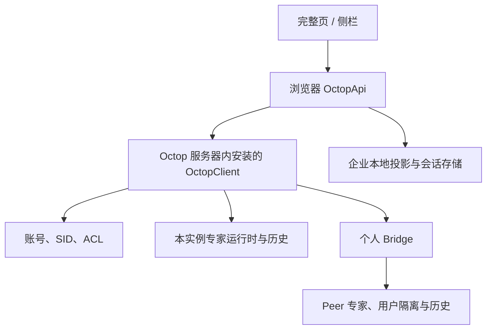
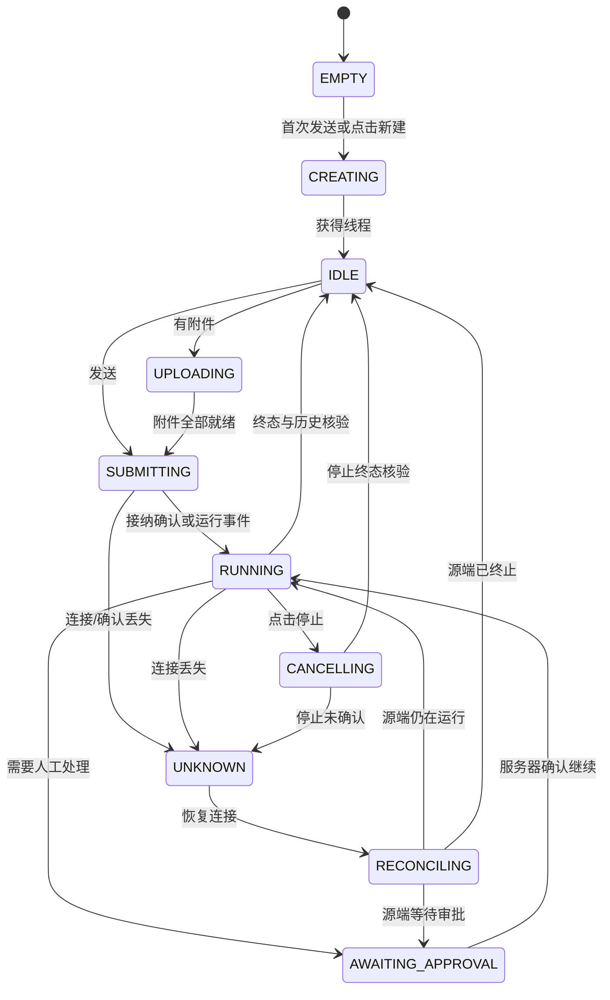

# Page Assist 方案 B 功能需求 PRD

**交付性质：** 本文件是可评审的需求工程合同，覆盖 Page Assist 仓库新增目录中的服务器模块 `OctopClient`、浏览器产品界面，以及 Octop 宿主必须配套开发的挂载能力。文件不是已实现报告；没有把源码阅读、模拟测试或文档检查当作真实系统验收。

**选定方案与用户澄清：** 在 Page Assist 仓库根目录新增 `octop-client/` 开发服务器端 `OctopClient`，独立构建 Python 安装包，安装到 Octop 服务器的 Python 环境，并由现有 Octop 进程挂载。浏览器扩展通过 `src/services/octop-api/` 消费其 Client API v1。代码仓库归属与运行位置分开：`OctopClient` 不运行在浏览器，不打入扩展包；它复用 Octop 的身份、专家 ACL、线程、历史、执行器和 Bridge，不另起 BFF 进程或第二套运行时。

**阅读顺序：** 产品范围见第 2–6 章；协议、状态与 SDK 见第 7–10 章；实现落位见第 17 章；可执行验收见第 20–27 章；开发计划准入见第 28–35 章。

# 0. PRD 使用原则

## 0.1 事实、决策与现场验证

- **源码事实**仅指文档固定的两个 commit，可通过附录 A 的永久链接复核。
- **目标合同**是 B1 要新增或修改的行为，包括所有 `/api/client/v1/*` 接口；不能从本文推断它们已在当前 Octop 中存在。
- **现场状态**尚未验证：截图中的 `192.168.102.104:8092` 仅是用户提供的界面示例，本文没有登录该实例、检查部署配置或执行真实专家对话。
- 本文沿用用户原始[工程模板][TEMPLATE]的 0–36 章、Requirement Unit、Acceptance、Evidence、Gate 结构。WHY、WHAT、BOUNDARY、STATE、INPUT、OUTPUT、SIDE EFFECT、FAILURE、ACCEPTANCE、EVIDENCE 均有对应章节。

## 0.2 规范用语与追踪

`MUST` 表示必需；`MUST NOT` 表示禁止；`SHOULD` 表示偏离时需要记录理由；`MAY` 表示不影响发布门禁的可选项。本文强制条款集中在第 10 章，每条紧邻 Acceptance ID；其他章节是这些条款引用的规范细节，追踪到第 27 章。

同一事实出现冲突时，优先级为：已批准的本 PRD 修订版 → 本版本的状态/协议/副作用合同 → 交互说明 → 示例。示例不能扩大权限、改变事务边界或覆盖字段限制。

## 0.3 No-Inference Rule

如果计划生成器无法从本文确定事实源、默认行为、身份范围、哈希、事务、失败、冲突或验收 oracle，输出 `SPEC_SEMANTIC_GAP` 和对应章节/REQ，停止生成该计划；修订 PRD 后继续。不能用代码中的隐式默认值补齐产品合同。该规则由 `REQ-EVID-001 / A-EVID-001` 验证。

# 1. 文档元数据

文首 YAML 为唯一元数据。`REVIEW` 表示方案 B 已被用户选择，本份详细 PRD 尚待产品/工程评审；不表示用户已经批准本文全部新设定。B1 的产品默认值均在本文明确给出，评审可以通过升版修改，开发不能自行换成另一套行为。

| 状态 | 本文含义 | 进入条件 |
|---|---|---|
| REVIEW | 当前交付状态 | 完成文档与内部一致性审阅 |
| APPROVED_FOR_PLAN | 可以据此生成 `.plan.md` | 负责人确认范围，语义检查无缺口 |
| IMPLEMENTED | 实现已落地 | 计划任务完成，仍不等于验收通过 |
| VERIFIED | 发布门禁成立 | 全部 required AC 有真实 Evidence，Gate=PASS |

版本标识采用源码 SHA；Page Assist 的 package 与扩展 manifest 版本不是本 PRD 的源码身份。构建验证记录实际输出版本，本文不顺带修改产品现有版本策略。[SRC-PA-01]

# 2. 一句话目标

让企业用户在已安装兼容版本 OctopClient 的 Octop 服务器环境下，通过 Page Assist 完整页和浏览器侧栏登录企业账号、选择获授权专家、创建和恢复远端会话，并按用户选择发送网页快照和附件；OctopClient 代码在 Page Assist 仓库独立目录维护，专家执行、权限与正式历史仍归 Octop 管理，原有本地聊天保持可用。

## 2.1 可观察的核心结果

1. 用户能看见当前登录账号和企业服务，登录后只获得服务器允许的专家目录。
2. 从专家卡片进入对话，无须选择 Page Assist 本地模型或配置模型 API Key。
3. 同一账号能重新打开其 Page Assist 远端线程，读取 Octop 保存的消息；断线恢复不自动重复提交问题。
4. 至少一个本实例专家、一个个人 Bridge 远端专家在真实扩展中完成“登录 → 目录 → 新建 → 流式问答 → 重开恢复”链路。
5. 用户不登录企业账号时，现有 Page Assist 的本地模型聊天、历史和配置仍按原行为工作。

# 3. 背景与问题定义

## 3.1 Current State：固定源码事实

| 领域 | 已有实现 | 对本需求的影响 |
|---|---|---|
| Page Assist 框架 | WXT、React、TypeScript；完整页与侧栏分别有 MemoryRouter；Chrome 与 Firefox 各有路由入口 | 两个界面都要接入企业入口；不能只添加一个 URL 或一个表单 [SRC-PA-01][SRC-PA-02] |
| 现有身份 | `getUserId()` 生成本地随机 ID；MCP OAuth 管理 MCP 服务授权 | 两者均不能当作 Octop 企业登录 [SRC-PA-03][SRC-PA-04] |
| 现有聊天 | 模型选择、LangChain/模型 provider、本地 RAG/MCP、各自的主界面/侧栏 hooks | 专家会话需要独立控制器，不能把专家 ID 填入 `selectedModel` [SRC-PA-05] |
| 本地数据 | 现有 Dexie 数据库已有 schema v1–v5；历史、消息与模型数据没有企业账号分区 | 新企业数据另建库，不能给旧历史自动认领企业所有者 [SRC-PA-06] |
| 页面与文件 | 有页面提取及本地文件处理；当前文件处理不等于上传 Octop | 可复用提取算法，发送范围、预览、服务端附件引用需新合同 [SRC-PA-07] |
| Octop 身份 | 已有账号登录、`/auth/me`、OIDC；现有 logout 不撤销已发出的普通账户 JWT | 扩展需要独立、可撤销的客户端会话，不直接沿用 Dashboard 回调与 token 语义 [SRC-OC-01] |
| Octop 专家/线程 | 已有专家权限、线程列表/历史、上传、原生聊天 WS、HITL；原生新建线程会重置 Dashboard 绑定 | 底层复用，新增客户端投影与独立线程创建 [SRC-OC-02][SRC-OC-03][SRC-OC-04] |
| 原生流恢复 | 代码明确采用 weak stream resume；WS 断开不等于取消运行 | 只承诺历史与状态重建，不承诺逐 token 持久重放或原生恰好一次发送 [SRC-OC-03] |
| Bridge | 远端专家有 `bridge:{connection_id}:{remote_agent_id}` 代理身份；历史归专家所在端；共享连接按连接拥有者身份请求对端 | 需要区分本地、个人远端、共享远端，不能把共享目录可见等同于用户级会话隔离 [SRC-OC-05][SRC-OC-06] |
| Bridge HITL | 当前 HTTP 隧道读取完整响应后返回；普通会话另有 turn 流通道 | 不能直接宣称原生 HITL SSE 经 Bridge 可实时透传 [SRC-OC-07] |
| 服务端扩展挂载 | Octop `api/app.py` 显式挂载路由；没有通用服务端 API 插件扫描；现有 `/api/*` JWT 中间件先验证普通账户 token | 安装 wheel 不会自动挂载 API；需要宿主挂载与精确认证分流补丁 [SRC-OC-08] |

## 3.2 可验证的问题

- 当前 Page Assist 没有 Octop 平台身份，因此不能按企业用户获得专家 ACL 或远端私有历史。
- 模型型聊天链路缺少 Octop thread、原生事件、HITL、远端来源和运行状态语义。
- 直接调用原生线程创建会改变 Dashboard 默认绑定，与扩展独立会话入口的产品语义不一致。
- 连接共享与会话隔离没有同一语义，按当前 Bridge 机制开放共享私聊可能复用远端连接拥有者的历史。
- 单靠前端重试无法判断断线前的发送是否已经被服务端接纳，存在重复执行风险。

## 3.3 Impact

业务：用户在浏览网页时无法进入已有企业专家流程。工程：复制现有模型链路会混淆两套会话事实源。安全：账号、线程、附件可能错误混用。运维：必须能分辨浏览器连接故障、Hub 故障和 Peer 故障。AI Coding：需要明确已存在的服务与必须新增的适配接口，避免把假设写成“已有 API”。

# 4. Scope

## 4.1 In Scope

| Scope ID | B1 交付范围 | Requirement |
|---|---|---|
| SCOPE-001 | 企业服务配置、协议发现、版本门禁 | REQ-CONFIG-001 |
| SCOPE-002 | 复用 Octop 登录页面的扩展认证、客户端会话、退出与失效 | REQ-AUTH-001、REQ-SESSION-001 |
| SCOPE-003 | 完整页/侧栏入口、专家目录、独立专家聊天界面 | REQ-UI-001、REQ-CATALOG-001 |
| SCOPE-004 | 根目录 octop-client/ 服务器模块与浏览器 octop-api 适配层 | REQ-CLIENT-001、REQ-HOST-001 |
| SCOPE-005 | 独立远端线程、历史、流式问答、停止、恢复 | REQ-THREAD-001、REQ-TURN-001、REQ-RECOVER-001 |
| SCOPE-006 | 本实例 HITL；远端按能力提供明确的外部审批状态 | REQ-HITL-001 |
| SCOPE-007 | 用户选择的网页快照与受控附件 | REQ-CONTEXT-001、REQ-FILE-001 |
| SCOPE-008 | 账号隔离、旧数据保留、可关闭企业能力 | REQ-DATA-001、REQ-COMPAT-001 |
| SCOPE-009 | 本实例专家 + 个人 Bridge 专家；共享连接显式受限 | REQ-BRIDGE-001 |
| SCOPE-010 | 权限、可观测性、失败注入、真实消费方验证 | REQ-SEC-001、REQ-OBS-001、REQ-EVID-001 |
| SCOPE-011 | 双产物构建、服务器安装/配置/启用、升级/关闭/卸载/回滚 | REQ-PACKAGE-001、REQ-DEPLOY-001、REQ-UPGRADE-001 |

## 4.2 Out of Scope：B1 的确定边界

| Non-goal ID | B1 不提供的能力 | 替代行为/对应验收 |
|---|---|---|
| NON-GOAL-001 | 独立 BFF、独立 SaaS 账号库、在扩展中运行专家执行器 | 只部署现有 Octop 的升级版本；A-CLIENT-001 |
| NON-GOAL-002 | 将专家包装为通用 OpenAI model provider | 专家独立模式；A-CLIENT-002 |
| NON-GOAL-003 | 未实现对端调用者隔离的共享 Bridge 私聊 | 可见的共享来源显示不可用原因，禁止创建/发送/读私有历史；A-BRIDGE-002 |
| NON-GOAL-004 | Bridge 上没有可靠流式支持时在扩展内完成 HITL | 显示“请在 Octop 完成审批”，恢复时重新读取状态；A-HITL-003 |
| NON-GOAL-005 | 专家配置编辑、Bridge 创建/密码管理、模型/技能/MCP 管理、团队编排 | 由 Octop 管理端负责；目录仅支持 `kind=expert`；A-CATALOG-003 |
| NON-GOAL-006 | 本地历史自动上云、企业历史导出、离线发送队列、记住密码 | 无自动迁移/导出/补发；A-DATA-002、A-RECOVER-002 |
| NON-GOAL-007 | 远端线程改名/删除/分叉/重新生成、现有线程改绑其他专家 | 只读历史与新建线程；A-THREAD-003 |
| NON-GOAL-008 | Firefox 的企业登录/专家功能 | Firefox 保持现有功能并通过构建回归；入口显示平台未开放或不渲染；A-COMPAT-003 |
| NON-GOAL-009 | 私密/无痕浏览器模式的企业能力、同一浏览器配置中同时登录多个企业账号 | 企业入口禁用无痕；同一时刻一个 Hub/账号；A-SESSION-002 |
| NON-GOAL-010 | 对现有所有 Octop JWT 增加全局注销、对远端工具副作用进行事务回滚 | 只撤销新增客户端 SID；停止不撤回已经发生的外部操作；A-SESSION-003、A-RECOVER-003 |
| NON-GOAL-011 | 独立 Node 网关、额外监听端口、在浏览器运行 Python、B1 多 worker/多实例 HA | B1 每个 Octop 实例单 worker；共享宿主进程、端口与 TLS；A-HOST-002 |

共享 Bridge 用户级委托身份、远端 HITL 真正流式化、Firefox 企业能力属于后续独立 PRD 范围；本文件定义其拒绝行为，不以隐藏 UI 将未实现能力计作完成。B1 **个人 Bridge 的目录、新建线程、发送和恢复是 required**，不能整体关闭远端入口后宣称满足本需求。

## 4.3 Architecture Boundary

| Domain | Owner | Input | Output | 不负责 |
|---|---|---|---|---|
| 产品需求 | 产品负责人 | 用户目标、本 PRD | 版本范围、交互、AC | 不替代源码事实 |
| Page Assist UI | Page Assist 前端 | 账号状态、专家、事件 | 两种界面和用户动作 | 不判定最终 ACL |
| 浏览器 octop-api | Page Assist 前端工程 | 类型化命令、会话凭据 | API 响应、事件、错误 | 不承担服务器安装和权限事实源 |
| OctopClient / Client API v1 | Page Assist 仓库的服务器模块负责人 | SID、expertKey、thread、请求 | 授权投影、宿主服务调用 | 不复制运行时、不保存第二套消息正文 |
| Octop 宿主适配 | Octop 工程 | 安装模块、HostPort、配置 | 一次性挂载、认证分流、生命周期 | 不把 pip 安装视为功能已启用 |
| 身份/ACL/runtime | Octop 现有域 | 当前用户、资源、任务 | 正式授权、状态、历史 | 不信任客户端 owner 声明 |
| Bridge Hub/Peer | Octop 工程 | 已授权的个人连接 | 远端专家和源端结果 | 不承诺共享用户隔离已存在 |
| 计划与执行 | 开发负责人/Agent | APPROVED_FOR_PLAN PRD | `.plan.md`、代码、测试 | 不自行放宽 MUST |
| 验收与发布 | 测试/发布负责人 | Evidence 清单 | PASS/FAIL/BLOCKED/SKIPPED | 不用模拟替代 Golden Consumer |

# 5. Terminology / Domain Model

| 术语 | 唯一定义 |
|---|---|
| Hub | Page Assist 配置并登录的 Octop 实例 |
| Peer | 经 Hub Bridge 连接的专家源实例 |
| 本实例专家 | Hub 本地运行、由 Hub 授权的专家 |
| 个人 Bridge | 当前 Hub 用户拥有、未共享给其他用户/组，并完成 B1 个人身份绑定检查的连接 |
| 共享 Bridge | 连接记录向其他用户/组开放；包括拥有者自己浏览该共享连接，B1 一律不以个人连接对待 |
| expertKey | Client API 提供的稳定资源标识；用于寻址，不构成授权凭证 |
| thread | Octop 正式远端线程；一个 thread 只能属于一个源端用户与专家 |
| turn | 一次用户提交及其生成/工具过程；不等于一条 token 或一个本地气泡 |
| SID | 新增客户端会话记录，独立于现有普通账户 JWT，支持撤销 |
| accountPartition | 由 Hub origin、实例 ID、租户标识、subject 组成的本地分区哈希 |
| accountEpoch | 浏览器内账号代际；退出、切号、换 Hub 时递增，拦截迟到响应 |
| Desired | 用户期望的 Hub、当前专家、待发草稿、用户选中的上下文 |
| Observed | 最近服务器响应与传输状态，可能过期，不能覆盖更高版本正式状态 |
| Resolved | 经过配置优先级、协议能力、ACL、账号校验得出的可执行状态 |
| Last Applied | 已收到确认的本地配置/缓存版本，不代表远端运行已结束 |
| Runtime | 页面内 WS、流片段、AbortController、未发送文件；随页面销毁丢失 |
| Evidence | 运行生成、与源码/输入/断言绑定的证据；不是手写 PASS 文本 |
| OctopClient | Page Assist 仓库 octop-client/ 内的 Python 服务端分发包，安装于 Octop 服务器 |
| OctopApi | Page Assist 浏览器内 src/services/octop-api/ 的 TypeScript API 消费适配层；与 OctopClient 不是同一部署产物 |
| HostPort v1 | Octop 对安装模块提供的受限宿主接口：身份、ACL、事务、线程、运行、上传与 Bridge；不是已有公共插件 API |
| RESULT_UNKNOWN | 客户端无法确认提交/取消是否生效；不能等同 FAILED 或允许自动重发 |

# 6. System Context

## 6.1 Context Diagram



外部 IdP 仅参与 Octop 托管登录。扩展不保存 IdP client secret，不直接登录 Peer，不获取 Bridge 密码；浏览器使用 HTTPS/WSS 访问 Hub。

## 6.2 System Boundary 与信任

可信决策点是 Hub/Peer 的服务器授权和其正式数据；扩展界面、用户传入的 URL/ID、网页、文件、专家输出、目录缓存均不能授予权限。Hub 与 Peer 的运维管理员属于相应服务的信任域；本 PRD 不承诺防止已控制服务器的管理员读取该服务器数据。

浏览器运行环境限定 Chrome/Chromium 116+、Edge 对应 Chromium 116+ 且存在所需 `identity`/`storage.session` API；构建及 Golden Consumer 记录实际浏览器版本。企业功能仅在普通浏览器配置中开放。WS 由活动扩展页面持有，页面关闭可以断开；不依赖 Service Worker 永久存活。

# 7. Authoritative State / Source of Truth

| State | 类型 | 唯一事实源 | 本地存放/用途 | 冲突与失效策略 |
|---|---|---|---|---|
| Hub 连接配置 | Desired/Last Applied | 浏览器 managed 策略优先，其次用户配置，其次 disabled | `storage.local` 的企业专属 key；无 secret | 同字段 managed 胜出，用户不得覆盖 |
| 服务实例和协议能力 | Observed/Resolved | Hub `/capabilities` | 内存，5 分钟 TTL | major 不兼容拒绝；过期刷新后再写操作 |
| 用户身份、SID 状态 | Authoritative | Hub 会话表 + 当前用户状态 | token 仅 trusted `storage.session`；公开 user 投影 | SID 撤销/过期以服务端为准；401 清本地身份 |
| 专家可见性和操作权限 | Authoritative | 当前 Hub ACL；个人远端还校验 Peer ACL/绑定 | 目录可缓存，不能用于最终授权 | 每次变更动作服务器重查；403 不转为本地模型 |
| thread、消息、运行/HITL | Authoritative | 专家所在端原有线程、消息与 runtime | 浏览器只缓存引用/摘要；正文仅活动界面内存 | 重连以源端历史+运行状态重建，旧 token 拼接结果丢弃 |
| 未发送草稿与网页快照 | Desired/Runtime | 当前界面的用户操作 | 内存，按界面+分区+专家+thread/new 隔离 | 退出/关闭界面即清；不跨专家自动移送 |
| 发送中临时气泡 | Observed | 客户端提交状态 | 内存，显式 pending/unknown 标记 | 服务器正式历史替换，不成为另一份正式历史 |
| 上传归属与引用 | Authoritative | 源端受管附件元数据 | 内存引用；不信任手工 workspace_path | 用户、专家、thread、摘要均匹配才允许发送 |
| 最近专家/线程引用 | Last Applied | 受账号分区的企业数据库 | 重开入口；不缓存消息/正文/原始文件 | 重新登录校验 SID/ACL 后可用；退出删除该分区 |
| Gate/Evidence | Evidence | 验收运行器产物 | 代码仓库 CI artifacts | 无证据不得把状态改为 PASS |

默认 **不在 IndexedDB 持久保存企业消息正文、网页快照、文件字节或草稿**。这是一项 B1 数据最小化决策，代价是关闭界面后未发送内容不会恢复；正式历史可从 Octop 重新读取。普通 Page Assist 本地历史不受这项企业策略影响。

# 8. State Machine

## 8.1 企业认证状态

| From → To | 触发条件 | 持久化/副作用 | 恢复 |
|---|---|---|---|
| DISABLED → SIGNED_OUT | 有效配置且功能启用 | 保存非敏感配置 | 展示登录入口 |
| SIGNED_OUT → AUTHENTICATING | 用户点登录 | 创建一次 PKCE transaction；session 存 state/verifier | 10 分钟超时或用户取消回 SIGNED_OUT |
| AUTHENTICATING → AUTHENTICATED | 回调/PKCE/交换、`GET /session` 全部验证成功 | 发布 token、身份、递增 epoch；清登录事务 | 加载目录 |
| AUTHENTICATING → SIGNED_OUT | 拒绝/取消/无效回调/交换失败 | 清临时 state/verifier；不发布半成品身份 | 用户可重新登录 |
| AUTHENTICATED → EXPIRED | 本地到达 expires_at 或服务器 401/会话撤销 | 广播失效、清 token/敏感内存、关本地连接 | 显示重新登录，不自动补发 |
| AUTHENTICATED → SIGNED_OUT | 退出 | 先切断本地使用与广播，再尝试服务端撤销 | 撤销超时单独提示，不伪称全局撤销成功 |
| 任意 → DISABLED | 企业功能关闭/运行环境不支持 | 按本地退出清理；不删除正式远端历史 | 本地聊天继续工作 |

禁止 SIGNED_OUT 直接发布 AUTHENTICATED；禁止以目录缓存替代身份校验；旧 epoch 的响应不产生状态变化。一个浏览器配置同时只发布一个有效账号分区。

## 8.2 会话与提交状态



EMPTY 的 thread_id 为空；其余需要线程的状态都有源端 thread_id。请求发出前验证失败回到原可编辑状态；发出后不能确定结果则为 UNKNOWN。`SUBMITTING/UPLOADING/RUNNING/CANCELLING/RECONCILING` 中禁止发第二个 turn；同一 thread 在另一界面发送由服务器原子忙碌检查拒绝，不能依赖页面锁。

切换专家/会话在 UPLOADING、SUBMITTING、RUNNING、CANCELLING、RECONCILING 时禁用；UNKNOWN 只提供“重新连接并核对”和“离开此会话”显式操作，后者不取消运行。关闭浏览器页面始终允许，但不等于停止服务端。

## 8.3 服务器状态、持久化与恢复

线程所有权、SID 撤销、创建线程幂等记录、附件元数据持久保存。正在运行的瞬态任务依赖既有 Octop runtime，进程重启后以其真实可恢复能力报告 `RUNNING/IDLE/INTERRUPTED`；不能把旧缓存 RUNNING 当作仍在执行。Bridge 断线报告 `PEER_UNAVAILABLE` 并保留源线程引用；不能自动切换到同名本地专家。

终态投影包含 `completed|cancelled|failed|interrupted` 与源端状态；客户端 `close()` 只关闭连接；`cancelTurn()` 才请求取消。任务已产生的外部工具副作用不因取消或退出而撤回。

# 9. Data / Schema Contract

## 9.1 通用 Schema Rule

下面是 B1 的规范化客户端协议，不是当前原生 API 的完整复制。Schema ID 前缀为 `urn:page-assist:octop-client:v1:`。实施时将本章落为 JSON Schema 与 TypeScript 类型，必填字段按表执行。请求 `additionalProperties=false`；服务器响应允许未知字段供 minor 扩展，但客户端只保留已定义字段；未知必需能力、未知核心事件类型或不支持的 major 返回 `PROTOCOL_INCOMPATIBLE`。未知可选事件按第 9.7 节处理。

公共类型：ID 为非空 UTF-8 字符串，最大 512 字节，不解释为本地路径；时间为 UTC RFC3339 毫秒字符串；整数使用安全整数范围；boolean 不接受字符串转换。所有 JSON UTF-8，无 BOM；空字符串与字段缺失不是同义。可选字段的缺失默认值在表中规定，不允许从 UI 猜测。

## 9.2 配置、能力与认证对象

| Schema / 字段 | 必填/默认 | 合同 |
|---|---|---|
| Config.enabled | 是，默认 false | 启用企业模块，不影响本地模式 |
| Config.base_url | enabled 时必填 | B1 只支持 origin 形式的 HTTPS URL；禁止 userinfo、query、fragment、非根路径；规范化去末尾 `/`、小写 host、去默认端口 |
| Config.client_id | enabled 时必填 | 部署注册的公开客户端 ID；无 secret；绑定精确扩展 ID/回调/Origin |
| Config.source | 派生 | `managed\|user\|disabled`；managed 同字段优先 |
| Config.allow_insecure_dev | 默认 false | 仅开发构建允许设置；正式包忽略并拒绝 HTTP，包括截图中的 LAN HTTP 地址 |
| Capabilities.protocol | 是 | `{major:1,minor:0}`；major 必须等于 1；minor 更高允许已知字段子集 |
| Capabilities.build | 是 | `{module_version,host_api_version:1,host_build_id,ready:true}`；实例未ready时不返回成功能力对象 |
| Capabilities.instance_id | 是 | Octop 部署时生成并持久保存的 UUID；数据库克隆作为新实例时重新生成 |
| Capabilities.auth | 是 | `{mode:"hosted_pkce",session_ttl_seconds:28800}`；不发布用户或 secret |
| Capabilities.features | 是 | `catalog_v1,independent_threads,history_v1,chat_ws_v1,uploads_v1,revocable_sessions` 六项 B1 核心能力均为 true |
| Capabilities.limits | 是 | question_utf8_bytes≤32768；context_utf8_bytes≤65536；turn_json_bytes≤131072；file_bytes≤10485760；files_per_turn≤5；files_total_bytes≤20971520；服务端可降低不可提高 B1 上限 |
| Session | 全部必填 | `{sid,instance_id,tenant_id,subject,display_name,expires_at,client_id,scopes}`；tenant_id 无多租户实现时为固定 `"default"`，不暗示新增租户 ACL |
| Session.scopes | 是 | 仅 `experts:read,threads:read,threads:create,chat:send,chat:cancel,uploads:write,approvals:write` 的获准子集 |
| AuthExchange | 是 | `{access_token,token_type:"Bearer",session}`；token 为新增独立 opaque 客户端 token，不是普通账户 JWT |

Session 内不含密码、IdP token 或 Bridge 凭据。本地 `accountPartition` 按第 13 章计算；显示名不能作用户身份。

## 9.3 Expert 与目录

```typescript
type Expert = {
  expertKey: string;
  name: string;
  description: string;
  avatar: { kind: "emoji" | "asset" | "none"; value: string };
  kind: "expert";
  source: { kind: "local" | "bridge_personal" | "bridge_shared"; label: string };
  availability: "available" | "offline" | "forbidden" | "unsupported";
  unavailable_reason: string | null;
  capabilities: {
    create_thread: boolean; chat: boolean; attachments: boolean;
    approval_in_client: boolean;
    approval_mode: "in_client" | "external_instructions" | "none";
  };
};
type ExpertPage = { items: Expert[]; next_cursor: string | null };
```

所有字段必填，缺boolean能力默认 false、缺approval_mode为none；description 无值为 `""`，avatar 无值为 `{kind:"none",value:""}`。投影不返回系统提示词、工作区路径、provider key、MCP/技能内部配置或 Bridge 地址/账号/密码。头像 asset 只能是 Hub 的已授权资源路径，不自动请求外域图片；目录不直接返回Peer审批URL，说明通过第9.5章的受鉴权接口读取。

目录分页 size 固定 50；按 `name` 的 Unicode code point 顺序、再按 expertKey 的 ASCII 顺序升序排列。游标是服务端签名的短期位置令牌，绑定 SID、过滤条件和目录 revision，10 分钟有效；revision 改变返回 `CURSOR_STALE`，客户端清本次列表从第一页重读。搜索默认空，首尾 trim，最大 100 code points；按 name/description 的 Unicode NFC 后小写子串匹配，服务器执行。UI 去重以 expertKey 为键，不以专家名为键。

## 9.4 Thread、History 与附件

| Schema | 字段/默认 | 语义 |
|---|---|---|
| Thread | `thread_id,expertKey,channel_type:"page_assist",title,created_at,updated_at,runtime` 必填 | 独立于 Dashboard 默认线程绑定；标题由源端生成/投影，空时显示“新会话” |
| ThreadPage | `items,next_cursor` 必填 | 分页 50，按 updated_at 降序、thread_id 升序；游标绑定分区和专家，失效处理同目录 |
| RuntimeState | `state:"idle"\|"running"\|"awaiting_approval"\|"interrupted",turn_id:string\|null,pending_id:string\|null,last_outcome:string\|null` | 服务端正式观察；空 pending_id 不能进行审批 |
| HistoryPage | `thread_id,items,next_cursor,history_revision,runtime` 必填 | 默认最近 50 条，向前翻页；items 按源端顺序升序；cursor 是历史游标，不是事件重放游标 |
| HistoryMessage | `message_id,order,role,parts,created_at,client_request_id` 必填 | role=`user\|assistant\|tool\|system`；client_request_id 无关联时 null；message_id 源端稳定；order 为线程内稳定安全整数 |
| Part | `kind:"text"\|"tool_call"\|"tool_result"\|"attachment"\|"reasoning_summary",data` | data 根据 kind 校验；不返回隐藏内部推理，仅展示源端明确可展示的摘要 |
| AttachmentRef | `upload_id,thread_id,expertKey,filename,media_type,bytes,sha256,expires_at,state` 必填 | state=`ready\|attached\|expired`；不给 UI 可手工拼接的任意路径；发送时服务端解析实际 workspace_path |

稳定 message_id/order 由源端在新page_assist消息写入时建立元数据/投影，不能用浏览器随机 ID 冒充；重启和重新投影不改变其值。GET不偷偷补写业务或生成身份元数据，缺少必要投影时返回503/HISTORY_PROJECTION_PENDING，由受控源端维护流程重建后再读。原始流片段不逐条写入第二套历史。恢复顺序固定为：订阅并收到确认 → 缓冲后续事件 → 读取历史/runtime → 丢弃旧临时回答投影并按 message_id 重建 → 展示确认后的状态 → 终态再次核对历史。回读期间发生的无法与消息明确关联的 delta 不直接拼到正式正文；允许稍后回读收敛，不能重复文本。

线程列表以 10 分钟快照中的 thread_id 顺序分页，新增或更新线程在下一次刷新体现；快照绑定 SID/expertKey。历史以首次读取的最大 order 为上界向前 keyset 分页，新消息不会打乱旧页；游标绑定源端身份、专家、thread、上界和投影 generation。删除/重建导致 generation 变化时 CURSOR_STALE，客户端从最新页重读。同一 message_id 的正文修订按较新 history_revision 替换，不新增一条消息。

## 9.5 Client API v1：路由合同

**下表全部为新增的进程内接入接口。** “复用”表示调用既有服务/处理逻辑，不表示当前源码已经暴露这些路径。统一前缀 `/api/client/v1`，JSON 错误结构见第 9.8 节。

| Method / Path | 输入 | 输出与写入语义 | 复用/新增边界 |
|---|---|---|---|
| GET `/capabilities` | 无用户身份 | 200 Capabilities；只读 | 新能力投影；不泄露目录 |
| POST `/auth/transactions` | client_id、redirect_uri、state、code_challenge、method=S256 | 201 `{authorization_url,expires_at}`；创建 10 分钟登录事务 | 新扩展入口；复用 Octop 托管登录与 OIDC |
| POST `/auth/exchange` | client_id、redirect_uri、code、code_verifier | 200 AuthExchange；code 60 秒、单次消费 | 新 PKCE 与 SID 事务；不是原 `/auth/oidc/exchange` 直接复用 |
| GET `/session` | Bearer 客户端 token | 200 Session；重查用户启用状态 | 新 SID + 现有账号 |
| DELETE `/session` | Bearer 客户端 token | 204；撤销 SID、其 WS tickets、连接 | 仅影响该 SID；重复已撤销 SID 204 |
| GET `/experts` | SID、q、source、cursor | 200 ExpertPage | 现有 agents/Bridge 目录 + ACL 安全投影 |
| GET `/experts/{key}/threads` | SID、cursor | 200 ThreadPage；只列当前用户 channel=page_assist | 复用线程仓储，新增通道过滤/游标投影 |
| POST `/experts/{key}/threads` | SID、Idempotency-Key、`{}` | 201 Thread；重复同键回 200 同线程 | 新独立通道创建，禁止 dashboard reset |
| GET `/experts/{key}/threads/{id}/history` | SID、cursor | 200 HistoryPage | 复用源端历史；补稳定 ID/顺序投影 |
| POST `/experts/{key}/threads/{id}/uploads` | SID、Idempotency-Key、multipart file、文件 sha256 | 201 AttachmentRef；重复同键同摘要 200 | 复用上传，增加 owner/thread 元数据、受管路径与清理 |
| POST `/ws-tickets` | SID、`{expertKey}` | 201 `{ticket,expires_at,ws_url}`；30 秒单次票据 | 新 WS 握手能力 |
| WS `/experts/{key}/chat/ws?ticket=…` | 绑定 SID/key/Origin 的 ticket | 101；第 9.7 节命令和事件 | 调用原生聊天/Bridge turn 通道，不经 HTTP 缓冲隧道模拟流 |
| POST `/experts/{key}/threads/{id}/approvals` | SID、`{pending_id,decision_id,decisions}` | 202 `{decision_id,status:"accepted"}`；后续走同线程 WS | 本实例复用 HITL coordinator；远端 B1 返回 CAPABILITY_UNAVAILABLE |
| GET `/experts/{key}/threads/{id}/approval-instructions` | SID、当前pending_id查询参数 | 200 `{pending_id,source_label,entry_url,instructions}`；只读 | 复核当前绑定/待审批状态，提供扩展内显示的远端指引，不返回凭据 |

目录 source 只接受 `all|local|remote`，缺省 all。Thread/history 路径中的 key/id 由 URL path segment 编码后传输；后台不能将其解码为磁盘路径。客户端 token 只允许本表的认证后路由，不能用于任意 legacy `/api/agents/*`、管理路由或直接 Bridge 路由。适配器在服务端内部传递受检用户上下文，不给浏览器换发通用账户 JWT。

## 9.6 登录、SID 与权限合同

浏览器通过 `identity.getRedirectURL("octop")` 获得本次构建的回调地址，由部署侧预先精确注册；开发、正式扩展 ID 分开注册。添加 `identity` 权限，不增加 `identity.email`。托管页面可复用 Octop 的账号密码/验证码或已配置 OIDC；扩展只收一次性授权码，密码不经过浏览器 OctopApi。服务器 OctopClient 复用宿主已认证的登录结果，不另存一份账号密码。[EXT-CHROME-IDENTITY]

state、code_verifier、授权码、ticket、token 均以密码学随机源生成至少 32 字节熵、base64url 无 padding。PKCE 为 S256。callback 只接受已注册精确 URI、匹配 state、尚未完成的事务；授权码绑定 client_id、redirect_uri、challenge、已认证 subject。交换成功在同一 DB 事务消费 code 并建立 SID；响应丢失时重新登录，不重用 code。

客户端 token 前缀 `octopc1_` 后接 32 字节随机数的 base64url；数据库只保存其 SHA-256 与 SID，不存原 token。SID 绝对有效期 8 小时，无滑动续期和 refresh token；浏览器重启后 session storage 丢失，需要再次登录，可利用 Octop 已有 SSO 会话。服务器拒绝把这种 token 按普通 JWT 解析，legacy 路由也拒绝；现有普通账户 JWT 的行为另属原系统。

WS 票据绑定 SID、client_id、expertKey、instance_id、允许的 extension Origin，握手时原子单次消费。每个 user_turn/subscribe/cancel 再校验 SID、scope、当前 ACL、源端用户和 thread 归属。SID/ACL 撤销事件关闭相关连接，最长 5 秒的周期复核作为兜底；过期关闭 code=4401，资源撤权=4403，忙碌=409 错误事件。

## 9.7 浏览器 OctopApi 消费接口与事件

```typescript
// 新增浏览器模块：src/services/octop-api/index.ts；不是服务器 OctopClient 的安装入口。
interface OctopApi {
  getCapabilities(signal?: AbortSignal): Promise<ClientCapabilities>;
  login(signal?: AbortSignal): Promise<ClientSession>;
  getSession(signal?: AbortSignal): Promise<ClientSession>;
  logout(): Promise<{ localCleared: true; serverRevoked: boolean }>;
  listExperts(input: { q?: string; source?: "all" | "local" | "remote"; cursor?: string }, signal?: AbortSignal): Promise<ExpertPage>;
  listThreads(expertKey: string, cursor?: string, signal?: AbortSignal): Promise<ThreadPage>;
  createThread(input: { expertKey: string; requestId: string }, signal?: AbortSignal): Promise<RemoteThread>;
  getHistory(input: { expertKey: string; threadId: string; cursor?: string }, signal?: AbortSignal): Promise<HistoryPage>;
  uploadAttachment(input: { expertKey: string; threadId: string; requestId: string; file: File }, signal?: AbortSignal): Promise<AttachmentRef>;
  connect(input: { expertKey: string; signal?: AbortSignal }): ConversationConnection;
  resolveApproval(input: { expertKey: string; threadId: string; pendingId: string; decisionId: string; decisions: ApprovalDecision[] }, signal?: AbortSignal): Promise<ApprovalReceipt>;
  getApprovalInstructions(input: { expertKey: string; threadId: string; pendingId: string }, signal?: AbortSignal): Promise<ApprovalInstructions>;
}
interface ConversationConnection {
  subscribe(threadId: string): Promise<void>;
  sendTurn(input: { threadId: string; clientRequestId: string; question: string; context: ContextSnapshot | null; uploadIds: string[] }): Promise<SubmissionReceipt>;
  cancelTurn(input: { threadId: string; turnId: string }): Promise<CancelReceipt>;
  events: AsyncIterable<OctopEvent>;
  close(): void; // 只关连接，不调用 cancel
}
```

所有 UI 只能使用该公共接口，不自行拼接 Octop URL、处理 JWT、构造 workspace_path 或解析原生 SSE/WS。浏览器平台能力通过 `AuthBroker`/`BrowserAdapter` 注入；HTTP/WS/clock/storage 可替换以运行契约测试；生产实现仍使用实际 fetch/WebSocket，不把测试适配器打进生产选择菜单。

连接命令 envelope：`{v:1,type,request_id,thread_id,payload}`，type=`subscribe|user_turn|cancel|ping`；ping 的 thread_id=null，其余必填。`request_id` 为 UUID v4；`user_turn` payload 只允许 question、context、upload_ids，不能覆盖模型、系统提示词、MCP、工具、skills 或 as_user。服务器把问题与上下文打包为一个用户文本部分，附件由受检 upload_id 解析；不会利用原生“取第一个文本块”的行为丢失第二块内容。

subscribe.payload=`{}`，确认返回 `{request_id,thread_id,runtime}`。cancel.payload=`{expected_turn_id}`，源端在取消同一临界区比对当前 turn_id；匹配才请求停止，不匹配返回 TURN_CHANGED，无活动 turn 返回 `{status:"already_terminal"}`。CancelReceipt=`{request_id,thread_id,turn_id,status:"requested"|"already_terminal"}`，requested 不等于已停止。SubmissionReceipt=`{request_id,thread_id,turn_id,status:"accepted"}`，只有实际接纳后才返回；消息关联 client_request_id 写入源端原有消息元数据，不能把这个字段误当持久幂等队列。

事件 envelope：`{v:1,connection_id,seq,type,thread_id,turn_id,client_request_id,payload}`；seq 从该连接 1 开始单调递增，仅用于本连接去重，不是持久 replay cursor。重复 `(connection_id,seq)` 丢弃；出现缺号或乱序进入 RECONCILING，不等待无限补包；重连换 connection_id。

| 规范化事件 | 原生来源/目标语义 | UI 行为 |
|---|---|---|
| `submission.accepted` | 新适配确认，代表当前进程已接纳，非崩溃安全 exactly-once receipt | pending 变 accepted，仍等正式历史 |
| `turn.started / resumed` | 原生 turn 事件 | RUNNING |
| `message.delta` | 原生 token | 临时回答累积；100ms 内批处理渲染 |
| `reasoning.summary` | 仅源端显式可展示摘要 | 可折叠摘要，不猜测内部推理 |
| `tool.call / tool.result` | 原生工具事件 | 工具名称/状态/安全输出；不在浏览器执行命令 |
| `approval.required` | 原生 hitl_required | 停在审批卡片，显示 pending_id 绑定 |
| `usage` | 原生 usage，可缺失 | 显示已有计数；缺失显示“未提供”，不是 0 |
| `turn.ended` | 原生结束/取消/失败 | 触发历史核对；单个 done 不自动等于全部工作完成 |
| `thread.status / error / pong` | 原生状态/错误/心跳 | 更新连接与错误；不推断未报告的成功 |

事件payload schema按以下固定字段实现；可选值用显式null，字符串默认不做trim；正常事件的thread_id/turn_id与操作对象一致，ping/pong的资源字段可为null。

| Event | payload 必填字段与含义 |
|---|---|
| submission.accepted | `{status:"accepted"}`；envelope提供request/thread/turn关联 |
| turn.started、turn.resumed | `{state:"running"}` |
| message.delta | `{stream_id:string,text:string}`；文本为增量；流ID在当前turn内稳定，重连不得无依据续拼旧流 |
| reasoning.summary | `{text:string}`；仅宿主允许展示的摘要 |
| tool.call | `{tool_call_id,name,status:"running",arguments_summary:string或null}`；summary只含宿主允许显示且已脱敏内容 |
| tool.result | `{tool_call_id,name,status:"succeeded"或"failed",summary:string,upload_ids:string[]}`；附件仍按同线程权限读取 |
| approval.required | 下文ApprovalPending；无未知的可执行脚本或外部schema引用 |
| usage | `{input_tokens:非负整数或null,output_tokens:非负整数或null,total_tokens:非负整数或null}`；未报告值为null |
| turn.ended | `{outcome:"completed"或"cancelled"或"failed"或"interrupted",runtime:RuntimeState}` |
| thread.status | `{runtime:RuntimeState,history_revision:string}` |
| error | 第9.8章的error对象；不得含原始堆栈/secret |
| pong | `{nonce:string,server_time:UTC时间}`；回显ping nonce，单nonce最长64字节 |

**本实例审批业务schema：** `ApprovalPending={pending_id,items,mode}`，mode=`in_client|external_instructions`；mode=in_client时items为1–20个唯一item_id的有序列表；mode=external_instructions时items=[]，仅提供pending_id供受鉴权说明查询。每项为 `{item_id,kind:"tool"|"question",title,detail,allowed_decisions,fields}`，title≤256字符、detail≤8192字符。tool允许approve/reject，fields=[]；question仅允许respond，fields为1–20个字段：`{key,label,type:"text"|"boolean"|"select",required,options}`，key唯一；select的options为非空唯一字符串数组，其余options=[]。text答案最多4096 UTF-8字节，select答案只能为给定选项，boolean必须是boolean。UI只渲染这三种字段，不执行动态代码或远程JSON引用。

`ApprovalDecision`判别联合为 `{item_id,type:"approve"}`、`{item_id,type:"reject",reason:string}`、`{item_id,type:"respond",answers:{字段key:对应值}}`；reason≤4096 UTF-8字节，可为空。请求必须按pending的全部items各提交一次且无多余item，answers只有声明字段且满足required；整批先校验再决定，不能只批准部分后失败。B1不开放edit或任意工具参数编辑；宿主待审批项无法投影为上述schema时返回外部处理状态，不能隐藏字段后默认批准。pending_id属于当前用户/thread；decision_id是UUID v4，绑定完整决策hash，重复同内容返回原结果，不同内容409。

审批接纳的原子范围是pending状态与决策记录；审批产生的工具执行不属于可回滚事务。源端pending已变化返回APPROVAL_STALE；连接不确定时不自动重复批准。`ApprovalReceipt={decision_id,status:"accepted"}`，只表示决策已接纳；任务是否继续/结束由随后runtime与历史决定。

未知事件如果 `optional=true` 则记录类型后忽略；未标 optional 的未知事件停止当前投影、回读历史并报告 `PROTOCOL_INCOMPATIBLE`，不继续执行隐含动作。服务端适配为新增 envelope；不声称当前原生 WS 已有 seq/message_id 等所有字段。

HTTP GET：10 秒超时，只对网络失败/502/503/504 最多自动重试 2 次，间隔 1、2 秒；429 遵循 Retry-After（1–60 秒内），不重复触发写操作。创建线程和上传仅在相同幂等键/相同 payload 下允许一次显式或自动查询式重试；user_turn、HITL 不自动重发。WS 10 秒握手，20 秒 ping、40 秒无 pong 断开；活动页面重连间隔 1、2、4、8、16 秒，5 次失败停到手动重试。重连只订阅/读历史，不发送旧 user_turn。普通运行超过 60 秒未有内容只显示等待，不因推理慢判作任务失败。

## 9.8 Error Contract

```json
{
  "error": {
    "code": "TURN_BUSY",
    "message": "该会话已有任务运行",
    "retryable": false,
    "request_id": "UUID-v4",
    "details": {"thread_id": "opaque-id"}
  }
}
```

| 类别 | 固定 code | HTTP/连接语义 |
|---|---|---|
| 配置/协议 | CONFIG_INVALID、INSECURE_ENDPOINT、PROTOCOL_INCOMPATIBLE、CAPABILITY_UNAVAILABLE | 客户端阻止或 400/409/426，不回落到猜测协议 |
| 认证 | AUTH_CANCELLED、AUTH_STATE_MISMATCH、AUTH_CODE_INVALID、AUTH_REQUIRED、SESSION_EXPIRED、SESSION_REVOKED、LOGOUT_UNCONFIRMED | code/state无效为400；会话无效为401/4401；本地错误不捏造 HTTP 状态 |
| 授权/资源 | FORBIDDEN、EXPERT_NOT_FOUND、THREAD_NOT_FOUND、SHARED_BRIDGE_UNSUPPORTED、PERSONAL_BINDING_REQUIRED | 403/404/4403；外部不可见资源统一 404，避免资源枚举 |
| 导航/状态 | INVALID_ROUTE、REQUEST_IN_FLIGHT、TURN_BUSY、RESULT_UNKNOWN、CURSOR_STALE、STALE_ACCOUNT_EPOCH | 400/409；epoch 迟到为丢弃事件，不向新账号显示旧内容 |
| 取消竞态 | TURN_CHANGED | 409；源端当前 turn 已变化，迟到的取消不影响新 turn |
| 连接 | NETWORK_UNAVAILABLE、PEER_UNAVAILABLE、TIMEOUT、RATE_LIMITED | 502/503/504/429 或本地传输错误；区分可重读与可重发 |
| 内容/上传 | INPUT_EMPTY、INPUT_TOO_LARGE、CONTEXT_CAPTURE_DENIED、UNSUPPORTED_MEDIA、UPLOAD_TOO_LARGE、UPLOAD_INCOMPLETE、UPLOAD_REF_FORBIDDEN | 400/403/413/415；校验失败发送数为 0 |
| 幂等/审批 | IDEMPOTENCY_CONFLICT、IDEMPOTENCY_EXPIRED、APPROVAL_STALE、APPROVAL_RESULT_UNKNOWN | 409；不自动生成新键规避冲突 |
| 存储/工程 | STORAGE_UNAVAILABLE、STORAGE_CLEANUP_REQUIRED、MIGRATION_BLOCKED、SPEC_SEMANTIC_GAP、EVIDENCE_INVALID | 阻止对应能力/计划/发布，不能吞错继续标绿 |

details 为白名单字段集合，只包含非敏感资源 ID、限制值、重试时刻；无 token、正文、密码或物理路径。每个 request_id 均可关联日志，不把原始异常堆栈显示给用户。

## 9.9 OctopClient 服务器包与 HostPort 合同

| 项目 | B1 唯一取值/行为 |
|---|---|
| 代码目录 | Page Assist 仓库根目录 `octop-client/`，不放在浏览器 `src/` 中 |
| Python distribution | `page-assist-octop-client`；首个产品协议版本 1.0.0；module=`page_assist_octop_client` |
| Python 版本 | 与已核验宿主一致，Python ≥3.12；B1 发布 wheel 的验证环境固定 Python 3.12.x，记录精确 patch 版本 [SRC-OC-09] |
| 构建产物 | `page_assist_octop_client-1.0.0-py3-none-any.whl`、sdist、checksums、SBOM、release manifest、安装手册；不含 Octop 源码副本、venv、secret 或运行数据 |
| 安装位置 | Octop 实际运行进程使用的 Python 环境；管理员显式提供 interpreter 与 state root，不能默认系统 Python |
| 运行位置 | Octop 已有 ASGI 进程；同端口、同 TLS；不另监听，不另启动 Node/Python HTTP 服务 |
| 宿主版本门禁 | `host_api_version=1` + 本文列出的 capability 集合；基线 Octop 原 commit 需要宿主补丁后才满足；普通 `1.0.3b1` 版本串不足以放行 |
| 挂载入口 | 宿主显式调用 `page_assist_octop_client.integration.register(app, host_port, config)`；单实例一次注册，生命周期 startup/shutdown 由宿主调用 |
| 状态目录 | `<OCTOP_STATE_ROOT>/extensions/octop-client/`；config、安装回执、迁移回执、恢复记录；根路径由宿主实际配置传入 |
| 数据表 | 同一 Octop SQLite 业务库内新增 `paoc_` 前缀受管表；不新建一份正式消息/专家/用户库 |
| 进程模型 | B1 每个实例单 worker；多 worker 配置预检为不兼容，不默认为分布式锁已存在 |
| 认证分流 | 宿主 setup_lockdown 仍优先；仅精确 `/api/client/v1` 路由交 OctopClient SID/公开端点认证；其余 JWT/Bridge 路由沿用原鉴权 |

模块新增 `paoc_schema_version`、`paoc_sessions`、`paoc_auth_transactions`、`paoc_auth_codes`、`paoc_ws_tickets`、`paoc_operation_receipts`、`paoc_personal_bindings`、`paoc_uploads`、`paoc_thread_metadata`、`paoc_message_projection`。这些是协议、授权和投影元数据，不保存第二份消息正文。线程/消息仍在现有仓储；个人 Peer 的源端元数据落 Peer，Hub 只保留绑定/寻址信息。

HostPort v1 是配套开发的宿主边界，提供：当前认证结果与账号查询、ACL 检查、同库 unit-of-work、独立 page_assist 线程创建/查询、原历史读取与稳定投影、运行时接纳/按 expected_turn_id 取消、HITL coordinator、受管上传、Bridge 能力/源端身份/受限调用、状态根目录、日志与启动配置。接口不暴露任意 SQL/命令执行给浏览器。module 内只能通过 HostPort 访问这些宿主能力；禁止运行时修改 Octop 源码文件或 monkey patch 原 Dashboard handler。

现有 `jwt_auth` 覆盖 `/api/*`，所以只 include_router 无法完成 SID 接入。宿主补丁要同时提供受限认证分流和 router/lifespan 挂载，并保持 setup_lockdown、现有普通 JWT、Bridge 代理顺序的安全语义。模块未启用或初始化失败时，client 命名空间返回 `CLIENT_MODULE_DISABLED` 或 `CLIENT_MODULE_UNAVAILABLE`（503），不落入匿名逻辑；Octop 原有健康/登录/专家端点仍按其原合同工作。[SRC-OC-08]

## 9.10 个人 Bridge 与 Peer 扩展合同

个人连接可用谓词为：`current_subject == connection.owner` 且共享用户/组集合均为空，连接在线，Hub/Peer 都支持 client_peer_v1，并存在有效绑定 `(hub_instance_id, hub_subject, connection_id, peer_instance_id, peer_subject, binding_revision)`。peer_subject 由已认证的对端身份查询返回，不能由显示名、客户端参数或本地随机 userId 推导。

绑定由拥有者在 Octop 管理界面明确建立；同一 Peer subject 在 B1 客户端绑定表中只允许绑定一个 Hub 用户身份（同一用户可以更新同一连接）。这避免两个 Hub 用户通过相同远端账号被当作两个隔离主体。此约束不声称验证了两端自然人身份。共享状态、远端账号、实例 ID、凭据所属身份变化时，绑定 revision 失效；旧 thread/upload 的寻址随之拒绝，重新绑定不会自动把旧账号历史授予新账号。

Peer 同样安装 OctopClient 并具备 HostPort v1。Hub→Peer 经已认证 Bridge 通道协商 `client_peer_v1`，允许的操作只有 `identity,capabilities,catalog,threads.list,threads.create,history,upload,chat.subscribe,chat.send,chat.cancel`，每次携带绑定标识，Peer 再查当前源端用户/ACL。Peer 直接建立独立 page_assist 线程和附件元数据；禁止回退 Dashboard reset 或借用默认会话。B1 的 `approval_in_client=false` 对所有远端专家固定，Hub 不尝试将现有缓冲 HTTP 隧道当成实时 HITL 流。

远端进入审批时，OctopApi以Bearer调用approval-instructions，只读接口复核SID、当前用户、thread、个人绑定及pending_id；失效为APPROVAL_STALE/403，无普通页面导航携带SID的问题。返回说明由扩展内展示；`entry_url`仅为管理员预先配置且校验的HTTPS入口或null，instructions是服务器固定文案，指引用户以已绑定Peer账号在Octop完成审批。用户显式点击后才打开外部入口，不附加SID/JWT/密码，扩展不fetch该外域、不传递登录态。没有地址时返回null和人工处理说明，不猜测深链；完成后重新订阅并读取源端状态。该指引不是自动批准。本实例遇到B1不支持的审批表单时使用同一说明API，entry_url为已配置Hub公开入口、source_label为本实例；同样需要用户显式进入Octop界面处理。

## 9.11 附件与上下文边界

附件仅在用户点击发送后上传；新会话先创建 thread。允许 png/jpeg/webp/pdf/txt/markdown/csv/docx，MIME 与文件头/扩展名一致性由服务器校验；压缩包仅 docx 容器例外，不在浏览器执行或展开其内容。限制取第 9.2 节服务端与 B1 限制的较小值。一个文件失败不提交整个 turn；已上传文件保留为 ready，界面提示可重试/移除。

上传文件位于源端受管 `inbound/page-assist/<owner_hash>/<thread_hash>/<upload_id>/` 范围，实际路径由服务器生成。ready 的 `expires_at=上传提交时间+24h`；每小时只回收已到期、没有正式消息引用且没有运行中提交引用的 ready 文件。attached 文件不按 24h TTL 删除，交既有历史保留策略；同一 owner/expert/thread 内允许再次引用，跨 thread/专家/账号禁止。客户端 unknown 不构成删除附件的依据；Hub 不清理 Peer 物理文件。

网页快照为 `{snapshot_id,tab_id,url,title,captured_at,text,utf8_bytes,truncated,sha256}`；仅用户点“添加当前页面”后采集可访问的 http/https 页正文，不读取 cookie、密码框、隐藏表单值或其他标签页；受限页面和 file:// 本轮直接拒绝。发送前可见预览、来源、截断标记与移除按钮。正文最多 20,000 Unicode code points 且 64 KiB UTF-8，按完整 code point 截断；限额以服务端较低值为准。网页 URL 默认去 userinfo、query、fragment，title 最多 512 code points；预览明确展示实际将发送的脱敏 URL，避免将查询参数中的凭据带到专家端。

问题最多 32 KiB UTF-8，question trim 后为空且没有附件/快照时 INPUT_EMPTY；有材料但未写问题时采用可见的固定默认问题“请分析这些材料。”。问题与快照合并为一个 JSON 用户文本对象 `{question,context:{source_url,title,captured_at,text}|null}` 的序列化文本，用户可在预览中查看；源端将其标记为用户提供的非可信材料，不能提升为系统指令。截图、全站抓取、多标签自动读取不在 B1 范围。


# 10. Requirement Unit

本章每个单元均按原工程模板的完整字段书写。每条 Normative Requirement 对应一个 Acceptance；同编号的 TEST 与 EVID 跟随该 Acceptance。第 11–19 章的详细合同通过这里的引用进入强制范围。

## REQ-CONFIG-001 — 企业服务配置与协议发现

### Goal

让用户能连接已安装 OctopClient 的正确服务器，并在不兼容时得到可操作的阻断原因。

### Normative Requirement

- MUST 按第 7、9.2 章解析 managed/user/disabled 优先级并验证 origin，只有协议和核心能力满足时才能进入企业登录/写操作。（A-CONFIG-001）
- MUST NOT 对 HTTP 正式地址、含凭据/非根路径的地址、不兼容 major 或缺失核心能力尝试认证、自动降级或发送问题。（A-CONFIG-002）
- MUST 在换 Hub 时执行本地退出、递增 accountEpoch；配置写入失败保持旧有效配置并报告错误，不产生半切换状态。（A-CONFIG-003）

### Inputs

enabled、base_url、client_id、managed 策略、构建环境、capabilities 响应。

### Preconditions

浏览器运行于受支持普通配置；正式服务器已有 HTTPS；用户配置不得覆盖 managed 字段。

### Authoritative State

SOT=配置优先级与 Hub 能力；Observed=最近一次发现结果；Derived=可登录/不可登录与 accountPartition。

### State Transition

DISABLED → SIGNED_OUT；能力失败保持不可登录；换 Hub 先清会话再提交新配置。

### Allowed Side Effects

企业专属配置 key、一次能力 GET、状态广播与脱敏日志。

### Forbidden Side Effects

改本地模型配置、把截图 LAN 地址硬编码为默认生产地址、向未验证地址发送凭据。

### Ownership Scope

entry：storage.local 中 paoc.config；resource：本次能力发现。

### Idempotency

同一规范化配置再次保存不增加 epoch、不重复退出；失败提交保留原配置摘要。

### Failure Semantics

| Trigger | Expected State | Error Code | Rollback / Retry |
|---|---|---|---|
| 无效地址/协议 | 不发认证或聊天请求，旧配置不变 | CONFIG_INVALID / PROTOCOL_INCOMPATIBLE | 无需回滚；修正配置可重试 |
| 持久写失败 | 旧配置仍活动，登录不迁到新 Hub | STORAGE_UNAVAILABLE | 配置事务回滚；用户重试 |

### Postconditions

UI 展示当前服务与配置来源；本地聊天可继续使用。

### Invariants

INV-CONFIG-001：企业凭据只能发给已解析并通过发现的同一 Hub origin。

### Error Codes

`CONFIG_INVALID`、`INSECURE_ENDPOINT`、`PROTOCOL_INCOMPATIBLE`、`CAPABILITY_UNAVAILABLE`、`STORAGE_UNAVAILABLE`。部署/工程补充码见第17、19、24章；未列出的原始异常统一映射为内部错误，不暴露秘密。

### Acceptance

A-CONFIG-001、A-CONFIG-002、A-CONFIG-003；详细 Given / When / Then / Oracle / Evidence 见第20章。

### Evidence

`TEST-CONFIG-001..003` → `EVID-CONFIG-001..003`；逐项运行产生 `artifacts/acceptance/A-CONFIG-00N/<run_id>/run.json`、assertions 与脱敏原始输出。预后摘要范围见第13章。当前文档交付不代表这些实现测试已执行。

## REQ-AUTH-001 — 托管登录、PKCE 与客户端 SID

### Goal

通过 Octop 已有登录页面获取扩展专用身份，避免浏览器持有普通账户 JWT 或企业密码。

### Normative Requirement

- MUST 实现第 9.5–9.6 章完整授权码 + state + S256 流程，并在服务端同一事务消费 code 和创建 SID。（A-AUTH-001）
- MUST NOT 接受未注册回调、错误 state/verifier、过期或重复 code；MUST NOT 在扩展、日志或产物中存密码/IdP secret/普通账户 JWT。（A-AUTH-002）
- MUST 在用户取消、交换响应丢失、持久化失败时清理临时登录状态；无法证明登录完成时回 SIGNED_OUT 并由用户重新发起。（A-AUTH-003）

### Inputs

公开 client_id、精确 redirect_uri、随机 state/verifier、一次性 code、宿主已认证账号。

### Preconditions

OctopClient READY；扩展 ID 已注册；setup 完成；账号有效；验证码与 OIDC 由宿主页面处理。

### Authoritative State

SOT=宿主账号与 paoc_auth_codes/paoc_sessions；Observed=回调 URL；Derived=受检 Session。

### State Transition

SIGNED_OUT → AUTHENTICATING → AUTHENTICATED 或 SIGNED_OUT。

### Allowed Side Effects

登录事务/授权码/SID 行、session storage 临时状态、托管认证窗口。

### Forbidden Side Effects

给 code 交换添加跳过 PKCE 分支、外部回调重定向、保存登录密码或把 MCP OAuth 状态当企业登录。

### Ownership Scope

row：paoc_auth_transactions/paoc_auth_codes/paoc_sessions；entry：paoc.auth.pending 与 session token。

### Idempotency

code 单次消费；相同 code 第二次交换失败且不新建 SID；重复点击登录复用正在进行的本地事务。

### Failure Semantics

| Trigger | Expected State | Error Code | Rollback / Retry |
|---|---|---|---|
| state/verifier 不符 | 无可用 SID；原认证事务不可当成功 | AUTH_STATE_MISMATCH / AUTH_CODE_INVALID | 清本地临时状态；重新登录 |
| 交换已提交但响应丢失 | 可能存在无客户端持有的 SID，60 秒 code 不可再用 | AUTH_CODE_INVALID | 不回滚已消费 code；该 SID 到期/撤销清理 |

### Postconditions

有效登录只发布一份当前 Session；身份来自 /session 验证。

### Invariants

INV-AUTH-001：获得浏览器身份的必要条件是宿主认证成功、PKCE 和 state 全部通过。

### Error Codes

`AUTH_CANCELLED`、`AUTH_STATE_MISMATCH`、`AUTH_CODE_INVALID`、`AUTH_REQUIRED`、`STORAGE_UNAVAILABLE`。部署/工程补充码见第17、19、24章；未列出的原始异常统一映射为内部错误，不暴露秘密。

### Acceptance

A-AUTH-001、A-AUTH-002、A-AUTH-003；详细 Given / When / Then / Oracle / Evidence 见第20章。

### Evidence

`TEST-AUTH-001..003` → `EVID-AUTH-001..003`；逐项运行产生 `artifacts/acceptance/A-AUTH-00N/<run_id>/run.json`、assertions 与脱敏原始输出。预后摘要范围见第13章。当前文档交付不代表这些实现测试已执行。

## REQ-SESSION-001 — 账号生命周期、退出与跨界面失效

### Goal

在完整页与侧栏中维持一致的账号边界，并区分本地退出和服务器撤销是否完成。

### Normative Requirement

- MUST 将 token 限于 trusted storage.session/受信扩展内存；绝对到期 8 小时；两界面共享账号事件但独立活动会话。（A-SESSION-001）
- MUST NOT 允许旧 epoch 响应、第二账号缓存、无痕配置或服务端已撤销 SID 继续进入企业操作；MUST NOT 将退出/关闭页面宣称为任务已取消。（A-SESSION-002）
- MUST 退出时先本地封锁和广播、清当前分区/敏感内存，再撤销该 SID；撤销超时返回 serverRevoked=false 并显示 LOGOUT_UNCONFIRMED。（A-SESSION-003）

### Inputs

Session、expires_at、401/4401、退出点击、浏览器生命周期、账号 epoch。

### Preconditions

企业登录已经成功或处于 SIGNED_OUT；广播来源必须是本扩展受信上下文。

### Authoritative State

SOT=服务端 SID/user 状态；Observed=本地过期时间和广播；Derived=是否可用与 epoch。

### State Transition

AUTHENTICATED → EXPIRED/SIGNED_OUT；所有旧连接关闭；远端运行状态不因本地状态推断。

### Allowed Side Effects

删除当前企业缓存、清 session storage、关闭本地 WS、服务端 SID/ticket 撤销与相关连接失效。

### Forbidden Side Effects

删除旧 Page Assist 本地数据库、远端正式历史、其他 SID 或普通账户 JWT；静默注销宿主全部账号会话。

### Ownership Scope

row：本 SID 与其 tickets；entry/record：当前 accountPartition 的企业记录。

### Idempotency

重复退出仍为 SIGNED_OUT；已撤销 SID 的 DELETE 返回 204；无第二次业务删除。

### Failure Semantics

| Trigger | Expected State | Error Code | Rollback / Retry |
|---|---|---|---|
| 撤销网络不可达 | 本地已退出；服务器状态未确认 | LOGOUT_UNCONFIRMED | 不恢复本地 token；提示管理员撤销/等待到期 |
| 本地清理失败 | 立即封锁企业入口，保留非敏感清理标记 | STORAGE_CLEANUP_REQUIRED | 下次启动先完成清理，完成前不登录新账号 |

### Postconditions

所有已打开界面在收到退出广播后 1 秒内不再显示旧账号正文；服务器正常连通时 5 秒内拒绝该 SID 后续操作。

### Invariants

INV-SESSION-001：本地会话状态不能提升服务端已撤销/过期身份；退出不等于执行器停止。

### Error Codes

`SESSION_EXPIRED`、`SESSION_REVOKED`、`LOGOUT_UNCONFIRMED`、`STALE_ACCOUNT_EPOCH`、`STORAGE_CLEANUP_REQUIRED`。部署/工程补充码见第17、19、24章；未列出的原始异常统一映射为内部错误，不暴露秘密。

### Acceptance

A-SESSION-001、A-SESSION-002、A-SESSION-003；详细 Given / When / Then / Oracle / Evidence 见第20章。

### Evidence

`TEST-SESSION-001..003` → `EVID-SESSION-001..003`；逐项运行产生 `artifacts/acceptance/A-SESSION-00N/<run_id>/run.json`、assertions 与脱敏原始输出。预后摘要范围见第13章。当前文档交付不代表这些实现测试已执行。

## REQ-UI-001 — 完整页与侧栏的专家入口和导航

### Goal

使两个实际产品界面都具备完整企业路径，并明确显示当前专家、账号与连接状态。

### Normative Requirement

- MUST 在完整页和侧栏提供企业入口、登录、目录、专家聊天与历史入口；按第 17 章的显式 MemoryRouter 路径导航。（A-UI-001）
- MUST NOT 因未登录深链、非法路由或选择专家而发送消息、修改本地模型选择或将草稿移交给另一专家。（A-UI-002）
- MUST 保留 loading/empty/offline/forbidden/unsupported/error 状态；在规定忙碌状态阻止切换，键盘操作和窄侧栏保持可达。（A-UI-003）

### Inputs

导航动作、白名单深链、目录 item、专家/线程选择、账号/连接状态。

### Preconditions

路由只表达意图；登录和资源授权通过服务端复核。

### Authoritative State

SOT=路由与当前服务器响应；Observed=活动界面状态；Derived=按钮 enabled/disabled。

### State Transition

企业入口 → 登录/目录 → 专家新会话或选定历史；同专家重复点击保持当前线程。

### Allowed Side Effects

界面内路由、受分区限制的最近引用、内存草稿与焦点。

### Forbidden Side Effects

调用本地 clearChat 来处理远端切换、自动发消息、在两界面之间强制同步活动线程。

### Ownership Scope

resource：本界面 route/controller；record：该界面会话草稿。

### Idempotency

同一专家重复选择不创建线程；同一深链解析结果不重复触发认证或发送。

### Failure Semantics

| Trigger | Expected State | Error Code | Rollback / Retry |
|---|---|---|---|
| 非法/不存在路由 | 显示 INVALID_ROUTE 或资源不存在页，无发送 | INVALID_ROUTE / EXPERT_NOT_FOUND | 可返回目录 |
| 加载失败/离线 | 保留非敏感状态提示，不展示旧账号内容 | NETWORK_UNAVAILABLE | 显式刷新；无提交重试 |

### Postconditions

用户能确认当前账号、专家来源和会话状态；本地模式入口继续存在。

### Invariants

INV-UI-001：一个远端线程的专家绑定不可因导航而更改。

### Error Codes

`INVALID_ROUTE`、`EXPERT_NOT_FOUND`、`AUTH_REQUIRED`、`REQUEST_IN_FLIGHT`、`NETWORK_UNAVAILABLE`。部署/工程补充码见第17、19、24章；未列出的原始异常统一映射为内部错误，不暴露秘密。

### Acceptance

A-UI-001、A-UI-002、A-UI-003；详细 Given / When / Then / Oracle / Evidence 见第20章。

### Evidence

`TEST-UI-001..003` → `EVID-UI-001..003`；逐项运行产生 `artifacts/acceptance/A-UI-00N/<run_id>/run.json`、assertions 与脱敏原始输出。预后摘要范围见第13章。当前文档交付不代表这些实现测试已执行。

## REQ-CATALOG-001 — 专家目录、安全投影与操作能力

### Goal

展示用户实际获准访问的专家，同时给出清晰的来源和能力限制。

### Normative Requirement

- MUST 实现第 9.3 章目录 schema、分页、搜索、排序、ACL 投影和刷新；只列 kind=expert。（A-CATALOG-001）
- MUST NOT 从目录返回系统提示词、provider/Bridge secret、工作区路径；MUST NOT 将缓存可见性当作发送权限。（A-CATALOG-002）
- MUST 对目录空、游标失效、专家撤权、离线和共享受限分别输出确定状态，不以同名专家替代资源。（A-CATALOG-003）

### Inputs

当前 SID、搜索文本、来源筛选、游标、Hub agents/Bridge 元数据。

### Preconditions

身份有效；服务器目录和 ACL 可读；远端数据通过受检连接。

### Authoritative State

SOT=当前 ACL + 源端专家；Observed=目录缓存；Derived=卡片 availability/capabilities。

### State Transition

loading → ready/empty/error；目录 revision 变化 → 清分页 → 重读第一页。

### Allowed Side Effects

内存目录、受分区的专家引用、只读源端查询与脱敏审计。

### Forbidden Side Effects

读取/修改用户无权专家的私有配置，自动建立/分享 Bridge，缓存密码。

### Ownership Scope

object：投影 Expert；none：原专家/连接配置不归本模块编辑。

### Idempotency

同一 revision/查询返回相同排序；重复页按 expertKey 去重。

### Failure Semantics

| Trigger | Expected State | Error Code | Rollback / Retry |
|---|---|---|---|
| cursor 过期/变更 | 清本次分页并重读；不混入两版目录 | CURSOR_STALE | GET 可重试 |
| 专家被撤权/离线 | 旧卡片不能发消息；更新状态 | FORBIDDEN / PEER_UNAVAILABLE | 服务端复核；用户刷新 |

### Postconditions

每张卡片包含名称、说明、头像、来源、可用性和明确会话入口。

### Invariants

INV-CATALOG-001：目录中的同名不等于同一专家；最终操作权限每次服务器校验。

### Error Codes

`CURSOR_STALE`、`FORBIDDEN`、`EXPERT_NOT_FOUND`、`PEER_UNAVAILABLE`、`SHARED_BRIDGE_UNSUPPORTED`。部署/工程补充码见第17、19、24章；未列出的原始异常统一映射为内部错误，不暴露秘密。

### Acceptance

A-CATALOG-001、A-CATALOG-002、A-CATALOG-003；详细 Given / When / Then / Oracle / Evidence 见第20章。

### Evidence

`TEST-CATALOG-001..003` → `EVID-CATALOG-001..003`；逐项运行产生 `artifacts/acceptance/A-CATALOG-00N/<run_id>/run.json`、assertions 与脱敏原始输出。预后摘要范围见第13章。当前文档交付不代表这些实现测试已执行。

## REQ-CLIENT-001 — 同仓库的服务端 OctopClient 与浏览器 API 边界

### Goal

在 Page Assist 仓库交付可安装服务器模块，同时提供简洁的浏览器消费层。

### Normative Requirement

- MUST 在根目录 octop-client/ 实现服务器 Client API/鉴权/规范化，浏览器只在 src/services/octop-api/ 实现第 9.7 章消费接口；两者共享版本化 contracts。（A-CLIENT-001）
- MUST NOT 把服务器包打入扩展、把专家变成 model provider、让浏览器调用管理/原始 Bridge 凭据接口、复制 Octop runtime 或正式历史。（A-CLIENT-002）
- MUST 统一处理超时、取消本地请求、错误、事件解码、重试预算和能力缺失；close() 不触发远端 cancel。（A-CLIENT-003）

### Inputs

类型化 API 参数、HostPort、HTTP/WS 响应、浏览器平台 adapter、协议 schema。

### Preconditions

HostPort v1 可用；服务端 package 与前端 major 匹配；模块边界按第17章落位。

### Authoritative State

SOT=Octop host/peer；Observed=传输；Derived=类型化响应/错误；前端不是服务器真相。

### State Transition

transport idle → connecting → connected/recovering/closed；server module 状态由宿主生命周期控制。

### Allowed Side Effects

受限 API 请求、HostPort 调用、事件投影和各自 namespace 的模块状态。

### Forbidden Side Effects

独立运行模型、触发本地 RAG/MCP 代替专家、浏览器任意拼路径、隐藏后台补发。

### Ownership Scope

directory：新增 octop-client/；directory：新增 src/services/octop-api/；object：contracts/v1。

### Idempotency

读请求按预算重试；连接 close 重复调用无附加副作用；写操作遵守各自合同。

### Failure Semantics

| Trigger | Expected State | Error Code | Rollback / Retry |
|---|---|---|---|
| 未知核心事件/major | 停止不可信投影，核对历史，禁止新写 | PROTOCOL_INCOMPATIBLE | 升级或重新连接兼容版本 |
| 中止本地请求 | 取消等待，不声明服务器副作用已撤销 | RESULT_UNKNOWN（已写出时） | 按操作恢复 |

### Postconditions

两界面使用同一消费接口；服务端模块是安装到 Octop 的 wheel。

### Invariants

INV-CLIENT-001：共享仓库不等于共享部署产物，浏览器端和服务器端职责不能互换。

### Error Codes

`PROTOCOL_INCOMPATIBLE`、`CAPABILITY_UNAVAILABLE`、`TIMEOUT`、`RESULT_UNKNOWN`。部署/工程补充码见第17、19、24章；未列出的原始异常统一映射为内部错误，不暴露秘密。

### Acceptance

A-CLIENT-001、A-CLIENT-002、A-CLIENT-003；详细 Given / When / Then / Oracle / Evidence 见第20章。

### Evidence

`TEST-CLIENT-001..003` → `EVID-CLIENT-001..003`；逐项运行产生 `artifacts/acceptance/A-CLIENT-00N/<run_id>/run.json`、assertions 与脱敏原始输出。预后摘要范围见第13章。当前文档交付不代表这些实现测试已执行。

## REQ-HOST-001 — Octop 宿主挂载、认证分流与生命周期

### Goal

确保安装的模块在真正的 Octop app 中可运行，且不会绕过现有安全中间件。

### Normative Requirement

- MUST 提供 HostPort v1、显式 register/start/ready/stop、精确 Client API 认证分流；在 SPA fallback 前注册并保留 setup_lockdown 优先级。（A-HOST-001）
- MUST NOT 依赖 pip import 副作用、.pth、monkey patch、修改已安装宿主源码或多 worker 未验证并发；缺 HostPort/模块/配置时禁止 Client API。（A-HOST-002）
- MUST 在启动失败、重复挂载、数据库重绑和停机时清理模块资源并报告准确状态；原 Octop 接口不被改成匿名或被安装操作删除。（A-HOST-003）

### Inputs

已打宿主补丁的 app/server、HostPort capability 清单、模块配置、单 worker、服务已完成 setup。

### Preconditions

宿主 API version=1，Python兼容；数据库/runtime 已就绪；未处于数据库替换过程。

### Authoritative State

SOT=宿主实际服务引用与模块注册 handle；Observed=health；Derived=READY 或不可用。

### State Transition

DISABLED → VALIDATING → REGISTERED → READY；失败 → FAILED；stop → DRAINING → STOPPED。

### Allowed Side Effects

注册一次 client namespace routes、创建受管后台任务/连接集合、宿主安全分流与显式 HostPort 补丁。

### Forbidden Side Effects

跳过 setup lock、放宽全部 /api/ 鉴权、替换整个宿主 lifespan、额外监听端口。

### Ownership Scope

resource：当前 app 中的模块 handle；section：明确宿主挂载/鉴权分流代码；none：任意其他路由。

### Idempotency

同一 app/config 第二次 register 返回同 handle；不同配置重复挂载拒绝；路由和后台任务不翻倍。

### Failure Semantics

| Trigger | Expected State | Error Code | Rollback / Retry |
|---|---|---|---|
| 缺宿主能力/多worker | 模块 FAILED/不可用；原宿主按原合同工作 | HOST_INCOMPATIBLE | 补正确版本后重启 |
| 初始化/DB重绑 | Client API503，已创建模块资源清理 | CLIENT_MODULE_UNAVAILABLE | 重新验证并重启，不能继续用旧 services |

### Postconditions

READY 前所有受保护客户端操作拒绝；READY 后仍逐操作鉴权。

### Invariants

INV-HOST-001：命名空间分流只改变凭据验证方式，绝不形成匿名 API 缺口。

### Error Codes

`HOST_INCOMPATIBLE`、`CLIENT_MODULE_DISABLED`、`CLIENT_MODULE_UNAVAILABLE`。部署/工程补充码见第17、19、24章；未列出的原始异常统一映射为内部错误，不暴露秘密。

### Acceptance

A-HOST-001、A-HOST-002、A-HOST-003；详细 Given / When / Then / Oracle / Evidence 见第20章。

### Evidence

`TEST-HOST-001..003` → `EVID-HOST-001..003`；逐项运行产生 `artifacts/acceptance/A-HOST-00N/<run_id>/run.json`、assertions 与脱敏原始输出。预后摘要范围见第13章。当前文档交付不代表这些实现测试已执行。

## REQ-PACKAGE-001 — 双产物独立构建与可验证发布包

### Goal

从同一 Page Assist 仓库产出浏览器包与服务器 wheel，保证来源可追踪且不会互相捆绑。

### Normative Requirement

- MUST 独立构建浏览器扩展和 Python wheel，生成第17章的发布清单、SHA-256、锁文件摘要与 SBOM；共享协议变更触发两端契约门禁。（A-PACKAGE-001）
- MUST NOT 在 Node postinstall/WXT 中暗装 Python，也不能在 wheel 构建中运行浏览器发布；产物不得含 secret、源码工作区数据或未声明文件。（A-PACKAGE-002）
- MUST 在产物篡改、构建任一 required 分支失败、来源 SHA 不完整时拒绝组合发布，不把路径过滤 SKIPPED 当作 PASS。（A-PACKAGE-003）

### Inputs

Page Assist提交、Python/Node lockfiles、共享 schema、固定构建工具与源码清单。

### Preconditions

独立隔离构建 runner；无产品运行数据；当前构建配置与依赖可解析。

### Authoritative State

SOT=固定源码/锁文件/实际产物字节；Observed=构建日志；Derived=manifest与摘要。

### State Transition

source → built → inspected → releasable；失败 → BLOCKED/FAIL，不生成已批准发布标记。

### Allowed Side Effects

显式 dist/build/测试 artifacts 目录、包 metadata；不修改用户源码。

### Forbidden Side Effects

生产从可变main安装、editable install、自动发布到包索引、写仓库之外未声明位置。

### Ownership Scope

directory：octop-client/dist、.output、artifacts/build；file：release manifest；none：用户源码改动。

### Idempotency

相同源码/锁文件的构建记录可比较；若工具产生时间戳差异，逐文件逻辑清单一致且实际artifact hash各自记录，不虚称bitwise reproducible。

### Failure Semantics

| Trigger | Expected State | Error Code | Rollback / Retry |
|---|---|---|---|
| 构建或契约失败 | 保留失败日志，不进入releasable | BUILD_FAILED | 修复后重新完整构建 |
| digest/来源不符 | 安装前拒绝，已部署服务不变 | ARTIFACT_DIGEST_MISMATCH | 换可信产物 |

### Postconditions

两种产物可独立分发，组合发布有不可变来源记录。

### Invariants

INV-PACKAGE-001：浏览器 zip 不是服务器安装包，wheel 不是浏览器扩展。

### Error Codes

`BUILD_FAILED`、`ARTIFACT_DIGEST_MISMATCH`、`EVIDENCE_INVALID`。部署/工程补充码见第17、19、24章；未列出的原始异常统一映射为内部错误，不暴露秘密。

### Acceptance

A-PACKAGE-001、A-PACKAGE-002、A-PACKAGE-003；详细 Given / When / Then / Oracle / Evidence 见第20章。

### Evidence

`TEST-PACKAGE-001..003` → `EVID-PACKAGE-001..003`；逐项运行产生 `artifacts/acceptance/A-PACKAGE-00N/<run_id>/run.json`、assertions 与脱敏原始输出。预后摘要范围见第13章。当前文档交付不代表这些实现测试已执行。

## REQ-DEPLOY-001 — 服务器安装、配置与启用

### Goal

把 OctopClient 以受控安装包部署到真正运行 Octop 的服务器，并验证其实际可用。

### Normative Requirement

- MUST 采用第17章唯一受支持的 Linux/systemd 单worker版本化venv部署流程：预检、stage、离线验证、受控切换、重启与在线验证；Hub和required Peer分别安装。（A-DEPLOY-001）
- MUST NOT 原地修改运行中venv、隐式升级宿主依赖、下载可变分支、自动猜Python/状态目录、把pip成功标为READY。（A-DEPLOY-002）
- MUST 安装前核验可信manifest、wheel摘要、HostPort、配置、权限和回滚材料；失败保留可恢复回执并按第14章处理。（A-DEPLOY-003）

### Inputs

可信release manifest、Octop宿主wheel/约束wheelhouse、OctopClient wheel、显式部署参数、服务端配置。

### Preconditions

有运维授权；状态目录与releases目录显式指定；旧版本可回滚；配置通过schema；maintenance窗口可用。

### Authoritative State

SOT=active release指针、systemd实际进程/命令、模块health与数据库schema；Observed=安装日志。

### State Transition

PRECHECK → STAGED → VERIFIED_OFFLINE → ACTIVATING → VERIFYING_ONLINE → READY；失败走保留/回滚。

### Allowed Side Effects

受管release目录、唯一active指针、模块配置/回执、paoc_表、受控重启。

### Forbidden Side Effects

写Page Assist工作仓库、覆盖Octop第三方源码、删除业务库/workspace、读取/回传生产secret。

### Ownership Scope

directory：显式releases_root下本release；entry：唯一managed active指针；table：paoc_前缀。

### Idempotency

相同release_id+artifact digest重复安装只验证状态，不再次迁移/创建session；不同digest同release_id拒绝。

### Failure Semantics

| Trigger | Expected State | Error Code | Rollback / Retry |
|---|---|---|---|
| 预检/stage失败 | 旧进程和active指针保持原样 | INSTALL_PRECHECK_FAILED / ARTIFACT_DIGEST_MISMATCH | 无激活回滚；保留失败stage回执 |
| 激活后health失败 | 切回旧兼容release并重启；无法恢复时明确FAILED | ACTIVATION_FAILED / ROLLBACK_FAILED | 不删除新旧材料，不恢复业务库快照覆盖新消息 |

### Postconditions

只有实际进程加载正确wheel、HostPort与Client API健康后记录安装成功。

### Invariants

INV-DEPLOY-001：安装对象是Octop服务器环境，Page Assist仓库仅提供源码与产物。

### Error Codes

`INSTALL_PRECHECK_FAILED`、`ARTIFACT_DIGEST_MISMATCH`、`HOST_INCOMPATIBLE`、`ACTIVATION_FAILED`、`ROLLBACK_FAILED`。部署/工程补充码见第17、19、24章；未列出的原始异常统一映射为内部错误，不暴露秘密。

### Acceptance

A-DEPLOY-001、A-DEPLOY-002、A-DEPLOY-003；详细 Given / When / Then / Oracle / Evidence 见第20章。

### Evidence

`TEST-DEPLOY-001..003` → `EVID-DEPLOY-001..003`；逐项运行产生 `artifacts/acceptance/A-DEPLOY-00N/<run_id>/run.json`、assertions 与脱敏原始输出。预后摘要范围见第13章。当前文档交付不代表这些实现测试已执行。

## REQ-UPGRADE-001 — 升级、关闭、卸载与兼容回滚

### Goal

允许服务器模块独立维护，同时保留所有已被源端接受的业务数据。

### Normative Requirement

- MUST 升级前验证协议/HostPort/schema读写兼容，采用新release切换；只进行声明的paoc_增量迁移，保留旧release与回执。（A-UPGRADE-001）
- MUST NOT 用降级数据库或删除线程/消息/附件来回滚模块；卸载默认只禁用并移除distribution，不删除业务数据和paoc_恢复记录。（A-UPGRADE-002）
- MUST 区分关闭、卸载、回滚：关闭撤销客户端SID并拒绝新提交；卸载在关闭及重启核验后执行；回滚失败保留材料并以非0状态退出。（A-UPGRADE-003）

### Inputs

旧/新release清单、module schema版本、enabled配置、关闭/卸载/回滚运维动作。

### Preconditions

安装回执可信；旧包能读取当前schema；无未声明破坏性迁移；操作窗口允许重启。

### Authoritative State

SOT=实际active版本与共享业务库；Observed=health/回执；Derived=可回滚范围。

### State Transition

READY → DRAINING → DISABLED；升级→STAGED→READY；失败→旧兼容版本READY或RECOVERY_REQUIRED。

### Allowed Side Effects

模块配置、active指针、受管wheel文件、paoc_增量迁移、SID撤销与WS关闭；受控宿主重启。

### Forbidden Side Effects

删除已接收消息、清幂等receipt来绕开重复键、移除整个venv父目录、让旧schema reader写新表。

### Ownership Scope

release/file/table：只限安装清单和paoc_迁移；none：源端业务记录及用户自改配置不自动覆盖。

### Idempotency

重复关闭/卸载返回ALREADY_DISABLED/ALREADY_ABSENT；迁移ID已应用不再执行；幂等receipt保留跨升级。

### Failure Semantics

| Trigger | Expected State | Error Code | Rollback / Retry |
|---|---|---|---|
| schema不兼容 | 新版本不激活，旧版本继续 | MIGRATION_BLOCKED | 需要独立迁移PRD，不自动down migration |
| 回滚失败 | 明确RECOVERY_REQUIRED，禁止宣称READY | ROLLBACK_FAILED | 保留两版/备份/回执，按恢复指引人工处理 |

### Postconditions

模块停用后原Octop可用；正式业务历史保留；本地扩展显示模块不可用。

### Invariants

INV-UPGRADE-001：部署回滚不等于回滚用户业务；停止接入不声称已撤销工具动作。

### Error Codes

`MIGRATION_BLOCKED`、`ROLLBACK_FAILED`、`CLIENT_MODULE_DISABLED`。部署/工程补充码见第17、19、24章；未列出的原始异常统一映射为内部错误，不暴露秘密。

### Acceptance

A-UPGRADE-001、A-UPGRADE-002、A-UPGRADE-003；详细 Given / When / Then / Oracle / Evidence 见第20章。

### Evidence

`TEST-UPGRADE-001..003` → `EVID-UPGRADE-001..003`；逐项运行产生 `artifacts/acceptance/A-UPGRADE-00N/<run_id>/run.json`、assertions 与脱敏原始输出。预后摘要范围见第13章。当前文档交付不代表这些实现测试已执行。

## REQ-THREAD-001 — 独立远端线程与正式历史

### Goal

让 Page Assist 创建和恢复自己的远端会话，而不改变 Octop Dashboard 的默认线程。

### Normative Requirement

- MUST 在源端以 channel_type=page_assist 创建线程，保持用户/专家绑定；创建与幂等receipt在同一连接/同一事务提交；实现第9.4章历史与分页。（A-THREAD-001）
- MUST NOT 调用 Dashboard reset、在发送/恢复时重新绑定 Dashboard，或允许客户端改线程owner/专家、删除/分叉/改名远端线程。（A-THREAD-002）
- MUST 对重复键、payload冲突、游标过期、来源改变、创建确认丢失给出确定结果；源端历史是正式事实源。（A-THREAD-003）

### Inputs

expertKey、当前 SID、UUID requestId、线程引用、历史/列表cursor。

### Preconditions

专家授权且 create_thread=true；个人Peer具备独立通道；数据库事务能力可用。

### Authoritative State

SOT=源端 thread/message/projection；Observed=浏览器投影；Derived=最近入口和列表。

### State Transition

EMPTY → CREATING → IDLE；确认丢失通过同键查询式重试返回同thread；历史失效回读。

### Allowed Side Effects

源端新thread、paoc线程元数据与receipt、历史只读投影、企业最近引用。

### Forbidden Side Effects

原Dashboard绑定写入、自动认领本地历史、按专家名合并线程、用户无权线程读写。

### Ownership Scope

row：新创建的page_assist thread与模块metadata；none：已有Dashboard默认绑定。

### Idempotency

创建键按第13章，24h保留；同键同业务hash返回同thread，不同hash409；键过期拒绝自动复用。

### Failure Semantics

| Trigger | Expected State | Error Code | Rollback / Retry |
|---|---|---|---|
| DB提交前失败 | thread与receipt均无新增 | STORAGE_UNAVAILABLE | 同事务回滚，可原键重试 |
| 提交后响应丢失 | 一个thread和receipt已存在 | RESULT_UNKNOWN | 同键重读，不创建第二个线程 |

### Postconditions

thread可在另一页面重开；正式消息ID稳定；Dashboard绑定摘要不变。

### Invariants

INV-THREAD-001：一个线程绑定一个源端用户、专家和通道，路由/前端缓存不能改其所有者。

### Error Codes

`THREAD_NOT_FOUND`、`IDEMPOTENCY_CONFLICT`、`IDEMPOTENCY_EXPIRED`、`CURSOR_STALE`、`RESULT_UNKNOWN`。部署/工程补充码见第17、19、24章；未列出的原始异常统一映射为内部错误，不暴露秘密。

### Acceptance

A-THREAD-001、A-THREAD-002、A-THREAD-003；详细 Given / When / Then / Oracle / Evidence 见第20章。

### Evidence

`TEST-THREAD-001..003` → `EVID-THREAD-001..003`；逐项运行产生 `artifacts/acceptance/A-THREAD-00N/<run_id>/run.json`、assertions 与脱敏原始输出。预后摘要范围见第13章。当前文档交付不代表这些实现测试已执行。

## REQ-TURN-001 — 流式专家问答、工具状态与并发

### Goal

在两种浏览器界面稳定展示专家回答，并防止跨界面并发误入原生steer/排队语义。

### Normative Requirement

- MUST 使用显式thread_id、规范化WS命令/事件和源端原子忙碌检查；显示正文、工具状态、可展示摘要及终态。（A-TURN-001）
- MUST NOT 覆盖模型/系统提示词/工具权限，自动重发user_turn，将原生client_pending_id当持久幂等键，或把单个done当全部运行已结束。（A-TURN-002）
- MUST 按connection_id+seq处理重复/乱序，并以历史收敛正式消息；发出后失去确认进入UNKNOWN，不能假装未发送。（A-TURN-003）

### Inputs

问题、确认的上下文、受检uploadIds、thread_id、client_request_id、规范化事件。

### Preconditions

SID/专家/线程有效；scope允许；能力兼容；附件ready/attached且同归属；无活动turn。

### Authoritative State

SOT=源端运行时/正式消息；Observed=流和acceptance；Derived=界面临时文本/工具卡片。

### State Transition

IDLE → SUBMITTING → RUNNING → IDLE/AWAITING_APPROVAL；确认丢失→UNKNOWN。

### Allowed Side Effects

源端接纳一个turn及其合法工具副作用、正式消息元数据、临时界面投影和脱敏审计。

### Forbidden Side Effects

浏览器执行专家工具命令、隐式本地模型调用、同thread第二turn排队/steer、两份正式历史。

### Ownership Scope

resource：当前turn；object：源端用户消息；runtime：当前连接投影。

### Idempotency

user_turn不承诺持久幂等；客户端不自动重发；本连接重复事件可去重；双点击本地只发一次。

### Failure Semantics

| Trigger | Expected State | Error Code | Rollback / Retry |
|---|---|---|---|
| 两个界面同线程并发 | 源端仅接纳一个，另一个TURN_BUSY | TURN_BUSY | 拒绝者保留草稿，不改成steer |
| 接纳确认丢失/流断开 | UNKNOWN，保留thread/request引用 | RESULT_UNKNOWN | 先恢复查询，不重发 |

### Postconditions

结束后可见正式历史与源端一致，工具失败可见，不编造usage。

### Invariants

INV-TURN-001：服务器busy检查与接纳发生在同一个线程级临界区，浏览器内存锁不作为隔离证明。

### Error Codes

`TURN_BUSY`、`INPUT_EMPTY`、`INPUT_TOO_LARGE`、`RESULT_UNKNOWN`、`PROTOCOL_INCOMPATIBLE`。部署/工程补充码见第17、19、24章；未列出的原始异常统一映射为内部错误，不暴露秘密。

### Acceptance

A-TURN-001、A-TURN-002、A-TURN-003；详细 Given / When / Then / Oracle / Evidence 见第20章。

### Evidence

`TEST-TURN-001..003` → `EVID-TURN-001..003`；逐项运行产生 `artifacts/acceptance/A-TURN-00N/<run_id>/run.json`、assertions 与脱敏原始输出。预后摘要范围见第13章。当前文档交付不代表这些实现测试已执行。

## REQ-RECOVER-001 — 停止、断线与弱恢复

### Goal

让用户准确理解运行是否停止，并在弱流恢复条件下重新获得正式状态。

### Normative Requirement

- MUST 按第9.7章以expected_turn_id在源端原子取消；恢复先确认subscribe，再回读历史/runtime，最后按需要收敛。（A-RECOVER-001）
- MUST NOT 因关闭侧栏、退出、AbortSignal或WS断开自动cancel/重发；MUST NOT 承诺逐token持久重放或exactly-once。（A-RECOVER-002）
- MUST 区分停止requested/confirmed/unknown、turn变化和源端不可达；达到重连预算后提供手动恢复，不无限占用后台。（A-RECOVER-003）

### Inputs

停止动作、expected_turn_id、断网/重连事件、源端runtime/history、连接寿命。

### Preconditions

可确定目标thread和turn；客户端不能从气泡数量推断运行状态。

### Authoritative State

SOT=源端current turn与正式历史；Observed=取消receipt/网络；Derived=恢复结果。

### State Transition

RUNNING→CANCELLING→IDLE或UNKNOWN；UNKNOWN→RECONCILING→源端实际状态。

### Allowed Side Effects

明确cancel请求、只读恢复与订阅、关闭本地连接、预算内重连。

### Forbidden Side Effects

取消后已发生工具副作用回滚承诺、迟到cancel影响新turn、自动复制问题至新线程。

### Ownership Scope

resource：expected_turn_id匹配的当前turn；none：之后的新turn。

### Idempotency

重复cancel对已终态返回already_terminal；旧turn_id不取消新turn；恢复GET/subscribe可重复。

### Failure Semantics

| Trigger | Expected State | Error Code | Rollback / Retry |
|---|---|---|---|
| 取消未确认 | UNKNOWN/停止未确认，不显示已停止 | RESULT_UNKNOWN | 重新读runtime |
| 新turn替换目标 | 新turn保持运行 | TURN_CHANGED | 用户自行决定是否停止新turn |

### Postconditions

重开页面可重建当前状态；终态以源端证明，不要求缺失token重放。

### Invariants

INV-RECOVER-001：取消请求、连接关闭、任务终止是三个不同事实。

### Error Codes

`RESULT_UNKNOWN`、`TURN_CHANGED`、`PEER_UNAVAILABLE`、`NETWORK_UNAVAILABLE`。部署/工程补充码见第17、19、24章；未列出的原始异常统一映射为内部错误，不暴露秘密。

### Acceptance

A-RECOVER-001、A-RECOVER-002、A-RECOVER-003；详细 Given / When / Then / Oracle / Evidence 见第20章。

### Evidence

`TEST-RECOVER-001..003` → `EVID-RECOVER-001..003`；逐项运行产生 `artifacts/acceptance/A-RECOVER-00N/<run_id>/run.json`、assertions 与脱敏原始输出。预后摘要范围见第13章。当前文档交付不代表这些实现测试已执行。

## REQ-HITL-001 — 本实例人工审批与远端能力受限状态

### Goal

保留专家需要人工确认的控制边界，并明确B1不能在扩展内批准远端任务。

### Normative Requirement

- MUST 对本实例approval显示源端pending_id、动作摘要和可用决策；审批绑定当前用户/thread/pending，接纳后通过同线程事件和历史确认。（A-HITL-001）
- MUST NOT 自动批准、对过期pending或其他用户thread审批、让网页内容触发approve，或在个人/共享Bridge上假装支持扩展内HITL。（A-HITL-002）
- MUST 在远端或审批结果未确认时提供第9.10章确定指引/UNKNOWN状态；没有真实能力不启用按钮，不经缓冲HTTP隧道冒充流。（A-HITL-003）

### Inputs

approval.required、pending_id、decision_id、明确用户approve/reject/respond动作。

### Preconditions

本实例approval_in_client=true且宿主提供对应decision schema；远端固定false。

### Authoritative State

SOT=源端HITL coordinator pending状态；Observed=审批卡片/receipt；Derived=可点击动作。

### State Transition

RUNNING→AWAITING_APPROVAL→RUNNING/终态；结果丢失保留核对状态，不重复提交。

### Allowed Side Effects

单次用户审批的源端决策、运行继续、受鉴权说明API读取与用户显式外部导航。

### Forbidden Side Effects

隐式自动审批、把审批URL携带SID转发Peer、修改未获授权工具参数。

### Ownership Scope

resource：一个pending_id；object：对应decision_id；none：其他待审批项。

### Idempotency

相同decision_id同pending/内容返回原结果；不同内容409；不自动重发；pending已消费返回APPROVAL_STALE。

### Failure Semantics

| Trigger | Expected State | Error Code | Rollback / Retry |
|---|---|---|---|
| pending已消费/权限变化 | 无新决策；刷新当前状态 | APPROVAL_STALE / FORBIDDEN | 只读核对 |
| 审批接纳后断线 | APPROVAL_RESULT_UNKNOWN | APPROVAL_RESULT_UNKNOWN | 回读pending/runtime；不自动重复审批 |

### Postconditions

只有源端确认继续/终态后更新运行状态；远端指引不代表审批已完成。

### Invariants

INV-HITL-001：任何审批副作用都需要当前用户对具体pending的显式动作和服务器授权。

### Error Codes

`APPROVAL_STALE`、`APPROVAL_RESULT_UNKNOWN`、`CAPABILITY_UNAVAILABLE`、`IDEMPOTENCY_CONFLICT`。部署/工程补充码见第17、19、24章；未列出的原始异常统一映射为内部错误，不暴露秘密。

### Acceptance

A-HITL-001、A-HITL-002、A-HITL-003；详细 Given / When / Then / Oracle / Evidence 见第20章。

### Evidence

`TEST-HITL-001..003` → `EVID-HITL-001..003`；逐项运行产生 `artifacts/acceptance/A-HITL-00N/<run_id>/run.json`、assertions 与脱敏原始输出。预后摘要范围见第13章。当前文档交付不代表这些实现测试已执行。

## REQ-CONTEXT-001 — 用户选择的网页快照

### Goal

使用户明确知道哪些网页内容会发送给专家，并避免自动抓取与指令混淆。

### Normative Requirement

- MUST 按第9.11章仅在用户添加页面后采集一次快照，显示发送预览、来源、长度和截断；发送使用已确认快照。（A-CONTEXT-001）
- MUST NOT 默认读取页面、切标签自动替换快照、读取受限协议/表单秘密、把网页当系统指令或后台拉取整站。（A-CONTEXT-002）
- MUST 对采集失败、长度边界和用户移除提供确定行为；失败不偷偷换页面或创建空材料。（A-CONTEXT-003）

### Inputs

用户点击、明确tabId、当前可访问http/https页面、用户问题与确认快照。

### Preconditions

拥有activeTab/scripting权限；所选页面可注入；前端与服务器内容限额一致。

### Authoritative State

SOT=采集瞬间可访问正文与用户确认；Observed=当前tab可能已变化；Derived=脱敏/截断后的发送快照。

### State Transition

none→capturing→preview_ready→attached_to_turn；失败回none或保留旧已确认快照。

### Allowed Side Effects

一次用户授权页面提取、内存预览、发送时上传该快照文本。

### Forbidden Side Effects

读取cookies/password inputs、在未点击时执行提取、在其他账号或专家复用材料。

### Ownership Scope

object：本界面草稿中的snapshot；none：网页原始DOM不修改。

### Idempotency

发送同一快照不重新抓页；显式重新采集产生新snapshot_id；移除两次无附加行为。

### Failure Semantics

| Trigger | Expected State | Error Code | Rollback / Retry |
|---|---|---|---|
| 受限页/权限拒绝 | 无新快照、不发送空材料 | CONTEXT_CAPTURE_DENIED | 用户选择其他页再点添加 |
| 超限 | 按完整code point截断并标记，仍超总payload则阻止发送 | INPUT_TOO_LARGE | 用户缩减材料 |

### Postconditions

实际发送内容与用户看到的预览文本/脱敏URL一致，可按sha256验证。

### Invariants

INV-CONTEXT-001：页面切换不改变已经确认的快照；网页永远是用户材料而非权限来源。

### Error Codes

`CONTEXT_CAPTURE_DENIED`、`INPUT_TOO_LARGE`、`STALE_ACCOUNT_EPOCH`。部署/工程补充码见第17、19、24章；未列出的原始异常统一映射为内部错误，不暴露秘密。

### Acceptance

A-CONTEXT-001、A-CONTEXT-002、A-CONTEXT-003；详细 Given / When / Then / Oracle / Evidence 见第20章。

### Evidence

`TEST-CONTEXT-001..003` → `EVID-CONTEXT-001..003`；逐项运行产生 `artifacts/acceptance/A-CONTEXT-00N/<run_id>/run.json`、assertions 与脱敏原始输出。预后摘要范围见第13章。当前文档交付不代表这些实现测试已执行。

## REQ-FILE-001 — 受控上传、归属与清理

### Goal

把用户选中的材料安全地交给指定专家线程，同时控制部分失败与孤儿文件。

### Normative Requirement

- MUST 按第9.11章在发送时上传，校验类型/大小/数量/摘要；源端保存owner/expert/thread归属并只接受受检upload_id。（A-FILE-001）
- MUST NOT 跨账号/专家/thread复用引用、接受任意workspace_path、自动发送部分附件或根据客户端UNKNOWN删除已引用文件。（A-FILE-002）
- MUST 对上传幂等、部分失败、登出中断、24h ready清理和attached保留实现确定恢复，逐项给出错误状态。（A-FILE-003）

### Inputs

用户选File、当前分区/专家/thread、requestId、SHA256与源端AttachmentRef。

### Preconditions

thread已建立，attachments=true；服务器剩余额度足够；受管目录与symlink校验通过。

### Authoritative State

SOT=源端上传元数据/正式引用关系；Observed=前端进度；Derived=可发送uploadIds。

### State Transition

selected→uploading→ready→attached；失败→failed；未引用ready到期→expired。

### Allowed Side Effects

源端受管文件/上传元数据、临时staging、合规到期清理、内存进度。

### Forbidden Side Effects

删除workspace其他文件、跟随越界symlink、将原始文件写入浏览器持久缓存或外域。

### Ownership Scope

file/row：upload_id对应的受管路径与paoc_uploads；none：用户手工放置或非受管附件。

### Idempotency

同请求键同文件/归属回相同upload_id；同键不同摘要409；重试不生成第二个可见文件。

### Failure Semantics

| Trigger | Expected State | Error Code | Rollback / Retry |
|---|---|---|---|
| 413/类型/部分失败 | 不提交turn；成功的附件保持ready并显示 | UPLOAD_TOO_LARGE / UNSUPPORTED_MEDIA / UPLOAD_INCOMPLETE | 用户移除/重试失败项 |
| 文件落盘后DB提交失败 | staging未被引用；恢复器清理或保留隔离回执 | STORAGE_UNAVAILABLE | 不伪称上传成功；不删除其他路径 |

### Postconditions

发送仅带已就绪且归属完全匹配的引用；自动清理不破坏正式历史。

### Invariants

INV-FILE-001：文件名、URL或路径不能替代源端归属授权；物理删除需受管manifest与无引用证明。

### Error Codes

`UNSUPPORTED_MEDIA`、`UPLOAD_TOO_LARGE`、`UPLOAD_INCOMPLETE`、`UPLOAD_REF_FORBIDDEN`、`IDEMPOTENCY_CONFLICT`、`STORAGE_UNAVAILABLE`。部署/工程补充码见第17、19、24章；未列出的原始异常统一映射为内部错误，不暴露秘密。

### Acceptance

A-FILE-001、A-FILE-002、A-FILE-003；详细 Given / When / Then / Oracle / Evidence 见第20章。

### Evidence

`TEST-FILE-001..003` → `EVID-FILE-001..003`；逐项运行产生 `artifacts/acceptance/A-FILE-00N/<run_id>/run.json`、assertions 与脱敏原始输出。预后摘要范围见第13章。当前文档交付不代表这些实现测试已执行。

## REQ-DATA-001 — 企业分区存储与最小化

### Goal

隔离企业账号与本地聊天数据，避免浏览器长期留存企业正文。

### Normative Requirement

- MUST 新建 PageAssistOctopDatabase v1，仅保存第7章允许的非正文引用；分区按第13章元组hash；异步提交校验epoch。（A-DATA-001）
- MUST NOT 修改既有PageAssistDatabase schema v1–v5或认领旧历史；企业消息/网页/文件/草稿不写IndexedDB、storage.local/sync或日志。（A-DATA-002）
- MUST 原子更新受管记录，退出删除本分区；清理/迁移失败封锁企业能力并保留非敏感恢复标记，本地模式保持可用。（A-DATA-003）

### Inputs

已验证Session、Hub origin/instance、企业最近引用、epoch、storage事件。

### Preconditions

浏览器存储可用；只通过企业repository写入；正文只在当前页面内存。

### Authoritative State

SOT=服务器正式数据与用户本地配置；Observed=企业引用缓存；Derived=partition key。

### State Transition

无企业库→schema1；登录→可访问当前分区；退出→删除当前分区/清敏感内存。

### Allowed Side Effects

新数据库schema与受管records、清理标记；不碰旧DB。

### Forbidden Side Effects

把同display_name/subject但不同Hub视为同账号、保存secret/正文、全库清空旧数据。

### Ownership Scope

database：PageAssistOctopDatabase；record：当前partition；none：PageAssistDatabase。

### Idempotency

创建schema及重复清理幂等；记录键相同执行upsert但不覆盖不同epoch/partition。

### Failure Semantics

| Trigger | Expected State | Error Code | Rollback / Retry |
|---|---|---|---|
| 存储配额/事务失败 | 事务前状态保留，企业功能提示不可持久化 | STORAGE_UNAVAILABLE | 不转写旧DB |
| 清理失败 | 新登录被阻止，下一次启动先清理 | STORAGE_CLEANUP_REQUIRED | 保留无敏感标记，不吞错 |

### Postconditions

退出后本分区记录不可访问且被清理；原本地数据仍可读。

### Invariants

INV-DATA-001：accountPartition与accountEpoch共同约束每次企业存储/UI写入。

### Error Codes

`STORAGE_UNAVAILABLE`、`STORAGE_CLEANUP_REQUIRED`、`MIGRATION_BLOCKED`、`STALE_ACCOUNT_EPOCH`。部署/工程补充码见第17、19、24章；未列出的原始异常统一映射为内部错误，不暴露秘密。

### Acceptance

A-DATA-001、A-DATA-002、A-DATA-003；详细 Given / When / Then / Oracle / Evidence 见第20章。

### Evidence

`TEST-DATA-001..003` → `EVID-DATA-001..003`；逐项运行产生 `artifacts/acceptance/A-DATA-00N/<run_id>/run.json`、assertions 与脱敏原始输出。预后摘要范围见第13章。当前文档交付不代表这些实现测试已执行。

## REQ-BRIDGE-001 — 个人远端专家与共享连接受限

### Goal

打通真实云端专家核心链路，同时守住现有共享连接的身份边界。

### Normative Requirement

- MUST 按第9.10章在Hub/Peer双端校验个人绑定、client_peer_v1与当前ACL；个人远端完成目录、新建、发送、取消、上传和历史。（A-BRIDGE-001）
- MUST NOT 将共享连接按个人连接使用、信任前端声明的Peer用户、以Hub本地映射伪造Peer隔离，或降级调用Dashboard默认线程。（A-BRIDGE-002）
- MUST 在Peer未升级、掉线、换账号/实例/共享状态变化时使旧绑定失效，保留非敏感引用并阻止旧线程/附件继续使用。（A-BRIDGE-003）

### Inputs

Hub当前用户、connection owner/shared集合、已认证Peer身份与能力、绑定revision、expertKey。

### Preconditions

Hub/Peer均安装兼容模块及宿主补丁；个人连接已由拥有者在Octop建立；Peer身份未绑定另一Hub用户。

### Authoritative State

SOT=Hub连接ACL+Peer身份/ACL/线程；Observed=连接在线状态；Derived=可用远端专家。

### State Transition

unbound→bound→available；身份/共享/能力变化→invalid；失联→offline，不自动换源。

### Allowed Side Effects

受管personal binding与源端业务动作；Bridge受限消息；只读能力协商。

### Forbidden Side Effects

向扩展暴露Peer token/密码、共享私有历史、取消别人的任务、后台创建连接。

### Ownership Scope

row：模块绑定；none：用户已有Bridge配置未经显式管理动作不修改；resource：获授权源端线程。

### Idempotency

同元组/revision重验不重复建绑定；绑定版本变化旧键不可继续；远端创建保留同幂等键。

### Failure Semantics

| Trigger | Expected State | Error Code | Rollback / Retry |
|---|---|---|---|
| 共享/无绑定/Peer过旧 | 目录可显示受限，所有私有操作拒绝 | SHARED_BRIDGE_UNSUPPORTED / PERSONAL_BINDING_REQUIRED / CAPABILITY_UNAVAILABLE | 升级或管理员建立个人绑定 |
| 运行时Peer断线/换号 | UNKNOWN或失效，不泄露旧身份数据 | PEER_UNAVAILABLE / PERSONAL_BINDING_REQUIRED | 重验后重新恢复合规源 |

### Postconditions

正式消息和附件位于Peer；Hub不成为第二份正文历史库。

### Invariants

INV-BRIDGE-001：专家可见性、连接可用性、用户私有线程权限是三次不同检查。

### Error Codes

`SHARED_BRIDGE_UNSUPPORTED`、`PERSONAL_BINDING_REQUIRED`、`CAPABILITY_UNAVAILABLE`、`PEER_UNAVAILABLE`。部署/工程补充码见第17、19、24章；未列出的原始异常统一映射为内部错误，不暴露秘密。

### Acceptance

A-BRIDGE-001、A-BRIDGE-002、A-BRIDGE-003；详细 Given / When / Then / Oracle / Evidence 见第20章。

### Evidence

`TEST-BRIDGE-001..003` → `EVID-BRIDGE-001..003`；逐项运行产生 `artifacts/acceptance/A-BRIDGE-00N/<run_id>/run.json`、assertions 与脱敏原始输出。预后摘要范围见第13章。当前文档交付不代表这些实现测试已执行。

## REQ-COMPAT-001 — 原有功能、浏览器范围与功能关闭回归

### Goal

保证企业改造是可关闭的增量能力，原Page Assist和Octop基础功能不会被接管。

### Normative Requirement

- MUST 保留原本地聊天、模型选择、MCP、RAG、历史读写入口；企业功能默认关闭；关闭后不要求企业登录即可使用原流程。（A-COMPAT-001）
- MUST NOT 改写旧数据所有者、升级旧Dexie schema、在非企业操作中强制连接Octop或将企业secret写入原配置。（A-COMPAT-002）
- MUST 通过Chrome/Edge企业目标与Firefox原功能构建回归；不支持的平台拒绝企业入口但原功能正常。（A-COMPAT-003）

### Inputs

已有源码/用户数据、enterprise enabled、平台、升级前后构建。

### Preconditions

以固定PageAssist源码为基线；有效本地模型fixture/服务用于回归，不依赖企业账号。

### Authoritative State

SOT=既有本地数据库/配置；Observed=页面与请求；Derived=企业入口是否展示。

### State Transition

旧版→新版本（disabled）→enabled→disabled；本地流程持续按原语义工作。

### Allowed Side Effects

明确导航增量、独立企业库、构建manifest必要identity权限；原功能自身正常动作仍按既有合同写数据。

### Forbidden Side Effects

全局拦截原聊天发送、自动迁移旧消息、将Firefox构建失败解释为企业功能不支持而忽略。

### Ownership Scope

section：入口/路由的企业增量；none：旧数据批量改写。

### Idempotency

反复启停不重复创建本地记录或变更选中模型；本地功能自己的用户操作不计为安装副作用。

### Failure Semantics

| Trigger | Expected State | Error Code | Rollback / Retry |
|---|---|---|---|
| 企业不可用 | 企业模块报错，本地入口仍可用 | CLIENT_MODULE_UNAVAILABLE | 修复企业服务，无本地数据迁移 |
| 平台不支持 | 企业入口受限，原构建/功能保留 | PLATFORM_UNSUPPORTED | 使用受支持浏览器 |

### Postconditions

用户可在未登录情况下继续原工作；回退浏览器版本能打开原数据库。

### Invariants

INV-COMPAT-001：企业账号不是原本地功能的新增前置条件。

### Error Codes

`PLATFORM_UNSUPPORTED`、`CLIENT_MODULE_UNAVAILABLE`、`MIGRATION_BLOCKED`。部署/工程补充码见第17、19、24章；未列出的原始异常统一映射为内部错误，不暴露秘密。

### Acceptance

A-COMPAT-001、A-COMPAT-002、A-COMPAT-003；详细 Given / When / Then / Oracle / Evidence 见第20章。

### Evidence

`TEST-COMPAT-001..003` → `EVID-COMPAT-001..003`；逐项运行产生 `artifacts/acceptance/A-COMPAT-00N/<run_id>/run.json`、assertions 与脱敏原始输出。预后摘要范围见第13章。当前文档交付不代表这些实现测试已执行。

## REQ-SEC-001 — 服务端逐操作授权、输入边界与秘密保护

### Goal

确保浏览器、网页与Bridge不能绕过源端的用户和资源权限。

### Normative Requirement

- MUST 对SID/票据/Origin/scope/ACL/线程/附件逐操作验证，严格schema、受管路径、受控输出和第18章安全边界。（A-SEC-001）
- MUST NOT 将客户端token用于legacy管理或部署接口，允许通配回调/任意代理URL/任意命令、泄露secret或执行专家返回HTML脚本。（A-SEC-002）
- MUST 在ACL撤销、ticket重复、输入穿越、恶意渲染和同源外跳攻击下按固定拒绝语义失败，且保留无敏感内容的审计。（A-SEC-003）

### Inputs

所有外部请求、前端消息、网页/文件、专家输出、Origin、SID和资源ID。

### Preconditions

注册精确Origin/redirect；TLS可用；宿主ACL是最终裁决；admin属于服务信任边界。

### Authoritative State

SOT=服务器会话/ACL/受管manifest；Observed=输入声明；Derived=允许或拒绝。

### State Transition

unvalidated→validated→authorized→operation；任一失败→denied，无业务写入。

### Allowed Side Effects

仅已授权业务动作、脱敏审计、限制内元数据。

### Forbidden Side Effects

信任客户端owner字段、向外部域转发Bearer、任意fetch/文件路径/命令桥、秘密进日志/包。

### Ownership Scope

resource：具体授权对象；none：任意系统/用户文件或部署命令。

### Idempotency

拒绝可重复且不产生业务变化；ticket第二次消费始终拒绝；授权撤销不能被缓存复活。

### Failure Semantics

| Trigger | Expected State | Error Code | Rollback / Retry |
|---|---|---|---|
| 鉴权/资源不匹配 | 拒绝且业务状态不变 | AUTH_REQUIRED / FORBIDDEN / THREAD_NOT_FOUND | 不自动换身份重试 |
| 恶意渲染/路径 | 文本化或拒绝，不执行/不越界 | INPUT_INVALID / UPLOAD_REF_FORBIDDEN | 记录安全代码，不回显秘密 |

### Postconditions

恶意输入失败可关联request_id，原始敏感内容不进入常规日志。

### Invariants

INV-SEC-001：UI隐藏按钮和扩展host permission不能替代服务器授权。

### Error Codes

`AUTH_REQUIRED`、`FORBIDDEN`、`INPUT_INVALID`、`UPLOAD_REF_FORBIDDEN`、`SESSION_REVOKED`。部署/工程补充码见第17、19、24章；未列出的原始异常统一映射为内部错误，不暴露秘密。

### Acceptance

A-SEC-001、A-SEC-002、A-SEC-003；详细 Given / When / Then / Oracle / Evidence 见第20章。

### Evidence

`TEST-SEC-001..003` → `EVID-SEC-001..003`；逐项运行产生 `artifacts/acceptance/A-SEC-00N/<run_id>/run.json`、assertions 与脱敏原始输出。预后摘要范围见第13章。当前文档交付不代表这些实现测试已执行。

## REQ-OBS-001 — 可观测性、性能与操作反馈

### Goal

让用户和运维能定位登录、Hub/Peer、运行与部署问题，而不泄露聊天内容。

### Normative Requirement

- MUST 输出第19章统一结构日志、模块health和脱敏request关联，并满足声明环境下可机器判断的UI/接口时延预算。（A-OBS-001）
- MUST NOT 默认记录密码/token/授权码/票据/正文/原始附件，或把模型生成时延、离线和功能未部署伪装为成功/空目录。（A-OBS-002）
- MUST 在日志写失败、限流、慢专家、模块初始化失败时保持正确业务状态和明确错误；诊断导出仅用户显式触发且脱敏。（A-OBS-003）

### Inputs

请求/事件/模块阶段、request_id、binding/source、耗时、错误code、非敏感环境信息。

### Preconditions

有受控logger/clock；生产日志默认INFO；性能fixture环境按第19章固定。

### Authoritative State

SOT=实际执行结果与测量值；Observed=日志/health；Derived=统计与排障提示。

### State Transition

operation_start→accepted/denied/unknown/finished；安装阶段独立于业务turn阶段。

### Allowed Side Effects

受管日志/metrics/用户请求的诊断文件；不默认上传第三方遥测。

### Forbidden Side Effects

把异常message全量序列化含秘密、用日志成功代替业务成功、错误时泄露内部物理路径。

### Ownership Scope

file/record：模块受管日志与诊断输出；none：外部遥测账户。

### Idempotency

request_id关联一次动作，多事件可共享；重复记录不改变业务；日志丢失不重执行业务。

### Failure Semantics

| Trigger | Expected State | Error Code | Rollback / Retry |
|---|---|---|---|
| 日志输出失败 | 业务按实际结果处理并标记诊断降级 | OBSERVABILITY_DEGRADED | 不重复提交，运维告警 |
| 慢生成/超时/限流 | 等待或错误与源端相符 | TIMEOUT / RATE_LIMITED | 只对允许读请求重试 |

### Postconditions

能区分浏览器、服务器包、Hub、Peer和专家运行故障；没有虚假成功状态。

### Invariants

INV-OBS-001：可观测性是证据，不是修改业务结果的事实源。

### Error Codes

`OBSERVABILITY_DEGRADED`、`TIMEOUT`、`RATE_LIMITED`、`CLIENT_MODULE_UNAVAILABLE`。部署/工程补充码见第17、19、24章；未列出的原始异常统一映射为内部错误，不暴露秘密。

### Acceptance

A-OBS-001、A-OBS-002、A-OBS-003；详细 Given / When / Then / Oracle / Evidence 见第20章。

### Evidence

`TEST-OBS-001..003` → `EVID-OBS-001..003`；逐项运行产生 `artifacts/acceptance/A-OBS-00N/<run_id>/run.json`、assertions 与脱敏原始输出。预后摘要范围见第13章。当前文档交付不代表这些实现测试已执行。

## REQ-EVID-001 — 需求追踪、可执行验收与真实发布门禁

### Goal

使PRD能够进入开发计划，并用真实证据证明浏览器与服务器组合交付完成。

### Normative Requirement

- MUST 按第20–29章建立每项REQ/INV/AC/Test/Evidence追踪；语义缺口输出SPEC_SEMANTIC_GAP；仅APPROVED_FOR_PLAN可生成正式计划。（A-EVID-001）
- MUST NOT 把未运行、fixture代替现场、缺失产物、SKIPPED/BLOCKED或仅安装/import成功标为验证/发布PASS。（A-EVID-002）
- MUST 在真实Page Assist扩展+真实Hub+真实个人Peer中完成安装、登录、核心对话、隔离、回滚/卸载验证，Evidence绑定两仓库SHA与两个产物摘要。（A-EVID-003）

### Inputs

本PRD、实现计划、代码/产物、测试runner、fixture/live环境、验收输出。

### Preconditions

文档可解析；计划需人工批准状态；真实环境缺少时Gate明确BLOCKED。

### Authoritative State

SOT=实际运行命令/断言/产物；Observed=测试报告；Derived=发布Gate。

### State Transition

REVIEW→APPROVED_FOR_PLAN→IMPLEMENTED→VERIFIED；每一步有不同证据，禁止跳步。

### Allowed Side Effects

测试fixture数据、隔离测试环境、验收产物与文档状态；测试生产数据需另有运维授权。

### Forbidden Side Effects

编造SHA/命令退出码、静态填PASS、在没有真实Peer的情况下把远端required测试跳过。

### Ownership Scope

artifact：Evidence目录和清单；record：指定隔离验收账号/线程；none：未授权生产对象。

### Idempotency

重复验收生成独立run_id；合并以本次完整required集合为准，不借旧证据掩盖新代码未测。

### Failure Semantics

| Trigger | Expected State | Error Code | Rollback / Retry |
|---|---|---|---|
| 语义/覆盖缺口 | 计划或发布BLOCKED | SPEC_SEMANTIC_GAP / EVIDENCE_INVALID | 补文档/证据后重跑 |
| 环境不可达/required未运行 | BLOCKED，非0退出 | ENVIRONMENT_BLOCKED | 恢复真实环境后再执行，不能填PASS |

### Postconditions

每条required AC都有可追溯断言与产物；文档交付不冒充产品已实现。

### Invariants

INV-EVID-001：通过结论必须能从实际输入、退出码和产物重新计算。

### Error Codes

`SPEC_SEMANTIC_GAP`、`EVIDENCE_INVALID`、`ENVIRONMENT_BLOCKED`。部署/工程补充码见第17、19、24章；未列出的原始异常统一映射为内部错误，不暴露秘密。

### Acceptance

A-EVID-001、A-EVID-002、A-EVID-003；详细 Given / When / Then / Oracle / Evidence 见第20章。

### Evidence

`TEST-EVID-001..003` → `EVID-EVID-001..003`；逐项运行产生 `artifacts/acceptance/A-EVID-00N/<run_id>/run.json`、assertions 与脱敏原始输出。预后摘要范围见第13章。当前文档交付不代表这些实现测试已执行。


# 11. Side Effect / Mutation Contract

本章约束第 10 章条款的允许写入；未列出的写入不属于授权范围。下表的“源端”指专家所在 Hub 或 Peer，不指浏览器缓存。

| 操作 | 允许副作用 | 禁止副作用 | 失败后状态 |
|---|---|---|---|
| 发现、目录、历史、订阅 | 读取受权资源；脱敏访问日志；订阅连接注册 | 创建线程、启动执行、改变 Dashboard 绑定、修改源消息正文 | 业务数据不变；读取失败不补发写操作 |
| 托管登录/交换 | 本次 transaction/code/SID；浏览器 session token | 返回普通账户 JWT、保存密码、自动连接 Peer | 提交前无 SID；提交后丢响应不重用 code |
| 新建线程 | 源端正式 thread、page_assist 元数据、创建 receipt | dashboard reset、创建另一专家线程、第二份消息库 | 同事务全有或全无；响应丢失按原键查询式重试 |
| 上传 | 源端受管临时文件/最终文件、paoc_uploads、receipt | 使用客户端 workspace_path、覆盖同名文件、Hub 删除 Peer 文件 | 无 ready 行不得发送；孤儿文件进入受管回收 |
| user_turn | 当前 thread 的正式消息/执行；关联 client_request_id；受检附件引用 | 自动重发、浏览器调用模型、改默认 Dashboard 绑定 | 已发出但未确认即 RESULT_UNKNOWN，不宣称回滚执行 |
| cancel / 本实例审批 | 比对当前 turn/pending 后请求停止或恢复 | 迟到 cancel 停止新 turn、远端客户端直接审批、撤回外部工具副作用 | 未确认保持 unknown；以源端状态核对 |
| 退出/关闭接入 | 本 SID/ticket 撤销、连接关闭、企业本地分区清理 | 注销全部账户 JWT、删除正式历史、隐式 cancel | 本地先封锁；撤销未确认单独报告 |
| 安装/升级/卸载 | 明确 release、active 指针、模块配置/回执、paoc_增量迁移、受控重启 | 改活动 venv、覆盖宿主源码、删业务库/workspace/父目录 | 按第 14 章保留与恢复；不把 pip 成功记为 READY |

运行前拒绝与运行后失败不同：校验、ACL、绑定或能力拒绝必须在对应业务写入前完成；一旦调用源端执行器，关闭请求、退出或部署失败均不能推导业务已撤销。日志、计数和安全拒绝审计不计入“业务零写入”，但不得包含正文或凭据。对应 REQ-THREAD、TURN、FILE、SESSION、DEPLOY、UPGRADE 的 Acceptance。

# 12. Ownership / Drift Contract

## 12.1 所有权粒度

浏览器仅拥有 `paoc.*` 配置/session keys、新企业数据库及当前账号分区；旧 Dexie 记录不归模块迁移。服务器包拥有 distribution `page-assist-octop-client`、清单内 release 文件、模块状态目录内配置/回执、`paoc_` 表及本模块上传目录。正式用户、专家、消息、runtime 与源线程归宿主；模块通过 HostPort 按当前用户权限写入，不能因“同进程”取得全库管理权。Peer 文件只由 Peer 执行受管操作。

安装回执记录绝对根目录、release_id、artifact/config 摘要、受管相对路径、旧/新指针目标、schema、阶段、时间、结果和恢复指引。缺回执、回执摘要不符或出现额外文件，均不推定其为可删除文件。禁用和卸载保留正式业务、绑定、幂等记录、迁移回执；删除这些数据需要另一项显式数据保留策略，不属于 B1 卸载。

## 12.2 路径、链接与漂移

安装器对显式 state_root/releases_root 及每个受管路径分量使用不跟随链接的检查；拒绝 `..`、绝对归档成员、设备/FIFO、跨根路径和链接替换。打开/修改时再次核对父目录和目标身份，不能只先 realpath 后按原字符串写入。文件名只作展示，实际上传路径由 upload_id 生成。

**`active` 是唯一可变的受管符号链接**：其目标必须是同一 releases_root 下已校验的直接 release 目录。只读取链接文本核验，并以同目录临时链接加原子 rename 替换；不沿该链接递归扫描、安装或清理。stage venv 使用 `--copies` 创建解释器副本；允许制品manifest逐项列明的只读结构symlink，例如 `lib64 → lib`，其链接文本、归一化目标及所经链接链均须核验，最终目标必须仍在同一release内。循环链接、目标缺失、链接链任一环越界或不在白名单均以 `INSTALL_PRECHECK_FAILED` 拒绝，零激活；不能仅凭第一个链接目标在根内放行。清理对合法结构链接只删除链接entry，不递归进入目标；其他非白名单链接均拒绝，不跟随至root外。uploads、config和DB等受管可写区域始终拒绝symlink。宿主提供的系统解释器是只读输入，安装器记录其真实身份，不管理其系统目录。

写配置采用预期摘要比较：当前值等于回执值才写新配置；不等时报告漂移并停止。release 内容变化、active 指向未知目标、迁移checksum变化同样阻断；不自动覆盖用户改动。业务消息增长不是安装漂移，不能用旧库摘要要求线上业务恢复原值。恢复失败时保留新旧 release、配置快照和全部回执，不自动清理失败 stage。

受管普通文件若存在多个硬链接同样拒绝原地写入，防止修改传播到未管理路径。清理只删除清单中摘要仍匹配、无业务引用的确定对象；未知对象留原位并报告。B1安装器不提供递归清空state_root、releases_root或workspace的选项，也不以安装用户拥有目录为依据扩大删除范围。

# 13. Identity / Hash Contract

## 13.1 唯一算法与字节范围

定义 `H(x)=lowercase_hex(SHA-256(UTF-8(JCS(x))))`。JCS 严格遵循 RFC 8785；拒绝重复JSON键、不成对surrogate、非有限数及超过安全整数范围的数；不以语言默认 JSON 序列化替代。JCS只规范对象键和JSON表达，不改变字符串内容，不额外做Unicode NFC、大小写、换行或空白归一化。

`canonicalOrigin` 按第 9.2 章 URL 规则得到 `scheme://host[:nondefault_port]`，无末尾斜杠；IPv6使用URL序列化的方括号形式。`accountPartition=H({v:1,canonicalOrigin,instance_id,tenant_id,subject})`，四个身份字段均来自已验证配置/Session；subject是源身份字符串，不是显示名。SID、epoch、客户端ID不进入分区，因此同账号重登可寻址同一分区；不同实例/账号不能合并。accountEpoch 是浏览器代际计数，不是分区身份。

源端附件路径的 `owner_hash=H({v:1,instance_id,tenant_id,subject})`；`thread_hash=H({v:1,instance_id,expert_id,thread_id})`。expertKey 为 `ex1_` 加以下对象 JCS UTF-8 的 base64url（无 padding）：本实例 `{v:1,kind:"local",instance_id,agent_id}`；个人远端 `{v:1,kind:"bridge",hub_instance_id,connection_id,peer_instance_id,remote_agent_id}`。它仅是稳定寻址，不是签名凭证；解析后仍重查 ACL/绑定。绑定revision不进入稳定key，但每次操作必须比对当前revision，不能借稳定key绕过失效。

## 13.2 内容与请求摘要

文件 `sha256` 是原始文件全部字节的SHA-256；服务端流式重算，不能信任客户端声明。网页快照 `sha256` 是最终已截断 `text` 的UTF-8字节摘要，不含URL/title/时间；整体请求摘要仍覆盖这些业务字段。wheel/zip/锁文件摘要按文件实际字节计算，不先解包或改换行。

`request_hash=H({v:1,operation,resource,payload})`。resource 使用已解析的源实例/专家/thread身份；payload为验证后的完整业务对象，保留字符串全部内容、数组次序和显式null，不增删业务字段。仅“空问题且有材料”按第9.11章补固定可见默认问题后再计算。创建线程payload为`{}`；上传payload固定为 `{filename,media_type,bytes,sha256}`，其中bytes/sha256由服务器核验原始文件后取得。user_turn覆盖question、完整context和upload_ids。token、ticket、SID、HTTP头、request_id、connection_id、seq、重试计数不进入hash；但身份与资源仍进入幂等scope。不能把业务文本trim或把两个不同附件数组视为相同请求。

幂等scope为 `(accountPartition,source_instance_id,client_id,operation,resource_identity,request_id)`；request_id/Idempotency-Key是同一个UUID v4，远端转发保留，不生成替代键。Peer通过受检绑定验证发起Hub身份并在源库保存scope/hash/result；跨SID的同账号重试可命中，跨账号不能命中。完整结果保留24小时，自首次commit计时；到期转成含scope/hash/资源ID的拒绝复用记录，B1不自动删除。过期键返回 `IDEMPOTENCY_EXPIRED`，不创建新资源。

请求哈希不是认证凭据，不允许客户端提交一个hash后跳过实际内容校验。日志只记摘要与非敏感关联ID；安装制品摘要与发布清单的信任来源分别核验：清单必须来自管理员预先确认的发布渠道/校验记录，不能仅用同一不可信下载源返回的checksum证明真实性。相同源码构建出的字节不同必须各记实际摘要，不能用逻辑内容一致覆盖制品校验失败。

## 13.3 Evidence预后摘要与文件清单

每次验收先冻结scope manifest，再产生before/after；两者使用同一scope，不能事后删去发生变化的对象。scope分为legacy_browser（原库全部表及原设置key）、enterprise_browser（指定partition的新库/paoc keys）、host_business（指定用户/专家/Dashboard绑定/既有thread/附件引用）、module_state（paoc表）、deployment_managed（清单内文件/指针/配置）和unowned_fixture_tree（测试沙箱中受管范围外文件）。业务测试允许新增的测试thread/消息集合单独列allowlist，不从before集合抹除原对象。

数据库导出不包含数据库文件页布局、WAL时序或SQLite内部统计，而按表名UTF-8字节序、记录规范化内容字节序排序。每个字段带类型：null值为null；整数为十进制字符串（无前导零）；浮点为Python3.12 format(value,'.17g')字符串（保留负零，非有限值拒绝）；文本保留原Unicode字符串；blob为原字节小写hex。每条记录是按实际schema字段名生成的对象，列名参与摘要，created_at/updated_at等业务列不默认排除；记录排序按该类型化对象JCS的UTF-8字节序，保留重复记录。最终H({scope_manifest_sha256,tables:[{name,rows}]})。Dexie导出JSON字段同样带值类型，Date转UTC毫秒ISO字符串，Blob按bytes+SHA256表示，undefined缺失与null分开记录。测试开始前枚举并冻结表/字段清单，新表/字段出现在after即属于变化。

文件树摘要为H({scope_manifest_sha256,entries})；entries按相对POSIX路径UTF-8字节序排序，每项含path、kind、bytes、content_sha256、mode、owner_uid、owner_gid；链接项另含link_target文本，只哈希链接文本不跟随。目录项没有content_sha256，用null；mtime/atime/inode不参与内容相等判断，但路径身份安全检查独立记录。禁止路径大小写折叠或Unicode归一化。active指针记录链接文本和目标release manifest摘要，不递归沿active扫描。归档/wheel真实性仍按原始整文件SHA256核验，不能以解包树摘要替代。

before.json/after.json只发布scope/计数/摘要与无敏感差异，包含正文/秘密的原始导出只在隔离测试进程内参与计算并立即销毁，不进入日志或共享产物。未适用的scope记录not_applicable及具体原因；不能用全零hash或空集合替代未检查。schema/dirty源码、命令、工具版本和输入清单摘要均绑定到run.json。

# 14. Transaction / Failure Recovery Contract

## 14.1 本地与源端事务

| 事务 | T0 / Commit | 失败、恢复与oracle |
|---|---|---|
| 授权码交换 | T0=核验未消费code；commit=同DB事务消费code并创建SID | commit前两者不生效；commit后丢响应重新登录，不重放code |
| 新建线程 | T0=授权/绑定复核；HostPort同一SQLite connection开启unit-of-work；同事务写原线程、paoc_thread_metadata、receipt；commit后才响应 | 任一步失败rollback三者均无新增；commit后丢响应，原键读同receipt返回同thread；禁止底层提前commit或第二连接补写receipt |
| 文件上传 | T0=受管临时文件；完整校验/fsync后无覆盖发布最终文件，再同DB事务写ready元数据与receipt | DB失败遗留孤儿文件，不能引用；恢复只回收无元数据/正式引用/运行引用的受管孤儿；ready行存在但文件丢失标为不可用，不伪造成功 |
| 浏览器配置 | T0=旧配置摘要/epoch；commit=企业配置原子写入成功 | 换Hub先清身份；写失败保留旧配置但不恢复旧token；迟到epoch响应丢弃 |

SQLite unit-of-work执行短事务；不持锁等待网络、上传或专家运行。个人Bridge新建在Peer源库提交thread+receipt，Hub不做跨库事务；Peer提交后链路丢响应由同键重试查询结果。该接口是待开发HostPort能力，不能用“复用原生创建后插入receipt”冒充原子接纳。

user_turn只有当前进程的接纳确认与原消息关联字段，不提供持久exactly-once保证。写出后超时、断线、进程崩溃均不得自动重发；恢复先确认订阅，再读取源端历史/runtime，按稳定ID重建。没有关联消息不证明原提交未发生；仍不能确定时保留RESULT_UNKNOWN，允许用户核对后显式发起一项新提交。cancel、审批响应丢失分别核对turn/pending，不能重用旧决定批准新pending。工具外部副作用、上传FS与DB、Hub与Peer均不属于单事务。

## 14.2 部署事务与恢复边界

部署状态为PRECHECK→STAGED→VERIFIED_OFFLINE→ACTIVATING→VERIFYING_ONLINE→READY。预检只读；stage只写新release和回执，不停止旧服务。激活前验证旧版仍能读写迁移后schema，缺失则MIGRATION_BLOCKED。维护窗口内停止服务后执行可回滚的paoc_增量迁移，先写恢复记录，再以同文件系统rename切active并fsync父目录，随后启动并核验实际解释器、加载摘要、HostPort、Client API及legacy冒烟。

**原子性仅覆盖单次active指针替换或各自本地DB事务**；切指针、systemd重启、在线健康和两个实例升级不构成一个全局原子事务。切换前失败保持旧指针；切换后健康失败恢复旧兼容指针/配置并重启，保留已完成的兼容增量schema与业务写入。不得还原旧业务库快照覆盖新消息，也不得声称回滚远端工具。恢复旧版仍失败则RECOVERY_REQUIRED、非0退出，不重试无限循环；保留两版release、前后指针/配置摘要、迁移与安装回执、失败日志和人工恢复命令。重新运行先核对实际状态再继续，不能从最后一条日志猜测commit结果。

故障注入的数据库oracle直接查询源库：创建commit前任一写失败时三种记录增量均为零；commit后断响应时重复原键只能观察到一个thread和一个receipt。文件oracle分别检查元数据、实际字节摘要及引用关系，不把HTTP状态码当持久化证明。部署oracle记录实际指针、进程启动命令、加载版本与schema；在线仍有业务写入时不比较整个数据库是否等于升级前快照。恢复记录采用临时文件、fsync和rename发布；记录写入失败发生在切换前即停止，切换后则保留现场并报告恢复材料不完整，不再执行自动删除。

# 15. Conflict / Concurrency Contract

| 冲突 | 唯一处理 |
|---|---|
| 同scope/key、同hash | 创建/上传返回原资源；不再次写业务 |
| 同scope/key、不同hash | 409 IDEMPOTENCY_CONFLICT；零新增；不自动换键 |
| 两界面向同thread提交 | 源端单临界区检查并接纳；仅一个成功，另一个TURN_BUSY；不排队、不steer合并 |
| 迟到cancel/审批 | expected_turn_id或pending已变更即TURN_CHANGED/APPROVAL_STALE；不作用于新任务 |
| 账号/ACL/绑定变化 | 旧epoch丢弃；服务器重查拒绝；不转同名专家或旧目录权限 |
| 两个安装/迁移进程 | 固定S/extensions/octop-client/deploy.lock持有OS排他锁；第二进程预检失败，零停止/切换/迁移；进程退出由OS释放锁 |
| 同release_id不同产物/配置漂移 | INSTALL_PRECHECK_FAILED；保留现有值；管理员选新release或显式修复漂移 |

幂等唯一约束和thread忙碌判定在源端，单worker不意味着并发协程不存在。运行中禁止第二turn的规则也适用于Peer；Hub本地页面锁不算服务器并发控制。所有部署写命令与migrate共用以规范化state_root S为身份的这把锁；同一S与另一R或unit组合由安装回执绑定检查拒绝，不能通过换release目录绕开迁移互斥。部署锁只协调受管安装器，不宣称能阻止管理员在外部直接改文件；激活前再次核对指针/配置，发现变化立即停止。

# 16. Compatibility / Migration Contract

B1支持矩阵固定为第9.9章Python 3.12.x已验环境、Linux/systemd单worker、SQLite、HostPort v1、Client API major=1，以及个人Peer的client_peer_v1；未验证PostgreSQL、多worker、其他宿主版本不得凭导入成功放行。wheel和浏览器包独立构建；生产禁用editable安装和可变分支安装。认证分流、模块启停及协议schema变更必须跑双端契约与legacy回归。

所有迁移由模块版本清单声明`migration_id/from/to/checksum/reader_min/writer_min`；先核对当前schema及已有checksum，再在宿主unit-of-work中应用一次并记paoc_schema_version/迁移回执。同ID不同checksum拒绝。B1仅允许新增表/兼容字段及可重入元数据补充，不删列、不重写正式正文、不做down migration。旧release不具备迁移后读写能力时升级在激活前阻断，需要独立迁移PRD。

新增企业浏览器库不升级旧Page Assist数据归属；未登录及Firefox原功能保持。Hub先升级可以显示Peer不兼容并禁写，但组合发布门禁只有required个人Peer也完成验证才PASS；升级中不能退回Dashboard接口维持表面可用。正常关闭先拒绝新命令并撤销客户端SID/ticket、关WS，不自动cancel；卸载须在关闭及重启确认legacy正常后移除受管distribution。重复关闭/卸载返回ALREADY_DISABLED/ALREADY_ABSENT。所有兼容回滚保留receipt、正式历史、附件引用和失败材料；模块重新启用必须重新完成HostPort/schema/绑定/健康验证。


# 17. External Dependency Contract 与工程落位

本章是 `REQ-CLIENT-001 / REQ-HOST-001 / REQ-PACKAGE-001 / REQ-DEPLOY-001 / REQ-UPGRADE-001` 引用的规范细节。以下目录、命令和部署机制均为 B1 **目标合同**，不是现有实现声明。Page Assist 基线为 `2c286d949d30a7667437b796513c09b69e0a98a6`；Octop 基线为 `e3041c452ffc870f754378bd99d964349580d3f9`。源码事实见 [Page Assist 构建配置](https://github.com/loudon84/page-assist/blob/2c286d949d30a7667437b796513c09b69e0a98a6/package.json)、[Octop app 挂载](https://github.com/smc-copilot/octop/blob/e3041c452ffc870f754378bd99d964349580d3f9/src/octop/api/app.py) 和 [Bridge 文档](https://github.com/smc-copilot/octop/blob/e3041c452ffc870f754378bd99d964349580d3f9/docs/bridge.md)。原始 SHA 不是带 HostPort 补丁的可部署产物；发布清单另记补丁源码 SHA 和 wheel 摘要。

## 17.1 同仓库双产物与源码改造地图

```text
octop-client/
  pyproject.toml
  src/page_assist_octop_client/{integration,cli,api,auth,host,bridge,storage}/
  tests/
  tools/deploy.py
  config.example.toml
  dist/
src/services/octop-api/{index,types,http,websocket,errors}.ts
src/components/Octop/
src/hooks/octop/
src/db/octop/
contracts/octop-client/v1/{openapi.json,events.schema.json,release.schema.json}
```

| Owner / 位置 | 新增或改造内容 | 禁止越界 |
|---|---|---|
| Page Assist `octop-client/` | Python distribution=`page-assist-octop-client`，import=`page_assist_octop_client`；Client API、SID、HostPort 消费、CLI、部署工具 | 不复制 Octop runtime、用户库或正式消息正文 |
| 浏览器 `src/services/octop-api/` | 第 9.7 章类型接口、HTTP/WS、错误归一化 | 不包含 Python、部署凭据、普通账户 JWT、Bridge 密码 |
| 浏览器 `components/Octop`、`hooks/octop`、`db/octop` | 两界面企业入口、独立会话控制、账号分区引用库 | 不把专家写入 selectedModel，不认领旧本地历史 |
| `entries/options/App.tsx`、`entries/sidepanel/App.tsx`、`routes/chrome.tsx`、导航与 i18n | 注册企业 Provider、路由、入口、文案；添加 identity 权限 | 不替换原本地模型控制器；Firefox 原功能只做回归 |
| Octop `api/app.py`、现有认证中间件 | 显式挂载、startup/shutdown、精确 Client API 认证分流、HostPort v1 | 不以全局 `/api/*` 免认证实现 SID，不跳过 setup_lockdown |
| Octop 线程/历史/运行/上传/HITL 适配 | 独立 page_assist 线程、权限、关联元数据、稳定投影、条件取消 | 不通过原生新线程接口重置 Dashboard 默认绑定 |
| Hub/Peer Bridge 能力与隧道策略 | client_peer_v1、个人身份绑定、受限操作与源端再授权 | 不把共享连接或原生缓冲 HTTP 隧道视作隔离私聊/实时 HITL |

上述 Octop 修改属于配套宿主补丁；模块通过 `page_assist_octop_client.integration.register(app, host_port, config)` 消费边界，不能运行时覆盖第三方源码。现有鉴权、线程、WS 与上传可参照 [history.py](https://github.com/smc-copilot/octop/blob/e3041c452ffc870f754378bd99d964349580d3f9/src/octop/api/routers/chat/history.py)、[ws.py](https://github.com/smc-copilot/octop/blob/e3041c452ffc870f754378bd99d964349580d3f9/src/octop/api/routers/chat/ws.py)、[uploads.py](https://github.com/smc-copilot/octop/blob/e3041c452ffc870f754378bd99d964349580d3f9/src/octop/api/routers/uploads.py)；新 Client API 不能被描述为这些文件已提供的协议。

完整页与侧栏均固定 MemoryRouter 路径：`/enterprise`（按身份跳转）→ `/enterprise/login` → `/enterprise/experts` → `/enterprise/experts/:expertKey`（新会话）→ `/enterprise/experts/:expertKey/threads/:threadId`。历史条目进入最后路径；后退返回目录，不隐式重发。动态 segment 做 URL 编码并校验归属；路径不含 token。完整页只在首次初始化读取经白名单校验的 hash，侧栏从入口导航；重开时由账号状态与已验证引用恢复。现有入口事实见 [options/App.tsx](https://github.com/loudon84/page-assist/blob/2c286d949d30a7667437b796513c09b69e0a98a6/src/entries/options/App.tsx) 与 [sidepanel/App.tsx](https://github.com/loudon84/page-assist/blob/2c286d949d30a7667437b796513c09b69e0a98a6/src/entries/sidepanel/App.tsx)。

## 17.2 构建、制品和门禁

Node/Bun runner 按仓库锁文件构建 Chrome/Edge 扩展并回归 Firefox；独立 Python 3.12.x runner 通过 `python -m build` 构建 wheel/sdist、测试并生成 SBOM。精确 Python patch、打包工具与依赖锁摘要记入 Evidence。Node 构建不安装 Python，Python 构建不运行 WXT；根 postinstall 不增加服务器安装。共享协议变更触发两端契约测试。

每份 release manifest 使用 schema v1、UTF-8 JSON、未知字段拒绝，必含：release_id、kind=`client|host-only`、Page Assist/Octop 原始与补丁 SHA、distribution/version、protocol_major=1、host_api_version=1、能力集合、Python 精确版本、每个 wheel 的相对文件名/字节数/SHA-256、requirements.lock 与 SBOM 摘要、schema 最小/最大读写版本、预期宿主启动 argv、回滚兼容范围。manifest 不含 secret。release_id 只允许 `[A-Za-z0-9][A-Za-z0-9._-]{0,63}`；同 ID 不同 manifest 摘要拒绝。

离线制品集合包含可信补丁宿主 wheel、OctopClient wheel、所有锁定依赖的 wheelhouse、全量 hash 锁文件、manifest/SBOM；禁止源码包现场编译、可变分支和 editable 安装。管理员通过独立可信发布渠道取得 manifest SHA-256，不能只相信制品目录内自带的 checksum。所有 required 构建/契约必须 PASS 才可生成 releasable 标记；SKIPPED/BLOCKED 不算 PASS。当前没有核验完整仓库 CI，不虚构已有工作流名称；实施时新增 required job 与汇总 Gate，路径过滤不能绕过共享协议检查。验收对应 A-PACKAGE-001～003。

## 17.3 唯一支持的服务器形态与所有权

B1 只支持 Linux、本机 systemd、单 Octop worker、同进程挂载、现有端口/TLS、版本化 venv。Hub 与 required 个人 Peer 分别部署同协议兼容包。容器、多 worker、远程执行 SSH、自动改防火墙/TLS/systemd unit 不属于本工具范围；预检发现不匹配就退出，不猜测另一种安装方法。

管理员显式准备绝对路径 R=`releases_root`、S=`Octop state_root`、systemd unit、Python interpreter 和现有业务库定位。受管布局固定为 `R/releases/<release_id>/venv`、`R/active`、`S/extensions/octop-client/{config.toml,receipts,recovery,deploy.lock}`。venv **直接在最终路径创建**，禁止先建临时 venv 再重命名。`R/active` 是唯一可变的受管 symlink，目标必须为 `R/releases/` 下带可信回执的 release；stage解释器用 `venv --copies`。venv中只允许manifest逐项列出的只读结构symlink（如lib64→lib），完整链接链归一化后仍处于同一release内，循环/缺失/越界或未知链接均拒绝；清理只移除链接entry，不递归跟随。其余可写输入路径逐级拒绝symlink、同名非受管对象和路径穿越。R/S 的预存内容无所有权证据时保留并阻断。安装回执将规范化R、S、unit、实际DB文件身份与instance_id绑定；同一S换R/unit/DB，或同一R绑定另一S，均预检拒绝，不能产生第二套独立部署锁。

systemd unit 必须预先配置为经 `R/active/venv` 启动发布清单声明的宿主命令，以显式 S 读取业务状态；deploy 核验 ExecStart/Environment、实际进程 executable、worker 数与服务用户，不自行改 unit。生产 secret 保持在服务器专用 0600 文件或服务秘密环境中，只传引用；制品/配置示例/浏览器包不包含 secret。发布配置只保存非敏感值及秘密引用。状态文件归服务用户，部署写入由获授权管理员执行；receipt/recovery 不得向其它用户可读。

首次 install 的前置条件是存在已核验、可恢复的旧宿主 baseline release、受管 active 指针和旧版本回执。把任意既有部署迁入此布局是管理员准备步骤，不能自动扫描猜测或修改原部署。baseline 可以没有客户端模块，但必须能在保留 paoc_ 表的业务库上运行原服务；安装失败恢复 baseline 时结果为原核心健康、客户端未启用，而非虚报客户端 READY。

## 17.4 确定 CLI 输入输出

所有命令均是 B1 新增接口。模块 CLI 使用所指定 release 的 Python 执行；不默认系统 Python：

```text
<venv>/bin/python -m page_assist_octop_client.cli doctor|status|migrate|verify
<operator-python> octop-client/tools/deploy.py install|upgrade|enable|disable|uninstall|rollback|status
```

deploy 全部子命令必填 `--releases-root R --state-root S --unit UNIT --json`。install/upgrade/uninstall 另必填 `--release-id ID --python /abs/python3.12 --manifest /abs/manifest.json --manifest-sha256 HEX --wheelhouse /abs/wheelhouse --requirements-lock /abs/requirements.lock --config /abs/config.toml`；install/upgrade 要求 kind=client 且目标配置enabled=true，uninstall 要求 kind=host-only 且锁清单不含客户端 distribution。rollback 必填 `--target-release ID`，目标必须在保留回执中；enable另必填 --config /abs/new-config.toml --expected-config-sha256 HEX，配置enabled=true；disable 不接受目标版本，status 不接受任何写参数。无隐式在线下载、默认目录或确认后另选版本。

模块命令共同必填 `--state-root S --config /abs/config.toml --json`。doctor 增加 `--manifest PATH --offline`，只验证 import、版本、HostPort、路径权限和配置，不调用业务写服务；status 只读部署/模块状态；migrate 必填 `--target-schema 1 --operation-id UUID --expected-schema 0|1`，仅部署锁内、宿主已停时可执行；verify 必填 `--base-url HTTPS_ORIGIN --expect-release ID --mode ready|disabled`，读取健康与能力，不创建用户/thread/SID。模块 CLI 只在含本包的 release 使用；host-only release 的离线检查与 disabled 健康检查由 deploy 自身按同一 oracle 执行，不能尝试 import 已卸载包。真实登录/对话冒烟由独立 AC runner 执行，不把生产账号密码放 CLI 参数。

stdout 恰好一个 JSON 对象：`{operation_id,command,status,code,release_id,previous_release_id,stage,changed,checks,receipt_path}`；status 枚举 PASS/FAIL/BLOCKED/RECOVERY_REQUIRED，checks 为逐项 expected/actual/pass，不输出 token/正文/secret 内容。stderr 仅脱敏日志。退出码：0=全部 oracle 通过或幂等无变化；2=参数/配置不合法；3=预检、摘要、所有权、兼容或漂移阻断；4=stage/迁移失败且未切换；5=激活失败且已恢复旧服务；6=回滚失败需人工恢复。ALREADY_DISABLED/ALREADY_ABSENT 为 code，status=PASS、changed=false。status 不创建锁/回执/缓存；其它命令的回执记录实际 mutation。

## 17.5 安装与升级事务

流程固定：PRECHECK → STAGED → VERIFIED_OFFLINE → ACTIVATING → VERIFYING_ONLINE → READY。预检阶段只读；通过后先获取独占 deploy.lock，重复核对active/配置摘要，才进入stage。竞争者返回 DEPLOYMENT_BUSY；锁和失败回执属于声明的部署管理元数据。预检先核验可信摘要、完整 wheel 清单、Python、HostPort、现有 active/配置摘要、可回滚版本及空间；失败不建 release、不停服务、不写 DB。stage 才创建新 release，在最终 venv 中以 `pip --no-index --find-links <wheelhouse> --require-hashes --no-deps -r <lock>` 安装全量明确条目；禁止依赖解析隐式升级。随后 doctor/offline、import、schema 读写兼容与 wheel RECORD 验证。stage 不连接生产库写数据。

激活前保存指针/受管配置 T0 和回执；停止旧 unit，确认无旧 worker，在同一共享 SQLite 库执行增量 paoc_ 迁移；迁移提交后原子替换受管配置，再以同文件系统临时 symlink + rename 切换 active，重启 unit。在线验证限 60 秒，每 2 秒检查实际进程来自目标 venv、载入 distribution/RECORD 摘要符合 manifest、HostPort=1、client_ready=true、原健康及鉴权冒烟通过；未全部通过不得写 READY。相同 ID+相同摘要再次 install/upgrade 只核验现状，不再迁移或创建 SID。

schema1 只新增第 9.9 章 paoc_ 表/索引，不改、删或回填既有业务表；DDL 与迁移版本登记在一个事务提交。expected-schema 不符返回 MIGRATION_BLOCKED。迁移 ID 已登记则摘要核对后无变化；同 ID 不同内容拒绝。共享 DB 仍接纳并保留正式线程/消息；部署回滚不能恢复整库快照覆盖运行期业务。激活前必须证明旧 reader/writer 能读取当前 schema；不能证明则在停服务前阻断，另立迁移 PRD。

stage/切换前失败保留失败回执且 active/旧进程不变。已停旧服务后、切换前失败恢复原配置并重启旧服务。切换后在线失败恢复旧兼容 release 与受管配置并重启核验；保留已提交增量表，不执行 down migration。失败回滚返回 RECOVERY_REQUIRED/ROLLBACK_FAILED，保留两版 wheel、venv、T0、迁移与恢复回执，不自动清理。业务库备份只用于灾难人工处置，不属于自动回滚步骤。验收 A-DEPLOY-001～003、A-UPGRADE-001/003 注入 stage、迁移、切换、health、回滚重启故障。

## 17.6 关闭、卸载与版本回滚

enable用于active已是兼容client release且当前disabled的实例；若已经READY且配置摘要完全相同，返回ALREADY_ENABLED、changed=false，不重复撤销/重启。先检查HostPort/schema/完整配置和Last Applied摘要，expected-config-sha256与实际受管配置及回执一致才原子提交新配置；启用不复活旧SID/code/ticket，用户重新登录。按已声明生命周期重启并验证READY后才记成功；失败恢复原disabled配置且保留回执。host-only状态返回CLIENT_MODULE_DISABLED，需先install一个新client release；重复同release的install不代替enable。

disable 原子写受管配置 enabled=false；宿主每次客户端准入检查并在 1 秒内轮询配置。进入 DRAINING 后拒绝新提交，5 秒内撤销全部客户端 SID/code/ticket 并关闭客户端 WS；不主动调用cancel。准入闸门关闭时刻G由源端/Hub模块记录；G后新客户端业务命令的接纳数为0。线程创建在源端事务提交前再次检查闸门，尚未提交则回滚；上传在ready元数据提交前再检查，关闭则不发布引用并留受管staging待回收；turn/审批在接纳临界区检查。G前已接纳的turn及其结果写入允许继续；关闭自身的SID/票据/回执写入不计入该业务准入指标。上传/创建在G前已提交但响应丢失仍按原receipt恢复，不撤销资源。G只对被关闭的当前实例定义；Hub关闭不自动关闭Peer全局模块。G前已由Hub准入并转发的请求视为既有请求，按Peer本地闸门与事务规则完成；不承诺跨实例原子关闭。工具等待 disabled 确认后重启并执行 verify/disabled；确认失败不能写 DISABLED。核心健康保持，远端已接收任务和工具副作用不随客户端关闭回撤。

uninstall 先完成 disable 及重启核验，再按同一 stage/切换流程构造不含客户端包的 **新 host-only release**；宿主补丁在包缺失时精确返回 CLIENT_MODULE_DISABLED，不回落匿名，不卸掉原宿主。禁止从活动 venv 原地 pip uninstall；“卸载”指实际活动进程不再载入该 distribution，旧受管 release 保留作恢复材料。重复卸载返回 ALREADY_ABSENT。配置、paoc_ 元数据/幂等 receipt、正式 thread/消息/附件均保留；本版不提供 purge 或自动清理旧 release。

rollback 只切向明确目标及其可信锁清单，保持当前 enabled 决定；不会因回到旧包而重新启用已关闭入口。目标不支持当前 schema/配置则阻断。用户手改受管配置导致摘要偏离 Last Applied 时 PRESERVE+CONFIG_DRIFT，所有写动作阻断；没有 force 自动覆盖分支。成功判据是实际进程、模块状态和原核心健康符合目标，不是指针修改或 pip 返回 0。验收 A-UPGRADE-002 要证明 remote_cancel_calls=0、unowned_deletions=0、已接收业务保留。

## 17.7 宿主、Peer 与外部故障边界

Hub 与个人 Peer 都必须是固定补丁产物、HostPort v1、client_peer_v1，并满足第 9.10 章身份绑定；安装 Hub 不能替代 Peer 升级。Peer 无能力/离线时保持专家来源和明确不可用状态，不回退 Dashboard 默认 thread，不借连接拥有者身份绕过绑定；本实例专家仍可用。共享 Bridge 按固定拒绝合同；远端 HITL 在扩展中只显示外部审批说明。TLS、已配置 IdP、浏览器 identity API、原 Octop 数据库与运行时均是显式依赖，其故障不产生备用账号库、免鉴权模式或重复提交。

真实 Golden Consumer 必须记录两个实例的进程/产物/HostPort/协议版本，完成本实例及个人 Peer 的新建、发送、重开恢复，以及安装、关闭、升级、回滚、卸载。缺 Peer、只有模拟宿主、只有 wheel import 成功都不能算 required AC PASS。Evidence 绑定实际源码 SHA、命令、退出码、manifest 摘要、前后业务/受管范围摘要；发布汇总据此执行第 25 章门禁。


# 18. Security Contract

本章由 REQ-AUTH/SESSION/HOST/DEPLOY/FILE/BRIDGE/SEC 强制条款引用。目标是保护用户、资源、安装范围和秘密；不把浏览器界面、客户端参数或可见目录作为授权事实源。

## 18.1 威胁、控制与验收映射

| 威胁 | 确定控制 | 拒绝/失败语义 | Acceptance |
|---|---|---|---|
| 将 wheel 安装成功误认为已挂载 | 宿主 HostPort v1 + 显式 register/start + 实际 READY 检查 | 缺钩子/认证分流则不启用 | A-HOST-001/002、A-DEPLOY-001 |
| 命名空间跳过 JWT 后匿名访问 | 仅精确 client API 路由分流；SID/ticket 验证；保留 setup_lockdown | 401/403/503，无业务写入 | A-HOST-002、A-SEC-001 |
| 授权码截获、伪回调、回放 | 精确注册回调、state、PKCE S256、短时单次 code | AUTH_CODE_INVALID；不发布身份 | A-AUTH-002/003 |
| SID 盗用或变成管理员凭据 | 独立 opaque token、绝对到期、撤销、路由/scope白名单 | legacy/管理/部署接口拒绝 | A-SESSION-003、A-SEC-002 |
| WS query 泄露长效 token | URL只携30秒单次ticket；日志在写入前移除ticket；逐帧资源授权 | 票据复用/过期拒绝，SID撤销关闭 | A-SEC-001/002 |
| 完整页/侧栏/账号之间串数据 | 账号分区 + epoch；敏感信息只在当前内存/session存储；退出广播 | 旧epoch丢弃；清理失败封锁新登录 | A-SESSION-002、A-DATA-002/003 |
| 内容脚本请求任意带鉴权URL | 仅扩展受信页面可调用AuthBroker；校验sender.id、页面URL、消息schema；不提供任意fetch接口 | 非受信来源拒绝，无网络请求 | A-SEC-002 |
| 专家/线程/附件ID伪造 | Hub与Peer逐操作ACL、owner、绑定revision检查；不可见资源统一404 | 无正文泄露或业务写入 | A-THREAD-002、A-FILE-002、A-BRIDGE-002 |
| 共享Bridge复用远端连接owner | B1共享私聊禁止；个人绑定唯一性及变更失效 | SHARED_BRIDGE_UNSUPPORTED / PERSONAL_BINDING_REQUIRED | A-BRIDGE-002/003 |
| 任意文件路径/穿越/symlink | 源端生成受管路径；可写区不跟随symlink；release只允许manifest中受控内部结构链接 | 路径拒绝，无root外写删 | A-FILE-002、A-DEPLOY-002、A-SEC-003 |
| 文件/MIME欺骗、压缩膨胀 | 字节/数量/聚合上限；类型检测；上传阶段不自动解压；docx中央目录限500项、声明解压总量50MiB、压缩比100:1，超限拒绝 | 413/415；不提交turn | A-FILE-002/003、A-SEC-003 |
| 网页prompt injection | 仅显式选择内容、作为用户资料；不转为系统消息或权限配置；审批始终是明确用户动作 | 不自动批准/执行浏览器动作 | A-CONTEXT-002、A-HITL-002 |
| 专家输出XSS或恶意链接 | Markdown安全渲染，禁raw HTML脚本/事件；链接只允许http/https且用户显式打开；新页noopener/noreferrer | 脚本/危险scheme不可执行 | A-SEC-003 |
| 供应链篡改 | 运维提供可信manifest，独立可信渠道核对其来源，再按真实文件字节验证SHA/锁约束；不从可变main部署 | 首次mutation前拒绝 | A-PACKAGE-003、A-DEPLOY-002 |
| 安装脚本改写用户代码/宿主源码 | 生产不需要Page Assist checkout；只写已声明release/state/active；宿主补丁作为单独审核的宿主包输入 | 不自动patch site-packages | A-PACKAGE-002、A-DEPLOY-002 |
| 密钥进入扩展/日志/截图/诊断 | 字段白名单、写日志前脱敏、构建扫描、证据截图自动遮挡凭据 | 测试失败/门禁拒绝 | A-AUTH-002、A-OBS-002 |

可信 manifest 是运维输入的信任根；仅将同一不可信目录中的 wheel 与其自行声明的 hash 比较，不足以验证来源。部署流程需要记录 manifest 的可信取得方式和摘要；生产签名/企业制品库策略由既有运维系统提供，不由普通浏览器用户设置或替换。B1 不提供从网页指令触发安装/升级的接口。

## 18.2 浏览器网络与凭据边界

现有 Page Assist 有较广的 host permissions 来支持本地/自定义模型；本次不把“已获 host permission”等同于“可任意携带企业 token 请求”。OctopApi 在请求发出前校验目标 origin，重定向默认 `redirect:"error"`；托管登录窗口的跳转单独遵循注册认证流程。原有跨域模型功能的权限治理不在本轮自动重写范围。[SRC-PA-01][EXT-CHROME-NETWORK]

`storage.session` 仅受信扩展上下文可读；不主动将其开放给content script。企业 secret 不进入 `storage.local/sync`、localStorage、Dexie、路由参数、错误message、剪贴板或诊断正文。浏览器普通内容脚本只返回用户授权的页面快照，不能读取SID或代发Octop任意请求。[EXT-CHROME-STORAGE]

生产支持 HTTPS/WSS；浏览器信任的企业内网CA可用于私网部署，但不关闭证书校验。CORS/Origin 按具体扩展构建注册，不配置 `*` 与凭据同时开放；OPTIONS仅返回允许方法/头，不执行认证或业务操作。WS独立验证Origin与ticket，不能依赖HTTP中间件自动覆盖。

## 18.3 服务端配置与安装权限

服务器配置 schema 使用 `schema_version=1`，未知字段拒绝；部署工具只接收文件参数，不接受网页传来的命令。必填字段包含：enabled、public_origin、allowed_clients、state_root、host_api_version、worker_count、session_ttl_seconds、log_level；其中 `session_ttl_seconds=28800`、`worker_count=1` 固定于B1。allowed_clients逐项包括公开client_id、精确extension_origin和redirect_uri，无client_secret。

state_root由宿主注入，模块不能把配置中的任意目录当作可写根；`public_origin`遵循HTTPS origin规则。cursor签名密钥由服务器安装时生成32字节随机值，存入模块受管secrets文件（0600，所有者为宿主服务用户），不进入example、wheel或浏览器；启动缺失时拒绝就绪。配置非敏感部分0640、state目录0750；实际服务用户须有必要最小读写权限。

生产运维账号与客户端SID分开。CLI操作使用OS部署权限，不存在“拿浏览器SID运行deploy”的HTTP管理端点。关闭/卸载保留密码与文件的既有宿主所有权；不能顺带重置用户账号、Bridge连接或模型密钥。

# 19. Observability

## 19.1 统一事件与日志

每条服务器操作日志包含：`timestamp,level,module,phase,operation_id,request_id,result,error_code,duration_ms,source_kind,instance_id,module_version,host_build_id`；涉及用户/资源时增加不可逆分区短标识、expertKey/thread_id（均非凭据）。安装日志还含 release_id、artifact_digest、stage、active_release_before/after、recovery_receipt。字段不适用时用null，不能捏造值。

phase固定为 `precheck|stage|activate|verify|auth|catalog|thread|upload|turn|approval|recover|cleanup|rollback|uninstall`；result固定为 `started|accepted|completed|denied|failed|unknown|blocked`。`accepted`不等于`completed`。同一个request_id可跨Hub/Peer关联，但不能把原始Bearer、密码或审批正文加到关联头。

生产默认INFO，不默认发送第三方遥测。普通日志保留7天并按日轮转，单实例总大小上限100MiB，达到上限先删最旧的本模块轮转文件；不清理宿主日志。安装/回滚失败回执不适用自动7天删除，按第14章人工确认恢复完成后处理。诊断导出由用户显式触发，仅含版本、能力、错误码、request_id、脱敏时间线和配置来源，不含消息/文件/凭据。

日志IO失败标记 `OBSERVABILITY_DEGRADED`，不重执行业务动作，也不能改写已经提交的业务结果。服务器health与运行状态来源独立于日志是否写成功。

## 19.2 Health 与用户状态

模块CLI `status/doctor` 的READY条件是：正确distribution加载、HostPort v1匹配、配置通过、setup完成、单worker、DB可用/schema兼容、所有核心能力注册成功。依赖项不可用时明确列出 `blocked_dependencies`。`/capabilities` 仅在READY时200；模块关闭/失败由宿主保留的命名空间哨兵返回503及固定错误。不得返回空目录掩盖未安装/未就绪。

界面最少区分“未配置”“未登录”“登录已过期”“正在连接”“服务器不可达”“远端实例不可达”“无可用专家”“无访问权限”“需要在Octop完成审批”“发送结果待核对”“停止状态未确认”。错误保留重新登录/刷新/核对/返回目录中适用的操作；不显示“重试发送”作为未知结果的默认自动动作。

## 19.3 性能与资源预算

以下为目标验收预算，不是当前实测成绩。fixture环境为2 vCPU、4GiB内存的Linux服务测试容器、独立浏览器进程、固定Chromium版本、网络模拟RTT≤20ms、1,000专家元数据、单次100个请求样本；不计首次依赖安装/浏览器冷启动。CI记录精确CPU/内存/浏览器版本与实际p95。

| 指标 | B1 目标 | 边界 |
|---|---|---|
| 已加载界面内部路由切换 | p95≤300ms | 不含登录/目录网络等待；反映按钮响应 |
| 接收到可展示流事件到DOM更新 | p95≤150ms | 100ms内批处理；后台被浏览器节流另记，不编造前台值 |
| fixture目录第一页 | p95≤500ms | 本实例/受控Peer；不包含真实远端网络不可控延迟 |
| 退出广播后清旧正文 | ≤1,000ms | 正常运行的受信扩展页面 |
| SID/ACL撤销后关闭/拒绝 | ≤5,000ms | 正常服务器与连接；离线客户端本地立即封锁 |
| 活动页面WS | 一个界面同一活动专家最多一个连接 | 切换关闭旧连接；无永久Service Worker保活假设 |
| 目录/线程分页 | 每页50 | 不一次渲染全部10万条历史 |
| 历史展示 | 默认50条，用户向前加载 | 不自动把整库下载到浏览器 |
| 未收到模型内容60秒 | 显示仍在等待/可停止 | 不把慢生成判为失败，不自动重发 |

真实Golden Consumer报告实际Hub/Peer网络与专家耗时；不将模型推理/工具执行时长当作OctopApi解析开销。若目标环境超出上述固定fixture条件，保留实测值和环境差异，不将阈值静默调高后标绿。

## 19.4 部署与工程补充错误码

| Code | 分类/结果 | 允许的恢复 |
|---|---|---|
| HOST_INCOMPATIBLE | 模块不可启用 | 安装匹配HostPort的宿主release |
| CLIENT_MODULE_DISABLED | 503 | 运维显式启用后重启；浏览器不自行安装 |
| CLIENT_MODULE_UNAVAILABLE | 503 | 运维查看doctor/回执修复 |
| INSTALL_PRECHECK_FAILED | CLI BLOCKED | 修正明确缺项；首次mutation前终止 |
| ARTIFACT_DIGEST_MISMATCH | CLI FAIL | 换可信产物，不能跳过校验 |
| BUILD_FAILED | CI FAIL | 修复源码/构建环境后重跑 |
| ACTIVATION_FAILED | CLI FAIL | 进入声明的兼容回滚 |
| ROLLBACK_FAILED | CLI FAIL / RECOVERY_REQUIRED | 保留两版/回执并人工恢复 |
| PLATFORM_UNSUPPORTED | 企业入口受限 | 使用受支持普通浏览器配置 |
| INPUT_INVALID | 400或本地校验失败 | 用户修正输入；不执行动作 |
| OBSERVABILITY_DEGRADED | 诊断降级 | 不重执行业务；修复日志环境 |
| ENVIRONMENT_BLOCKED | Gate BLOCKED | 补齐真实测试依赖后重跑 |
| HISTORY_PROJECTION_PENDING | 503 | 源端受控维护重建稳定投影；GET不补写业务 |
| DEPLOYMENT_BUSY | CLI BLOCKED | 等待持锁操作结束后重新预检，不并发迁移 |
| CONFIG_DRIFT | CLI BLOCKED | 保留用户改动并核实所有权；无force自动覆盖 |
| INTERNAL_ERROR | 500 | 返回request_id，脱敏记录；有写出风险则UNKNOWN |

错误层级保留原始原因的脱敏code，不把所有失败统一成“网络错误”。user_turn一旦可能被接受，HTTP/WS错误映射不能抹去UNKNOWN语义。


# 20. Acceptance Design Standard

以下 66 项 Acceptance 全部 required。每项的列举输入都是参数化子例，不得只运行第一个成功样本。测试执行器、命令与测试文件属于本PRD要求新增的实现内容；源码基线尚未提供这些 runner，下面不是已执行记录。

每条 Evidence 继承第24章完整schema，并包含实际命令/退出码、环境、前后摘要、断言和产物。Oracle 中的符号表达式是测试输出字段约束；runner需要将它们实现为可执行断言，不得只搜索成功文案。

## A-CONFIG-001 — 配置优先级与兼容连接

### Requirement Refs

REQ-CONFIG-001；INV-CONFIG-001。

### Given

managed 指定 A，用户保存 B；A 返回 major=1、全部核心能力

### When

启用并点击连接，再重复保存相同有效配置

### Then

最终 origin=A；显示 managed；第二次保存不增加 epoch

### Oracle

`resolved.base_url==A；auth_call_count==0（尚未点击登录）；epoch_delta(second_save)==0`。所有该条参数化子例均满足才为PASS；断言失败为FAIL，环境缺失为BLOCKED。

### Evidence

- Test：`TEST-CONFIG-001`；Evidence：`EVID-CONFIG-001`。
- 计划实现的执行命令：`node scripts/enterprise/verify.mjs --acceptance A-CONFIG-001 --mode fixture --output artifacts/acceptance/A-CONFIG-001`。
- 期望退出码：PASS=0；FAIL=1；BLOCKED=2；SKIPPED=3。
- 产物：`run.json`、`assertions.json`、`before.json`、`after.json`、`stdout.txt`、`stderr.txt`、`artifacts.manifest.json`；仅写实际生成的路径和SHA。
- 摘要：按第13章与本AC作用域，未触及范围显式记录 `not_applicable` 及理由，不用虚构空摘要。
- 真实绑定：涉及真实实例的验证由 `A-EVID-003` 调用同一断言套件的 live 适配；fixture通过不替代相应live结果。

## A-CONFIG-002 — 不兼容与不安全地址拒绝

### Requirement Refs

REQ-CONFIG-001；INV-CONFIG-001。

### Given

参数化 HTTP、userinfo、非根 path、major=2、缺少 independent_threads

### When

尝试连接并点击发送入口

### Then

显示对应固定错误，认证/写操作均未发出

### Oracle

`每个输入 auth_post_count==0 && mutation_count==0；错误 code 精确匹配输入表`。所有该条参数化子例均满足才为PASS；断言失败为FAIL，环境缺失为BLOCKED。

### Evidence

- Test：`TEST-CONFIG-002`；Evidence：`EVID-CONFIG-002`。
- 计划实现的执行命令：`node scripts/enterprise/verify.mjs --acceptance A-CONFIG-002 --mode fixture --output artifacts/acceptance/A-CONFIG-002`。
- 期望退出码：PASS=0；FAIL=1；BLOCKED=2；SKIPPED=3。
- 产物：`run.json`、`assertions.json`、`before.json`、`after.json`、`stdout.txt`、`stderr.txt`、`artifacts.manifest.json`；仅写实际生成的路径和SHA。
- 摘要：按第13章与本AC作用域，未触及范围显式记录 `not_applicable` 及理由，不用虚构空摘要。
- 真实绑定：涉及真实实例的验证由 `A-EVID-003` 调用同一断言套件的 live 适配；fixture通过不替代相应live结果。

## A-CONFIG-003 — 换 Hub 与写入失败

### Requirement Refs

REQ-CONFIG-001；INV-CONFIG-001。

### Given

A 已登录且存在延迟响应；将目标改 B，注入配置事务失败与成功两例

### When

保存配置并释放 A 的延迟响应

### Then

失败例保留 A 配置但账号已本地清除；成功例配置 B；旧响应不进入新界面

### Oracle

`config_digest 符合各例；old_epoch_ui_writes==0；B_session 不含 A identity`。所有该条参数化子例均满足才为PASS；断言失败为FAIL，环境缺失为BLOCKED。

### Evidence

- Test：`TEST-CONFIG-003`；Evidence：`EVID-CONFIG-003`。
- 计划实现的执行命令：`node scripts/enterprise/verify.mjs --acceptance A-CONFIG-003 --mode fixture --output artifacts/acceptance/A-CONFIG-003`。
- 期望退出码：PASS=0；FAIL=1；BLOCKED=2；SKIPPED=3。
- 产物：`run.json`、`assertions.json`、`before.json`、`after.json`、`stdout.txt`、`stderr.txt`、`artifacts.manifest.json`；仅写实际生成的路径和SHA。
- 摘要：按第13章与本AC作用域，未触及范围显式记录 `not_applicable` 及理由，不用虚构空摘要。
- 真实绑定：涉及真实实例的验证由 `A-EVID-003` 调用同一断言套件的 live 适配；fixture通过不替代相应live结果。

## A-AUTH-001 — 合法登录与单次 code

### Requirement Refs

REQ-AUTH-001；INV-AUTH-001。

### Given

真实注册回调和可登录账号，客户端尚未登录

### When

完成托管登录与交换，再重复交换同一 code

### Then

首次有 SID 且身份正确；第二次拒绝；仅一条成功 SID

### Oracle

`subject==host_user.id；session_rows_created==1；second_exchange.status==400；token_type!=native_jwt`。所有该条参数化子例均满足才为PASS；断言失败为FAIL，环境缺失为BLOCKED。

### Evidence

- Test：`TEST-AUTH-001`；Evidence：`EVID-AUTH-001`。
- 计划实现的执行命令：`node scripts/enterprise/verify.mjs --acceptance A-AUTH-001 --mode fixture --output artifacts/acceptance/A-AUTH-001`。
- 期望退出码：PASS=0；FAIL=1；BLOCKED=2；SKIPPED=3。
- 产物：`run.json`、`assertions.json`、`before.json`、`after.json`、`stdout.txt`、`stderr.txt`、`artifacts.manifest.json`；仅写实际生成的路径和SHA。
- 摘要：按第13章与本AC作用域，未触及范围显式记录 `not_applicable` 及理由，不用虚构空摘要。
- 真实绑定：涉及真实实例的验证由 `A-EVID-003` 调用同一断言套件的 live 适配；fixture通过不替代相应live结果。

## A-AUTH-002 — 伪造、过期与 secret 泄漏阻止

### Requirement Refs

REQ-AUTH-001；INV-AUTH-001。

### Given

错误 state/verifier、未注册 URI、过期 code，以及嵌入 secret 的负向样本

### When

运行登录安全矩阵与构建产物/日志扫描

### Then

全部非法认证拒绝；真实产物与日志没有 secret fixture 字节

### Oracle

`invalid_login_successes==0；secret_occurrences==0；redirect_destination ∈ registered_exact_uris`。所有该条参数化子例均满足才为PASS；断言失败为FAIL，环境缺失为BLOCKED。

### Evidence

- Test：`TEST-AUTH-002`；Evidence：`EVID-AUTH-002`。
- 计划实现的执行命令：`node scripts/enterprise/verify.mjs --acceptance A-AUTH-002 --mode fixture --output artifacts/acceptance/A-AUTH-002`。
- 期望退出码：PASS=0；FAIL=1；BLOCKED=2；SKIPPED=3。
- 产物：`run.json`、`assertions.json`、`before.json`、`after.json`、`stdout.txt`、`stderr.txt`、`artifacts.manifest.json`；仅写实际生成的路径和SHA。
- 摘要：按第13章与本AC作用域，未触及范围显式记录 `not_applicable` 及理由，不用虚构空摘要。
- 真实绑定：涉及真实实例的验证由 `A-EVID-003` 调用同一断言套件的 live 适配；fixture通过不替代相应live结果。

## A-AUTH-003 — 取消与交换故障恢复

### Requirement Refs

REQ-AUTH-001；INV-AUTH-001。

### Given

AUTHENTICATING；分别注入用户取消、提交前失败、服务端交换提交后丢响应

### When

结束登录流程并再次手动登录

### Then

第一次均不发布不完整身份；临时 verifier 清理；新事务可成功

### Oracle

`pending_auth_keys==0；half_session_visible==false；second_transaction_id!=first_transaction_id`。所有该条参数化子例均满足才为PASS；断言失败为FAIL，环境缺失为BLOCKED。

### Evidence

- Test：`TEST-AUTH-003`；Evidence：`EVID-AUTH-003`。
- 计划实现的执行命令：`node scripts/enterprise/verify.mjs --acceptance A-AUTH-003 --mode fixture --output artifacts/acceptance/A-AUTH-003`。
- 期望退出码：PASS=0；FAIL=1；BLOCKED=2；SKIPPED=3。
- 产物：`run.json`、`assertions.json`、`before.json`、`after.json`、`stdout.txt`、`stderr.txt`、`artifacts.manifest.json`；仅写实际生成的路径和SHA。
- 摘要：按第13章与本AC作用域，未触及范围显式记录 `not_applicable` 及理由，不用虚构空摘要。
- 真实绑定：涉及真实实例的验证由 `A-EVID-003` 调用同一断言套件的 live 适配；fixture通过不替代相应live结果。

## A-SESSION-001 — 两界面共享身份与绝对到期

### Requirement Refs

REQ-SESSION-001；INV-SESSION-001。

### Given

完整页和侧栏以同一 SID 登录，使用受控时间源

### When

推进到 8 小时并触发一次请求

### Then

两界面失效；token 清除；无需等下一条聊天才能发现过期

### Oracle

`auth_state_both==EXPIRED；session_token_count==0；write_after_expiry==0`。所有该条参数化子例均满足才为PASS；断言失败为FAIL，环境缺失为BLOCKED。

### Evidence

- Test：`TEST-SESSION-001`；Evidence：`EVID-SESSION-001`。
- 计划实现的执行命令：`node scripts/enterprise/verify.mjs --acceptance A-SESSION-001 --mode fixture --output artifacts/acceptance/A-SESSION-001`。
- 期望退出码：PASS=0；FAIL=1；BLOCKED=2；SKIPPED=3。
- 产物：`run.json`、`assertions.json`、`before.json`、`after.json`、`stdout.txt`、`stderr.txt`、`artifacts.manifest.json`；仅写实际生成的路径和SHA。
- 摘要：按第13章与本AC作用域，未触及范围显式记录 `not_applicable` 及理由，不用虚构空摘要。
- 真实绑定：涉及真实实例的验证由 `A-EVID-003` 调用同一断言套件的 live 适配；fixture通过不替代相应live结果。

## A-SESSION-002 — 迟到响应与第二账号隔离

### Requirement Refs

REQ-SESSION-001；INV-SESSION-001。

### Given

A 发起慢历史请求；A 退出后 B 登录；另运行无痕模式例

### When

释放 A 响应和旧 WS delta，尝试无痕登录

### Then

B 中无 A 记录；无痕企业入口不可用；A 的旧 SID 被拒绝

### Oracle

`A_records_visible_to_B==0；old_epoch_write_count==0；incognito_auth_calls==0`。所有该条参数化子例均满足才为PASS；断言失败为FAIL，环境缺失为BLOCKED。

### Evidence

- Test：`TEST-SESSION-002`；Evidence：`EVID-SESSION-002`。
- 计划实现的执行命令：`node scripts/enterprise/verify.mjs --acceptance A-SESSION-002 --mode fixture --output artifacts/acceptance/A-SESSION-002`。
- 期望退出码：PASS=0；FAIL=1；BLOCKED=2；SKIPPED=3。
- 产物：`run.json`、`assertions.json`、`before.json`、`after.json`、`stdout.txt`、`stderr.txt`、`artifacts.manifest.json`；仅写实际生成的路径和SHA。
- 摘要：按第13章与本AC作用域，未触及范围显式记录 `not_applicable` 及理由，不用虚构空摘要。
- 真实绑定：涉及真实实例的验证由 `A-EVID-003` 调用同一断言套件的 live 适配；fixture通过不替代相应live结果。

## A-SESSION-003 — 退出失败的诚实语义

### Requirement Refs

REQ-SESSION-001；INV-SESSION-001。

### Given

运行中 turn；分别让 DELETE 成功/超时，并注入一次本地缓存清理失败

### When

点击退出两次

### Then

不自动 cancel；成功 SID 撤销，超时提示未确认；清理失败封锁新登录

### Oracle

`cancel_call_count==0；localCleared==true 或 cleanup_block==true；serverRevoked 与实际撤销行一致；legacy_jwt_unchanged==true`。所有该条参数化子例均满足才为PASS；断言失败为FAIL，环境缺失为BLOCKED。

### Evidence

- Test：`TEST-SESSION-003`；Evidence：`EVID-SESSION-003`。
- 计划实现的执行命令：`node scripts/enterprise/verify.mjs --acceptance A-SESSION-003 --mode fixture --output artifacts/acceptance/A-SESSION-003`。
- 期望退出码：PASS=0；FAIL=1；BLOCKED=2；SKIPPED=3。
- 产物：`run.json`、`assertions.json`、`before.json`、`after.json`、`stdout.txt`、`stderr.txt`、`artifacts.manifest.json`；仅写实际生成的路径和SHA。
- 摘要：按第13章与本AC作用域，未触及范围显式记录 `not_applicable` 及理由，不用虚构空摘要。
- 真实绑定：涉及真实实例的验证由 `A-EVID-003` 调用同一断言套件的 live 适配；fixture通过不替代相应live结果。

## A-UI-001 — 两界面完整路径

### Requirement Refs

REQ-UI-001；INV-UI-001。

### Given

Chrome 完整页和侧栏各从初始入口开始

### When

依次登录、打开目录、选专家、新建、打开历史、后退、重开

### Then

两端页面标识/当前专家/thread 正确；可在 360px 宽侧栏操作

### Oracle

`route_sequence 等于第17章序列；关键按钮可聚焦；horizontal_overflow_px<=1`。所有该条参数化子例均满足才为PASS；断言失败为FAIL，环境缺失为BLOCKED。

### Evidence

- Test：`TEST-UI-001`；Evidence：`EVID-UI-001`。
- 计划实现的执行命令：`node scripts/enterprise/verify.mjs --acceptance A-UI-001 --mode fixture --output artifacts/acceptance/A-UI-001`。
- 期望退出码：PASS=0；FAIL=1；BLOCKED=2；SKIPPED=3。
- 产物：`run.json`、`assertions.json`、`before.json`、`after.json`、`stdout.txt`、`stderr.txt`、`artifacts.manifest.json`；仅写实际生成的路径和SHA。
- 摘要：按第13章与本AC作用域，未触及范围显式记录 `not_applicable` 及理由，不用虚构空摘要。
- 真实绑定：涉及真实实例的验证由 `A-EVID-003` 调用同一断言套件的 live 适配；fixture通过不替代相应live结果。

## A-UI-002 — 深链与草稿隔离

### Requirement Refs

REQ-UI-001；INV-UI-001。

### Given

未登录/非法 key 深链；A 专家有未发文本/文件；本地模型 M 已选

### When

打开深链并从 A 切 B 再返回 A

### Then

无自动发送；B 无 A 草稿；当前界面返回 A 恢复内存草稿；本地模型仍 M

### Oracle

`mutation_count_before_send==0；B_payload_contains_A==false；selectedModel_digest_unchanged==true`。所有该条参数化子例均满足才为PASS；断言失败为FAIL，环境缺失为BLOCKED。

### Evidence

- Test：`TEST-UI-002`；Evidence：`EVID-UI-002`。
- 计划实现的执行命令：`node scripts/enterprise/verify.mjs --acceptance A-UI-002 --mode fixture --output artifacts/acceptance/A-UI-002`。
- 期望退出码：PASS=0；FAIL=1；BLOCKED=2；SKIPPED=3。
- 产物：`run.json`、`assertions.json`、`before.json`、`after.json`、`stdout.txt`、`stderr.txt`、`artifacts.manifest.json`；仅写实际生成的路径和SHA。
- 摘要：按第13章与本AC作用域，未触及范围显式记录 `not_applicable` 及理由，不用虚构空摘要。
- 真实绑定：涉及真实实例的验证由 `A-EVID-003` 调用同一断言套件的 live 适配；fixture通过不替代相应live结果。

## A-UI-003 — 忙碌和空错状态

### Requirement Refs

REQ-UI-001；INV-UI-001。

### Given

目录空/离线/被撤权；另有 RUNNING turn

### When

刷新目录，点击被禁用的切换入口，使用键盘导航

### Then

状态文案不同；忙碌时 thread 与 route 不变；无额外发送

### Oracle

`state_marker 精确匹配fixture；thread_id_before==after；extra_send_count==0`。所有该条参数化子例均满足才为PASS；断言失败为FAIL，环境缺失为BLOCKED。

### Evidence

- Test：`TEST-UI-003`；Evidence：`EVID-UI-003`。
- 计划实现的执行命令：`node scripts/enterprise/verify.mjs --acceptance A-UI-003 --mode fixture --output artifacts/acceptance/A-UI-003`。
- 期望退出码：PASS=0；FAIL=1；BLOCKED=2；SKIPPED=3。
- 产物：`run.json`、`assertions.json`、`before.json`、`after.json`、`stdout.txt`、`stderr.txt`、`artifacts.manifest.json`；仅写实际生成的路径和SHA。
- 摘要：按第13章与本AC作用域，未触及范围显式记录 `not_applicable` 及理由，不用虚构空摘要。
- 真实绑定：涉及真实实例的验证由 `A-EVID-003` 调用同一断言套件的 live 适配；fixture通过不替代相应live结果。

## A-CATALOG-001 — 目录分页搜索与多来源

### Requirement Refs

REQ-CATALOG-001；INV-CATALOG-001。

### Given

120 个授权专家，含同名不同源；另有无权专家和 team

### When

遍历分页、搜索并切来源筛选

### Then

授权 expert 按规定顺序且无重漏；team 不列入；来源正确

### Oracle

`visible_set==authorized_expert_set；unique_keys==items_count；sort_order==spec；page_size<=50`。所有该条参数化子例均满足才为PASS；断言失败为FAIL，环境缺失为BLOCKED。

### Evidence

- Test：`TEST-CATALOG-001`；Evidence：`EVID-CATALOG-001`。
- 计划实现的执行命令：`node scripts/enterprise/verify.mjs --acceptance A-CATALOG-001 --mode fixture --output artifacts/acceptance/A-CATALOG-001`。
- 期望退出码：PASS=0；FAIL=1；BLOCKED=2；SKIPPED=3。
- 产物：`run.json`、`assertions.json`、`before.json`、`after.json`、`stdout.txt`、`stderr.txt`、`artifacts.manifest.json`；仅写实际生成的路径和SHA。
- 摘要：按第13章与本AC作用域，未触及范围显式记录 `not_applicable` 及理由，不用虚构空摘要。
- 真实绑定：涉及真实实例的验证由 `A-EVID-003` 调用同一断言套件的 live 适配；fixture通过不替代相应live结果。

## A-CATALOG-002 — 投影无机密与权限复核

### Requirement Refs

REQ-CATALOG-001；INV-CATALOG-001。

### Given

专家配置嵌入可追踪 secret；目录读后撤销用户 ACL

### When

检查目录 JSON 并请求该专家历史/发送

### Then

JSON 无私有字段/secret；后续操作拒绝且业务无变化

### Oracle

`secret_occurrences==0；forbidden_field_count==0；unauthorized_mutation_count==0`。所有该条参数化子例均满足才为PASS；断言失败为FAIL，环境缺失为BLOCKED。

### Evidence

- Test：`TEST-CATALOG-002`；Evidence：`EVID-CATALOG-002`。
- 计划实现的执行命令：`node scripts/enterprise/verify.mjs --acceptance A-CATALOG-002 --mode fixture --output artifacts/acceptance/A-CATALOG-002`。
- 期望退出码：PASS=0；FAIL=1；BLOCKED=2；SKIPPED=3。
- 产物：`run.json`、`assertions.json`、`before.json`、`after.json`、`stdout.txt`、`stderr.txt`、`artifacts.manifest.json`；仅写实际生成的路径和SHA。
- 摘要：按第13章与本AC作用域，未触及范围显式记录 `not_applicable` 及理由，不用虚构空摘要。
- 真实绑定：涉及真实实例的验证由 `A-EVID-003` 调用同一断言套件的 live 适配；fixture通过不替代相应live结果。

## A-CATALOG-003 — 空目录、失效游标与受限类型

### Requirement Refs

REQ-CATALOG-001；INV-CATALOG-001。

### Given

分别为空集、revision 改变、共享连接、offline Peer

### When

刷新/翻页/点击会话

### Then

空集显示空态；失效页从头读取；共享/离线入口禁用且原因精确

### Oracle

`empty!=network_error；mixed_revision_count==0；disabled_action_calls==0`。所有该条参数化子例均满足才为PASS；断言失败为FAIL，环境缺失为BLOCKED。

### Evidence

- Test：`TEST-CATALOG-003`；Evidence：`EVID-CATALOG-003`。
- 计划实现的执行命令：`node scripts/enterprise/verify.mjs --acceptance A-CATALOG-003 --mode fixture --output artifacts/acceptance/A-CATALOG-003`。
- 期望退出码：PASS=0；FAIL=1；BLOCKED=2；SKIPPED=3。
- 产物：`run.json`、`assertions.json`、`before.json`、`after.json`、`stdout.txt`、`stderr.txt`、`artifacts.manifest.json`；仅写实际生成的路径和SHA。
- 摘要：按第13章与本AC作用域，未触及范围显式记录 `not_applicable` 及理由，不用虚构空摘要。
- 真实绑定：涉及真实实例的验证由 `A-EVID-003` 调用同一断言套件的 live 适配；fixture通过不替代相应live结果。

## A-CLIENT-001 — 正确目录与端到端协议边界

### Requirement Refs

REQ-CLIENT-001；INV-CLIENT-001。

### Given

新仓库结构与受控 HostPort fixture

### When

通过浏览器 OctopApi 调用目录、线程、上传、流式 API

### Then

调用由服务器 OctopClient/HostPort 完成；没有独立执行器或额外服务进程

### Oracle

`import_boundary_scan==PASS；hostport_calls==expected；extra_listener_count==0`。所有该条参数化子例均满足才为PASS；断言失败为FAIL，环境缺失为BLOCKED。

### Evidence

- Test：`TEST-CLIENT-001`；Evidence：`EVID-CLIENT-001`。
- 计划实现的执行命令：`node scripts/enterprise/verify.mjs --acceptance A-CLIENT-001 --mode fixture --output artifacts/acceptance/A-CLIENT-001`。
- 期望退出码：PASS=0；FAIL=1；BLOCKED=2；SKIPPED=3。
- 产物：`run.json`、`assertions.json`、`before.json`、`after.json`、`stdout.txt`、`stderr.txt`、`artifacts.manifest.json`；仅写实际生成的路径和SHA。
- 摘要：按第13章与本AC作用域，未触及范围显式记录 `not_applicable` 及理由，不用虚构空摘要。
- 真实绑定：涉及真实实例的验证由 `A-EVID-003` 调用同一断言套件的 live 适配；fixture通过不替代相应live结果。

## A-CLIENT-002 — 阻止浏览器承载服务器能力

### Requirement Refs

REQ-CLIENT-001；INV-CLIENT-001。

### Given

浏览器构建、服务器 wheel、专家发送 spy

### When

解包两种产物并运行专家问答

### Then

浏览器无 Python/服务器 secret；服务器 wheel 无浏览器 bundle；本地 provider 调用数 0

### Oracle

`server_files_in_browser==0；browser_bundle_in_wheel==0；local_model_send_count==0`。所有该条参数化子例均满足才为PASS；断言失败为FAIL，环境缺失为BLOCKED。

### Evidence

- Test：`TEST-CLIENT-002`；Evidence：`EVID-CLIENT-002`。
- 计划实现的执行命令：`node scripts/enterprise/verify.mjs --acceptance A-CLIENT-002 --mode fixture --output artifacts/acceptance/A-CLIENT-002`。
- 期望退出码：PASS=0；FAIL=1；BLOCKED=2；SKIPPED=3。
- 产物：`run.json`、`assertions.json`、`before.json`、`after.json`、`stdout.txt`、`stderr.txt`、`artifacts.manifest.json`；仅写实际生成的路径和SHA。
- 摘要：按第13章与本AC作用域，未触及范围显式记录 `not_applicable` 及理由，不用虚构空摘要。
- 真实绑定：涉及真实实例的验证由 `A-EVID-003` 调用同一断言套件的 live 适配；fixture通过不替代相应live结果。

## A-CLIENT-003 — 重试、未知事件与 close 语义

### Requirement Refs

REQ-CLIENT-001；INV-CLIENT-001。

### Given

GET 连续503、未知核心/可选事件、运行中连接

### When

读取、解码事件并连续 close 两次

### Then

GET 最多3次总尝试；核心未知报错，可选未知忽略；close不取消

### Oracle

`get_attempts<=3；decoded_behavior==spec；remote_cancel_count==0；unhandled_exception_count==0`。所有该条参数化子例均满足才为PASS；断言失败为FAIL，环境缺失为BLOCKED。

### Evidence

- Test：`TEST-CLIENT-003`；Evidence：`EVID-CLIENT-003`。
- 计划实现的执行命令：`node scripts/enterprise/verify.mjs --acceptance A-CLIENT-003 --mode fixture --output artifacts/acceptance/A-CLIENT-003`。
- 期望退出码：PASS=0；FAIL=1；BLOCKED=2；SKIPPED=3。
- 产物：`run.json`、`assertions.json`、`before.json`、`after.json`、`stdout.txt`、`stderr.txt`、`artifacts.manifest.json`；仅写实际生成的路径和SHA。
- 摘要：按第13章与本AC作用域，未触及范围显式记录 `not_applicable` 及理由，不用虚构空摘要。
- 真实绑定：涉及真实实例的验证由 `A-EVID-003` 调用同一断言套件的 live 适配；fixture通过不替代相应live结果。

## A-HOST-001 — 真实宿主挂载与重复注册

### Requirement Refs

REQ-HOST-001；INV-HOST-001。

### Given

已打补丁的固定 Octop 构建，模块已安装，enabled=true

### When

启动、重复 register、访问能力接口和原 Dashboard

### Then

模块仅一次 READY；路由/任务数量不增加；Dashboard仍可用

### Oracle

`registration_handle_equal==true；duplicate_routes==0；original_auth_behavior==baseline`。所有该条参数化子例均满足才为PASS；断言失败为FAIL，环境缺失为BLOCKED。

### Evidence

- Test：`TEST-HOST-001`；Evidence：`EVID-HOST-001`。
- 计划实现的执行命令：`python octop-client/tools/verify.py --acceptance A-HOST-001 --mode fixture --output artifacts/acceptance/A-HOST-001`。
- 期望退出码：PASS=0；FAIL=1；BLOCKED=2；SKIPPED=3。
- 产物：`run.json`、`assertions.json`、`before.json`、`after.json`、`stdout.txt`、`stderr.txt`、`artifacts.manifest.json`；仅写实际生成的路径和SHA。
- 摘要：按第13章与本AC作用域，未触及范围显式记录 `not_applicable` 及理由，不用虚构空摘要。
- 真实绑定：涉及真实实例的验证由 `A-EVID-003` 调用同一断言套件的 live 适配；fixture通过不替代相应live结果。

## A-HOST-002 — 宿主不兼容与认证分流拒绝

### Requirement Refs

REQ-HOST-001；INV-HOST-001。

### Given

分别缺HostPort、未安装包、disabled、多worker、setup未完成、伪造SID/native token

### When

请求client与legacy端点，尝试启用

### Then

不兼容模块不启用；setup仍拦截；错误凭据不能借命名空间绕过权限

### Oracle

`anonymous_protected_successes==0；client_ready==false（不兼容例）；extra_listener_count==0`。所有该条参数化子例均满足才为PASS；断言失败为FAIL，环境缺失为BLOCKED。

### Evidence

- Test：`TEST-HOST-002`；Evidence：`EVID-HOST-002`。
- 计划实现的执行命令：`python octop-client/tools/verify.py --acceptance A-HOST-002 --mode fixture --output artifacts/acceptance/A-HOST-002`。
- 期望退出码：PASS=0；FAIL=1；BLOCKED=2；SKIPPED=3。
- 产物：`run.json`、`assertions.json`、`before.json`、`after.json`、`stdout.txt`、`stderr.txt`、`artifacts.manifest.json`；仅写实际生成的路径和SHA。
- 摘要：按第13章与本AC作用域，未触及范围显式记录 `not_applicable` 及理由，不用虚构空摘要。
- 真实绑定：涉及真实实例的验证由 `A-EVID-003` 调用同一断言套件的 live 适配；fixture通过不替代相应live结果。

## A-HOST-003 — 启动/停止/数据库替换故障

### Requirement Refs

REQ-HOST-001；INV-HOST-001。

### Given

在register后start前注入异常；另模拟DB引用替换和正常停机

### When

启动或触发服务替换，然后恢复/重启

### Then

资源清理、Client API503；不复用旧DB；原核心服务保持其合同

### Oracle

`orphan_module_tasks==0；old_db_access_after_rebind==0；ready_report_matches_actual==true`。所有该条参数化子例均满足才为PASS；断言失败为FAIL，环境缺失为BLOCKED。

### Evidence

- Test：`TEST-HOST-003`；Evidence：`EVID-HOST-003`。
- 计划实现的执行命令：`python octop-client/tools/verify.py --acceptance A-HOST-003 --mode fixture --output artifacts/acceptance/A-HOST-003`。
- 期望退出码：PASS=0；FAIL=1；BLOCKED=2；SKIPPED=3。
- 产物：`run.json`、`assertions.json`、`before.json`、`after.json`、`stdout.txt`、`stderr.txt`、`artifacts.manifest.json`；仅写实际生成的路径和SHA。
- 摘要：按第13章与本AC作用域，未触及范围显式记录 `not_applicable` 及理由，不用虚构空摘要。
- 真实绑定：涉及真实实例的验证由 `A-EVID-003` 调用同一断言套件的 live 适配；fixture通过不替代相应live结果。

## A-PACKAGE-001 — 两条独立构建链

### Requirement Refs

REQ-PACKAGE-001；INV-PACKAGE-001。

### Given

无Python的Node runner与无Node/Bun的Python runner，固定源码

### When

分别构建Chrome/Edge包与wheel，再生成manifest

### Then

各自产物成功且来源/协议/宿主兼容信息齐全

### Oracle

`node_build_exit==0；python_build_exit==0；manifest_schema_valid==true；artifact_sha256_recomputed_match==true`。所有该条参数化子例均满足才为PASS；断言失败为FAIL，环境缺失为BLOCKED。

### Evidence

- Test：`TEST-PACKAGE-001`；Evidence：`EVID-PACKAGE-001`。
- 计划实现的执行命令：`python octop-client/tools/verify.py --acceptance A-PACKAGE-001 --mode fixture --output artifacts/acceptance/A-PACKAGE-001`。
- 期望退出码：PASS=0；FAIL=1；BLOCKED=2；SKIPPED=3。
- 产物：`run.json`、`assertions.json`、`before.json`、`after.json`、`stdout.txt`、`stderr.txt`、`artifacts.manifest.json`；仅写实际生成的路径和SHA。
- 摘要：按第13章与本AC作用域，未触及范围显式记录 `not_applicable` 及理由，不用虚构空摘要。
- 真实绑定：涉及真实实例的验证由 `A-EVID-003` 调用同一断言套件的 live 适配；fixture通过不替代相应live结果。

## A-PACKAGE-002 — 产物和源码保护

### Requirement Refs

REQ-PACKAGE-001；INV-PACKAGE-001。

### Given

带未提交用户改动的仓库fixture及secret诱饵

### When

构建并解包扫描，两端依赖安装分别监控

### Then

未声明源码不变；无cross-runtime安装；无secret与运行数据入包

### Oracle

`unowned_file_changes==0；cross_runtime_install_calls==0；secret_occurrences==0`。所有该条参数化子例均满足才为PASS；断言失败为FAIL，环境缺失为BLOCKED。

### Evidence

- Test：`TEST-PACKAGE-002`；Evidence：`EVID-PACKAGE-002`。
- 计划实现的执行命令：`python octop-client/tools/verify.py --acceptance A-PACKAGE-002 --mode fixture --output artifacts/acceptance/A-PACKAGE-002`。
- 期望退出码：PASS=0；FAIL=1；BLOCKED=2；SKIPPED=3。
- 产物：`run.json`、`assertions.json`、`before.json`、`after.json`、`stdout.txt`、`stderr.txt`、`artifacts.manifest.json`；仅写实际生成的路径和SHA。
- 摘要：按第13章与本AC作用域，未触及范围显式记录 `not_applicable` 及理由，不用虚构空摘要。
- 真实绑定：涉及真实实例的验证由 `A-EVID-003` 调用同一断言套件的 live 适配；fixture通过不替代相应live结果。

## A-PACKAGE-003 — 失败与路径过滤门禁

### Requirement Refs

REQ-PACKAGE-001；INV-PACKAGE-001。

### Given

浏览器失败/Python失败/协议变更仅跑一端/篡改wheel四种输入

### When

运行组合发布门禁与部署预检

### Then

所有例均非PASS且非0退出；篡改不触碰服务器

### Oracle

`aggregate_exit!=0；required_skipped_blocks==true；deployment_mutations==0`。所有该条参数化子例均满足才为PASS；断言失败为FAIL，环境缺失为BLOCKED。

### Evidence

- Test：`TEST-PACKAGE-003`；Evidence：`EVID-PACKAGE-003`。
- 计划实现的执行命令：`python octop-client/tools/verify.py --acceptance A-PACKAGE-003 --mode fixture --output artifacts/acceptance/A-PACKAGE-003`。
- 期望退出码：PASS=0；FAIL=1；BLOCKED=2；SKIPPED=3。
- 产物：`run.json`、`assertions.json`、`before.json`、`after.json`、`stdout.txt`、`stderr.txt`、`artifacts.manifest.json`；仅写实际生成的路径和SHA。
- 摘要：按第13章与本AC作用域，未触及范围显式记录 `not_applicable` 及理由，不用虚构空摘要。
- 真实绑定：涉及真实实例的验证由 `A-EVID-003` 调用同一断言套件的 live 适配；fixture通过不替代相应live结果。

## A-DEPLOY-001 — 真实服务器首次安装

### Requirement Refs

REQ-DEPLOY-001；INV-DEPLOY-001。

### Given

支持的Octop主机和一个个人Peer，原核心健康，可信两个wheel与配置

### When

完成预检、stage、切换、重启和登录目录冒烟

### Then

两个实例实际加载模块；版本/协议一致；原核心端点可用

### Oracle

`process_executable==active_release_venv；loaded_dist_digest==manifest；client_ready==true；legacy_smoke==PASS`。所有该条参数化子例均满足才为PASS；断言失败为FAIL，环境缺失为BLOCKED。

### Evidence

- Test：`TEST-DEPLOY-001`；Evidence：`EVID-DEPLOY-001`。
- 计划实现的执行命令：`python octop-client/tools/verify.py --acceptance A-DEPLOY-001 --mode fixture --output artifacts/acceptance/A-DEPLOY-001`。
- 期望退出码：PASS=0；FAIL=1；BLOCKED=2；SKIPPED=3。
- 产物：`run.json`、`assertions.json`、`before.json`、`after.json`、`stdout.txt`、`stderr.txt`、`artifacts.manifest.json`；仅写实际生成的路径和SHA。
- 摘要：按第13章与本AC作用域，未触及范围显式记录 `not_applicable` 及理由，不用虚构空摘要。
- 真实绑定：涉及真实实例的验证由 `A-EVID-003` 调用同一断言套件的 live 适配；fixture通过不替代相应live结果。

## A-DEPLOY-002 — 首次写入前拒绝

### Requirement Refs

REQ-DEPLOY-001；INV-DEPLOY-001。

### Given

篡改wheel、错误interpreter、缺HostPort、缺必需配置、父目录symlink越界各例

### When

运行install预检

### Then

全部拒绝；没有停止服务、切换指针或修改数据库

### Oracle

`preflight_exit!=0；active_digest_before==after；db_business_digest_before==after；service_restart_count==0`。所有该条参数化子例均满足才为PASS；断言失败为FAIL，环境缺失为BLOCKED。

### Evidence

- Test：`TEST-DEPLOY-002`；Evidence：`EVID-DEPLOY-002`。
- 计划实现的执行命令：`python octop-client/tools/verify.py --acceptance A-DEPLOY-002 --mode fixture --output artifacts/acceptance/A-DEPLOY-002`。
- 期望退出码：PASS=0；FAIL=1；BLOCKED=2；SKIPPED=3。
- 产物：`run.json`、`assertions.json`、`before.json`、`after.json`、`stdout.txt`、`stderr.txt`、`artifacts.manifest.json`；仅写实际生成的路径和SHA。
- 摘要：按第13章与本AC作用域，未触及范围显式记录 `not_applicable` 及理由，不用虚构空摘要。
- 真实绑定：涉及真实实例的验证由 `A-EVID-003` 调用同一断言套件的 live 适配；fixture通过不替代相应live结果。

## A-DEPLOY-003 — 安装失败与回滚保留

### Requirement Refs

REQ-DEPLOY-001；INV-DEPLOY-001。

### Given

分别在stage/切换前/切换后health/回滚重启注入失败

### When

运行安装恢复流程

### Then

切换前旧版本保持；切换后恢复旧版本；回滚失败报告并留全材料

### Oracle

`state==failure_matrix_expected；receipt_exists==true；rollback_failed_case.retained_releases==2`。所有该条参数化子例均满足才为PASS；断言失败为FAIL，环境缺失为BLOCKED。

### Evidence

- Test：`TEST-DEPLOY-003`；Evidence：`EVID-DEPLOY-003`。
- 计划实现的执行命令：`python octop-client/tools/verify.py --acceptance A-DEPLOY-003 --mode fixture --output artifacts/acceptance/A-DEPLOY-003`。
- 期望退出码：PASS=0；FAIL=1；BLOCKED=2；SKIPPED=3。
- 产物：`run.json`、`assertions.json`、`before.json`、`after.json`、`stdout.txt`、`stderr.txt`、`artifacts.manifest.json`；仅写实际生成的路径和SHA。
- 摘要：按第13章与本AC作用域，未触及范围显式记录 `not_applicable` 及理由，不用虚构空摘要。
- 真实绑定：涉及真实实例的验证由 `A-EVID-003` 调用同一断言套件的 live 适配；fixture通过不替代相应live结果。

## A-UPGRADE-001 — 兼容升级与重复迁移

### Requirement Refs

REQ-UPGRADE-001；INV-UPGRADE-001。

### Given

schema1旧版、新兼容版、有已接收线程和幂等receipt

### When

升级并重复执行迁移，再切回兼容旧版

### Then

迁移仅一次；线程/历史/receipt保留；两版均健康

### Oracle

`migration_application_count==1；business_digest_unchanged_when_quiescent==true；receipt_ids_preserved==true`。所有该条参数化子例均满足才为PASS；断言失败为FAIL，环境缺失为BLOCKED。

### Evidence

- Test：`TEST-UPGRADE-001`；Evidence：`EVID-UPGRADE-001`。
- 计划实现的执行命令：`python octop-client/tools/verify.py --acceptance A-UPGRADE-001 --mode fixture --output artifacts/acceptance/A-UPGRADE-001`。
- 期望退出码：PASS=0；FAIL=1；BLOCKED=2；SKIPPED=3。
- 产物：`run.json`、`assertions.json`、`before.json`、`after.json`、`stdout.txt`、`stderr.txt`、`artifacts.manifest.json`；仅写实际生成的路径和SHA。
- 摘要：按第13章与本AC作用域，未触及范围显式记录 `not_applicable` 及理由，不用虚构空摘要。
- 真实绑定：涉及真实实例的验证由 `A-EVID-003` 调用同一断言套件的 live 适配；fixture通过不替代相应live结果。

## A-UPGRADE-002 — 关闭与卸载边界

### Requirement Refs

REQ-UPGRADE-001；INV-UPGRADE-001。

### Given

有运行中turn与已上传文件；模块READY

### When

关闭、重启核验、enable恢复、再次关闭、卸载、重复卸载，再使用enabled=true重新install并验证READY

### Then

客户端不可用但核心正常；不自动cancel或删业务；重复卸载无额外变化

### Oracle

`new_client_business_admissions_after_gate_closed==0；remote_cancel_calls==0；unowned_deletions==0；second_uninstall==ALREADY_ABSENT`。所有该条参数化子例均满足才为PASS；断言失败为FAIL，环境缺失为BLOCKED。

### Evidence

- Test：`TEST-UPGRADE-002`；Evidence：`EVID-UPGRADE-002`。
- 计划实现的执行命令：`python octop-client/tools/verify.py --acceptance A-UPGRADE-002 --mode fixture --output artifacts/acceptance/A-UPGRADE-002`。
- 期望退出码：PASS=0；FAIL=1；BLOCKED=2；SKIPPED=3。
- 产物：`run.json`、`assertions.json`、`before.json`、`after.json`、`stdout.txt`、`stderr.txt`、`artifacts.manifest.json`；仅写实际生成的路径和SHA。
- 摘要：按第13章与本AC作用域，未触及范围显式记录 `not_applicable` 及理由，不用虚构空摘要。
- 真实绑定：涉及真实实例的验证由 `A-EVID-003` 调用同一断言套件的 live 适配；fixture通过不替代相应live结果。

## A-UPGRADE-003 — 不兼容和回滚故障

### Requirement Refs

REQ-UPGRADE-001；INV-UPGRADE-001。

### Given

新schema不向后兼容或旧release启动失败的fixture

### When

尝试激活/回滚并运行Gate

### Then

不兼容在切换前阻断；失败保留恢复材料；Gate非PASS

### Oracle

`incompatible_activation_count==0；recovery_manifest_complete==true；gate_exit!=0`。所有该条参数化子例均满足才为PASS；断言失败为FAIL，环境缺失为BLOCKED。

### Evidence

- Test：`TEST-UPGRADE-003`；Evidence：`EVID-UPGRADE-003`。
- 计划实现的执行命令：`python octop-client/tools/verify.py --acceptance A-UPGRADE-003 --mode fixture --output artifacts/acceptance/A-UPGRADE-003`。
- 期望退出码：PASS=0；FAIL=1；BLOCKED=2；SKIPPED=3。
- 产物：`run.json`、`assertions.json`、`before.json`、`after.json`、`stdout.txt`、`stderr.txt`、`artifacts.manifest.json`；仅写实际生成的路径和SHA。
- 摘要：按第13章与本AC作用域，未触及范围显式记录 `not_applicable` 及理由，不用虚构空摘要。
- 真实绑定：涉及真实实例的验证由 `A-EVID-003` 调用同一断言套件的 live 适配；fixture通过不替代相应live结果。

## A-THREAD-001 — 独立新建与稳定历史

### Requirement Refs

REQ-THREAD-001；INV-THREAD-001。

### Given

真实本地和个人Peer专家各有Dashboard绑定及超过100条消息的page_assist历史

### When

新建、发送、翻页、重启、重新投影和重开历史

### Then

绑定不变；同message_id/order稳定；分页没有重漏且正文归源端

### Oracle

`dashboard_binding_digest_before==after；history_id_order_pairs_stable==true；page_union==snapshot_message_set`。所有该条参数化子例均满足才为PASS；断言失败为FAIL，环境缺失为BLOCKED。

### Evidence

- Test：`TEST-THREAD-001`；Evidence：`EVID-THREAD-001`。
- 计划实现的执行命令：`python octop-client/tools/verify.py --acceptance A-THREAD-001 --mode fixture --output artifacts/acceptance/A-THREAD-001`。
- 期望退出码：PASS=0；FAIL=1；BLOCKED=2；SKIPPED=3。
- 产物：`run.json`、`assertions.json`、`before.json`、`after.json`、`stdout.txt`、`stderr.txt`、`artifacts.manifest.json`；仅写实际生成的路径和SHA。
- 摘要：按第13章与本AC作用域，未触及范围显式记录 `not_applicable` 及理由，不用虚构空摘要。
- 真实绑定：涉及真实实例的验证由 `A-EVID-003` 调用同一断言套件的 live 适配；fixture通过不替代相应live结果。

## A-THREAD-002 — 越权与禁用管理操作

### Requirement Refs

REQ-THREAD-001；INV-THREAD-001。

### Given

其他用户thread、另一个expertKey、修改owner、delete/fork/rename等非法输入

### When

用客户端SID尝试访问/变更

### Then

统一拒绝，不暴露正文，不执行管理操作

### Oracle

`unauthorized_successes==0；business_digest_before==after；dashboard_binding_changes==0`。所有该条参数化子例均满足才为PASS；断言失败为FAIL，环境缺失为BLOCKED。

### Evidence

- Test：`TEST-THREAD-002`；Evidence：`EVID-THREAD-002`。
- 计划实现的执行命令：`python octop-client/tools/verify.py --acceptance A-THREAD-002 --mode fixture --output artifacts/acceptance/A-THREAD-002`。
- 期望退出码：PASS=0；FAIL=1；BLOCKED=2；SKIPPED=3。
- 产物：`run.json`、`assertions.json`、`before.json`、`after.json`、`stdout.txt`、`stderr.txt`、`artifacts.manifest.json`；仅写实际生成的路径和SHA。
- 摘要：按第13章与本AC作用域，未触及范围显式记录 `not_applicable` 及理由，不用虚构空摘要。
- 真实绑定：涉及真实实例的验证由 `A-EVID-003` 调用同一断言套件的 live 适配；fixture通过不替代相应live结果。

## A-THREAD-003 — 线程幂等事务与游标竞争

### Requirement Refs

REQ-THREAD-001；INV-THREAD-001。

### Given

相同键同hash/不同hash，写thread后receipt前故障、提交后丢响应、列表snapshot过期

### When

执行创建/恢复/分页失败矩阵

### Then

同键至多一线程；事务中断无孤儿；冲突409；过期游标重读

### Oracle

`created_thread_count_by_key<=1；orphan_thread_count==0；error_codes==expected；mixed_snapshot_items==0`。所有该条参数化子例均满足才为PASS；断言失败为FAIL，环境缺失为BLOCKED。

### Evidence

- Test：`TEST-THREAD-003`；Evidence：`EVID-THREAD-003`。
- 计划实现的执行命令：`python octop-client/tools/verify.py --acceptance A-THREAD-003 --mode fixture --output artifacts/acceptance/A-THREAD-003`。
- 期望退出码：PASS=0；FAIL=1；BLOCKED=2；SKIPPED=3。
- 产物：`run.json`、`assertions.json`、`before.json`、`after.json`、`stdout.txt`、`stderr.txt`、`artifacts.manifest.json`；仅写实际生成的路径和SHA。
- 摘要：按第13章与本AC作用域，未触及范围显式记录 `not_applicable` 及理由，不用虚构空摘要。
- 真实绑定：涉及真实实例的验证由 `A-EVID-003` 调用同一断言套件的 live 适配；fixture通过不替代相应live结果。

## A-TURN-001 — 流式问答与工具投影

### Requirement Refs

REQ-TURN-001；INV-TURN-001。

### Given

受控专家返回正文、工具调用/结果、usage和终态

### When

从两界面分别完成一次合法问答

### Then

显示内容/工具/用量，终态历史用户和助手各一份

### Oracle

`rendered_final_messages==source_history_projection；local_provider_calls==0；unknown_usage_not_zero==true`。所有该条参数化子例均满足才为PASS；断言失败为FAIL，环境缺失为BLOCKED。

### Evidence

- Test：`TEST-TURN-001`；Evidence：`EVID-TURN-001`。
- 计划实现的执行命令：`node scripts/enterprise/verify.mjs --acceptance A-TURN-001 --mode fixture --output artifacts/acceptance/A-TURN-001`。
- 期望退出码：PASS=0；FAIL=1；BLOCKED=2；SKIPPED=3。
- 产物：`run.json`、`assertions.json`、`before.json`、`after.json`、`stdout.txt`、`stderr.txt`、`artifacts.manifest.json`；仅写实际生成的路径和SHA。
- 摘要：按第13章与本AC作用域，未触及范围显式记录 `not_applicable` 及理由，不用虚构空摘要。
- 真实绑定：涉及真实实例的验证由 `A-EVID-003` 调用同一断言套件的 live 适配；fixture通过不替代相应live结果。

## A-TURN-002 — 并发与越权参数拒绝

### Requirement Refs

REQ-TURN-001；INV-TURN-001。

### Given

同thread两个界面同步发送；另输入model/system_prompt/as_user字段

### When

释放并发屏障并发送非法payload

### Then

仅一个合法turn接纳，其余忙碌或schema拒绝；无steer排队

### Oracle

`accepted_turn_count==1；steer_queue_growth==0；forbidden_field_mutations==0`。所有该条参数化子例均满足才为PASS；断言失败为FAIL，环境缺失为BLOCKED。

### Evidence

- Test：`TEST-TURN-002`；Evidence：`EVID-TURN-002`。
- 计划实现的执行命令：`node scripts/enterprise/verify.mjs --acceptance A-TURN-002 --mode fixture --output artifacts/acceptance/A-TURN-002`。
- 期望退出码：PASS=0；FAIL=1；BLOCKED=2；SKIPPED=3。
- 产物：`run.json`、`assertions.json`、`before.json`、`after.json`、`stdout.txt`、`stderr.txt`、`artifacts.manifest.json`；仅写实际生成的路径和SHA。
- 摘要：按第13章与本AC作用域，未触及范围显式记录 `not_applicable` 及理由，不用虚构空摘要。
- 真实绑定：涉及真实实例的验证由 `A-EVID-003` 调用同一断言套件的 live 适配；fixture通过不替代相应live结果。

## A-TURN-003 — 重复乱序与确认丢失

### Requirement Refs

REQ-TURN-001；INV-TURN-001。

### Given

重复seq、缺seq、未知事件、服务端接纳后丢ack等fixture

### When

投递事件并重连

### Then

重复不加文本；缺口回读；不自动重发；最终历史收敛

### Oracle

`automatic_user_turn_retry_count==0；duplicate_rendered_messages==0；unknown_state_observed==true；final_projection==source_history`。所有该条参数化子例均满足才为PASS；断言失败为FAIL，环境缺失为BLOCKED。

### Evidence

- Test：`TEST-TURN-003`；Evidence：`EVID-TURN-003`。
- 计划实现的执行命令：`node scripts/enterprise/verify.mjs --acceptance A-TURN-003 --mode fixture --output artifacts/acceptance/A-TURN-003`。
- 期望退出码：PASS=0；FAIL=1；BLOCKED=2；SKIPPED=3。
- 产物：`run.json`、`assertions.json`、`before.json`、`after.json`、`stdout.txt`、`stderr.txt`、`artifacts.manifest.json`；仅写实际生成的路径和SHA。
- 摘要：按第13章与本AC作用域，未触及范围显式记录 `not_applicable` 及理由，不用虚构空摘要。
- 真实绑定：涉及真实实例的验证由 `A-EVID-003` 调用同一断言套件的 live 适配；fixture通过不替代相应live结果。

## A-RECOVER-001 — 取消及恢复终态竞态

### Requirement Refs

REQ-RECOVER-001；INV-RECOVER-001。

### Given

turn运行；另在subscribe确认与历史回读之间结束turn

### When

停止当前turn并执行标准恢复序列

### Then

取消最终以runtime确认；竞态例不永久停RUNNING

### Oracle

`cancel_target==expected_turn；terminal_state_matches_source==true；stuck_running_after_reconcile==false`。所有该条参数化子例均满足才为PASS；断言失败为FAIL，环境缺失为BLOCKED。

### Evidence

- Test：`TEST-RECOVER-001`；Evidence：`EVID-RECOVER-001`。
- 计划实现的执行命令：`node scripts/enterprise/verify.mjs --acceptance A-RECOVER-001 --mode fixture --output artifacts/acceptance/A-RECOVER-001`。
- 期望退出码：PASS=0；FAIL=1；BLOCKED=2；SKIPPED=3。
- 产物：`run.json`、`assertions.json`、`before.json`、`after.json`、`stdout.txt`、`stderr.txt`、`artifacts.manifest.json`；仅写实际生成的路径和SHA。
- 摘要：按第13章与本AC作用域，未触及范围显式记录 `not_applicable` 及理由，不用虚构空摘要。
- 真实绑定：涉及真实实例的验证由 `A-EVID-003` 调用同一断言套件的 live 适配；fixture通过不替代相应live结果。

## A-RECOVER-002 — 断线不重复提交

### Requirement Refs

REQ-RECOVER-001；INV-RECOVER-001。

### Given

服务端已接纳，分别关闭侧栏、退出、切断WS、Abort本地fetch

### When

重开/重新登录并恢复

### Then

没有自动cancel或user_turn；最多原提交的一份正式用户消息

### Oracle

`auto_cancel_count==0；auto_resend_count==0；message_count_for_request_id<=1`。所有该条参数化子例均满足才为PASS；断言失败为FAIL，环境缺失为BLOCKED。

### Evidence

- Test：`TEST-RECOVER-002`；Evidence：`EVID-RECOVER-002`。
- 计划实现的执行命令：`node scripts/enterprise/verify.mjs --acceptance A-RECOVER-002 --mode fixture --output artifacts/acceptance/A-RECOVER-002`。
- 期望退出码：PASS=0；FAIL=1；BLOCKED=2；SKIPPED=3。
- 产物：`run.json`、`assertions.json`、`before.json`、`after.json`、`stdout.txt`、`stderr.txt`、`artifacts.manifest.json`；仅写实际生成的路径和SHA。
- 摘要：按第13章与本AC作用域，未触及范围显式记录 `not_applicable` 及理由，不用虚构空摘要。
- 真实绑定：涉及真实实例的验证由 `A-EVID-003` 调用同一断言套件的 live 适配；fixture通过不替代相应live结果。

## A-RECOVER-003 — 迟到取消与重连预算

### Requirement Refs

REQ-RECOVER-001；INV-RECOVER-001。

### Given

旧turn结束后新turn开始；Peer长时间不可达

### When

发旧expected_turn_id取消并让重连全部失败

### Then

返回TURN_CHANGED，新turn不受影响；5次后停止自动重连

### Oracle

`new_turn_cancelled==false；reconnect_attempts==5；manual_reconnect_available==true`。所有该条参数化子例均满足才为PASS；断言失败为FAIL，环境缺失为BLOCKED。

### Evidence

- Test：`TEST-RECOVER-003`；Evidence：`EVID-RECOVER-003`。
- 计划实现的执行命令：`node scripts/enterprise/verify.mjs --acceptance A-RECOVER-003 --mode fixture --output artifacts/acceptance/A-RECOVER-003`。
- 期望退出码：PASS=0；FAIL=1；BLOCKED=2；SKIPPED=3。
- 产物：`run.json`、`assertions.json`、`before.json`、`after.json`、`stdout.txt`、`stderr.txt`、`artifacts.manifest.json`；仅写实际生成的路径和SHA。
- 摘要：按第13章与本AC作用域，未触及范围显式记录 `not_applicable` 及理由，不用虚构空摘要。
- 真实绑定：涉及真实实例的验证由 `A-EVID-003` 调用同一断言套件的 live 适配；fixture通过不替代相应live结果。

## A-HITL-001 — 本实例审批完整链

### Requirement Refs

REQ-HITL-001；INV-HITL-001。

### Given

本实例专家依次请求approve/reject/respond可支持的决策类型

### When

用户查看详情并提交对应决定

### Then

正确pending消费一次，任务按决策继续/终止，历史记录对应结果

### Oracle

`decision_count_by_id==1；decision_bound_pending==expected；runtime_transition==host_result`。所有该条参数化子例均满足才为PASS；断言失败为FAIL，环境缺失为BLOCKED。

### Evidence

- Test：`TEST-HITL-001`；Evidence：`EVID-HITL-001`。
- 计划实现的执行命令：`node scripts/enterprise/verify.mjs --acceptance A-HITL-001 --mode fixture --output artifacts/acceptance/A-HITL-001`。
- 期望退出码：PASS=0；FAIL=1；BLOCKED=2；SKIPPED=3。
- 产物：`run.json`、`assertions.json`、`before.json`、`after.json`、`stdout.txt`、`stderr.txt`、`artifacts.manifest.json`；仅写实际生成的路径和SHA。
- 摘要：按第13章与本AC作用域，未触及范围显式记录 `not_applicable` 及理由，不用虚构空摘要。
- 真实绑定：涉及真实实例的验证由 `A-EVID-003` 调用同一断言套件的 live 适配；fixture通过不替代相应live结果。

## A-HITL-002 — 过期、重复冲突与自动审批拒绝

### Requirement Refs

REQ-HITL-001；INV-HITL-001。

### Given

过期pending、他人pending、同decision不同内容、恶意网页含approve指令

### When

尝试提交并投递网页内容

### Then

非法决定拒绝；网页不会调用审批API

### Oracle

`unauthorized_decisions==0；conflict_http==409；page_triggered_approval_calls==0`。所有该条参数化子例均满足才为PASS；断言失败为FAIL，环境缺失为BLOCKED。

### Evidence

- Test：`TEST-HITL-002`；Evidence：`EVID-HITL-002`。
- 计划实现的执行命令：`node scripts/enterprise/verify.mjs --acceptance A-HITL-002 --mode fixture --output artifacts/acceptance/A-HITL-002`。
- 期望退出码：PASS=0；FAIL=1；BLOCKED=2；SKIPPED=3。
- 产物：`run.json`、`assertions.json`、`before.json`、`after.json`、`stdout.txt`、`stderr.txt`、`artifacts.manifest.json`；仅写实际生成的路径和SHA。
- 摘要：按第13章与本AC作用域，未触及范围显式记录 `not_applicable` 及理由，不用虚构空摘要。
- 真实绑定：涉及真实实例的验证由 `A-EVID-003` 调用同一断言套件的 live 适配；fixture通过不替代相应live结果。

## A-HITL-003 — 远端受限与审批响应丢失

### Requirement Refs

REQ-HITL-001；INV-HITL-001。

### Given

个人Peer pending且approval_in_client=false；本地审批接纳后丢响应

### When

打开审批卡片并恢复状态

### Then

远端按钮禁用并显示受控指引；本地不重复决定，显示未确认直到核对

### Oracle

`remote_resume_calls==0；outbound_url_has_secret==false；auto_decision_retry==0；final_pending_state==source`。所有该条参数化子例均满足才为PASS；断言失败为FAIL，环境缺失为BLOCKED。

### Evidence

- Test：`TEST-HITL-003`；Evidence：`EVID-HITL-003`。
- 计划实现的执行命令：`node scripts/enterprise/verify.mjs --acceptance A-HITL-003 --mode fixture --output artifacts/acceptance/A-HITL-003`。
- 期望退出码：PASS=0；FAIL=1；BLOCKED=2；SKIPPED=3。
- 产物：`run.json`、`assertions.json`、`before.json`、`after.json`、`stdout.txt`、`stderr.txt`、`artifacts.manifest.json`；仅写实际生成的路径和SHA。
- 摘要：按第13章与本AC作用域，未触及范围显式记录 `not_applicable` 及理由，不用虚构空摘要。
- 真实绑定：涉及真实实例的验证由 `A-EVID-003` 调用同一断言套件的 live 适配；fixture通过不替代相应live结果。

## A-CONTEXT-001 — 快照绑定与可见发送范围

### Requirement Refs

REQ-CONTEXT-001；INV-CONTEXT-001。

### Given

A页有查询参数，采集后切B页；A有超过20k字符内容

### When

预览A快照、切页、发送

### Then

发送A的脱敏URL/截断正文；B未被抓取；预览摘要与发送一致

### Oracle

`payload.context.sha256==preview.sha256；captured_tab_ids==[A]；query_in_sent_url==false；truncated==true`。所有该条参数化子例均满足才为PASS；断言失败为FAIL，环境缺失为BLOCKED。

### Evidence

- Test：`TEST-CONTEXT-001`；Evidence：`EVID-CONTEXT-001`。
- 计划实现的执行命令：`node scripts/enterprise/verify.mjs --acceptance A-CONTEXT-001 --mode fixture --output artifacts/acceptance/A-CONTEXT-001`。
- 期望退出码：PASS=0；FAIL=1；BLOCKED=2；SKIPPED=3。
- 产物：`run.json`、`assertions.json`、`before.json`、`after.json`、`stdout.txt`、`stderr.txt`、`artifacts.manifest.json`；仅写实际生成的路径和SHA。
- 摘要：按第13章与本AC作用域，未触及范围显式记录 `not_applicable` 及理由，不用虚构空摘要。
- 真实绑定：涉及真实实例的验证由 `A-EVID-003` 调用同一断言套件的 live 适配；fixture通过不替代相应live结果。

## A-CONTEXT-002 — 默认不抓取与不提权

### Requirement Refs

REQ-CONTEXT-001；INV-CONTEXT-001。

### Given

未点添加，页面含密码框、隐藏字段与要求自动审批的文本

### When

进行普通问答，再显式采集公开正文

### Then

默认采集调用0；敏感字段不出现；不触发审批或管理API

### Oracle

`capture_calls_before_click==0；sensitive_fixture_occurrences==0；privileged_calls_from_context==0`。所有该条参数化子例均满足才为PASS；断言失败为FAIL，环境缺失为BLOCKED。

### Evidence

- Test：`TEST-CONTEXT-002`；Evidence：`EVID-CONTEXT-002`。
- 计划实现的执行命令：`node scripts/enterprise/verify.mjs --acceptance A-CONTEXT-002 --mode fixture --output artifacts/acceptance/A-CONTEXT-002`。
- 期望退出码：PASS=0；FAIL=1；BLOCKED=2；SKIPPED=3。
- 产物：`run.json`、`assertions.json`、`before.json`、`after.json`、`stdout.txt`、`stderr.txt`、`artifacts.manifest.json`；仅写实际生成的路径和SHA。
- 摘要：按第13章与本AC作用域，未触及范围显式记录 `not_applicable` 及理由，不用虚构空摘要。
- 真实绑定：涉及真实实例的验证由 `A-EVID-003` 调用同一断言套件的 live 适配；fixture通过不替代相应live结果。

## A-CONTEXT-003 — 受限页面与长度边界

### Requirement Refs

REQ-CONTEXT-001；INV-CONTEXT-001。

### Given

chrome://、file://、注入拒绝、UTF-8多字节临界长度、用户移除等输入

### When

执行采集/移除/发送矩阵

### Then

受限不建空快照；Unicode不被拆坏；移除后payload无context

### Oracle

`invalid_capture_snapshot_count==0；utf8_valid==true；bytes<=effective_limit；removed_context_in_payload==false`。所有该条参数化子例均满足才为PASS；断言失败为FAIL，环境缺失为BLOCKED。

### Evidence

- Test：`TEST-CONTEXT-003`；Evidence：`EVID-CONTEXT-003`。
- 计划实现的执行命令：`node scripts/enterprise/verify.mjs --acceptance A-CONTEXT-003 --mode fixture --output artifacts/acceptance/A-CONTEXT-003`。
- 期望退出码：PASS=0；FAIL=1；BLOCKED=2；SKIPPED=3。
- 产物：`run.json`、`assertions.json`、`before.json`、`after.json`、`stdout.txt`、`stderr.txt`、`artifacts.manifest.json`；仅写实际生成的路径和SHA。
- 摘要：按第13章与本AC作用域，未触及范围显式记录 `not_applicable` 及理由，不用虚构空摘要。
- 真实绑定：涉及真实实例的验证由 `A-EVID-003` 调用同一断言套件的 live 适配；fixture通过不替代相应live结果。

## A-FILE-001 — 合法上传与同线程复用

### Requirement Refs

REQ-FILE-001；INV-FILE-001。

### Given

允许的每种MIME、10MiB边界和同线程已有attached文件

### When

选择、发送、再次在同线程引用，再运行清理

### Then

均由源端读取正确摘要；同线程复用允许；attached不被TTL删

### Oracle

`source_file_sha256==input_sha256；upload_ids_unique_by_request==true；attached_deleted_count==0`。所有该条参数化子例均满足才为PASS；断言失败为FAIL，环境缺失为BLOCKED。

### Evidence

- Test：`TEST-FILE-001`；Evidence：`EVID-FILE-001`。
- 计划实现的执行命令：`python octop-client/tools/verify.py --acceptance A-FILE-001 --mode fixture --output artifacts/acceptance/A-FILE-001`。
- 期望退出码：PASS=0；FAIL=1；BLOCKED=2；SKIPPED=3。
- 产物：`run.json`、`assertions.json`、`before.json`、`after.json`、`stdout.txt`、`stderr.txt`、`artifacts.manifest.json`；仅写实际生成的路径和SHA。
- 摘要：按第13章与本AC作用域，未触及范围显式记录 `not_applicable` 及理由，不用虚构空摘要。
- 真实绑定：涉及真实实例的验证由 `A-EVID-003` 调用同一断言套件的 live 适配；fixture通过不替代相应live结果。

## A-FILE-002 — 跨域引用与恶意路径拒绝

### Requirement Refs

REQ-FILE-001；INV-FILE-001。

### Given

他人/他专家/他thread upload_id、伪workspace_path、穿越文件名、受管目录symlink

### When

上传或发送并运行清理

### Then

全部不越权；无越界写删；非法引用不进入turn

### Oracle

`out_of_root_writes==0；unauthorized_upload_refs_accepted==0；unowned_deletions==0`。所有该条参数化子例均满足才为PASS；断言失败为FAIL，环境缺失为BLOCKED。

### Evidence

- Test：`TEST-FILE-002`；Evidence：`EVID-FILE-002`。
- 计划实现的执行命令：`python octop-client/tools/verify.py --acceptance A-FILE-002 --mode fixture --output artifacts/acceptance/A-FILE-002`。
- 期望退出码：PASS=0；FAIL=1；BLOCKED=2；SKIPPED=3。
- 产物：`run.json`、`assertions.json`、`before.json`、`after.json`、`stdout.txt`、`stderr.txt`、`artifacts.manifest.json`；仅写实际生成的路径和SHA。
- 摘要：按第13章与本AC作用域，未触及范围显式记录 `not_applicable` 及理由，不用虚构空摘要。
- 真实绑定：涉及真实实例的验证由 `A-EVID-003` 调用同一断言套件的 live 适配；fixture通过不替代相应live结果。

## A-FILE-003 — 部分失败和清理一致性

### Requirement Refs

REQ-FILE-001；INV-FILE-001。

### Given

5个文件中1个失败、上传中退出、DB失败、24h ready与attached、提交未知正在引用

### When

执行失败恢复和每小时清理任务

### Then

不部分发送；旧epoch不写UI；仅到期无引用ready可删；恢复回执保留

### Oracle

`partial_turn_submissions==0；deleted_set==expired_unreferenced_ready_set；old_epoch_writes==0`。所有该条参数化子例均满足才为PASS；断言失败为FAIL，环境缺失为BLOCKED。

### Evidence

- Test：`TEST-FILE-003`；Evidence：`EVID-FILE-003`。
- 计划实现的执行命令：`python octop-client/tools/verify.py --acceptance A-FILE-003 --mode fixture --output artifacts/acceptance/A-FILE-003`。
- 期望退出码：PASS=0；FAIL=1；BLOCKED=2；SKIPPED=3。
- 产物：`run.json`、`assertions.json`、`before.json`、`after.json`、`stdout.txt`、`stderr.txt`、`artifacts.manifest.json`；仅写实际生成的路径和SHA。
- 摘要：按第13章与本AC作用域，未触及范围显式记录 `not_applicable` 及理由，不用虚构空摘要。
- 真实绑定：涉及真实实例的验证由 `A-EVID-003` 调用同一断言套件的 live 适配；fixture通过不替代相应live结果。

## A-DATA-001 — 分区与数据最小化

### Requirement Refs

REQ-DATA-001；INV-DATA-001。

### Given

相同subject在两个origin/tenant/instance组合，分别登录使用

### When

保存最近线程并扫描全部扩展持久存储

### Then

分区不同；仅允许字段存在；无正文、快照、文件字节、token落持久区

### Oracle

`partition_count==distinct_identity_tuple_count；persisted_forbidden_field_count==0`。所有该条参数化子例均满足才为PASS；断言失败为FAIL，环境缺失为BLOCKED。

### Evidence

- Test：`TEST-DATA-001`；Evidence：`EVID-DATA-001`。
- 计划实现的执行命令：`node scripts/enterprise/verify.mjs --acceptance A-DATA-001 --mode fixture --output artifacts/acceptance/A-DATA-001`。
- 期望退出码：PASS=0；FAIL=1；BLOCKED=2；SKIPPED=3。
- 产物：`run.json`、`assertions.json`、`before.json`、`after.json`、`stdout.txt`、`stderr.txt`、`artifacts.manifest.json`；仅写实际生成的路径和SHA。
- 摘要：按第13章与本AC作用域，未触及范围显式记录 `not_applicable` 及理由，不用虚构空摘要。
- 真实绑定：涉及真实实例的验证由 `A-EVID-003` 调用同一断言套件的 live 适配；fixture通过不替代相应live结果。

## A-DATA-002 — 旧数据与跨账号保护

### Requirement Refs

REQ-DATA-001；INV-DATA-001。

### Given

既有本地历史/模型/文件；A的慢请求在B登录后返回

### When

使用企业能力后检查旧库与B界面

### Then

旧库记录摘要一致；B无A数据；未自动认领历史

### Oracle

`legacy_db_digest_before==after；cross_partition_records==0；auto_migration_count==0`。所有该条参数化子例均满足才为PASS；断言失败为FAIL，环境缺失为BLOCKED。

### Evidence

- Test：`TEST-DATA-002`；Evidence：`EVID-DATA-002`。
- 计划实现的执行命令：`node scripts/enterprise/verify.mjs --acceptance A-DATA-002 --mode fixture --output artifacts/acceptance/A-DATA-002`。
- 期望退出码：PASS=0；FAIL=1；BLOCKED=2；SKIPPED=3。
- 产物：`run.json`、`assertions.json`、`before.json`、`after.json`、`stdout.txt`、`stderr.txt`、`artifacts.manifest.json`；仅写实际生成的路径和SHA。
- 摘要：按第13章与本AC作用域，未触及范围显式记录 `not_applicable` 及理由，不用虚构空摘要。
- 真实绑定：涉及真实实例的验证由 `A-EVID-003` 调用同一断言套件的 live 适配；fixture通过不替代相应live结果。

## A-DATA-003 — 企业事务/清理失败

### Requirement Refs

REQ-DATA-001；INV-DATA-001。

### Given

企业schema创建、中间record写、退出删除各注入失败

### When

重新打开页面并尝试登录

### Then

事务失败无半记录；退出失败先清理再可登录；本地DB可打开

### Oracle

`partial_enterprise_records==0；new_login_before_cleanup==0；legacy_open_success==true`。所有该条参数化子例均满足才为PASS；断言失败为FAIL，环境缺失为BLOCKED。

### Evidence

- Test：`TEST-DATA-003`；Evidence：`EVID-DATA-003`。
- 计划实现的执行命令：`node scripts/enterprise/verify.mjs --acceptance A-DATA-003 --mode fixture --output artifacts/acceptance/A-DATA-003`。
- 期望退出码：PASS=0；FAIL=1；BLOCKED=2；SKIPPED=3。
- 产物：`run.json`、`assertions.json`、`before.json`、`after.json`、`stdout.txt`、`stderr.txt`、`artifacts.manifest.json`；仅写实际生成的路径和SHA。
- 摘要：按第13章与本AC作用域，未触及范围显式记录 `not_applicable` 及理由，不用虚构空摘要。
- 真实绑定：涉及真实实例的验证由 `A-EVID-003` 调用同一断言套件的 live 适配；fixture通过不替代相应live结果。

## A-BRIDGE-001 — 真实个人Bridge核心链路

### Requirement Refs

REQ-BRIDGE-001；INV-BRIDGE-001。

### Given

真实Hub+Peer、不同实例ID、单用户绑定且两端兼容

### When

在扩展完成目录→新建→附件→问答→重开→取消

### Then

源端有正确用户线程/附件；Hub无第二份正文；Dashboard绑定不变

### Oracle

`source_owner==bound_peer_subject；source_channel==page_assist；hub_duplicate_history_rows==0；dashboard_binding_digest_unchanged==true`。所有该条参数化子例均满足才为PASS；断言失败为FAIL，环境缺失为BLOCKED。

### Evidence

- Test：`TEST-BRIDGE-001`；Evidence：`EVID-BRIDGE-001`。
- 计划实现的执行命令：`python octop-client/tools/verify.py --acceptance A-BRIDGE-001 --mode fixture --output artifacts/acceptance/A-BRIDGE-001`。
- 期望退出码：PASS=0；FAIL=1；BLOCKED=2；SKIPPED=3。
- 产物：`run.json`、`assertions.json`、`before.json`、`after.json`、`stdout.txt`、`stderr.txt`、`artifacts.manifest.json`；仅写实际生成的路径和SHA。
- 摘要：按第13章与本AC作用域，未触及范围显式记录 `not_applicable` 及理由，不用虚构空摘要。
- 真实绑定：涉及真实实例的验证由 `A-EVID-003` 调用同一断言套件的 live 适配；fixture通过不替代相应live结果。

## A-BRIDGE-002 — 共享与伪身份拒绝

### Requirement Refs

REQ-BRIDGE-001；INV-BRIDGE-001。

### Given

共享用户/组连接、同Peer账号绑定第二Hub用户、伪造subject、越权thread

### When

尝试列私有历史/新建/发送/取消/上传

### Then

全部拒绝，双方业务状态不变

### Oracle

`unauthorized_bridge_successes==0；both_sides_business_digest_before==after；peer_credentials_in_browser==0`。所有该条参数化子例均满足才为PASS；断言失败为FAIL，环境缺失为BLOCKED。

### Evidence

- Test：`TEST-BRIDGE-002`；Evidence：`EVID-BRIDGE-002`。
- 计划实现的执行命令：`python octop-client/tools/verify.py --acceptance A-BRIDGE-002 --mode fixture --output artifacts/acceptance/A-BRIDGE-002`。
- 期望退出码：PASS=0；FAIL=1；BLOCKED=2；SKIPPED=3。
- 产物：`run.json`、`assertions.json`、`before.json`、`after.json`、`stdout.txt`、`stderr.txt`、`artifacts.manifest.json`；仅写实际生成的路径和SHA。
- 摘要：按第13章与本AC作用域，未触及范围显式记录 `not_applicable` 及理由，不用虚构空摘要。
- 真实绑定：涉及真实实例的验证由 `A-EVID-003` 调用同一断言套件的 live 适配；fixture通过不替代相应live结果。

## A-BRIDGE-003 — Peer变更与能力失效

### Requirement Refs

REQ-BRIDGE-001；INV-BRIDGE-001。

### Given

Peer过旧、掉线、账号/实例/凭据身份改变、连接改共享等矩阵

### When

刷新能力并对旧thread/upload操作

### Then

受限原因确定；旧binding失效；无Dashboard降级或同名替换

### Oracle

`old_binding_accepted_ops==0；native_dashboard_reset_calls==0；fallback_to_other_expert_count==0`。所有该条参数化子例均满足才为PASS；断言失败为FAIL，环境缺失为BLOCKED。

### Evidence

- Test：`TEST-BRIDGE-003`；Evidence：`EVID-BRIDGE-003`。
- 计划实现的执行命令：`python octop-client/tools/verify.py --acceptance A-BRIDGE-003 --mode fixture --output artifacts/acceptance/A-BRIDGE-003`。
- 期望退出码：PASS=0；FAIL=1；BLOCKED=2；SKIPPED=3。
- 产物：`run.json`、`assertions.json`、`before.json`、`after.json`、`stdout.txt`、`stderr.txt`、`artifacts.manifest.json`；仅写实际生成的路径和SHA。
- 摘要：按第13章与本AC作用域，未触及范围显式记录 `not_applicable` 及理由，不用虚构空摘要。
- 真实绑定：涉及真实实例的验证由 `A-EVID-003` 调用同一断言套件的 live 适配；fixture通过不替代相应live结果。

## A-COMPAT-001 — 本地功能基线回归

### Requirement Refs

REQ-COMPAT-001；INV-COMPAT-001。

### Given

有本地模型/MCP/RAG/历史测试数据，企业disabled或服务器断开

### When

在两界面执行原有可验证流程，再启用/关闭企业功能

### Then

本地流程可用，配置和非操作相关旧记录不变

### Oracle

`local_smoke_scenarios_pass==true；unrelated_legacy_digest_before==after；enterprise_required_for_local==false`。所有该条参数化子例均满足才为PASS；断言失败为FAIL，环境缺失为BLOCKED。

### Evidence

- Test：`TEST-COMPAT-001`；Evidence：`EVID-COMPAT-001`。
- 计划实现的执行命令：`node scripts/enterprise/verify.mjs --acceptance A-COMPAT-001 --mode fixture --output artifacts/acceptance/A-COMPAT-001`。
- 期望退出码：PASS=0；FAIL=1；BLOCKED=2；SKIPPED=3。
- 产物：`run.json`、`assertions.json`、`before.json`、`after.json`、`stdout.txt`、`stderr.txt`、`artifacts.manifest.json`；仅写实际生成的路径和SHA。
- 摘要：按第13章与本AC作用域，未触及范围显式记录 `not_applicable` 及理由，不用虚构空摘要。
- 真实绑定：涉及真实实例的验证由 `A-EVID-003` 调用同一断言套件的 live 适配；fixture通过不替代相应live结果。

## A-COMPAT-002 — 禁止自动旧数据认领

### Requirement Refs

REQ-COMPAT-001；INV-COMPAT-001。

### Given

旧库v5，有匿名本地userId和历史

### When

首次升级、企业登录/退出、回退旧扩展读取

### Then

无企业owner注入；旧库版本不变；旧扩展可读

### Oracle

`legacy_schema_version==5；auto_owner_fields_added==0；old_version_open_success==true`。所有该条参数化子例均满足才为PASS；断言失败为FAIL，环境缺失为BLOCKED。

### Evidence

- Test：`TEST-COMPAT-002`；Evidence：`EVID-COMPAT-002`。
- 计划实现的执行命令：`node scripts/enterprise/verify.mjs --acceptance A-COMPAT-002 --mode fixture --output artifacts/acceptance/A-COMPAT-002`。
- 期望退出码：PASS=0；FAIL=1；BLOCKED=2；SKIPPED=3。
- 产物：`run.json`、`assertions.json`、`before.json`、`after.json`、`stdout.txt`、`stderr.txt`、`artifacts.manifest.json`；仅写实际生成的路径和SHA。
- 摘要：按第13章与本AC作用域，未触及范围显式记录 `not_applicable` 及理由，不用虚构空摘要。
- 真实绑定：涉及真实实例的验证由 `A-EVID-003` 调用同一断言套件的 live 适配；fixture通过不替代相应live结果。

## A-COMPAT-003 — 浏览器构建与不支持平台

### Requirement Refs

REQ-COMPAT-001；INV-COMPAT-001。

### Given

Chrome/Edge支持环境和Firefox构建runner

### When

执行原build:chrome/build:edge/build:firefox与compile，访问企业入口

### Then

构建均通过；Firefox不启用企业功能；Chromium两入口可用

### Oracle

`build_exit_codes==[0,0,0,0]；firefox_enterprise_mutations==0；chromium_routes_present==true`。所有该条参数化子例均满足才为PASS；断言失败为FAIL，环境缺失为BLOCKED。

### Evidence

- Test：`TEST-COMPAT-003`；Evidence：`EVID-COMPAT-003`。
- 计划实现的执行命令：`node scripts/enterprise/verify.mjs --acceptance A-COMPAT-003 --mode fixture --output artifacts/acceptance/A-COMPAT-003`。
- 期望退出码：PASS=0；FAIL=1；BLOCKED=2；SKIPPED=3。
- 产物：`run.json`、`assertions.json`、`before.json`、`after.json`、`stdout.txt`、`stderr.txt`、`artifacts.manifest.json`；仅写实际生成的路径和SHA。
- 摘要：按第13章与本AC作用域，未触及范围显式记录 `not_applicable` 及理由，不用虚构空摘要。
- 真实绑定：涉及真实实例的验证由 `A-EVID-003` 调用同一断言套件的 live 适配；fixture通过不替代相应live结果。

## A-SEC-001 — 授权和票据完整链

### Requirement Refs

REQ-SEC-001；INV-SEC-001。

### Given

有效SID/Origin/资源与30秒单次ticket

### When

建立WS并逐操作调用，再重复/过期ticket及撤ACL

### Then

合法路径成功；重复/过期/撤权拒绝，5秒内连接失效

### Oracle

`ticket_success_count==1；post_revoke_successes==0；revocation_close_latency_ms<=5000`。所有该条参数化子例均满足才为PASS；断言失败为FAIL，环境缺失为BLOCKED。

### Evidence

- Test：`TEST-SEC-001`；Evidence：`EVID-SEC-001`。
- 计划实现的执行命令：`python octop-client/tools/verify.py --acceptance A-SEC-001 --mode fixture --output artifacts/acceptance/A-SEC-001`。
- 期望退出码：PASS=0；FAIL=1；BLOCKED=2；SKIPPED=3。
- 产物：`run.json`、`assertions.json`、`before.json`、`after.json`、`stdout.txt`、`stderr.txt`、`artifacts.manifest.json`；仅写实际生成的路径和SHA。
- 摘要：按第13章与本AC作用域，未触及范围显式记录 `not_applicable` 及理由，不用虚构空摘要。
- 真实绑定：涉及真实实例的验证由 `A-EVID-003` 调用同一断言套件的 live 适配；fixture通过不替代相应live结果。

## A-SEC-002 — 凭据不能升级到管理/部署

### Requirement Refs

REQ-SEC-001；INV-SEC-001。

### Given

客户端token、伪造Origin、通配回调、任意外域URL/管理路由

### When

执行负向安全矩阵和产物扫描

### Then

无管理/部署/代理成功；无secret泄露

### Oracle

`privilege_escalation_successes==0；secret_occurrences==0；unapproved_origin_requests_with_token==0`。所有该条参数化子例均满足才为PASS；断言失败为FAIL，环境缺失为BLOCKED。

### Evidence

- Test：`TEST-SEC-002`；Evidence：`EVID-SEC-002`。
- 计划实现的执行命令：`python octop-client/tools/verify.py --acceptance A-SEC-002 --mode fixture --output artifacts/acceptance/A-SEC-002`。
- 期望退出码：PASS=0；FAIL=1；BLOCKED=2；SKIPPED=3。
- 产物：`run.json`、`assertions.json`、`before.json`、`after.json`、`stdout.txt`、`stderr.txt`、`artifacts.manifest.json`；仅写实际生成的路径和SHA。
- 摘要：按第13章与本AC作用域，未触及范围显式记录 `not_applicable` 及理由，不用虚构空摘要。
- 真实绑定：涉及真实实例的验证由 `A-EVID-003` 调用同一断言套件的 live 适配；fixture通过不替代相应live结果。

## A-SEC-003 — 不可信内容与路径边界

### Requirement Refs

REQ-SEC-001；INV-SEC-001。

### Given

脚本HTML、javascript链接、prompt注入、路径穿越、symlink、zip炸弹/超限文件

### When

渲染或提交材料并审计

### Then

脚本不执行、不越界写删、不自动审批；输入超限阻断

### Oracle

`script_execution_count==0；out_of_scope_fs_changes==0；auto_approval_count==0；audit_secret_occurrences==0`。所有该条参数化子例均满足才为PASS；断言失败为FAIL，环境缺失为BLOCKED。

### Evidence

- Test：`TEST-SEC-003`；Evidence：`EVID-SEC-003`。
- 计划实现的执行命令：`python octop-client/tools/verify.py --acceptance A-SEC-003 --mode fixture --output artifacts/acceptance/A-SEC-003`。
- 期望退出码：PASS=0；FAIL=1；BLOCKED=2；SKIPPED=3。
- 产物：`run.json`、`assertions.json`、`before.json`、`after.json`、`stdout.txt`、`stderr.txt`、`artifacts.manifest.json`；仅写实际生成的路径和SHA。
- 摘要：按第13章与本AC作用域，未触及范围显式记录 `not_applicable` 及理由，不用虚构空摘要。
- 真实绑定：涉及真实实例的验证由 `A-EVID-003` 调用同一断言套件的 live 适配；fixture通过不替代相应live结果。

## A-OBS-001 — 结构日志与性能

### Requirement Refs

REQ-OBS-001；INV-OBS-001。

### Given

第19章受控性能环境与100次测量样本

### When

执行目录/界面路由/接收事件/查询模块状态

### Then

字段完整；p95满足预算；模型首token单独记录不计客户端开销

### Oracle

`log_schema_valid==true；route_p95_ms<=300；event_render_p95_ms<=150；fixture_catalog_p95_ms<=500`。所有该条参数化子例均满足才为PASS；断言失败为FAIL，环境缺失为BLOCKED。

### Evidence

- Test：`TEST-OBS-001`；Evidence：`EVID-OBS-001`。
- 计划实现的执行命令：`node scripts/enterprise/verify.mjs --acceptance A-OBS-001 --mode fixture --output artifacts/acceptance/A-OBS-001`。
- 期望退出码：PASS=0；FAIL=1；BLOCKED=2；SKIPPED=3。
- 产物：`run.json`、`assertions.json`、`before.json`、`after.json`、`stdout.txt`、`stderr.txt`、`artifacts.manifest.json`；仅写实际生成的路径和SHA。
- 摘要：按第13章与本AC作用域，未触及范围显式记录 `not_applicable` 及理由，不用虚构空摘要。
- 真实绑定：涉及真实实例的验证由 `A-EVID-003` 调用同一断言套件的 live 适配；fixture通过不替代相应live结果。

## A-OBS-002 — 日志与诊断无秘密

### Requirement Refs

REQ-OBS-001；INV-OBS-001。

### Given

所有敏感字段含可追踪诱饵，专家响应含内网路径

### When

运行登录/上传/对话/部署失败并导出诊断

### Then

常规日志/诊断均无秘密/正文/物理路径；不调用第三方遥测

### Oracle

`sensitive_fixture_occurrences==0；third_party_telemetry_calls==0；diagnostic_requires_user_action==true`。所有该条参数化子例均满足才为PASS；断言失败为FAIL，环境缺失为BLOCKED。

### Evidence

- Test：`TEST-OBS-002`；Evidence：`EVID-OBS-002`。
- 计划实现的执行命令：`node scripts/enterprise/verify.mjs --acceptance A-OBS-002 --mode fixture --output artifacts/acceptance/A-OBS-002`。
- 期望退出码：PASS=0；FAIL=1；BLOCKED=2；SKIPPED=3。
- 产物：`run.json`、`assertions.json`、`before.json`、`after.json`、`stdout.txt`、`stderr.txt`、`artifacts.manifest.json`；仅写实际生成的路径和SHA。
- 摘要：按第13章与本AC作用域，未触及范围显式记录 `not_applicable` 及理由，不用虚构空摘要。
- 真实绑定：涉及真实实例的验证由 `A-EVID-003` 调用同一断言套件的 live 适配；fixture通过不替代相应live结果。

## A-OBS-003 — 可观测故障不改业务

### Requirement Refs

REQ-OBS-001；INV-OBS-001。

### Given

logger写失败、慢专家超过60秒、429、模块未ready

### When

执行对应操作并查看UI/health

### Then

日志失败不重发；慢专家仍等待；限流/未ready不是空成功

### Oracle

`duplicate_business_actions==0；status_mapping==expected；health_ready_matches_runtime==true`。所有该条参数化子例均满足才为PASS；断言失败为FAIL，环境缺失为BLOCKED。

### Evidence

- Test：`TEST-OBS-003`；Evidence：`EVID-OBS-003`。
- 计划实现的执行命令：`node scripts/enterprise/verify.mjs --acceptance A-OBS-003 --mode fixture --output artifacts/acceptance/A-OBS-003`。
- 期望退出码：PASS=0；FAIL=1；BLOCKED=2；SKIPPED=3。
- 产物：`run.json`、`assertions.json`、`before.json`、`after.json`、`stdout.txt`、`stderr.txt`、`artifacts.manifest.json`；仅写实际生成的路径和SHA。
- 摘要：按第13章与本AC作用域，未触及范围显式记录 `not_applicable` 及理由，不用虚构空摘要。
- 真实绑定：涉及真实实例的验证由 `A-EVID-003` 调用同一断言套件的 live 适配；fixture通过不替代相应live结果。

## A-EVID-001 — 文档与计划可编译性

### Requirement Refs

REQ-EVID-001；INV-EVID-001。

### Given

本PRD和候选计划；另删去一个事实源/事务/AC作为负例

### When

运行语义/追踪检查并检查批准状态

### Then

完整文档覆盖成立；负例及REVIEW状态不得产出已批准实施计划

### Oracle

`all_required_refs_resolve==true；mutated_doc_result==SPEC_SEMANTIC_GAP；plan_allowed==(prd_status==APPROVED_FOR_PLAN)`。所有该条参数化子例均满足才为PASS；断言失败为FAIL，环境缺失为BLOCKED。

### Evidence

- Test：`TEST-EVID-001`；Evidence：`EVID-EVID-001`。
- 计划实现的执行命令：`python octop-client/tools/verify.py --acceptance A-EVID-001 --mode fixture --output artifacts/acceptance/A-EVID-001`。
- 期望退出码：PASS=0；FAIL=1；BLOCKED=2；SKIPPED=3。
- 产物：`run.json`、`assertions.json`、`before.json`、`after.json`、`stdout.txt`、`stderr.txt`、`artifacts.manifest.json`；仅写实际生成的路径和SHA。
- 摘要：按第13章与本AC作用域，未触及范围显式记录 `not_applicable` 及理由，不用虚构空摘要。
- 真实绑定：涉及真实实例的验证由 `A-EVID-003` 调用同一断言套件的 live 适配；fixture通过不替代相应live结果。

## A-EVID-002 — 证据和Gate诚实性

### Requirement Refs

REQ-EVID-001；INV-EVID-001。

### Given

缺artifact/错误digest/手写PASS/仅fixture/required SKIPPED/BLOCKED矩阵

### When

运行聚合发布Gate

### Then

全部拒绝发布，非0退出；输出精确缺项

### Oracle

`gate_pass_count_invalid_inputs==0；exit_code!=0；missing_ids_reported==expected`。所有该条参数化子例均满足才为PASS；断言失败为FAIL，环境缺失为BLOCKED。

### Evidence

- Test：`TEST-EVID-002`；Evidence：`EVID-EVID-002`。
- 计划实现的执行命令：`python octop-client/tools/verify.py --acceptance A-EVID-002 --mode fixture --output artifacts/acceptance/A-EVID-002`。
- 期望退出码：PASS=0；FAIL=1；BLOCKED=2；SKIPPED=3。
- 产物：`run.json`、`assertions.json`、`before.json`、`after.json`、`stdout.txt`、`stderr.txt`、`artifacts.manifest.json`；仅写实际生成的路径和SHA。
- 摘要：按第13章与本AC作用域，未触及范围显式记录 `not_applicable` 及理由，不用虚构空摘要。
- 真实绑定：涉及真实实例的验证由 `A-EVID-003` 调用同一断言套件的 live 适配；fixture通过不替代相应live结果。

## A-EVID-003 — 真实消费方组合验收

### Requirement Refs

REQ-EVID-001；INV-EVID-001。

### Given

固定两个仓库提交、真实浏览器扩展、已安装模块的真实Hub和个人Peer及隔离测试账号

### When

执行第26章全部真实链路、权限隔离、安装升级回滚卸载与原功能回归

### Then

全部live断言通过，产物/命令/环境可复核；真实Peer无可用环境则BLOCKED

### Oracle

`required_live_oracles_all_true==true；real_peer_verified==true；evidence_sha_binding_valid==true；aggregate_exit==0`。所有该条参数化子例均满足才为PASS；断言失败为FAIL，环境缺失为BLOCKED。

### Evidence

- Test：`TEST-EVID-003`；Evidence：`EVID-EVID-003`。
- 计划实现的执行命令：`python octop-client/tools/verify.py --acceptance A-EVID-003 --mode live --output artifacts/acceptance/A-EVID-003`。
- 期望退出码：PASS=0；FAIL=1；BLOCKED=2；SKIPPED=3。
- 产物：`run.json`、`assertions.json`、`before.json`、`after.json`、`stdout.txt`、`stderr.txt`、`artifacts.manifest.json`；仅写实际生成的路径和SHA。
- 摘要：按第13章与本AC作用域，未触及范围显式记录 `not_applicable` 及理由，不用虚构空摘要。
- 真实绑定：涉及真实实例的验证由 `A-EVID-003` 调用同一断言套件的 live 适配；fixture通过不替代相应live结果。


# 21. Acceptance Input Matrix

每行映射到第20章的参数化测试。`normal/empty/missing/existing/duplicate/drifted/partial/invalid/boundary/retry/failure/rollback` 不是可选“测试建议”，由相关 Requirement 的三项 AC 共同覆盖。

| 输入类别 | 具体样本 | 预期状态/副作用 | Acceptance |
|---|---|---|---|
| normal | 真实账号、本实例专家、个人Peer、合法材料 | 成功授权、独立thread、源端历史 | A-AUTH-001、A-THREAD-001、A-BRIDGE-001 |
| empty | 无专家；空问题无材料；空问题有材料 | 分别为空态、INPUT_EMPTY、显示并发送固定默认问题 | A-CATALOG-003、A-TURN-002、A-CONTEXT-003 |
| missing | 未配置Hub、缺HostPort/包/核心capability、缺部署manifest | 对应入口/部署BLOCKED，不猜测回退 | A-CONFIG-002、A-HOST-002、A-DEPLOY-002 |
| existing | 已有本地历史、已有Dashboard绑定、已有企业thread/attached文件 | 保持旧所有权/绑定，正确恢复/复用 | A-COMPAT-002、A-THREAD-001、A-FILE-001 |
| duplicate | 双击登录/发送；同幂等键；重复seq；重复挂载/卸载 | 各自按合同幂等；无额外资源/路由/执行 | A-AUTH-001、A-THREAD-003、A-TURN-003、A-HOST-001、A-UPGRADE-002 |
| drifted | 配置被手改、release内容不符、active未知、迁移checksum改变 | 保留原值并阻断；不force覆盖 | A-PACKAGE-002/003、A-DEPLOY-002、A-UPGRADE-003 |
| partial | 5个附件有1个失败；登录已交换但响应丢失；挂载中失败 | 不部分提交turn；不重用code；资源清理 | A-FILE-003、A-AUTH-003、A-HOST-003 |
| invalid | 错state、未知JSON字段、他人thread、任意路径、未知核心事件 | 固定错误，无越权写入；必要时UNKNOWN/回读 | A-AUTH-002、A-THREAD-002、A-FILE-002、A-CLIENT-003 |
| boundary | 10MiB/10MiB+1、5/6文件、20MiB/20MiB+1、UTF-8多字节、30秒ticket/8hSID | 边界内按规则接受，超限在业务动作前拒绝 | A-FILE-001/003、A-CONTEXT-003、A-SEC-001、A-SESSION-001 |
| retry | GET 503、429；新建thread响应丢失；user_turn确认丢失 | 读重试受预算；新建同键；user_turn不重发 | A-CLIENT-003、A-THREAD-003、A-RECOVER-002 |
| failure | 网络中断、Peer换号、磁盘满、DB失败、log失败 | 状态/错误准确，不串号，不假成功 | A-BRIDGE-003、A-DATA-003、A-FILE-003、A-OBS-003 |
| rollback | stage失败、health失败、旧版本无法恢复、DB schema不兼容 | 只回滚受管部署范围；保留业务/恢复材料 | A-DEPLOY-003、A-UPGRADE-003 |
| concurrency | 两界面同thread发送、两个安装器、cancel迟到、审批pending被消费 | 源端单次接纳；部署锁；条件取消/审批 | A-TURN-002、A-DEPLOY-003、A-RECOVER-003、A-HITL-002 |
| isolation | 同subject不同Hub/instance、账号A慢响应后B登录、Peer身份重绑 | 分区分离，旧epoch/绑定拒绝 | A-DATA-001/002、A-SESSION-002、A-BRIDGE-003 |

## 21.1 必需的高风险组合

组合测试至少包含：个人Peer已接纳turn但Hub断线；SID撤销同时有附件上传返回；两界面同时发送并随后取消；升级期间已存在运行中业务；模块卸载后尝试用旧SID访问client与legacy路径。每例的业务断言复用相关AC，最终汇总到A-EVID-003，不通过减少组合来规避跨边界故障。

# 22. Negative Acceptance

每个 Requirement 的第二项 Acceptance 是该单元的主要负向验收，第一/三项还覆盖重复、竞态和失败拒绝。以下索引覆盖本文所有禁止类产品边界；新增禁止条款需要同时新增或扩充该表和可执行子例。

| 禁止行为 | 负向 Oracle | AC |
|---|---|---|
| 不兼容/不安全Hub仍认证或发送 | auth_post_count=0、mutation_count=0 | A-CONFIG-002 |
| 绕开PKCE/回调验证或保存密码 | invalid_login_successes=0、secret_occurrences=0 | A-AUTH-002 |
| 旧账号/无痕继续使用、退出自动取消 | cross_account_records=0、incognito_auth_calls=0、auto_cancel=0 | A-SESSION-002/003 |
| 深链自动发问、改本地模型、串草稿 | auto_send=0、selectedModel不变、B不含A材料 | A-UI-002 |
| 专家目录泄密或缓存授予权限 | private_fields=0、撤权后mutation=0 | A-CATALOG-002 |
| OctopClient进入浏览器或专家进入本地模型链 | server_files_in_browser=0、local_model_send=0 | A-CLIENT-002 |
| 宿主匿名分流、缺钩子仍ready、额外服务进程 | anonymous_success=0、ready=false、extra_listener=0 | A-HOST-002 |
| 构建脚本跨runtime安装或打入secret | cross_runtime_install=0、secret_occurrences=0 | A-PACKAGE-002 |
| 安装器原地改活动venv、首次校验前写业务 | active_digest不变、precheck_mutations=0 | A-DEPLOY-002 |
| 卸载删除业务、降级DB或清幂等receipt | unowned_deletions=0、business/receipt保留 | A-UPGRADE-002 |
| Dashboard重绑、线程越权和未开放管理操作 | binding_digest不变、unauthorized_mutations=0 | A-THREAD-002 |
| 并发steer/排队、模型/权限覆盖、自动重发 | accepted=1、steer=0、forbidden_mutation=0、auto_retry=0 | A-TURN-002/003 |
| 断线自动cancel、迟到cancel停止新turn | auto_cancel=0、new_turn_cancelled=false | A-RECOVER-002/003 |
| 自动/越权/过期审批、远端假HITL | unauthorized_decisions=0、remote_resume=0 | A-HITL-002/003 |
| 默认抓页、敏感表单抓取、页面提权 | capture_before_click=0、secret=0、privileged_calls=0 | A-CONTEXT-002 |
| 附件跨身份复用、任意路径、越界清理 | accepted_bad_refs=0、out_of_root_write/delete=0 | A-FILE-002 |
| 企业正文持久化、旧库自动认领、串账号 | forbidden_storage_fields=0、old_digest不变 | A-DATA-001/002 |
| 共享Bridge私聊、伪Peer身份、默认线程降级 | unauthorized_bridge_success=0、dashboard_reset=0 | A-BRIDGE-002/003 |
| 原本地功能强制登录、旧schema改写 | local_requires_enterprise=false、old_version_read=true | A-COMPAT-002 |
| 客户端凭据升级管理权、任意URL/命令、XSS | escalation/script_execution=0 | A-SEC-002/003 |
| 日志/诊断泄密、自动第三方遥测 | secret_occurrences=0、telemetry_calls=0 | A-OBS-002 |
| 用缺失证据、SKIPPED或模拟标绿发布 | invalid_gate_passes=0、exit!=0 | A-EVID-002 |

# 23. Failure Injection

故障由测试adapter、进程/网络控制或隔离数据库/文件系统fixture注入，记录准确注入点；不在生产真实用户数据上破坏性试验。所有下列点在相关 AC 中是 required 子例。

| FI ID / 注入点 | 操作 | 确定 Postcondition | AC |
|---|---|---|---|
| FI-01 首次业务写前 | 登录、新建、上传、部署 | 不新增对应业务对象；预检不能停服务/改active | A-AUTH-003、A-THREAD-003、A-FILE-003、A-DEPLOY-002 |
| FI-02 第一条写后、第二条写前 | thread→metadata→receipt | 同库事务回滚，三者增量均0 | A-THREAD-003 |
| FI-03 第N条记录写失败 | 企业IndexedDB批次、paoc迁移 | 当前事务无半成品；旧库/非受管记录不变 | A-DATA-003、A-UPGRADE-003 |
| FI-04 receipt commit前 | 新建线程/登录code交换 | 未提交资源不可见；不回成功 | A-THREAD-003、A-AUTH-003 |
| FI-05 receipt commit后响应前 | 新建线程、上传 | 源端一个资源；同键同hash恢复原结果 | A-THREAD-003、A-FILE-003 |
| FI-06 user_turn写出后ack前 | 本地与个人Peer问答 | UNKNOWN；禁止自动重发；查询后收敛，不能假定未执行 | A-TURN-003、A-RECOVER-002 |
| FI-07 订阅确认后、历史回读中 | turn恰好结束 | 回读终态，不永久等待缺失的终态event | A-RECOVER-001 |
| FI-08 文件发布后DB前 | 上传 | 不可引用孤儿，恢复器只处理受管无引用对象 | A-FILE-003 |
| FI-09 验证期间 | stage doctor、激活health、SID验证 | 未验证不能READY/登录；激活失败触发兼容回滚 | A-DEPLOY-003、A-AUTH-003 |
| FI-10 active切换后重启失败 | 安装/升级 | 切回旧兼容release+配置并验证；不恢复整库 | A-DEPLOY-003 |
| FI-11 rollback过程中 | 指针/旧服务重启/恢复回执失败 | RECOVERY_REQUIRED，保留两版/回执/日志，非0退出 | A-UPGRADE-003 |
| FI-12 旧epoch返回 | 历史、附件、目录或流 | 丢弃UI/存储写入；不移交新账号 | A-SESSION-002、A-DATA-002、A-FILE-003 |
| FI-13 pending/turn变化 | 审批和cancel | APPROVAL_STALE/TURN_CHANGED；不影响新任务 | A-HITL-002、A-RECOVER-003 |
| FI-14 Peer身份/连接变更 | 远端读写 | 旧绑定失效；无默认线程/同名本地fallback | A-BRIDGE-003 |
| FI-15 logger/磁盘满 | 诊断与部署 | 不重执行业务；安装回执无法可靠写入时不继续激活 | A-OBS-003、A-DEPLOY-003 |
| FI-16 两安装器竞争 | 部署锁与active CAS | 仅一个获得锁；另一个零迁移/切换/重启 | A-DEPLOY-003 |

若故障未被实际注入，`injection_observed=false`，对应子例不能PASS。失败后只检查返回码不够，还要检查源端记录、实际文件、active/进程身份与恢复材料。

# 24. Evidence Contract

## 24.1 证据目录与运行接口

每次执行产生唯一 run_id（UUID v4），路径为 `artifacts/acceptance/<acceptance_id>/<run_id>/`。默认脱敏文件：run.json、assertions.json、before.json、after.json、stdout.txt、stderr.txt、artifacts.manifest.json；特定测试再增加HTTP/WS transcript、截图、安装回执或故障注入日志。没有生成的文件不写进manifest，缺少该AC必需产物则证据无效。

第20章给出的 runner 都是后续要实现的接口。浏览器 runner 负责启动受控扩展环境和浏览器断言；Python runner 负责服务器/部署/组合验收。`--mode fixture` 与 `--mode live` 的定义进入schema，不能将mock endpoint的hostname写成真实实例以冒充live。禁止在命令参数和stdout中记录生产密码/token。

## 24.2 机器可读 schema（精简但完整）

```json
{
  "$schema": "https://json-schema.org/draft/2020-12/schema",
  "$id": "urn:page-assist:octop-client:v1:evidence",
  "type": "object",
  "additionalProperties": false,
  "required": ["schema_version", "run_id", "acceptance_id", "requirement_ids", "test_id", "mode", "status", "reason", "source", "artifacts_identity", "execution", "assertions", "state_digests", "artifacts"],
  "properties": {
    "schema_version": {"const": 1},
    "run_id": {"type": "string", "format": "uuid"},
    "acceptance_id": {"type": "string", "pattern": "^A-[A-Z]+-[0-9]{3}$"},
    "requirement_ids": {"type": "array", "minItems": 1, "uniqueItems": true, "items": {"type": "string", "pattern": "^REQ-[A-Z]+-[0-9]{3}$"}},
    "test_id": {"type": "string", "pattern": "^TEST-[A-Z]+-[0-9]{3}$"},
    "mode": {"enum": ["fixture", "live", "document"]},
    "status": {"enum": ["PASS", "FAIL", "SKIPPED", "BLOCKED"]},
    "reason": {"type": ["string", "null"]},
    "source": {
      "type": "object", "additionalProperties": false,
      "required": ["page_assist_sha", "octop_baseline_sha", "octop_patched_sha", "branch", "dirty", "dirty_manifest_sha256"],
      "properties": {
        "page_assist_sha": {"type": "string", "pattern": "^[0-9a-f]{40}$"},
        "octop_baseline_sha": {"type": "string", "pattern": "^[0-9a-f]{40}$"},
        "octop_patched_sha": {"type": ["string", "null"], "pattern": "^[0-9a-f]{40}$"},
        "branch": {"type": "string", "minLength": 1},
        "dirty": {"type": "boolean"},
        "dirty_manifest_sha256": {"type": ["string", "null"], "pattern": "^[0-9a-f]{64}$"}
      }
    },
    "artifacts_identity": {
      "type": "object", "additionalProperties": false,
      "required": ["browser_sha256", "wheel_sha256", "release_manifest_sha256"],
      "properties": {
        "browser_sha256": {"type": ["string", "null"], "pattern": "^[0-9a-f]{64}$"},
        "wheel_sha256": {"type": ["string", "null"], "pattern": "^[0-9a-f]{64}$"},
        "release_manifest_sha256": {"type": ["string", "null"], "pattern": "^[0-9a-f]{64}$"}
      }
    },
    "execution": {
      "type": "object", "additionalProperties": false,
      "required": ["command_argv", "cwd", "started_at", "finished_at", "exit_code", "tool_versions", "environment_id"],
      "properties": {
        "command_argv": {"type": "array", "items": {"type": "string"}, "minItems": 1},
        "cwd": {"type": "string"},
        "started_at": {"type": ["string", "null"], "format": "date-time"},
        "finished_at": {"type": ["string", "null"], "format": "date-time"},
        "exit_code": {"type": ["integer", "null"]},
        "tool_versions": {"type": "object", "additionalProperties": {"type": "string"}},
        "environment_id": {"type": ["string", "null"]}
      }
    },
    "assertions": {
      "type": "array",
      "items": {
        "type": "object", "additionalProperties": false,
        "required": ["name", "expected", "actual", "passed"],
        "properties": {"name": {"type": "string"}, "expected": {}, "actual": {}, "passed": {"type": "boolean"}}
      }
    },
    "state_digests": {
      "type": "array",
      "items": {
        "type": "object", "additionalProperties": false,
        "required": ["scope", "before", "after", "not_applicable_reason"],
        "properties": {
          "scope": {"type": "string"},
          "before": {"type": ["string", "null"], "pattern": "^[0-9a-f]{64}$"},
          "after": {"type": ["string", "null"], "pattern": "^[0-9a-f]{64}$"},
          "not_applicable_reason": {"type": ["string", "null"]}
        }
      }
    },
    "artifacts": {
      "type": "array",
      "items": {
        "type": "object", "additionalProperties": false,
        "required": ["path", "bytes", "sha256", "kind"],
        "properties": {
          "path": {"type": "string"}, "bytes": {"type": "integer", "minimum": 0},
          "sha256": {"type": "string", "pattern": "^[0-9a-f]{64}$"},
          "kind": {"enum": ["assertions", "snapshot", "log", "transcript", "screenshot", "receipt", "manifest"]}
        }
      }
    }
  }
}
```

schema校验后还执行语义校验：PASS要求非空assertions且全部passed、真实起止时间、exit_code=0、必需artifact存在且字节摘要匹配。live还要求非null的两个产物摘要、patched SHA、真实Hub/Peer环境标识与浏览器版本。dirty=true时dirty_manifest必填；发布的生产产物构建要求dirty=false。document模式不能为运行时AC提供PASS。BLOCKED/SKIPPED的reason必填；未执行时exit_code和时间为null，不填0伪装执行成功。

## 24.3 完整性与隐私

manifest路径限制在该run目录内，使用POSIX相对路径，无`..`/绝对路径；读取时验证symlink不越界。摘要覆盖文件实际字节，不是声明的旧摘要。Evidence对源码commit、输入fixture版本、浏览器/Node/Bun/Python/SQLite版本、Hub/Peer构建和命令绑定。证据与其manifest一起存入CI受管产物系统；PR描述只引用，不能修改原运行输出补“PASS”。

业务预后摘要的范围见第13章；“某表未改变”要有同一scope的before/after。声称未发网络请求需要请求spy/transcript计数，不用UI按钮灰色当作证明。声称无越权文件修改需要受管外测试树前后清单，不只检查目标文件。

## 24.4 当前交付状态

本PRD交付时，实现验收状态为 **BLOCKED，reason=IMPLEMENTATION_NOT_EXECUTED**。现有测试runner、安装包、宿主补丁及现场执行尚未由本次文档工作实现/验证。文档结构与追踪检查是文档质量证据，不能转换成66项运行时Acceptance的PASS。

# 25. Release Gate

## 25.1 Gate 判定

Gate状态仅 `PASS|FAIL|SKIPPED|BLOCKED`。全部required AC的全部子例、所需fixture/live模式和必需产物均通过才为PASS。任一真实断言失败=FAIL；无失败但环境/证据缺失=BLOCKED；SKIPPED只表示未执行，不可发布。聚合优先级为FAIL > BLOCKED > SKIPPED > PASS；对于required集合，出现SKIPPED转换为BLOCKED并给具体缺项。

验收runner统一退出码为PASS=0、FAIL=1、BLOCKED=2、SKIPPED=3；部署CLI本身有第17章更细退出码，验收适配器记录原码并按断言转换Gate状态，不把部署退出码3误解为“可忽略跳过”。

## 25.2 分层 required 门禁

| Gate | 必需证据 | 不能替代的内容 |
|---|---|---|
| G-DOC | 37章完整、22REQ/22INV/66AC追踪、无语义缺口、PRD批准状态 | 文档完整不证明实现完成 |
| G-BROWSER | compile、Chrome/Edge构建、Firefox回归、两界面交互/隔离/上下文/恢复 | 一个完整页截图不能代表侧栏已实现 |
| G-PACKAGE | Python测试/wheel、HostPort契约、SBOM/来源/摘要/双产物分离 | import成功不代表宿主挂载和鉴权正确 |
| G-PROTOCOL | 全部核心schema、错误、ACL、并发、幂等与失败注入 | happy path不能代替负向矩阵 |
| G-DEPLOY | 真实安装/启用/升级/关闭/回滚/卸载、原系统回归 | pip或systemd返回0不能代表应用可用 |
| G-LIVE | 真实扩展+真实Hub+真实个人Peer，本地和远端核心链路 | fixture/mock Peer不能代替真实远端 |
| G-RELEASE | 上述全部PASS、产物与代码一致、无required跳过 | 手工勾选/忽略缺项不能放行 |

生产发布前角色确认属于既有发布治理；本PRD不自动部署或触发发布。PRD评审确认只允许生成计划，不等于生产发布授权。

# 26. Golden Consumer / Real-world Acceptance

## 26.1 真实消费方

消费方是安装实际Chrome/Edge构建产物的浏览器与实际运行的Octop Hub和个人Peer，不是一个新的demo页面。采用隔离验收账号A/B与专用测试专家/材料；用户提供的截图不充当现场访问成功证据。

环境清单：Page Assist原始/实现SHA，Octop原始/补丁SHA，两个wheel与浏览器包摘要，HostPort/协议/schema，Python/浏览器/SQLite版本，Hub/Peer instance_id与脱敏网络标识，可信manifest摘要，systemd unit与实际进程命令，测试账号标识（不含密码/token），部署前原功能健康结果。

## 26.2 必经场景

1. **仓库保护与构建。** 在真实仓库的受控checkout中验证双产物；另一个含未提交用户改动的consumer验证构建不覆盖非受管文件。记录clean/dirty状态和差异清单。最终发布构建来自clean commit。
2. **真实安装。** Hub和Peer分别安装服务器wheel，证明实际进程已加载模块和HostPort。保留安装前后的核心健康与业务摘要。
3. **登录与目录。** 浏览器A登录，完整页和侧栏均能展示获权本实例及个人远端专家；B不能读取A线程。断言默认本地聊天无需登录。
4. **本实例业务。** 创建独立线程、问题+页面预览+附件、流式工具过程、本实例HITL、停止与重新打开历史；证明Dashboard默认绑定不变。
5. **个人Peer业务。** 在Peer创建page_assist线程，附件与正式历史位于Peer；断Hub/Peer连接后恢复，不重复发送；条件取消只作用于目标turn。
6. **受限与隔离。** 共享Bridge不能私聊；Peer过旧/身份变化被拒绝；远端审批显示真实外部指引而非伪内嵌流；错误SID、他人资源和票据重放失败。
7. **账号与失败。** A退出后B登录，A的延迟响应/上传/流不进入B；确认丢失显示UNKNOWN；本地清理失败阻止新登录。
8. **部署生命周期。** 兼容升级、失败回滚、关闭、host-only卸载、再启用；旧业务数据和幂等记录保留；模块关闭不自动cancel。重启造成的宿主运行中任务变化按真实runtime报告，不能宣称无停机或全部任务持续。
9. **原功能回归。** Chrome/Edge原聊天/MCP/RAG/历史场景，Firefox原构建和入口。企业服务不可达时仍可进入本地流程。

## 26.3 Pre/Post Evidence

部署测试的非业务操作窗口停止测试账号新提交，比较用户/专家/Dashboard绑定/既有线程与附件引用的受管外摘要；业务测试窗口只比较明确未授权对象集合，不要求合法新增的测试消息消失。回滚后确认已接受消息仍存在，不能通过还原整库让摘要“看起来相同”。

每个真实场景保存浏览器断言、服务端HTTP/WS脱敏trace、源端owner/channel/消息关联查询、安装回执与actual状态。缺少Peer、管理员权限、浏览器会话或真实模型可用性时，A-EVID-003=BLOCKED并说明哪一依赖缺失；可以继续完成fixture检查，但不能标VERIFIED或发布。


# 27. Requirement Traceability Matrix

| Requirement | Invariant | Acceptance | Test | Evidence | Release Gate |
|---|---|---|---|---|---|
| REQ-CONFIG-001 | INV-CONFIG-001 | A-CONFIG-001 / 002 / 003 | TEST-CONFIG-001 / 002 / 003 | EVID-CONFIG-001 / 002 / 003 | REQUIRED |
| REQ-AUTH-001 | INV-AUTH-001 | A-AUTH-001 / 002 / 003 | TEST-AUTH-001 / 002 / 003 | EVID-AUTH-001 / 002 / 003 | REQUIRED |
| REQ-SESSION-001 | INV-SESSION-001 | A-SESSION-001 / 002 / 003 | TEST-SESSION-001 / 002 / 003 | EVID-SESSION-001 / 002 / 003 | REQUIRED |
| REQ-UI-001 | INV-UI-001 | A-UI-001 / 002 / 003 | TEST-UI-001 / 002 / 003 | EVID-UI-001 / 002 / 003 | REQUIRED |
| REQ-CATALOG-001 | INV-CATALOG-001 | A-CATALOG-001 / 002 / 003 | TEST-CATALOG-001 / 002 / 003 | EVID-CATALOG-001 / 002 / 003 | REQUIRED |
| REQ-CLIENT-001 | INV-CLIENT-001 | A-CLIENT-001 / 002 / 003 | TEST-CLIENT-001 / 002 / 003 | EVID-CLIENT-001 / 002 / 003 | REQUIRED |
| REQ-HOST-001 | INV-HOST-001 | A-HOST-001 / 002 / 003 | TEST-HOST-001 / 002 / 003 | EVID-HOST-001 / 002 / 003 | REQUIRED |
| REQ-PACKAGE-001 | INV-PACKAGE-001 | A-PACKAGE-001 / 002 / 003 | TEST-PACKAGE-001 / 002 / 003 | EVID-PACKAGE-001 / 002 / 003 | REQUIRED |
| REQ-DEPLOY-001 | INV-DEPLOY-001 | A-DEPLOY-001 / 002 / 003 | TEST-DEPLOY-001 / 002 / 003 | EVID-DEPLOY-001 / 002 / 003 | REQUIRED |
| REQ-UPGRADE-001 | INV-UPGRADE-001 | A-UPGRADE-001 / 002 / 003 | TEST-UPGRADE-001 / 002 / 003 | EVID-UPGRADE-001 / 002 / 003 | REQUIRED |
| REQ-THREAD-001 | INV-THREAD-001 | A-THREAD-001 / 002 / 003 | TEST-THREAD-001 / 002 / 003 | EVID-THREAD-001 / 002 / 003 | REQUIRED |
| REQ-TURN-001 | INV-TURN-001 | A-TURN-001 / 002 / 003 | TEST-TURN-001 / 002 / 003 | EVID-TURN-001 / 002 / 003 | REQUIRED |
| REQ-RECOVER-001 | INV-RECOVER-001 | A-RECOVER-001 / 002 / 003 | TEST-RECOVER-001 / 002 / 003 | EVID-RECOVER-001 / 002 / 003 | REQUIRED |
| REQ-HITL-001 | INV-HITL-001 | A-HITL-001 / 002 / 003 | TEST-HITL-001 / 002 / 003 | EVID-HITL-001 / 002 / 003 | REQUIRED |
| REQ-CONTEXT-001 | INV-CONTEXT-001 | A-CONTEXT-001 / 002 / 003 | TEST-CONTEXT-001 / 002 / 003 | EVID-CONTEXT-001 / 002 / 003 | REQUIRED |
| REQ-FILE-001 | INV-FILE-001 | A-FILE-001 / 002 / 003 | TEST-FILE-001 / 002 / 003 | EVID-FILE-001 / 002 / 003 | REQUIRED |
| REQ-DATA-001 | INV-DATA-001 | A-DATA-001 / 002 / 003 | TEST-DATA-001 / 002 / 003 | EVID-DATA-001 / 002 / 003 | REQUIRED |
| REQ-BRIDGE-001 | INV-BRIDGE-001 | A-BRIDGE-001 / 002 / 003 | TEST-BRIDGE-001 / 002 / 003 | EVID-BRIDGE-001 / 002 / 003 | REQUIRED |
| REQ-COMPAT-001 | INV-COMPAT-001 | A-COMPAT-001 / 002 / 003 | TEST-COMPAT-001 / 002 / 003 | EVID-COMPAT-001 / 002 / 003 | REQUIRED |
| REQ-SEC-001 | INV-SEC-001 | A-SEC-001 / 002 / 003 | TEST-SEC-001 / 002 / 003 | EVID-SEC-001 / 002 / 003 | REQUIRED |
| REQ-OBS-001 | INV-OBS-001 | A-OBS-001 / 002 / 003 | TEST-OBS-001 / 002 / 003 | EVID-OBS-001 / 002 / 003 | REQUIRED |
| REQ-EVID-001 | INV-EVID-001 | A-EVID-001 / 002 / 003 | TEST-EVID-001 / 002 / 003 | EVID-EVID-001 / 002 / 003 | REQUIRED |

每行的 001/002/003 按同前缀逐项一一映射，不是“任意一项通过即可”。SCOPE 映射见第4章；完整66项见第20章。没有孤立 MUST、没有缺失 oracle 的 required AC。Gate 还依赖源码/产物构建与真实部署回归，不用纯目录静态检查替代运行。


# 28. Plan Generation Contract

正式实施计划只从 `status=APPROVED_FOR_PLAN` 的本PRD版本生成。当前REVIEW可以评审、估算和指出缺口，但不能声称已经得到负责人批准。产品范围变更先修订PRD，再同步计划与AC；不在代码中隐式扩展范围。

## 28.1 Semantic Gap Check

计划输入检查：服务器模块与浏览器消费层是否分清；新/旧接口是否区分；是否具备宿主挂载和认证分流；源端状态与权限是否唯一；默认值/错误/幂等/哈希/事务/ownership/drift是否完整；Hub/Peer责任是否明确；部署形态和回滚范围是否唯一；每个负向和失败路径是否有机器oracle。

缺任一决定实施结果的条件，输出 `{code:"SPEC_SEMANTIC_GAP",section,requirement_id,missing_decision,why_it_changes_plan}` 并停止相关计划生成。不能把“安装位置”“用普通JWT还是SID”“共享Bridge是否隔离”“服务端包还是浏览器SDK”等问题留给Coding Agent临时判断。

## 28.2 Coverage / Side Effect / State / Failure Check

每个计划任务绑定REQ/AC、具体文件owner、输入/输出/副作用/失败验证。所有required AC至少被一个任务实现；跨前后端任务共享同一协议schema版本。未知文件所有权默认PRESERVE，禁止递归清理。涉及新建线程的任务包含源端事务与receipt验证；涉及部署的任务包含rollback失败；涉及发送的任务包含UNKNOWN且禁止自动重发。

## 28.3 推荐实施顺序（不是已批准 `.plan.md`）

| 阶段 | 实现结果 | 进入下一阶段的条件 |
|---|---|---|
| M0 合同与骨架 | contracts/v1、两个产物边界、测试runner/证据schema | G-DOC批准，schema与目录边界可验证 |
| M1 宿主与安装 | HostPort、认证分流、服务器包挂载、构建/部署/回滚骨架 | 真实宿主加载、禁用/缺包安全、原核心回归 |
| M2 认证与目录 | 托管登录、SID/票据、投影目录、双界面入口 | 非法回调/撤销/越权矩阵通过 |
| M3 本实例会话 | 独立线程、历史、流、条件取消、附件、快照、HITL | 原绑定不变、失败注入与恢复通过 |
| M4 个人Peer | 双端安装、client_peer_v1、个人绑定、远端业务 | 真实个人Bridge核心AC通过，共享受限AC通过 |
| M5 组合发布 | 所有平台回归、生命周期/安全/性能与证据汇总 | G-RELEASE=PASS |

不提供未经实现拆解和实际环境验证的工期承诺；阶段依赖已明确，工程团队可据此生成包含人员/估时的计划。服务器安装和宿主补丁是主体工作，不应只给前端排期。

# 29. `.plan.md` 输出标准

将来生成的每个任务采用如下合同；本节只是格式示例，不是本次另行提交的实施计划。

```yaml
id: TASK-HOST-001
requirement_refs: [REQ-HOST-001]
acceptance_refs: [A-HOST-001, A-HOST-002, A-HOST-003]
repositories:
  - smc-copilot/octop
  - loudon84/page-assist
files:
  - "Octop: src/octop/api/app.py"
  - "Octop: src/octop/api/middleware/jwt_auth.py"
  - "Page Assist: octop-client/src/page_assist_octop_client/integration/"
goal: "显式注册服务器模块并保持setup/JWT/client鉴权边界"
preconditions:
  - "PRD已批准，HostPort v1 contract已冻结"
state_authority: "实际宿主服务与模块注册handle"
allowed_side_effects:
  - "一次注册client namespace、受管生命周期资源"
forbidden_side_effects:
  - "全局/api免鉴权、动态改site-packages、重复路由"
failure_cases:
  - "缺模块、错HostPort、setup锁定、start失败、DB重绑"
verification:
  - "python octop-client/tools/verify.py --acceptance A-HOST-001 --mode fixture --output artifacts/acceptance/A-HOST-001"
status: NOT_STARTED
evidence: []
```

任务状态限定 `NOT_STARTED|IN_PROGRESS|IMPLEMENTED|VERIFIED|BLOCKED`。IMPLEMENTED仅表示代码已写；VERIFIED需要对应AC的实际Evidence。任务完成不能修改PRD的事实源/副作用合同来迁就代码。跨仓库补丁分别记录commit，不能只绑定Page Assist SHA而遗漏Octop宿主变更。

# 30. Code Review Contract

审查顺序固定：需求目标与范围 → 服务器/浏览器部署边界 → 事实源/授权 → side effects → 失败与UNKNOWN → ownership/drift → 幂等/事务/冲突 → AC/oracle/evidence → 原系统与边界输入 → 代码可维护性。

重点审查问题：

- OctopClient是否确实位于仓库根目录并安装到服务器，而不是改名后的浏览器SDK？
- 是否将缺失HostPort、认证分流、Peer能力明确实现，而不是默认其已存在？
- SID是否只能使用受限Client API，legacy是否仍安全？
- thread创建/发送/恢复是否保留Dashboard绑定，Peer端是否执行同样约束？
- 代码是否用统一HostPort而非到处访问Octop私有字段；两界面是否用同一OctopApi接口？
- 发送/取消/审批的unknown是否被错误包装成可自动重发的普通网络错误？
- 安装与清理是否只操作受管清单；升级回滚是否保留已接受业务？
- Evidence是否来自对应代码/包/真实实例，负向和失败子例是否实际执行？

评审发现违反REQ/INV时阻断合并；纯风格意见不改变产品合同。PR描述需列问题、变更、用户可观察行为、源码/产物身份、验证证据和实际未通过项，不以“测试正常”代替清单。

# 31. PRD Quality Gate

以下是文档层检查，与代码/现场Gate分开。

| 维度 | 本文覆盖 | 状态含义 |
|---|---|---|
| Architecture | 用户澄清后的服务端安装型OctopClient、同仓库双产物、HostPort/Peer边界 | 文档已定义 |
| State | SOT、认证/连接/运行/部署状态、恢复与非法转移 | 文档已定义 |
| Semantics | 默认值、schema、幂等、hash、分页、事件顺序、条件取消 | 文档已定义 |
| Side Effects | 允许/禁止写入、ownership、漂移、事务原子性与非原子边界 | 文档已定义 |
| Failure | 各REQ失败码、16类故障注入、rollback失败保留 | 文档已定义 |
| Acceptance | 22REQ、22INV、66AC，Given/When/Then/Oracle/Evidence | 文档已定义 |
| Evidence | schema、摘要、命令、源码/产物、真实消费方与非绿门禁 | 文档已定义 |
| Plan Readiness | 语义检查与APPROVED_FOR_PLAN门槛 | 当前REVIEW，尚无人工批准记录 |
| Product Implementation | 服务器包、宿主补丁、浏览器功能、实际测试 | 本次未实施，不标已完成 |

文档机械检查至少核验：编号0–36无缺章；22个唯一Requirement Unit均包含模板全部16个子字段；66个唯一AC均含六个必需段；所有ID引用可解析；代码块闭合；相对/固定来源链接明确；强制关键词绑定AC；不存在将旧“浏览器内OctopClient”边界混入当前定义的段落。

# 32. PRD 禁止写法与本文确定替代

| 不作为需求合同的表述 | 本文的确定表达 |
|---|---|
| “安装好就能用” | wheel安装、宿主挂载、认证分流、READY和真实链路分别验收 |
| “放在Page Assist里” | 源码octop-client/；服务器wheel安装到Octop；浏览器只消费API |
| “支持云专家” | 本实例与个人Peer required；共享受限，远端HITL明确外部处理 |
| “登录成功即可使用所有专家” | 当前SID、scope、Hub/Peer ACL逐操作检查 |
| “断线无缝恢复” | 订阅确认后回读历史/runtime，无持久token replay承诺 |
| “自动重试保证只发一次” | thread/upload按幂等receipt；user_turn UNKNOWN不自动重发 |
| “失败全部回滚” | 本地事务/active单次替换限定原子性，业务副作用保留 |
| “不影响旧功能” | 原数据摘要、Dashboard绑定、具体本地场景和三个浏览器构建验证 |
| “日志里能查到” | 结构字段、脱敏、保留时长、关联ID和产物摘要 |
| “测试通过” | 本次run_id、命令/退出码、实际断言、required集合与真实消费者 |

# 33. ID 体系

本文ID规则：`PRD-PA-OCTOP-B-001`为文档；`SCOPE-NNN`、`NON-GOAL-NNN`为范围；`REQ-<DOMAIN>-NNN`为需求；`INV-<DOMAIN>-NNN`为不变量；`A-<DOMAIN>-NNN`为验收；`TEST-<DOMAIN>-NNN`为测试；`EVID-<DOMAIN>-NNN`为证据；`FI-NN`为故障注入；`G-<NAME>`为门禁；`TASK-<DOMAIN>-NNN`为后续计划任务。

领域固定为CONFIG、AUTH、SESSION、UI、CATALOG、CLIENT、HOST、PACKAGE、DEPLOY、UPGRADE、THREAD、TURN、RECOVER、HITL、CONTEXT、FILE、DATA、BRIDGE、COMPAT、SEC、OBS、EVID。删除需求不复用ID；需求拆分需要新ID及supersedes关系；历史Evidence不改归属以假装覆盖新合同。

# 34. PRD 最小完整结构覆盖

| 工程模板要素 | 本文位置 |
|---|---|
| Goal / Why / Problem | 2–3 |
| Scope / Boundary / Domain | 4–6 |
| Authoritative State / State Machine | 7–8 |
| Data / API / SDK消费接口 / 服务端包 | 9、17 |
| Requirement Unit | 10 |
| Side Effects / Ownership / Drift | 11–12 |
| Identity / Hash / Transaction / Conflict | 13–15 |
| Compatibility / Dependencies | 16–17 |
| Security / Observability | 18–19 |
| Acceptance / Input / Negative / Failure | 20–23 |
| Evidence / Gate / Golden Consumer / Traceability | 24–27 |
| Plan / Review / Quality / DoD | 28–36 |

# 35. Definition of Done

## 35.1 本次PRD交付

- 按用户原始工程模板组织完整需求，不以通用功能清单代替Requirement Unit。
- 体现最新用户澄清：服务器OctopClient源码新增于Page Assist仓库，运行安装于Octop服务器；浏览器适配层另有名称和职责。
- 固定源码基线与证据链接；新增协议/部署设计和已有能力清楚区分。
- 文档包含可评审的范围、接口、状态、数据、安装/升级/回滚、测试与门禁。
- 交付一个完整UTF-8 Markdown文件；文档状态REVIEW，不伪称开发或真实部署已完成。

## 35.2 后续产品完成

产品DoD只有以下全部成立：PRD批准；实施任务覆盖全部REQ；浏览器与服务器双产物来自可追踪构建；HostPort/Peer配套完成；所有66项required AC及子例有有效Evidence；真实Golden Consumer通过；原系统回归通过；发布包/安装手册/回滚材料齐全；G-RELEASE=PASS。任何BLOCKED/SKIPPED/FAIL都不满足产品完成。

产品负责人可通过PRD升版改变范围，但不能在验收时临时把required个人Peer改成“可选”，或通过隐藏共享连接风险来宣称用户隔离已实现。

# 36. 最终原则

代码共同存放在Page Assist仓库，运行部署分成浏览器和Octop服务器；OctopClient的服务器属性是本PRD的首要边界。每项实现以受权事实源为依据、在声明的所有权范围内产生副作用、对不确定结果诚实保留状态，并以可复核的真实证据判断完成。现有Octop业务服务可以复用，缺少的宿主钩子、客户端身份和Peer能力需要明确开发，不能写成已经具备。

---

# 附录 A. 源码与模板依据

核验基线为Page Assist `2c286d949d30a7667437b796513c09b69e0a98a6` 和 Octop `e3041c452ffc870f754378bd99d964349580d3f9`。以下固定链接可复核源代码；本文没有把未来分支HEAD变化自动纳入合同。

| Ref | 内容与证据用途 |
|---|---|
| TEMPLATE | 用户的[需求PRD工程模板 (1).md][TEMPLATE]，工程级需求PRD严格模板v1.0 |
| SRC-PA-01 | [WXT配置][SRC-PA-01]；[package.json][SRC-PA-PACKAGE]：框架、manifest/权限、构建脚本 |
| SRC-PA-02 | [Chrome路由][SRC-PA-02]；[完整页入口][SRC-PA-OPTIONS]；[侧栏入口][SRC-PA-SIDEPANEL]：两个MemoryRouter与入口行为 |
| SRC-PA-03 | [Dexie helpers][SRC-PA-03]：本地随机用户ID |
| SRC-PA-04 | [MCP OAuth流程][SRC-PA-04]：其授权对象为MCP，不是企业账号 |
| SRC-PA-05 | [完整页聊天hook][SRC-PA-05]；[侧栏聊天hook][SRC-PA-SIDEHOOK]；[模型选择][SRC-PA-MODELS]：本地模型链与两端改造位置 |
| SRC-PA-06 | [Dexie schema][SRC-PA-06]；[数据类型][SRC-PA-TYPES]：旧本地数据与企业分区差异 |
| SRC-PA-07 | [页面提取][SRC-PA-07]；[文件处理][SRC-PA-FILES]：可复用边界与原本地处理语义 |
| SRC-OC-01 | [账号认证][SRC-OC-01]；[OIDC路由][SRC-OC-OIDC]：登录、当前用户、退出与现有回调 |
| SRC-OC-02 | [专家路由][SRC-OC-02]：专家列表/权限与内部字段 |
| SRC-OC-03 | [聊天WS][SRC-OC-03]：原生事件、订阅、cancel、weak stream resume |
| SRC-OC-04 | [线程/历史][SRC-OC-04]；[上传][SRC-OC-UPLOAD]：Dashboard reset、用户归属、历史与工作区文件 |
| SRC-OC-05 | [Bridge API][SRC-OC-05]；[代理标识][SRC-OC-IDS]：远端专家寻址 |
| SRC-OC-06 | [Bridge manager][SRC-OC-06]；[隧道策略][SRC-OC-POLICY]：连接/对端身份与允许操作 |
| SRC-OC-07 | [HTTP tunnel][SRC-OC-07]；[Bridge代理中间件][SRC-OC-PROXY]：缓冲响应及远端透传边界 |
| SRC-OC-08 | [app工厂][SRC-OC-08]；[JWT中间件][SRC-OC-JWT]；[启动流程][SRC-OC-LAUNCH]：静态路由、认证顺序与生命周期 |
| SRC-OC-09 | [Octop pyproject][SRC-OC-09]：Python≥3.12与CLI；[Server][SRC-OC-SERVER]：服务初始化/替换 |
| EXT-CHROME | [identity][EXT-CHROME-IDENTITY]、[storage][EXT-CHROME-STORAGE]、[cross-origin requests][EXT-CHROME-NETWORK]：浏览器平台约束 |
| EXT-JCS | [RFC8785][EXT-JCS]：JSON规范化算法；本文所有请求/身份hash范围另在第13章定义 |

来源中的当前能力与本PRD目标存在差异是预期情况。尤其 `/api/client/v1/*`、HostPort v1、服务器安装包、client_peer_v1、SID、票据、稳定客户端事件envelope均为B1新增合同，不能根据附录链接推断已实现。

# 附录 B. 版本决策记录

| 决策 | v1.0.0采用值 | 原因 |
|---|---|---|
| OctopClient在哪里写/运行 | Page Assist根目录写；Octop服务器同进程运行 | 按用户最新澄清，区分代码归属与部署归属 |
| 浏览器层名称 | OctopApi，src/services/octop-api/ | 避免把服务器安装模块误写为浏览器SDK |
| 服务端语言/打包 | Python≥3.12，独立wheel | 与固定Octop宿主环境相符，不增加Node服务 |
| 宿主接入 | 显式HostPort/路由/认证分流补丁 | 当前安装外部包不会自动挂API |
| 首版远端支持 | 个人Bridge required；共享私聊拒绝 | 当前共享连接身份无法自动提供用户级线程隔离 |
| 历史/正文 | 源端正式保存，浏览器内存展示 | 避免两份事实源和本地长期企业材料残留 |
| 旧数据 | 新独立企业库，不认领旧历史 | 旧本地随机userId不能代表企业身份 |
| 发送恢复 | UNKNOWN后核对，不自动重发 | 原生弱恢复没有持久恰好一次接纳保证 |
| 部署 | Linux/systemd单worker版本化venv | 先定义一个可验收的生产形态，避免无边界“支持所有环境” |
| PRD状态 | REVIEW | 方案已选择，详细合同待负责人评审；本次交付文件不等于实现验收 |

[TEMPLATE]: https://chatgpt.com/library?file_id=libfile_6c61261c6d2c8191ac51238a0592d227&account_id=personal
[SRC-PA-01]: https://github.com/loudon84/page-assist/blob/2c286d949d30a7667437b796513c09b69e0a98a6/wxt.config.ts
[SRC-PA-PACKAGE]: https://github.com/loudon84/page-assist/blob/2c286d949d30a7667437b796513c09b69e0a98a6/package.json
[SRC-PA-02]: https://github.com/loudon84/page-assist/blob/2c286d949d30a7667437b796513c09b69e0a98a6/src/routes/chrome.tsx
[SRC-PA-OPTIONS]: https://github.com/loudon84/page-assist/blob/2c286d949d30a7667437b796513c09b69e0a98a6/src/entries/options/App.tsx
[SRC-PA-SIDEPANEL]: https://github.com/loudon84/page-assist/blob/2c286d949d30a7667437b796513c09b69e0a98a6/src/entries/sidepanel/App.tsx
[SRC-PA-03]: https://github.com/loudon84/page-assist/blob/2c286d949d30a7667437b796513c09b69e0a98a6/src/db/dexie/helpers.ts
[SRC-PA-04]: https://github.com/loudon84/page-assist/blob/2c286d949d30a7667437b796513c09b69e0a98a6/src/libs/mcp/oauth-flow.ts
[SRC-PA-05]: https://github.com/loudon84/page-assist/blob/2c286d949d30a7667437b796513c09b69e0a98a6/src/hooks/useMessageOption.tsx
[SRC-PA-SIDEHOOK]: https://github.com/loudon84/page-assist/blob/2c286d949d30a7667437b796513c09b69e0a98a6/src/hooks/useMessage.tsx
[SRC-PA-MODELS]: https://github.com/loudon84/page-assist/blob/2c286d949d30a7667437b796513c09b69e0a98a6/src/models/index.ts
[SRC-PA-06]: https://github.com/loudon84/page-assist/blob/2c286d949d30a7667437b796513c09b69e0a98a6/src/db/dexie/schema.ts
[SRC-PA-TYPES]: https://github.com/loudon84/page-assist/blob/2c286d949d30a7667437b796513c09b69e0a98a6/src/db/dexie/types.ts
[SRC-PA-07]: https://github.com/loudon84/page-assist/blob/2c286d949d30a7667437b796513c09b69e0a98a6/src/libs/get-tab-contents.ts
[SRC-PA-FILES]: https://github.com/loudon84/page-assist/blob/2c286d949d30a7667437b796513c09b69e0a98a6/src/utils/file-processor.ts
[SRC-OC-01]: https://github.com/smc-copilot/octop/blob/e3041c452ffc870f754378bd99d964349580d3f9/src/octop/api/routers/auth.py
[SRC-OC-OIDC]: https://github.com/smc-copilot/octop/blob/e3041c452ffc870f754378bd99d964349580d3f9/src/octop/api/routers/auth_oidc.py
[SRC-OC-02]: https://github.com/smc-copilot/octop/blob/e3041c452ffc870f754378bd99d964349580d3f9/src/octop/api/routers/agents.py
[SRC-OC-03]: https://github.com/smc-copilot/octop/blob/e3041c452ffc870f754378bd99d964349580d3f9/src/octop/api/routers/chat/ws.py
[SRC-OC-04]: https://github.com/smc-copilot/octop/blob/e3041c452ffc870f754378bd99d964349580d3f9/src/octop/api/routers/chat/history.py
[SRC-OC-UPLOAD]: https://github.com/smc-copilot/octop/blob/e3041c452ffc870f754378bd99d964349580d3f9/src/octop/api/routers/uploads.py
[SRC-OC-05]: https://github.com/smc-copilot/octop/blob/e3041c452ffc870f754378bd99d964349580d3f9/src/octop/api/routers/bridge.py
[SRC-OC-IDS]: https://github.com/smc-copilot/octop/blob/e3041c452ffc870f754378bd99d964349580d3f9/src/octop/infra/bridge/ids.py
[SRC-OC-06]: https://github.com/smc-copilot/octop/blob/e3041c452ffc870f754378bd99d964349580d3f9/src/octop/infra/bridge/manager.py
[SRC-OC-POLICY]: https://github.com/smc-copilot/octop/blob/e3041c452ffc870f754378bd99d964349580d3f9/src/octop/infra/bridge/tunnel_policy.py
[SRC-OC-07]: https://github.com/smc-copilot/octop/blob/e3041c452ffc870f754378bd99d964349580d3f9/src/octop/infra/bridge/http_tunnel.py
[SRC-OC-PROXY]: https://github.com/smc-copilot/octop/blob/e3041c452ffc870f754378bd99d964349580d3f9/src/octop/api/middleware/bridge_proxy.py
[SRC-OC-08]: https://github.com/smc-copilot/octop/blob/e3041c452ffc870f754378bd99d964349580d3f9/src/octop/api/app.py
[SRC-OC-JWT]: https://github.com/smc-copilot/octop/blob/e3041c452ffc870f754378bd99d964349580d3f9/src/octop/api/middleware/jwt_auth.py
[SRC-OC-LAUNCH]: https://github.com/smc-copilot/octop/blob/e3041c452ffc870f754378bd99d964349580d3f9/src/octop/launch.py
[SRC-OC-09]: https://github.com/smc-copilot/octop/blob/e3041c452ffc870f754378bd99d964349580d3f9/pyproject.toml
[SRC-OC-SERVER]: https://github.com/smc-copilot/octop/blob/e3041c452ffc870f754378bd99d964349580d3f9/src/octop/infra/server.py
[EXT-CHROME-IDENTITY]: https://developer.chrome.com/docs/extensions/reference/api/identity
[EXT-CHROME-STORAGE]: https://developer.chrome.com/docs/extensions/reference/api/storage
[EXT-CHROME-NETWORK]: https://developer.chrome.com/docs/extensions/develop/concepts/network-requests
[EXT-JCS]: https://www.rfc-editor.org/rfc/rfc8785
